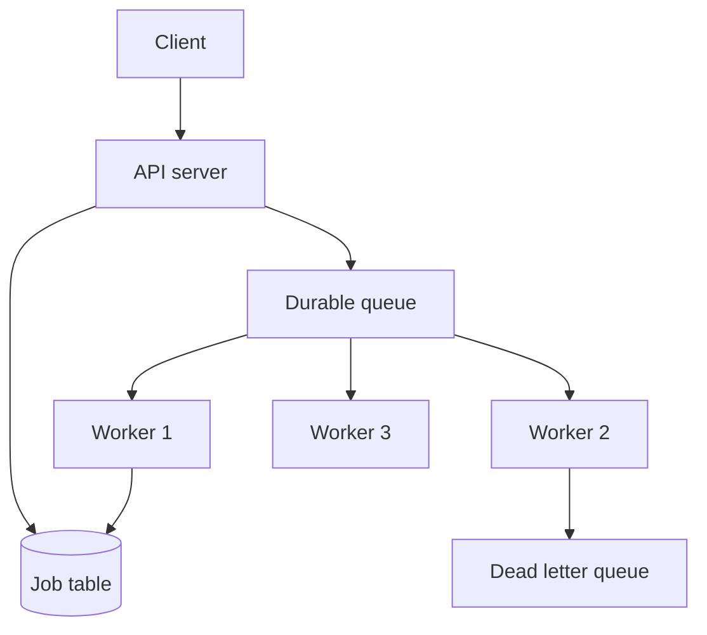
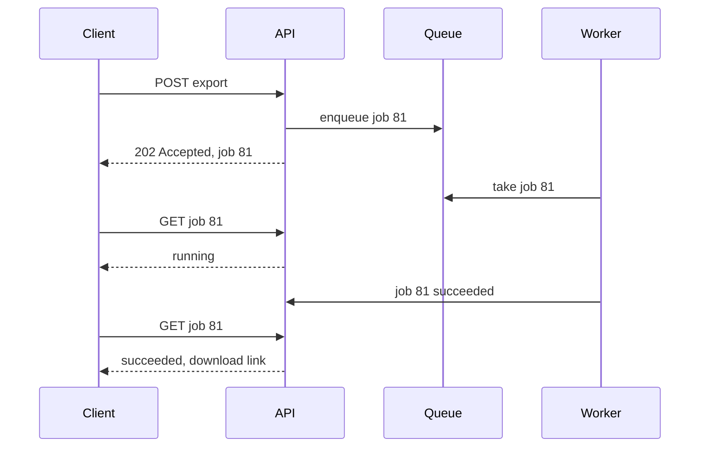

## The hook

You click "Export my data" and the page spins. Ten seconds. Thirty. At sixty seconds the load balancer gives up and shows an error, even though the server is still happily building your file. You click again, and now two exports are running. Multiply that by every user on a busy morning and the web servers are full of threads waiting on slow work, while new visitors cannot even load the homepage.

The fix is old and simple: do not make the user wait for slow work. Accept the request, hand back a receipt, and finish the job in the background. But "put it on a queue" is only the start. What happens when the job fails, when the worker crashes, or when the client wants to know whether it is done?

## The intuition

:::analogy
Think of a dry cleaner. You hand over a shirt, the clerk writes a ticket, gives you the stub, and you leave in under a minute. In the back, a few cleaners take shirts from a rail in order. If a stain will not come out, they try again with a stronger method, and after a few tries the shirt goes on a "needs the manager" shelf instead of blocking the rail. You can phone in with your ticket number to ask if it is ready, or the shop can call you when it is done. And the tickets are written in a book, so a fire alarm in the afternoon does not mean everyone's shirts are forgotten.
:::

Each part of that shop is a part of an async system: the ticket is a [[job id]], the rail is a durable queue, the cleaners are a [[worker pool]], the manager's shelf is a [[dead letter queue]], and the phone calls are status polling or callbacks.

## How it works

### 1. Accept fast

The API does the minimum synchronously: validate the input, store a job record with status `queued`, put a message on the queue, and return **202 Accepted** with the job id and a status URL. The user gets a response in milliseconds whatever the job's length.

Order matters here. If you write the job row and then the queue publish fails, the job is stuck forever; if you publish first and the database write fails, a worker runs a job nobody can track. The safe fix is to write the job row and an outbox row in one transaction and let a relay publish it, as in [Write the Letter and the Envelope Together](article:system-design-outbox-cdc).

### 2. Process with a worker pool

Workers pull messages from the queue, mark the job `running`, do the work, store the result, mark it `succeeded`, and only then acknowledge the message. That last order is what makes the shirt rail safe. If a worker dies mid-job, the message was never acknowledged, so after its [[visibility timeout]] it reappears for another worker. For long jobs, the worker extends the timeout with a periodic heartbeat so a slow but healthy job is not handed out twice.

Because a message can be delivered more than once, every [[background job]] must be idempotent: running it twice has the same effect as once. Use the job id as a deduplication key, check "already done?" before side effects, and make writes upserts. [Pressing the Pay Button Twice Should Charge Once](article:system-design-stateless-idempotency) covers the techniques.

### 3. Retry, then give up gracefully

Many failures are temporary: a timeout, a rate limit, a database failover. Retry those with [[exponential backoff]] and jitter, as in [Why Your App Waits a Random Moment Before Retrying](article:famous-algos-exponential-backoff). Other failures are permanent: bad input, a missing file, a bug. Retrying those only wastes capacity, so classify errors and fail permanent ones at once.

After a maximum number of attempts, move the job to the dead letter queue, mark it `dead`, and alert. Once the bug is fixed, an operator can replay the dead jobs. This is the dry cleaner's manager shelf: the hard shirt is set aside so the rail keeps moving.

The job's life is a small state machine: `queued → running → succeeded`, or `running → retrying → running` a few times, and finally `dead` if it never succeeds.

### 4. Tell the client

Three common ways, from simplest to most immediate:

- **Polling:** the client calls `GET /jobs/{id}` every few seconds. Simple and works everywhere, but most polls return "still running".
- **Callbacks ([[webhook|webhooks]]):** the client registers a URL; when the job finishes, your server POSTs the result there. Sign each callback (for example with an HMAC of the body) so the receiver can trust it, and retry failed deliveries with backoff, which makes webhook delivery itself a background job.
- **Push to a live connection:** if the user is on the page, send an event over a WebSocket or server-sent events stream, as in [Checking the Mailbox vs Hearing the Doorbell](article:system-design-realtime-communication).

Many systems combine them: push if the user is watching, a webhook for server-to-server clients, and polling as the fallback that always works.

### 5. Size the pool with estimates

All numbers here are **estimates**. Suppose jobs arrive at 50 per second and each takes 2 seconds. By Little's law, the average number of jobs in progress is arrival rate × time per job = 50 × 2 = **100 busy workers**. Running workers at about 70% utilisation leaves room for bursts: 100 ÷ 0.7 ≈ **143 workers**, or about 18 machines at 8 workers each.

Now a burst: for 10 minutes jobs arrive at 150 per second. The pool finishes 143 ÷ 2 = 71.5 jobs per second, so the backlog grows by 78.5 per second, reaching 78.5 × 600 = **47,100 jobs**. Afterwards the spare capacity is 71.5 − 50 = 21.5 jobs per second, so draining takes 47,100 ÷ 21.5 ≈ 2,190 seconds, about **36 minutes**. The queue turned a crash into a delay, which is the whole point. It also shows why you autoscale workers on queue depth.

The retry budget is an estimate too: 5 retries starting at 2 seconds and doubling wait 2 + 4 + 8 + 16 + 32 = **62 seconds** in total before the job reaches the dead letter queue.

:::insight
Async processing splits one slow request into a fast promise and a reliable worker. The promise is the job id; the reliability comes from a durable queue, acknowledging only after the work is done, idempotent jobs, bounded retries and a dead letter queue.
:::

:::try-this
With the same pool of 143 workers and 2-second jobs, what is the highest steady arrival rate it can sustain, and what happens above it? (143 ÷ 2 = 71.5 jobs per second. Above that the backlog grows without limit until you add workers or shed load.)
:::

## Trade-offs

| Choice | You gain | You give up |
|---|---|---|
| Async instead of sync | fast responses, burst absorption, isolation from slow work | the result is not ready immediately, more moving parts |
| Polling | simple, works through any firewall | wasted requests and a delay up to one poll interval |
| Webhooks | one message per job, near-immediate | client needs a public endpoint, signing, retries |
| Push over WebSocket | instant updates for users on the page | connection infrastructure, fallback still needed |
| Many retries | survives long outages | slow failure, more load during incidents |
| One queue for all jobs | simple | a flood of slow jobs delays urgent ones; use separate queues or priorities |

The cost of polling is easy to estimate. If 1 million jobs a day each take 30 seconds and clients poll every 2 seconds, that is 15 polls per job, or 15 million status requests a day, about 174 per second, all to report "not yet" (an estimate). Webhooks would send 1 million.

## What can go wrong

- **Jobs lost in memory.** An in-process queue or thread pool loses every pending job when the server restarts or deploys. Use a durable queue that writes to disk and replicates.
- **Acknowledging too early.** Ack on receipt, crash during work, and the job vanishes. Ack after the result is stored.
- **Duplicate side effects.** At-least-once delivery means two emails or two charges unless the job is idempotent.
- **Retry storms.** Every worker retrying at fixed intervals hammers a recovering dependency in waves. Use backoff with jitter and cap the attempts.
- **Silent backlog.** The queue grows for hours and nobody notices. Alert on queue depth and on the age of the oldest message, which tells you how late jobs are.
- **Dead letter queue as a graveyard.** Jobs pile up and are never examined. Alert on any arrival, and build a replay tool.
- **Head-of-line blocking.** Hour-long reports delay one-second password reset emails. Separate queues by priority or job size, each with its own workers.

:::warning
Common misconception: "putting work on a queue means it will definitely get done." A queue only moves the problem. Jobs are lost if the queue is not durable, if workers acknowledge before finishing, or if failures are silently dropped. Reliability comes from the whole loop: durable storage, ack after work, idempotent retries, a dead letter queue and alerts on lag.
:::

### Interview follow-ups

**"The user uploads a video. What happens synchronously and what is queued?"** Synchronously: validate, store the raw file, create a job record, return 202 Accepted with a job id. Everything slow, such as transcoding, thumbnails and notifications, goes onto a queue. The client polls the job status or gets a push when it is done.

**"A job keeps crashing the worker. What protects the system?"** Limit attempts with backoff, then move the job to a dead-letter queue so it stops blocking others, and alert on the dead-letter queue size. A human or a fixed deploy replays it later.

**"How do you scale workers?"** Watch queue depth and the age of the oldest job, not CPU. Add workers when the backlog grows faster than it drains; cap concurrency to what the downstream database or API can take.

**"How do you avoid processing a job twice?"** Assume at-least-once delivery. Make the handler idempotent: check a processed-job table or use a natural key (for example "thumbnail for video 42") so a repeat is a no-op.

## In the real world

- Job frameworks such as Celery for Python and Sidekiq for Ruby provide worker pools, retries with backoff and scheduled jobs on top of a broker such as RabbitMQ or Redis.
- Amazon SQS implements the visibility timeout described above, and lets you attach a dead letter queue that receives messages after a configured number of failed receives.
- Payment and code-hosting platforms such as Stripe and GitHub deliver events to customers as signed webhooks and retry failed deliveries.
- HTTP defines 202 Accepted for exactly this case: the request was accepted for processing, but the processing has not finished.

## Further reading

- RFC 9110, HTTP Semantics (see 202 Accepted): https://www.rfc-editor.org/rfc/rfc9110
- Marc Brooker, "Exponential Backoff And Jitter", AWS Architecture Blog: https://aws.amazon.com/blogs/architecture/exponential-backoff-and-jitter/
- Transactional outbox pattern: https://microservices.io/patterns/data/transactional-outbox.html

## Key takeaways

- Slow work should be accepted quickly with a 202 response and a job id, then processed by background workers instead of inside the request.
- Workers should acknowledge a job only after its result is stored, so a crashed worker's job reappears after the visibility timeout instead of being lost.
- Because jobs can run more than once, every job must be idempotent, keyed by its job id.
- Temporary failures deserve retries with exponential backoff and jitter, while jobs that keep failing belong in a dead letter queue with an alert and a replay tool.
- Clients learn the outcome by polling, by signed webhooks or by a push over a live connection, and Little's law sizes the worker pool from arrival rate times job duration.
