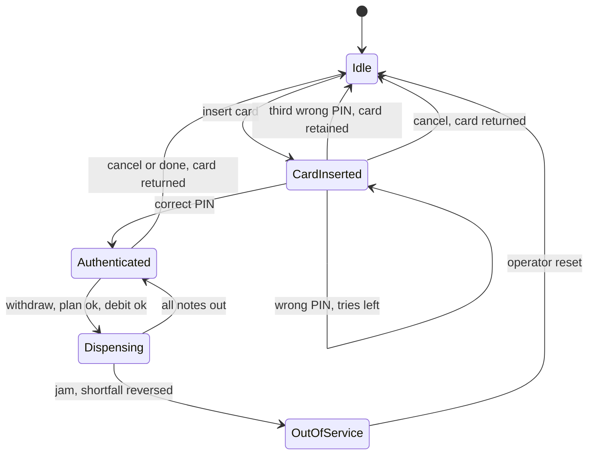
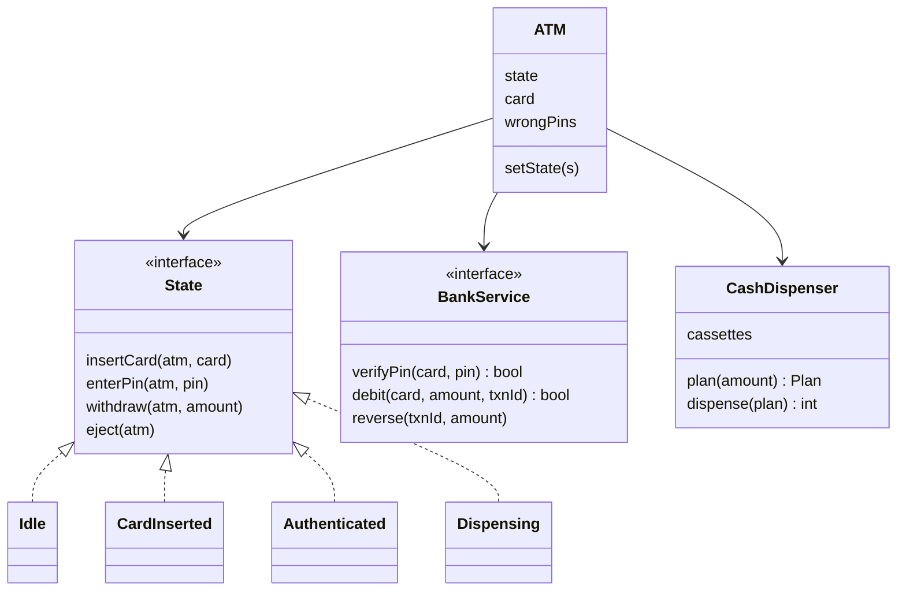

## The hook

You ask the ATM for ₹1,000. The machine whirs, a single ₹500 note slides out, and the motor goes silent. The screen says "Unable to complete your transaction". Your phone buzzes: "₹1,000 debited from your account".

Somewhere in that machine's code, two steps ran in an order that seemed fine on a whiteboard. The bank was told to take your money, and the hardware was told to give it, and nobody planned for the hardware stopping halfway.

An ATM looks like the vending machine's older sibling: same states, more buttons. The real interview question hides in that half-dispensed note. In what order must an ATM talk to the bank and the cash drawer so that neither you nor the bank is ever short?

## Requirements

**Functional**

- Insert a card, enter a PIN, choose a transaction, take cash and card.
- Three wrong PINs in a row retain the card.
- Withdraw cash in the denominations the machine holds; our example machine holds ₹500, ₹200 and ₹100 notes.
- Check balance. (Deposits and transfers are extensions.)
- Cancel at any point before cash moves returns the card.

**Non-functional**

- Never hand out cash that was not debited, and never keep a debit for cash that was not handed out.
- The bank is a remote system that can be slow, fail or time out; the ATM talks to it through an interface.
- The hardware (card reader, keypad, dispenser) sits behind interfaces, so the logic is testable without a machine.
- New states, such as out of service, slot in without editing every existing one.

:::analogy
Think of the ATM as **a cashier who follows a strict script**. Step one, see the passbook. Step two, check the signature. Step three, take the request. Before touching the cash drawer, the cashier checks the drawer can make the exact amount, then writes the debit in the ledger, then counts out notes. If the drawer jams halfway, the cashier does not shrug: they write a correction for what was not handed over. The cashier never skips a step and never changes the order.
:::

## Core objects

- **ATM**: the context. Holds the current state, the inserted card and the PIN attempt count.
- **State** with **Idle**, **CardInserted**, **Authenticated**, **Dispensing** and **OutOfService**.
- **BankService**: verify PIN, debit, reverse, balance. An interface over the bank's network API.
- **CashDispenser**: one [[cassette]] per denomination; it builds a [[dispense plan]] and then moves notes.
- **CardReader**, **Keypad**, **Screen**: hardware interfaces, faked in tests.
- **Transaction**: id, card, amount, status. The audit record of each attempt.

Wait, why is Dispensing its own state when it lasts only seconds? Because during those seconds the keypad still works. A customer can press Cancel while the motor is running. In Dispensing, every button is ignored, and that "ignore" has to live somewhere. That is the script's rule: once the cashier starts counting, they finish counting.

## Class design

The [[State pattern]] gives each mode its own class, exactly as in [Design a Vending Machine](article:system-design-vending-machine). The ATM forwards every event to its current state.





```pseudo
interface State:                       // default for every event: "not now"
    insertCard(atm, card), enterPin(atm, pin), withdraw(atm, amount), eject(atm)

class Idle:
    insertCard(atm, card): atm.card = card; atm.wrongPins = 0; atm.setState(CardInserted)

class CardInserted:
    enterPin(atm, pin):
        if bank.verifyPin(atm.card, pin): atm.setState(Authenticated); return
        atm.wrongPins += 1
        if atm.wrongPins == 3: retain card; atm.setState(Idle)
        else: show "wrong PIN, tries left"
    eject(atm): return card; atm.setState(Idle)

class Authenticated:
    withdraw(atm, amount):
        plan = dispenser.plan(amount)              // 1. can the drawer make it?
        if plan is NONE: show "choose another amount"; return
        txn = new Transaction(id, card, amount)
        if not bank.debit(card, amount, txn.id):   // 2. ledger first
            show "insufficient funds"; return
        atm.setState(Dispensing)
        given = dispenser.dispense(plan)           // 3. move notes
        if given < amount:                         // 4. correct the ledger
            bank.reverse(txn.id, amount - given)
            atm.setState(OutOfService); return card
        else: atm.setState(Authenticated)
    eject(atm): return card; atm.setState(Idle)

class Dispensing:      every event ignored
class OutOfService:    every event ignored until an operator reset
```

### The order of the four steps

Predict which order the hook's ATM used. It debited, then dispensed, and then had no step four. Here are the other orders and what each one breaks:

| Order | What goes wrong |
|---|---|
| Dispense, then debit | The debit fails after cash is out: the bank loses money |
| Debit, then plan | The plan fails after the debit: the customer is charged for nothing |
| Plan, debit, dispense, no correction | A jam leaves the customer short: the hook |
| Plan, debit, dispense, reverse shortfall | Correct: every path ends balanced |

That last row is the cashier's script. Planning is free and changes nothing, so it goes first. The debit is the commitment, so it comes before any irreversible physical action. The [[reversal]] is the compensation for the one step that can half-happen.

:::insight
When one operation spans two systems that cannot share a transaction, such as a bank ledger and a motor, order the steps so the cheap, checkable ones run first, the commitment comes before the irreversible action, and every partial failure has a written compensation.
:::

### Planning the notes

The dispenser must answer "which notes make ₹600?" without touching a note. You met the trap in the vending machine: largest first can fail. Here it is with notes. The machine holds 500 × 2, 200 × 3 and no 100s. Guess what largest-first does with ₹600 before you read on.

It takes one ₹500, needs ₹100, finds no ₹100 note, and gives up. But 200 × 3 was sitting right there. A planner that backtracks tries the largest count of the biggest note first, and if the rest cannot be made, tries one fewer. With three denominations and small counts, this search is tiny: at worst it tries every count of ₹500 times every count of ₹200, and the last denomination is forced. It still prefers big notes, so it usually hands out the fewest notes.

The trade-off is simple. Greedy does one pass and sometimes refuses an amount the machine could make; the planner does a few more steps and never refuses one. For a customer standing at the machine, that is no contest.

## Key flows

### One morning at the machine, traced

The machine starts with 500 × 2, 200 × 3, 100 × 0. CARD-1 has PIN 1234 and a balance of ₹5,000. CARD-2 has PIN 4321.

| Step | Event | State before | Decision | State after |
|---|---|---|---|---|
| 1 | withdraw 500, no card | Idle | ignored | Idle |
| 2 | insert CARD-2 | Idle | accept card | CardInserted |
| 3-4 | PIN 0000 twice | CardInserted | wrong, tries left 2 then 1 | CardInserted |
| 5 | PIN 0000 | CardInserted | third wrong PIN, card retained | Idle |
| 6 | insert CARD-1, PIN 1111 | Idle | wrong, tries left 2 | CardInserted |
| 7 | PIN 1234 | CardInserted | correct | Authenticated |
| 8 | withdraw 600 | Authenticated | plan 200 × 3, debit 600, dispense | Authenticated, balance 4,400 |
| 9 | withdraw 1,300 | Authenticated | no plan from 500 × 2, refuse before debit | Authenticated, balance 4,400 |
| 10 | withdraw 1,000, jam after 1 note | Authenticated | plan 500 × 2, debit 1,000, gave 500, reverse 500 | OutOfService, balance 3,900 |
| 11 | insert CARD-1 | OutOfService | ignored | OutOfService |

Look at step 9 and step 10 together. Step 9 never reached the bank, because planning failed first. Step 10 reached the bank, dispensed half, and wrote a correction for the other half. The final balance is 5,000 − 600 − 1,000 + 500 = 3,900, which is exactly the ₹1,100 the customer actually received.

:::try-this
Restart with 500 × 2, 200 × 3, 100 × 1. What does the planner give for ₹600, and for ₹900? (For ₹600 it tries one ₹500 first, and the ₹100 makes the rest, so 500 + 100. For ₹900 it tries 500 × 1, then 200 × 2 for the remaining ₹400, so 500 + 200 + 200.)
:::

### The code

The program implements the states, a backtracking planner, a bank with debit and reverse, and a test hook that jams the dispenser after a set number of notes. Its output matches the traced table.

```cpp
#include <bits/stdc++.h>
using namespace std;

// ---------- bank side, behind an interface ----------
struct Bank {
    map<string, pair<int, int>> accounts;            // card -> {pin, balance}
    bool verifyPin(const string& card, int pin) { return accounts.at(card).first == pin; }
    bool debit(const string& card, int amt) {
        int& bal = accounts.at(card).second;
        if (bal < amt) return false;
        bal -= amt; return true;
    }
    void reverse(const string& card, int amt) { accounts.at(card).second += amt; }
    int balance(const string& card) { return accounts.at(card).second; }
};

// ---------- cash: plan first, then move notes ----------
struct CashDispenser {
    map<int, int, greater<int>> notes;               // denomination -> count, largest first
    int failAfter = -1;                              // test hook: hardware jams after this many notes

    // Fewest notes, largest first, with backtracking when a big note leads to a dead end.
    bool plan(int amount, map<int, int, greater<int>>::iterator it, map<int, int>& out) {
        if (amount == 0) return true;
        if (it == notes.end()) return false;
        auto [d, have] = *it;
        for (int k = min(have, amount / d); k >= 0; k--) {
            out[d] = k;
            if (plan(amount - k * d, next(it), out)) return true;
        }
        out.erase(d);
        return false;
    }
    // Returns the cash actually handed out; less than planned means a jam.
    int dispense(const map<int, int>& p) {
        int given = 0, count = 0;
        for (auto [d, k] : p)
            for (int i = 0; i < k; i++) {
                if (count == failAfter) return given;
                notes[d]--; given += d; count++;
            }
        return given;
    }
};

struct ATM;
struct State {
    virtual string name() const = 0;
    virtual void insertCard(ATM&, const string&) { cout << "  ignored: " << name() << "\n"; }
    virtual void enterPin(ATM&, int) { cout << "  ignored: " << name() << "\n"; }
    virtual void withdraw(ATM&, int) { cout << "  ignored: " << name() << "\n"; }
    virtual void eject(ATM&) { cout << "  ignored: " << name() << "\n"; }
    virtual ~State() = default;
};

struct ATM {
    Bank& bank; CashDispenser& cash;
    State* state; string card; int wrongPins = 0;
    ATM(Bank& b, CashDispenser& c);
    void set(State* s) { state = s; cout << "  -> " << s->name() << "\n"; }
};

struct Idle : State {
    string name() const override { return "Idle"; }
    void insertCard(ATM& a, const string& c) override;
};
struct CardInserted : State {
    string name() const override { return "CardInserted"; }
    void enterPin(ATM& a, int pin) override;
    void eject(ATM& a) override;
};
struct Authenticated : State {
    string name() const override { return "Authenticated"; }
    void withdraw(ATM& a, int amt) override;
    void eject(ATM& a) override;
};
struct Dispensing : State {                          // buttons do nothing while notes move
    string name() const override { return "Dispensing"; }
};
struct OutOfService : State {                        // only an operator reset leaves this state
    string name() const override { return "OutOfService"; }
};
Idle IDLE; CardInserted CARD; Authenticated AUTH; Dispensing DISP; OutOfService OOS;

ATM::ATM(Bank& b, CashDispenser& c) : bank(b), cash(c), state(&IDLE) {}

void Idle::insertCard(ATM& a, const string& c) { a.card = c; a.wrongPins = 0; a.set(&CARD); }
void CardInserted::enterPin(ATM& a, int pin) {
    if (a.bank.verifyPin(a.card, pin)) { a.set(&AUTH); return; }
    if (++a.wrongPins == 3) { cout << "  wrong PIN 3 times, card retained\n"; a.card = ""; a.set(&IDLE); return; }
    cout << "  wrong PIN, tries left: " << 3 - a.wrongPins << "\n";
}
void CardInserted::eject(ATM& a) { cout << "  card returned\n"; a.card = ""; a.set(&IDLE); }
void Authenticated::eject(ATM& a) { cout << "  card returned\n"; a.card = ""; a.set(&IDLE); }
void Authenticated::withdraw(ATM& a, int amt) {
    map<int, int> p;
    if (!a.cash.plan(amt, a.cash.notes.begin(), p)) { cout << "  cannot make Rs " << amt << " from notes in machine\n"; return; }
    if (!a.bank.debit(a.card, amt)) { cout << "  insufficient funds\n"; return; }
    a.set(&DISP);
    int given = a.cash.dispense(p);
    if (given < amt) {
        a.bank.reverse(a.card, amt - given);
        cout << "  jam: gave Rs " << given << ", reversed Rs " << amt - given << "\n";
        cout << "  balance Rs " << a.bank.balance(a.card) << ", card returned\n";
        a.card = ""; a.set(&OOS); return;
    } else {
        cout << "  gave Rs " << given << " as";
        for (auto [d, k] : p) if (k) cout << " " << k << "x" << d;
        cout << "\n";
    }
    cout << "  balance Rs " << a.bank.balance(a.card) << "\n";
    a.set(&AUTH);
}

int main() {
    Bank bank; bank.accounts["CARD-1"] = {1234, 5000}; bank.accounts["CARD-2"] = {4321, 800};
    CashDispenser cash; cash.notes = {{500, 2}, {200, 3}, {100, 0}};
    ATM atm(bank, cash);

    cout << "withdraw 500 before any card\n"; atm.state->withdraw(atm, 500);
    cout << "insert CARD-2\n";                atm.state->insertCard(atm, "CARD-2");
    for (int i = 0; i < 3; i++) { cout << "PIN 0000\n"; atm.state->enterPin(atm, 0); }
    cout << "insert CARD-1\n";                atm.state->insertCard(atm, "CARD-1");
    cout << "PIN 1111\n";                     atm.state->enterPin(atm, 1111);
    cout << "PIN 1234\n";                     atm.state->enterPin(atm, 1234);
    cout << "withdraw 600\n";                 atm.state->withdraw(atm, 600);    // 3x200, not 500+100
    cout << "withdraw 1300\n";                atm.state->withdraw(atm, 1300);   // refused before any debit
    cash.failAfter = 1;                       // the next dispense jams after one note
    cout << "withdraw 1000\n";                atm.state->withdraw(atm, 1000);   // gives 500, reverses 500
    cout << "insert CARD-1\n";                atm.state->insertCard(atm, "CARD-1");
}
```

The key lines of output are `gave Rs 600 as 3x200`, `cannot make Rs 1300 from notes in machine`, `jam: gave Rs 500, reversed Rs 500` and `balance Rs 3900, card returned`. The demo's bank is in memory and the debit takes no transaction id, to stay short; the next section says why the real one needs it.

### When the bank does not answer

The debit is a network call. Suppose it times out. Did the bank apply it or not? You cannot know from the ATM's side.

Remember the cashier's script: never guess, ask. The ATM sends every debit with its transaction id as an [[idempotency key]]. On a timeout it retries with the same id, and the bank applies a given id at most once, as [Pressing the Pay Button Twice Should Charge Once](article:system-design-stateless-idempotency) explains. If retries keep failing, the ATM dispenses nothing and sends a reversal for that id, which the bank also applies at most once. Either way, the ledger and the cash agree.

## Patterns used

| Pattern | Where | Why it earns its place |
|---|---|---|
| State | Idle, CardInserted, Authenticated, Dispensing, OutOfService | Each screen's buttons mean different things; new states do not touch old ones |
| Adapter | BankService over the bank's network API | The ATM speaks one interface; a test bank, a sandbox and the real network all fit behind it |
| Strategy | Note planning | Fewest notes, keep small notes for later, or spread wear across cassettes |
| Chain of Responsibility, optionally | One handler per denomination | A common interview answer for dispensing; fine for greedy, awkward once you need backtracking |
| Command | Transaction | Each attempt is an object with an id, so it can be retried, reversed and audited |

:::warning
Common misconception: "Chain of Responsibility, one handler per note, is the standard dispenser design, so it is correct." The classic chain passes the remainder down: the ₹500 handler takes what it can and hands the rest on. That is greedy, and with limited notes it refuses ₹600 when 200 × 3 would work. If you use a chain, let each handler try fewer of its notes when the rest of the chain fails, or plan with a small search first.
:::

## Extensions

### Deposits and balance checks

A balance check is one more event on Authenticated, calling `bank.balance`. A cash deposit adds a state, CountingNotes, where the machine counts and validates notes, shows the total, and waits for the customer to confirm before crediting. Cancel in that state returns the physical notes. Neither change edits Idle or CardInserted.

### Concurrency

One ATM serves one person at a time, so the ATM's own state needs no lock beyond the hardware event queue. The shared thing is the account: a joint account can be debited from two ATMs at the same moment. That is the bank's problem, solved with an atomic conditional debit on its side ("subtract only if balance is at least the amount"). The ATM must never read the balance, decide locally, and then debit.

### Edge cases worth naming

- **Customer does not take the cash:** after a timeout, some machines are built to pull the notes back; the design then records a retract and a reversal for that transaction.
- **Customer does not take the card:** retain it after a timeout and move to Idle.
- **Amount not a multiple of the smallest note:** reject at input, before planning.
- **Daily withdrawal limit:** the bank enforces it inside the debit, so all ATMs agree.
- **Power cut during Dispensing:** on restart, the machine reads its own log of the last transaction and settles it with the bank before serving anyone.
- **Low cash:** when no plan exists for common amounts, move to OutOfService and alert the operator.

### Common mistakes

- One `ATM` class with a `switch (state)` in every method.
- Debiting after dispensing, or planning after debiting.
- Treating a timeout as a failure and dispensing nothing without reversing.
- A greedy dispenser with no backtracking.
- Calling the real bank from unit tests.

### Interview follow-ups

**"How do you support a new denomination?"** Add a cassette. The planner reads denominations from the cassettes, so nothing else changes. With the chain design, add a handler and insert it in order.

**"How do you test the jam path?"** Inject a fake dispenser that fails after k notes, as the demo does with `failAfter`. Assert the reversal amount, the final balance and the OutOfService state.

**"Why not keep the card in Authenticated after a jam?"** A machine that just failed mid-dispense cannot be trusted with the next withdrawal. Returning the card and stopping protects the next customer, and the operator reconciles the cassettes.

**"Where do you store the PIN attempt count?"** On the ATM session for the on-screen count, and at the bank for the real limit, because a thief could try three PINs at each of several machines.

The ATM writes a careful record of every step it takes. The next design is all about those records: [Design a Logging Framework](article:system-design-logger-lld).

## Key takeaways

- An ATM is a state machine in which each state owns its reaction to every event, so the screen's buttons mean different things in Idle, CardInserted, Authenticated and Dispensing without one giant switch.
- A withdrawal plans the notes first, debits the bank second, dispenses third, and reverses any shortfall, so every failure path ends with the ledger matching the cash handed out.
- Largest-note-first fails with limited notes, as ₹600 from 500 × 2 and 200 × 3 shows, so the dispenser needs a planner that can back off a big note.
- Every debit carries a transaction id as an idempotency key, so a timed-out request can be retried or reversed without charging twice.
- The bank, the dispenser and the card reader sit behind interfaces, which makes the jam, the timeout and the third wrong PIN easy to test.
