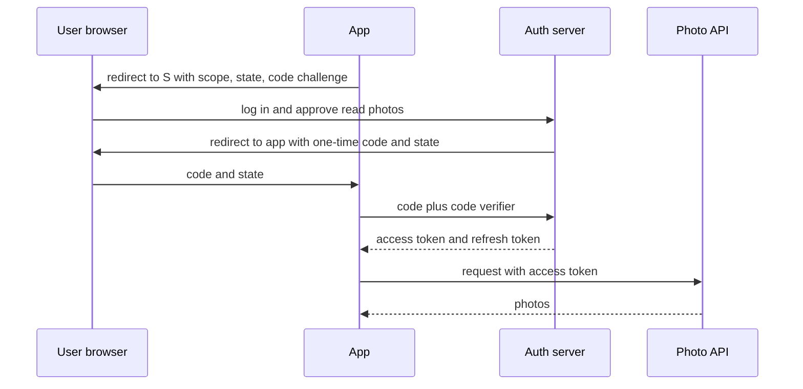

## The hook

A support engineer gets a ticket: a user changed their password after their laptop was stolen, yet the thief is still reading their messages twenty minutes later. The login system works. The password change worked. So how is the thief still inside?

The answer hides in a design choice made months earlier, when the team swapped server sessions for JSON Web Tokens "because they scale". Nobody planned how to take a token back. Interviewers love this area because almost every design has a login box, and the details decide whether it is safe. So what actually happens between typing a password and the server trusting your next request?

## The intuition

:::analogy
Think of a hotel. The first time you arrive, the front desk checks your ID. After that, you have two ways to get into your room. In the first, you walk to the front desk every time, say your room number, and the clerk checks the register before letting you in. In the second, the desk gives you a key card that encodes your room and checkout date, and the door lock checks the card by itself without phoning anyone.
:::

Checking your ID is [[authentication]]: proving who you are. Deciding which doors your card opens is [[authorisation]]: deciding what you may do. Mixing the two up is the root of many bugs, and HTTP even names them confusingly: `401 Unauthorized` really means "I do not know who you are", while `403 Forbidden` means "I know who you are, and the answer is no".

The front desk register is a server-side [[session]]. The self-checking key card is a signed token such as a [[JWT]]. Each has a cost, and the rest of this article is about choosing between them and handling the cases where they fail.

## How it works

### Step 0: storing the password

Everything starts with a password check, so store passwords as salted, deliberately slow hashes (Argon2id, scrypt or bcrypt), never as plain text and never with reversible encryption. [A Lock That Takes a Second to Turn](article:famous-algos-password-hashing) explains why a fast hash like SHA-256 alone is not enough. Add rate limiting on login and offer a second factor, because the strongest hash does nothing against a password the user reused on a site that was breached.

### Option 1: sessions (the front desk)

1. The user logs in. The server creates a random, unguessable session id from a cryptographically secure generator.
2. It stores `session id → user id, expiry` in a shared store such as Redis or a database table.
3. It sends the id in a cookie marked `HttpOnly` (scripts cannot read it), `Secure` (sent only over HTTPS) and `SameSite` (limits sending it on cross-site requests).
4. On every request, the server looks up the id. Logging out, or "log out everywhere", is just deleting rows.

Sessions make revocation trivial and keep the cookie meaningless to anyone who steals the database of user data. The cost is one lookup per request, which a shared cache makes cheap. Because the store is shared, the app servers stay stateless, as in [Pressing the Pay Button Twice Should Charge Once](article:system-design-stateless-idempotency).

### Option 2: tokens (the key card)

A JWT has three base64url-encoded parts joined by dots: `header.payload.signature`. Here is a real one, signed with a throwaway key:

| Part | Encoded | Decoded |
|---|---|---|
| Header | `eyJhbGciOiJIUzI1NiIsInR5cCI6IkpXVCJ9` | `{"alg":"HS256","typ":"JWT"}` |
| Payload | `eyJzdWIiOiJ1NDIi...MDAwNjAwfQ` | `{"sub":"u42","role":"viewer","iat":1700000000,"exp":1700000600}` |
| Signature | `SR1xcKyTkya5NohlW0rrkCcWIppwvV5-9XvgoVp84V0` | HMAC-SHA256 of the first two parts |

`sub` is the user, `iat` is "issued at", and `exp` is the expiry. Here `exp - iat` is 600 seconds, so the card works for 10 minutes. Any service holding the key can verify it with no database call, which is why tokens suit many services and many regions.

Two signing families matter:

- **HS256 (HMAC):** one shared secret signs and verifies. Every verifier can also forge tokens, so keep it to a single trusted service.
- **RS256 or ES256 (public key):** the auth server signs with a private key; every other service verifies with the public key, often fetched from a JWKS URL and chosen by the `kid` (key id) header. This is how [A Chain of Notaries Behind Every Padlock Icon](article:famous-algos-digital-signatures) applies to logins.

Verification order matters. Here is what every API should do before trusting a token:

```pseudo
function verify(token):
    header, payload, sig = split token on "."
    if header.alg is not the one algorithm we expect: reject      # never trust alg from the token
    key = trusted key for header.kid
    if signature check(header, payload, sig, key) fails: reject
    if now >= payload.exp or now < payload.nbf: reject
    if payload.iss is not our issuer or payload.aud is not this API: reject
    if payload.jti is on the denylist: reject                     # optional revocation hook
    return payload.sub, payload.scope
```

:::warning
Common misconception: "a JWT is encrypted, so it is safe to put data in it." A signed JWT is only encoded. Paste the payload above into any base64 decoder and you get the user id and role in plain text. Never put passwords, secrets or personal data in a JWT payload. If the contents must be hidden, use an encrypted token (JWE) or an opaque random token that the server looks up.
:::

### Taking a key card back

The key card's strength is also its weakness: the lock never phones the desk, so a stolen card works until checkout. The standard fix pairs a short-lived access token with a [[refresh token]] the server tracks. Here is a timeline with 10-minute access tokens and refresh token rotation:

| Time | Event | Thief can use access token? |
|---|---|---|
| 09:00 | Login: access token A1 (expires 09:10), refresh token R1 | n/a |
| 09:10 | App sends R1, gets A2 (expires 09:20) and R2; R1 is retired | n/a |
| 09:14 | Laptop stolen with A2 and R2 | yes |
| 09:15 | User clicks "log out everywhere": server deletes R2 | yes, A2 still valid |
| 09:20 | A2 expires; thief tries R2 | no, R2 is revoked |

Without any extra check, the thief keeps access for 5 more minutes. If that window is too long, add a per-user "tokens issued before 09:15 are invalid" stamp, or a denylist of token ids (`jti`) kept only until they would expire anyway. Both bring back a lookup, but a tiny and cacheable one. Rotation also catches theft: if a retired refresh token is ever presented again, someone copied it, so revoke the whole family.

:::try-this
Access tokens last 15 minutes. A user's last token was issued at 09:07, and they are banned at 09:12. With no denylist, until what time can a stolen copy still call the API? (Until 09:22, which is 10 more minutes after the ban.)
:::

### OAuth 2.0 and OpenID Connect

[[OAuth 2.0]] solves a different problem: letting a photo-printing app read your photos on another service without ever seeing your password. In hotel terms, you go to the front desk yourself and ask for a card that opens only your room's minibar, for one day, for the delivery person. The app gets a limited card; it never learns your ID.

The flow every web and mobile app should use is the authorisation code flow with [[PKCE]]:



1. The app creates a random `code_verifier` and sends its SHA-256 hash, the `code_challenge`, plus a random `state` value.
2. The user logs in at the auth server, not in the app, and approves the requested scopes.
3. The auth server redirects back with a short-lived, single-use code. The app checks that `state` matches what it sent, which blocks forged callbacks.
4. The app exchanges the code plus the original verifier for tokens. The server hashes the verifier and compares it with the challenge, so a code stolen in transit is useless.

Other grants exist for other shapes of client. The **client credentials** grant is for service-to-service calls with no user. The **device authorisation** grant is for TVs and consoles where you type a short code on your phone. The older implicit and password grants are discouraged by the current OAuth security best practice, RFC 9700.

OAuth itself only says what an app may access, not who the user is. **OpenID Connect (OIDC)** adds that: request the `openid` scope and you also receive an **ID token**, a JWT about the user whose `aud` is your app. "Sign in with Google" is OIDC. Validate the ID token's issuer, audience, expiry and `nonce` in your app, and never send it to an API in place of an access token.

### Authorisation: RBAC and ownership

Once you know who someone is, [[RBAC]] maps users to roles and roles to permissions: viewers read, editors write, admins manage users. It is easy to audit because you reason about a handful of roles instead of millions of users.

RBAC alone is not enough. "Editors can edit documents" does not say *which* documents. Every request that names an object must also check that this user may touch this object. Missing that check, called broken object level authorisation, tops the OWASP API Security Top 10.

:::insight
Sessions and tokens differ in one place: where the truth lives. A session keeps the truth on the server, so revoking is easy and every request needs a lookup. A token carries the truth with the user, so verifying is free and revoking needs a plan you design in advance.
:::

## Trade-offs

| Choice | You gain | You give up |
|---|---|---|
| Server sessions | instant revocation, tiny cookie, simple model | a store lookup per request; harder across many services |
| Self-contained JWTs | no lookup, works across services and regions | revocation needs short expiry plus refresh tokens or a denylist |
| HS256 | simple, fast | every verifier can also mint tokens |
| RS256 or ES256 | many verifiers, one signer; key rotation via `kid` | key distribution and rotation to manage |
| Token in an HttpOnly cookie | scripts cannot read it | cookies travel automatically, so you need CSRF defences |
| Token in browser storage | no CSRF, since nothing is sent automatically | any injected script can read and steal it |

A common middle ground for web apps keeps tokens on a small backend for the frontend and gives the browser only an HttpOnly session cookie. Back in the hotel, the guest carries a plain room card, and the hotel's own staff hold the powerful master keys.

## What can go wrong

- **Credential stuffing and brute force:** attackers replay leaked username and password pairs. Rate-limit by account and by IP as in [Design a Rate Limiter](article:system-design-rate-limiter), add MFA, and reject known breached passwords.
- **Session fixation:** an attacker plants a session id before login, and the victim logs into it. Always issue a new session id at login.
- **XSS stealing tokens:** injected script reads anything in browser storage. Use HttpOnly cookies and a strict content security policy.
- **CSRF:** another site makes the browser send your cookie with a harmful request. Use `SameSite` cookies and anti-CSRF tokens for state-changing requests.
- **JWT algorithm tricks:** accepting `"alg":"none"`, or letting an attacker switch RS256 to HS256 so the public key is used as an HMAC secret. Pin the expected algorithm per key.
- **Missing claim checks:** a token minted for another API is accepted because nobody checked `aud`.
- **Redirect and code theft in OAuth:** loose `redirect_uri` matching sends codes to an attacker. Register exact redirect URIs and use PKCE and `state`.
- **No revocation plan:** the hook's thief. Decide token lifetimes, refresh rotation and a denylist before launch, and rotate signing keys with overlapping validity so verifiers never see an unknown `kid`.
- **User enumeration and timing leaks:** different errors for "no such user" and "wrong password" reveal valid accounts; compare secrets in constant time.

## In the real world

- "Sign in with Google", "Sign in with Apple" and enterprise single sign-on providers use OpenID Connect on top of OAuth 2.0.
- OIDC providers publish their endpoints and signing keys at a well-known discovery URL, `/.well-known/openid-configuration`, which points to a JWKS document that APIs use to verify tokens.
- Kubernetes authorises API calls with RBAC objects: Roles list permissions and RoleBindings grant them to users or service accounts.
- Many web frameworks default to cookie-based server sessions, which remain a sound choice for a single web application.

## Further reading

- RFC 6749, The OAuth 2.0 Authorization Framework: https://www.rfc-editor.org/rfc/rfc6749
- RFC 7636, Proof Key for Code Exchange: https://www.rfc-editor.org/rfc/rfc7636
- RFC 9700, Best Current Practice for OAuth 2.0 Security: https://www.rfc-editor.org/rfc/rfc9700
- RFC 7519, JSON Web Token, and RFC 8725, JWT Best Current Practices: https://www.rfc-editor.org/rfc/rfc8725
- OpenID Connect Core 1.0: https://openid.net/specs/openid-connect-core-1_0.html
- OWASP Session Management Cheat Sheet: https://cheatsheetseries.owasp.org/cheatsheets/Session_Management_Cheat_Sheet.html

## Key takeaways

- Authentication proves who a user is and authorisation decides what they may do; keep the two checks separate and do both on every request.
- Server sessions keep the truth on the server, so logout is instant, while self-contained JWTs skip the lookup but must be designed with short lifetimes and a revocation plan.
- A signed JWT is readable by anyone who holds it, so never place secrets or personal data in its payload, and always pin the algorithm and check expiry, issuer and audience.
- Web and mobile apps should use the OAuth authorisation code flow with PKCE and state, and OpenID Connect's ID token when they need to know who the user is.
- RBAC keeps permissions manageable, but every request that names an object still needs an ownership check.
