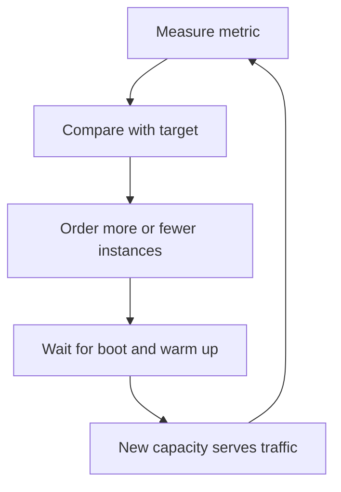

## The hook

A food-delivery app sees traffic quadruple between 7:30 and 7:35 pm every evening. The team turns on autoscaling: add servers when CPU goes above 70%. Problem solved?

At 7:33 the app is slow, at 7:34 orders fail, and at 7:38, when everything is calm again, the dashboard shows that the autoscaler did exactly its job. It noticed the load at 7:32 and started new servers. They just took three minutes to become ready.

Autoscaling is a control loop, and every control loop has a delay. Predict how long the app was overloaded in that evening's timeline. We'll trace it minute by minute.

## The intuition

:::analogy
A supermarket manager **opens more checkout counters when the queues grow**. But a new counter needs a cashier to walk over, log in and open the drawer, which takes a few minutes. Queues keep growing in the meantime. A smart manager opens counters before the 6 pm rush she sees every day, watches queue length rather than how tired the cashiers look, and does not close counters the moment the queue shortens, in case the next wave is just behind.
:::

That is **[[autoscaling]]**:

- Watch the right signal (queue length, not cashier fatigue).
- Accept the delay to bring capacity online (the **[[cold start]]**).
- Add capacity early for known peaks (**[[predictive scaling]]**).
- Remove capacity slowly (**[[cooldown]]s**).

## How it works

### Target tracking

The common policy is **[[target tracking]]**: keep a metric near a target. With instances that each handle about 500 requests per second and a 70% target, each instance should carry 350 requests per second:

instances needed = ceil(requests per second ÷ 350)

So 2,000 requests per second needs 6 instances, and 8,000 needs 23. The 30% headroom absorbs bursts and the loss of an instance while new ones start.

### The delay, traced

Traffic per minute: 2,000, 2,000, 3,000, 4,500, 6,000, 7,500, then 8,000 steady. Each minute the scaler computes the need and orders the difference; new instances become ready 3 minutes later.

| Minute | Requests/s | Ready instances | Utilisation | Needed | Ordered |
|---|---|---|---|---|---|
| 0 | 2,000 | 6 | 67% | 6 | 0 |
| 1 | 2,000 | 6 | 67% | 6 | 0 |
| 2 | 3,000 | 6 | **100%** | 9 | 3 |
| 3 | 4,500 | 6 | **150%** | 13 | 4 |
| 4 | 6,000 | 6 | **200%** | 18 | 5 |
| 5 | 7,500 | 9 | **167%** | 22 | 4 |
| 6 | 8,000 | 13 | **123%** | 23 | 1 |
| 7 | 8,000 | 18 | 89% | 23 | 0 |
| 8 | 8,000 | 22 | 73% | 23 | 0 |
| 9 | 8,000 | 23 | 70% | 23 | 0 |

The answer to the hook: from minute 2 to minute 6, the fleet was at or above full capacity, with the worst at 200%. The scaler made the right decisions every minute. The cold start made them late.

Ways to shrink the gap:

- **Faster cold starts**: smaller images, pre-baked machine images, keeping connections and caches warm.
- **Headroom**: a lower target (say 60%) buys time.
- **Predictive or scheduled scaling**: the 7:30 pm rush happens every day; add capacity at 7:20.
- **Scale on a leading signal**: request rate or queue growth reacts earlier than CPU.

### Choosing the metric

| Workload | Good scaling signal |
|---|---|
| Stateless web or API | Requests per instance, or CPU if CPU-bound |
| Queue consumers | Backlog per worker or age of the oldest message |
| Latency-sensitive service | Concurrency (in-flight requests) per instance |
| Memory-bound cache | Memory, but usually scaled deliberately, not automatically |

Wait, why is CPU so often the wrong choice? Because many services wait on databases or other services rather than computing. Their CPU stays low while requests pile up, so a CPU-based scaler never fires.

:::insight
Autoscaling is a feedback loop with a built-in delay: measure, decide, then wait minutes for new capacity. Scale on a signal that reflects waiting work, keep headroom for the delay, pre-scale for predictable peaks, and shrink slowly.
:::

## Trade-offs

| Setting | Lower | Higher |
|---|---|---|
| Target utilisation | More headroom, higher cost | Cheaper, more risk during the scaling delay |
| Scale-out speed | Calmer, risk of being late | Reacts fast, risk of overshooting |
| Scale-in cooldown | Saves money sooner, risk of flapping | Stable, pays for spare capacity longer |
| Minimum instances | Cheaper at night | Always ready for sudden spikes |

:::warning
Common misconception: "with autoscaling we never need to plan capacity." Autoscaling reacts to load after it arrives and needs minutes to deliver capacity, and it can only scale what is scalable: databases, quotas and downstream services may not grow with it. Plan for known peaks, keep headroom, and check that dependencies can absorb the extra instances.
:::

:::try-this
In the traced example, the team pre-scales to 23 instances at minute 0 every evening. What utilisation do they see at minute 4, and what does it cost? (6,000 ÷ (23 × 500) ≈ 52%: no overload at all. The cost is running 17 extra instances for a few minutes before the rush, which is usually far cheaper than failed orders.)
:::

## What can go wrong

- **Scaling on the wrong metric**, such as CPU for I/O-bound services.
- **Flapping**: scaling out and in repeatedly because thresholds are too close together.
- **Thundering cold starts**: 50 new instances all warming caches and opening database connections at once, overloading the database.
- **Hitting limits**: account quotas, IP addresses, database connection limits.
- **Scaling into a downstream bottleneck**: more app servers just send more traffic to an already saturated database.

### Interview follow-ups

**"How does serverless relate to autoscaling?"** Serverless platforms scale per request automatically, with cold starts as the main cost; provisioned or pre-warmed concurrency trades money for removing that delay.

**"Should the database autoscale too?"** Read replicas and some managed databases can scale, but write capacity and storage usually change deliberately, not in seconds. Protect the database with caches, connection pooling and limits.

**"How would you handle a TV-ad-driven spike that arrives in 30 seconds?"** Reactive scaling cannot help in time. Pre-scale before the ad, shed or queue non-essential work, and serve what you can from caches and CDNs, as in [Turning Away Walk-Ins When the Kitchen Is Full](article:system-design-backpressure-load-shedding).

## In the real world

- Cloud auto scaling groups and Kubernetes' Horizontal Pod Autoscaler implement target tracking on CPU, memory or custom metrics.
- Event-driven scalers can scale consumers on queue length.
- Many teams combine scheduled scaling for daily peaks with reactive scaling for the unexpected.

Autoscaling only works for stateless, horizontally scalable tiers, as explained in [One Stronger Horse or a Team of Horses?](article:system-design-vertical-horizontal), and only as well as the metrics from [A Dashboard, a Trip Log and a GPS Trace](article:system-design-observability).

## Further reading

- The Kubernetes Horizontal Pod Autoscaler documentation.
- Your cloud provider's documentation on target tracking, scheduled and predictive scaling.

## Key takeaways

- Autoscaling keeps a metric near a target by adding or removing instances, for example ceil(requests per second ÷ requests each instance should carry).
- New capacity arrives minutes after the decision, so a fast spike overloads the fleet in the meantime unless there is headroom.
- Scale on a signal that reflects waiting work, such as request rate, concurrency or queue backlog, rather than CPU for services that mostly wait.
- Pre-scale for predictable peaks, shorten cold starts, scale out quickly and scale in slowly with cooldowns.
- Check that databases, quotas and downstream services can absorb the extra instances, or autoscaling just moves the bottleneck.
