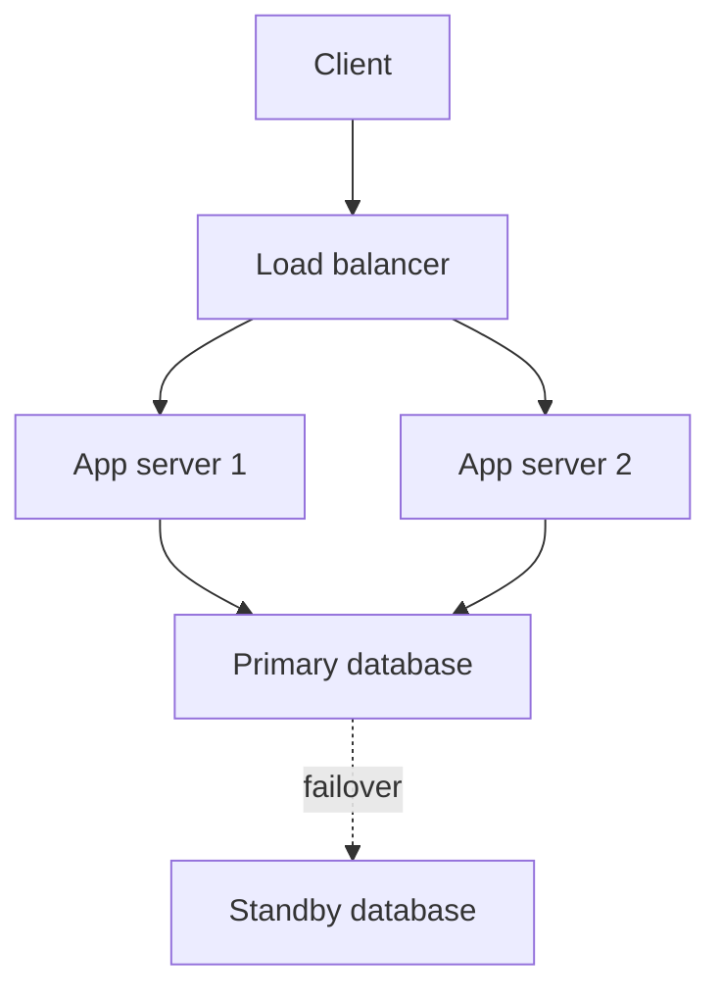

## The hook

Ask a product manager how often the app may be down and the answer is "never". Ask an engineer what "never" costs and the answer is "infinitely much". Neither answer helps anyone design anything.

The industry's way out is to turn reliability into numbers: how many nines, measured how, over what period. Once reliability is a number, it becomes a budget you can spend, and design discussions stop being about hope and start being about arithmetic.

## The intuition

:::analogy
Think of a chain holding up a swing. The swing is only as safe as its weakest link, and every extra link is one more thing that can break. But if you hang the swing from two separate chains, it falls only if both break at once. Reliability engineering is mostly about counting links in your chains and deciding where a second chain is worth its cost.
:::

Components in series, like links in one chain, multiply their availability downward. Components in parallel, like two chains, multiply their failure chances downward. That one idea explains most availability arithmetic.

## How it works

### Nines and downtime

| [[Availability]] | Downtime per year | Downtime per 30-day month |
|---|---|---|
| 99% (two nines) | about 3.65 days | about 7.2 hours |
| 99.9% (three nines) | about 8.8 hours | about 43 minutes |
| 99.99% (four nines) | about 53 minutes | about 4.3 minutes |
| 99.999% (five nines) | about 5.3 minutes | about 26 seconds |

These follow directly from the percentages: for example, 0.1% of 525,600 minutes in a year is about 526 minutes. Each extra nine cuts allowed downtime by ten, and usually costs far more than ten times as much engineering.

### SLIs, SLOs and SLAs

- An **[[SLI]]** is what you measure: "fraction of HTTP requests that return a non-error response within 300 ms".
- An **[[SLO]]** is your target: "99.9% of requests per 30 days meet the SLI".
- An **[[SLA]]** is a promise to customers, with refunds or penalties. SLAs are usually looser than internal SLOs, so you notice trouble before it costs money.

Good SLIs measure what users feel: successful requests, latency at the 99th percentile, freshness of data. "CPU below 80%" is not an SLI; users do not feel CPU.

### Series and parallel

If a request must pass through components A and B, both must work:

$$A_{\text{series}} = A_1 \times A_2$$

If either of two independent replicas can serve the request, it fails only when both fail:

$$A_{\text{parallel}} = 1 - (1 - A_1)(1 - A_2)$$

:::insight
Every dependency in the path of a request costs you nines, and every independent redundant copy buys them back. To raise availability, shorten the critical path and add [[redundancy]] where failures are most likely, while making sure the copies really fail independently.
:::

### Measuring availability: time or requests?

There are two common ways to measure. Time-based availability asks what fraction of minutes the service was "up", which is easy to understand but treats a 3 a.m. outage like one at peak. Request-based availability asks what fraction of requests succeeded, which weights failures by how many users actually felt them. Large services usually prefer request-based SLIs, and they compute them over rolling windows, such as the last 28 or 30 days, so the number moves smoothly instead of resetting each calendar month.

### Error budgets

An SLO of 99.9% means 0.1% of requests may fail. That 0.1% is the [[error budget]]. If the team has spent little of it this month, it can ship faster and take risks. If an incident burned most of it, releases slow down and reliability work comes first. The budget turns the endless argument between "ship features" and "be careful" into a shared, measurable rule. It also gives a clear signal for alerting: page an engineer when the budget is burning fast enough to run out well before the window ends, not every time a single request fails.

## Trade-offs

- **More nines cost more**: redundant regions, automated failover, careful deploys, on-call engineers. Each nine roughly multiplies the effort.
- **Too high an SLO slows everything**: if the target is stricter than users need, every change becomes risky and teams stop shipping.
- **Redundancy adds complexity**: failover logic itself can fail, and a badly tested failover path can turn a small outage into a big one.

## What can go wrong

- **Correlated failures**: two replicas in the same rack, region or software version fail together, so the parallel formula's independence assumption breaks. Spread replicas across failure domains and stagger releases.
- **Hidden dependencies**: a "highly available" service that calls a single-region config store on every request has that store's availability, not its own.
- **Measuring the wrong thing**: servers report healthy while users see errors at the load balancer or in the app. Measure as close to the user as possible.
- **Retry storms during incidents** turn a partial outage into a full one; budgets for retries and backoff matter as much as redundancy.

:::warning
Common misconception: "adding a replica always doubles reliability." The parallel formula assumes independent failures. Replicas sharing a power supply, a deployment or a bad configuration fail together, and then two copies are barely better than one.
:::

:::try-this
A request goes through a load balancer (99.99%), an app tier with two independent servers (each 99.9%), and one database (99.95%). Estimate end-to-end availability. (App tier: 1 − 0.001² ≈ 99.9999%. Total ≈ 0.9999 × 0.999999 × 0.9995 ≈ 0.9994, about 99.94%. The single database dominates, so that is where redundancy pays off next.)
:::

## In the real world

Google's Site Reliability Engineering practices popularised SLOs and error budgets, and many companies now run on similar rules. Cloud providers publish SLAs for their services, and architects combine those numbers with the series and parallel formulas to estimate what their own systems can promise. In interviews, stating an availability target early, as part of the non-functional requirements in the [interview framework](article:system-design-interview-framework), justifies every replica and region you add later.

## Further reading

- Google, *Site Reliability Engineering*, chapter "Service Level Objectives" (free online): https://sre.google/sre-book/service-level-objectives/
- Google, *The Site Reliability Workbook*, chapter "Implementing SLOs": https://sre.google/workbook/implementing-slos/

## Key takeaways

- Availability is usually stated in nines, and each extra nine cuts allowed downtime by a factor of ten.
- SLIs measure what users feel, SLOs set targets for them, and SLAs are contractual promises that are usually looser.
- Components in series multiply availability downward, while independent redundant copies multiply failure probability downward.
- An error budget turns the SLO into a shared rule for balancing feature releases against reliability work.
- Correlated failures and hidden dependencies break the arithmetic, so spread replicas across failure domains and measure close to the user.
