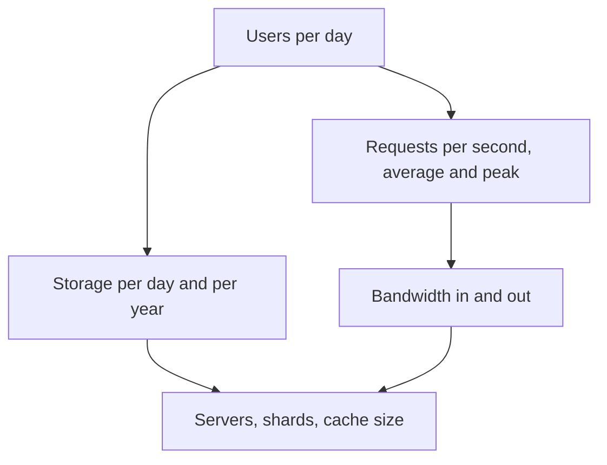

## The hook

A caterer planning a wedding for 500 guests does not weigh every grain of rice. They think: about 150 grams per guest, so roughly 75 kilograms, round up to 80 for safety. Two seconds of arithmetic, and they know whether to rent one pot or ten.

System design works the same way. Before you draw a single box, a few minutes of rough maths tells you whether you need one database or a hundred, and whether caching is optional or essential.

## The intuition

:::analogy
Estimation is the caterer's question applied to computers: how many guests (users), how much each eats (requests and bytes per user), and how many plates at the busiest moment (peak load). You are not trying to be exact. You are trying to land within a factor of a few, which is all you need to choose between very different designs.
:::

Every number in this article is an **estimate**. Say that out loud in interviews, round aggressively, and show your arithmetic so the interviewer can follow and correct your assumptions.

## Let's build it up

### The handful of numbers to memorise

- A day has 86,400 seconds. **Round to 100,000 (10⁵).**
- 1 million requests a day is therefore about **12 per second** on average. Easy to scale up: 100 million a day is about 1,200 per second.
- Powers of ten for data: KB is 10³ bytes, MB 10⁶, GB 10⁹, TB 10¹², PB 10¹⁵.
- A year is about 400 days if you want round numbers (365 really, but 400 is fine for a rough guess).

### The four questions

**1. Traffic.** Start from [[DAU]] and actions per user per day. Divide by about 10⁵ seconds to get average [[QPS]]. Then multiply by 2 to 5 for [[peak load]], depending on how bursty the product is.

**2. Storage.** New items per day times size per item, times the [[replication factor]]. Multiply by days to plan a year or five.

**3. Bandwidth.** Requests per second times bytes per request, for both reads and writes.

**4. Read-to-write ratio.** How many reads per write? A ratio like 100 to 1 shouts "cache this".

:::insight
The point of an estimate is the decision it unlocks. "About 60,000 reads per second at peak" means one database server will not cope and a cache is required. "About 50 TB a day" means the files go to blob storage, not the database.
:::

## A tiny example

Estimate a photo-sharing app. All numbers below are **estimates** chosen for the exercise.

**Assumptions:** 50 million DAU. Each user views their feed 20 times a day and uploads 0.2 photos a day. An average photo is 2 MB after compression. Each feed view loads metadata for 20 photos, about 1 KB each.

**Traffic.**

- Feed views: 50M × 20 = 1 billion a day, so about 10⁹ ÷ 10⁵ = **10,000 reads per second** on average. At a peak of 3× average, about **30,000 per second**.
- Uploads: 50M × 0.2 = 10 million a day, so about **100 writes per second**, maybe 300 at peak.
- Read-to-write ratio: about **100 to 1**.

**Storage.**

- Photos: 10M × 2 MB = 20 TB a day. With 3 copies, about **60 TB a day**, or roughly 60 × 400 ≈ **24 PB a year**.
- Metadata: 10M × 1 KB = 10 GB a day, tiny by comparison.

**Bandwidth.**

- Feed metadata out: 10,000 views/s × 20 photos × 1 KB ≈ **200 MB/s** on average.
- The photos themselves are far larger, which is why they are served from a CDN, not your app servers.

**Servers.** If one application server comfortably handles around 1,000 to 2,000 simple requests per second (an assumption you should state, since it depends heavily on the work per request), then 30,000 reads per second at peak needs on the order of 15 to 30 servers, plus spares for failures and deploys. The exact number matters less than the conclusion: this is a fleet behind a load balancer, not one machine.

**What it tells us.** Reads dominate, so add caching for feeds and metadata. Photos dwarf everything else, so they live in blob storage behind a CDN. Writes are modest, so the metadata database can start with one primary and read replicas.

:::try-this
Estimate a chat app: 100 million DAU, each sending 40 messages a day, 100 bytes per message. Work out messages per second (average and at 3× peak) and storage per day before replication. (You should get about 40,000 per second average, 120,000 at peak, and about 400 GB a day of message text.)
:::

### Common traps

:::warning
Common misconception: "more precise numbers make a better estimate." Writing 86,400 instead of 10⁵, or 1,157.4 QPS instead of "about 1,200", wastes time and hides the reasoning. Round, state the assumption, and move on. If the interviewer has a different number in mind, they will tell you.
:::

- **Forgetting peaks.** Size for the busiest hour, not the average.
- **Forgetting copies.** Replication and backups multiply storage.
- **Mixing bits and bytes.** Network speeds are often quoted in bits per second; storage is in bytes. There are 8 bits in a byte.
- **Estimating everything.** Only estimate what affects a decision. Five minutes is plenty.

## Where you'll see this again

Every case study in this subject begins with a "Back-of-envelope numbers" section built exactly this way, from the URL shortener to video streaming. The next article puts real latencies next to these numbers, so you can tell whether a design meets a 100 millisecond goal. This is step 2 of the [interview framework](article:system-design-interview-framework).

## Key takeaways

- Rough estimates exist to make decisions, such as whether you need a cache, sharding or blob storage, not to be exact.
- Round a day to 10⁵ seconds, so 1 million requests a day is about 12 per second and 100 million is about 1,200.
- Always estimate traffic, storage, bandwidth and the read-to-write ratio, and size for peak load, not the average.
- Multiply storage by the replication factor and by the retention period before deciding where data lives.
- Label every number as an estimate, show the arithmetic, and round aggressively so the reasoning stays visible.
