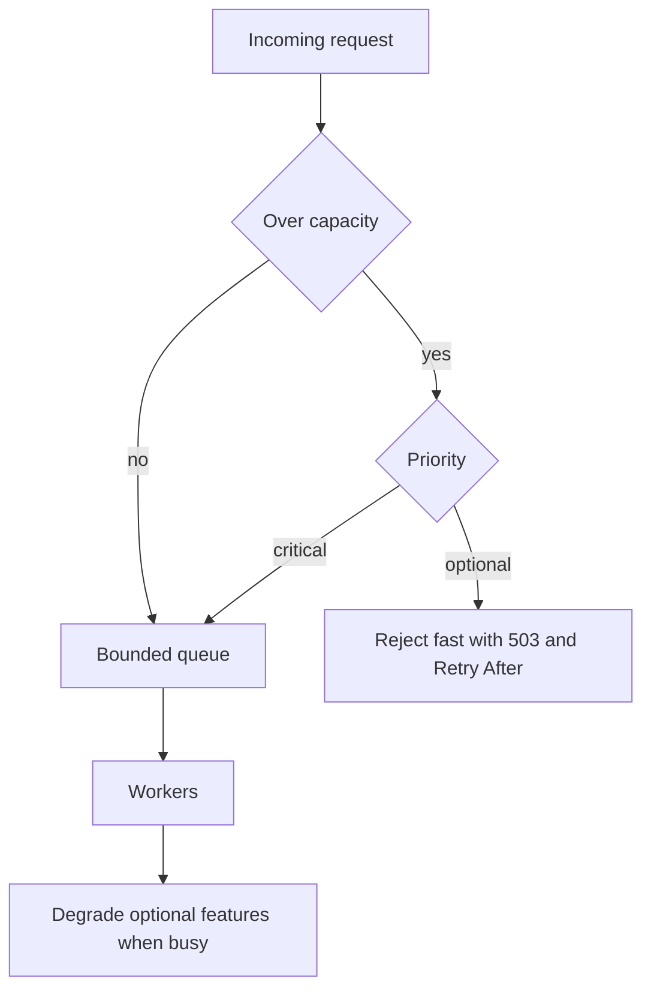

## The hook

A popular restaurant with 40 seats has a queue outside on Saturday night. The manager has a choice. Turn people away at the door with an honest "we are full for two hours". Or let everyone in to wait inside, crowding the aisles, until the waiters cannot move, orders get lost, and even seated guests wait an hour for water.

Software makes the second choice by default. An unbounded queue accepts everything, the service looks "up", and every request is slow. Users time out and retry, adding even more work.

Here is the puzzle: the service is processing 1,000 requests a second at full speed, yet almost every user sees a failure. How can a system working at 100% deliver almost 0% success? Hold that thought; we'll do the arithmetic in a minute.

## The intuition

:::analogy
A good restaurant **turns away walk-ins when the kitchen is full**. The host counts covers, stops seating new parties when the kitchen is at capacity, and serves the guests already seated properly. Regulars with reservations get priority. On a crazy night, the kitchen drops the complicated dessert menu so main courses still come out on time.
:::

The pieces map directly:

- Stop seating when full: a **[[bounded queue]]** and **[[backpressure]]**.
- "Sorry, we are full" at the door: **[[load shedding]]**.
- Reservations first: priority classes.
- Dropping the dessert menu: **[[graceful degradation]]**.

## How it works

### Why unbounded queues hide overload

Requests arrive at 1,200 per second; the service completes 1,000 per second. The queue grows by 200 every second:

| Time overloaded | Requests waiting | Wait for a new request |
|---|---|---|
| 10 s | 2,000 | 2 s |
| 30 s | 6,000 | 6 s |
| 60 s | 12,000 | 12 s |
| 5 min | 60,000 | 60 s |

Now the answer to the hook. If clients time out after 2 seconds, then after 10 seconds every request the service finishes is for a client who already gave up. The service runs at full speed doing useless work: goodput near zero. Meanwhile clients retry, raising arrival rate further.

**[[Little's law]]** (L = λ × W) is the quick check: at 1,000 requests per second and a 50 ms target, about 50 requests should be in the system. A queue holding thousands means latency in seconds.

### Bounded queues and backpressure

Give every queue a size limit. When it is full:

- **Block the producer** (inside one process, or a consumer that pulls at its own pace): the slowdown propagates upstream, which is backpressure.
- **Reject the new item** (at a network edge): return a clear error, such as HTTP 503 with Retry-After, or 429 for a client over its limit.

Wait, why is a fast rejection kinder than a slow success? Because the rejected client can retry later or go to another instance, while the queued client waits, times out and fails anyway, after using capacity that could have served someone else.

### Shed early, and by priority

Reject as close to the edge as possible, before spending CPU on parsing, auth or database calls. Decide using signals such as queue length, in-flight requests, or how long requests have waited (drop requests that have been queued longer than the client will wait).

Classify traffic:

| Priority | Examples | Under overload |
|---|---|---|
| Critical | Payments, order placement, login | Served while anything is |
| Normal | Browsing menus, order history | Shed after optional |
| Optional | Recommendations, analytics events, prefetching | Shed first |

:::insight
Overload cannot be absorbed by waiting longer: an unbounded queue turns a 20% overload into seconds of latency and near-zero useful work. Bound every queue, reject excess early and cheaply, keep the most important traffic, and turn off optional features before the core breaks.
:::

## Trade-offs

| Approach | Gain | Cost |
|---|---|---|
| Unbounded queue | Nothing rejected | Unbounded latency, wasted work, memory exhaustion |
| Bounded queue with rejection | Predictable latency for accepted work | Some users see errors |
| Blocking backpressure | No data dropped in pipelines | Upstream slows; can deadlock if cycles exist |
| Priority shedding | Core flows survive | Must classify traffic correctly |
| Degradation | Main feature keeps working | Reduced experience while degraded |

For asynchronous pipelines (log processing, event streams), dropping is often unacceptable; there, backpressure (slowing producers) and buffering to durable storage are the tools, and autoscaling adds capacity.

:::warning
Common misconception: "a bigger queue makes the system more reliable, because nothing is rejected." A queue only helps with short bursts. Under sustained overload it converts excess load into latency until every request times out. Size queues for bursts, and reject beyond that.
:::

:::try-this
Your service handles 1,000 requests per second and clients time out after 2 seconds. What is the largest queue that still lets queued requests finish in time? (At 1,000 per second, 2 seconds is 2,000 requests. Allow some margin for processing time and variance, so a limit around 1,000 to 1,500 is safer. Better still, drop requests that have already waited longer than the client's deadline.)
:::

## What can go wrong

- **Unbounded queues** in thread pools, message brokers or in-memory buffers.
- **Shedding too late**, after expensive work such as authentication or database queries.
- **Retry storms** amplifying overload; clients must back off and respect Retry-After.
- **No priorities**, so critical payments are shed alongside analytics pings.
- **Degradation paths never tested**, failing when first used.

### Interview follow-ups

**"How is load shedding different from rate limiting?"** Rate limiting caps each client by policy, even when the service is healthy. Load shedding rejects excess when the service itself is overloaded, regardless of who sent it. Both belong in a design, as in [Design a Rate Limiter](article:system-design-rate-limiter).

**"How do you decide you are overloaded?"** Watch queue length, request age in the queue, concurrency, and latency against targets. Adaptive concurrency limits adjust the allowed in-flight requests from observed latency.

**"What should clients do with a 503?"** Back off with jitter, respect Retry-After, and use a fallback for optional features, as in [A Fuse Box That Trips Before the House Burns](article:system-design-resilience-patterns).

## In the real world

- Proxies and load balancers can limit concurrency and queue length per backend and return errors when exceeded.
- Large services classify requests by criticality and shed the least critical first during overload, as described in Google's *Site Reliability Engineering* book.
- Streaming frameworks propagate backpressure from slow consumers to producers.

## Further reading

- *Site Reliability Engineering* (Google), chapters "Handling Overload" and "Addressing Cascading Failures".
- Little's law in any queueing theory introduction.

## Key takeaways

- Under sustained overload, an unbounded queue grows without limit, so latency explodes and the service ends up doing work for clients who have already given up.
- Bound every queue and use backpressure inside pipelines or fast rejection at the edge, with clear errors such as 503 and Retry-After.
- Shed load early and by priority, protecting critical flows such as payments and dropping optional work first.
- Graceful degradation turns off optional features under stress so the core function stays fast.
- Little's law (L = λ × W) quickly shows whether a queue's length is consistent with the latency you promise.
