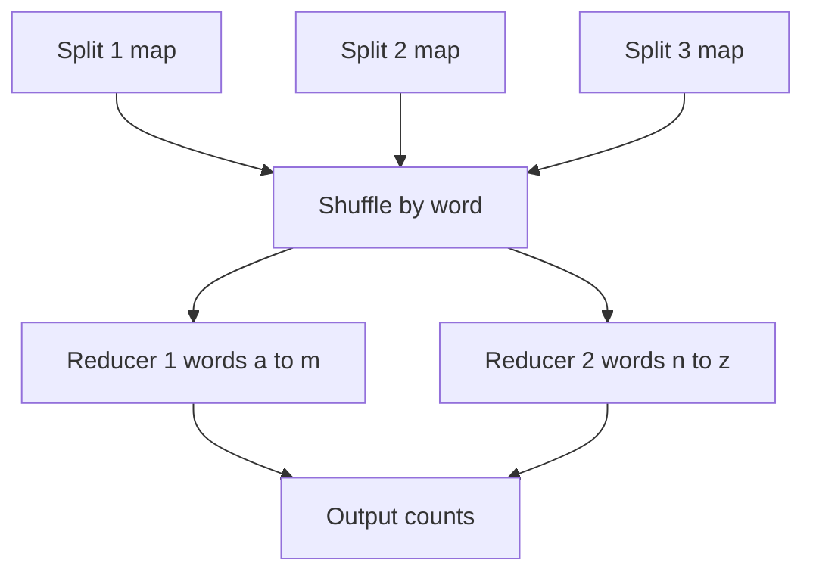

## The hook

Election night. A billion votes are spread across a million polling booths. Nobody carries every ballot to one hall to count them; the hall would take months.

Instead, every booth counts its own ballots and sends a tiny tally: "candidate A: 412, candidate B: 388". Regional centres add the tallies for their candidates. By morning the nation knows the result.

That is exactly how a cluster counts words in a petabyte of web pages, builds a search index, or computes yesterday's revenue per city. Before reading on, think about which step is the hard one: counting in each booth, or getting each candidate's tallies to the same place? (It is the second, and it has a name.)

## The intuition

:::analogy
**Counting votes in every booth, then adding the totals**: each booth works only on its own ballots, in parallel with every other booth. Then all tallies for candidate A travel to one counter and all tallies for candidate B to another. Each counter adds up its candidate's numbers. No booth needs to see another booth's ballots.
:::

MapReduce, described by Jeffrey Dean and Sanjay Ghemawat at Google in 2004, is that process:

- **[[Map]]**: each machine processes its own chunk of input independently and emits key-value pairs.
- **[[Shuffle]]**: pairs are grouped by key and sent so all values for one key meet in one place. This is the step the hook asked about, and the expensive one, because it crosses the network.
- **[[Reduce]]**: each key's values are combined into the result.

## How it works

### Word count, traced

Input split into three chunks: "to be or not to be", "to do is to be", "be quick". Two reducers: words starting a to m go to reducer 1, n to z to reducer 2.

| Stage | Split 1 | Split 2 | Split 3 |
|---|---|---|---|
| Map output | to 1, be 1, or 1, not 1, to 1, be 1 | to 1, do 1, is 1, to 1, be 1 | be 1, quick 1 |
| After [[combiner]] | to 2, be 2, or 1, not 1 | to 2, do 1, is 1, be 1 | be 1, quick 1 |

| Reducer | Receives after shuffle | Output |
|---|---|---|
| 1 (a to m) | be 2, be 1, be 1, do 1, is 1 | be 4, do 1, is 1 |
| 2 (n to z) | not 1, or 1, quick 1, to 2, to 2 | not 1, or 1, quick 1, to 4 |

The combiner cut the pairs crossing the network from 13 to 10 here. On real data, where a word like "the" appears thousands of times per chunk, the saving is enormous.

### Move code to the data

Input files live in a distributed file system, split into large blocks stored on many machines. The scheduler runs each map task on a machine that already holds its block: **[[data locality]]**. Shipping a small program to the data is cheaper than shipping terabytes to the program.

### Failures are routine, recomputation is the fix

With thousands of machines, some fail during every big job. Map and reduce tasks read immutable inputs and write new outputs, with no side effects. So a failed task is simply re-run elsewhere. Slow machines ("stragglers") get backup copies of their tasks; whichever finishes first wins.

Wait, why does that only work if tasks have no side effects? Because a task that sent an email or incremented a counter in a database would do it twice when re-run. Batch jobs stay safe by only reading inputs and writing outputs.

### Spark: keep it in memory

Classic MapReduce writes every stage's output to disk. Multi-step pipelines (join, then filter, then aggregate, then iterate) pay that cost many times. Spark keeps intermediate datasets in memory where possible and records each dataset's **[[lineage]]**: the transformations that produced it. If a partition is lost, Spark recomputes it from its parents instead of restoring a copy.

:::insight
Batch processing scales by splitting input into chunks processed independently (map), routing all values for a key to one place (shuffle), and combining them (reduce). Immutable inputs and side-effect-free tasks make failures cheap: just recompute the lost piece.
:::

## Trade-offs

| | Classic MapReduce | Spark-style engines |
|---|---|---|
| Intermediate data | Written to disk after each stage | Kept in memory when possible |
| Multi-stage and iterative jobs | Slow | Much faster |
| Fault tolerance | Re-run tasks from stored outputs | Recompute partitions from lineage |
| Programming model | Map and reduce functions | Dataframes, SQL, many operators |

Batch versus stream: batch processes a bounded dataset (yesterday's logs) with high throughput and simple correctness; results arrive when the job ends. Streams process unbounded data continuously with low latency, at the cost of handling late and out-of-order events, the topic of the next article.

:::warning
Common misconception: "big-data tools make every data job faster." Distributed frameworks pay fixed costs for scheduling, serialisation and shuffling. For data that fits comfortably on one machine (gigabytes, not terabytes), a single-machine script or database query is usually faster, cheaper and easier to debug.
:::

:::try-this
You need total revenue per city from 2 TB of order files, with only 300 cities. Where would a combiner help, and what does the shuffle carry with and without it? (Without a combiner, every order becomes a (city, amount) pair crossing the network. With a combiner, each map task sends at most 300 pairs, one partial sum per city it saw, so the shuffle shrinks from about one pair per order to at most 300 per task.)
:::

## What can go wrong

- **Skewed keys**: one reducer receives a giant key (a very popular word or a celebrity's id) and runs for hours while the others are idle. Salt the key into sub-keys, or pre-aggregate.
- **Too many small files** overwhelm the file system's metadata and the scheduler.
- **Side effects in tasks** repeat on retries.
- **Shuffle bottlenecks** from emitting far more pairs than needed; use combiners and filter early.
- **Using a cluster for small data**, adding cost and complexity with no gain.

### Interview follow-ups

**"How would you join two huge datasets, orders and users, by user id?"** Map both, emitting user id as the key and tagging each record with its source; the shuffle brings each user's record and orders together in one reducer. If one side is small, broadcast it to every mapper and join locally, avoiding the shuffle.

**"How do you make a daily batch pipeline safe to re-run?"** Write each day's output to a new partition (or overwrite that day's partition), never append blindly, so re-running produces the same result.

**"MapReduce versus a warehouse query?"** Warehouses are tuned for SQL over structured, columnar data; batch frameworks handle arbitrary code, unstructured data and complex pipelines. Many warehouses use the same distributed ideas internally.

## In the real world

- Hadoop MapReduce popularised the model in open source; Apache Spark became a common engine for batch pipelines, with SQL and dataframe APIs.
- Distributed file systems (HDFS) and object storage hold the input and output files, in columnar formats such as Parquet that suit warehouses, as in [Reading One Column Instead of Every Row](article:system-design-olap-warehouses).
- Search indexes, recommendation features and daily reports are classic batch outputs.

## Further reading

- Dean and Ghemawat, "MapReduce: Simplified Data Processing on Large Clusters" (OSDI 2004).
- Zaharia et al., "Resilient Distributed Datasets" (NSDI 2012), the paper behind Spark.

## Key takeaways

- Batch processing splits a bounded dataset into chunks processed in parallel by map tasks, then shuffles all values for each key to one reducer that combines them.
- The shuffle is the expensive network step; combiners that pre-aggregate on each mapper shrink it dramatically.
- Frameworks move code to the data (data locality) and tolerate failures by re-running deterministic, side-effect-free tasks.
- Spark keeps intermediate data in memory and recomputes lost partitions from lineage, which makes multi-stage pipelines much faster than disk-based MapReduce.
- Distributed batch tools pay real overhead, so use them when data outgrows one machine, and watch for key skew.
