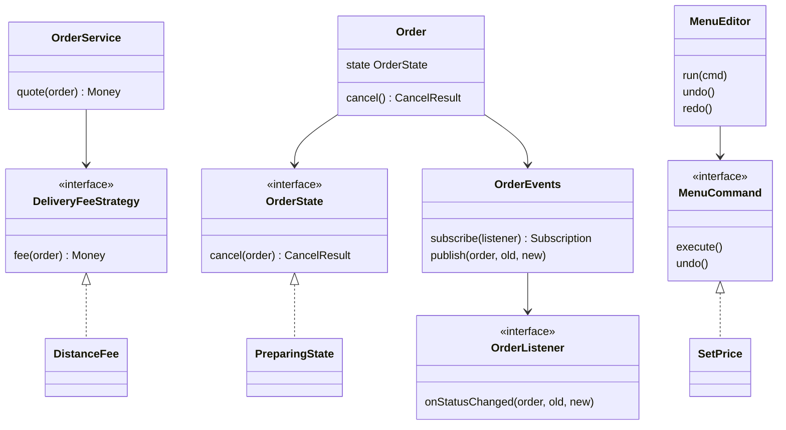

## The hook

It is 8:40 pm on a Friday. Your food-delivery app is in its busiest hour, and four product requests land in the same sprint.

Gold members should pay no delivery fee. The restaurant, the rider and the customer should all hear about every order update, and analytics wants a copy too. Cancelling must refund fully before the kitchen starts, partly while it cooks, and never once the rider has left. And restaurant owners keep fat-fingering menu prices, so they want an undo button.

You could add four more if-else blocks to OrderService. You already know from [Lego Bricks With Standard Studs](article:system-design-oop-solid) how that ends. So here is the real question: once objects exist, how should they **choose**, **react**, **change mode** and **remember what they did**, without one class knowing everything?

## Requirements

Four behaviour problems, one per request. Each maps to one classic pattern, and naming the mapping out loud is half the battle in an interview.

| Product request | Behaviour problem | Pattern |
|---|---|---|
| Fee depends on the customer type | Pick one of several interchangeable algorithms | Strategy |
| Many parties react to order updates | Tell an unknown number of listeners that something happened | Observer |
| Cancel means different things at different times | Same method, different behaviour depending on lifecycle stage | State |
| Undo menu edits | Turn actions into objects you can store and reverse | Command |

Non-functional: each of these must change without editing OrderService, and each must be testable on its own.

:::analogy
Picture a **universal remote with reprogrammable buttons**. Each button holds a little program card: press it and the card runs, and the remote has no idea what the card does. You can swap the card in a button whenever you like. The remote has a **mode switch** (TV, AC, music), and the same button does different things in each mode. Every device paired with the remote hears its signal, and a device you sold last year is still listening if you never unpaired it. Each of the four patterns ahead is one feature of this remote.
:::

These four are among the eleven behavioural patterns in the 1994 *Design Patterns* book by the Gang of Four. The other seven get a quick tour near the end.

## Core objects

Underline the nouns in the four requests:

- **Order**: the thing whose lifecycle moves from placed to delivered.
- **DeliveryFeeStrategy**: flat, distance-based, member-free.
- **OrderListener**: customer push, restaurant dashboard, rider app, analytics.
- **OrderState**: Placed, Preparing, OutForDelivery, Delivered, Cancelled.
- **MenuCommand**: SetPrice, MarkOutOfStock, each reversible.
- **MenuEditor**: runs commands and keeps the undo and redo stacks.

## Class design

### Strategy: swap the card in the button

The fee rule changes with the customer, and marketing will invent a new one every quarter. Predict what goes wrong if the fee lives in OrderService as an if-else on customer type.

Every new fee rule edits tested checkout code, and every rule's test has to build a whole OrderService. The [[Strategy pattern|Strategy]] fix is to give each rule its own class:

```pseudo
interface DeliveryFeeStrategy:
    fee(order) -> Money

class FlatFee implements DeliveryFeeStrategy:
    fee(order): return 30

class DistanceFee implements DeliveryFeeStrategy:
    fee(order): return 10 + 8 * order.distanceKm

class MemberFee implements DeliveryFeeStrategy:
    fee(order): return 0

class OrderService:
    constructor(feeChooser): store it        // picks a strategy per customer
    quote(order):
        strategy = feeChooser.forCustomer(order.customer)
        return order.itemTotal + strategy.fee(order)
```

With our example rates, a 5 km order on DistanceFee costs 10 + 8 × 5 = ₹50 in delivery fee; the same order costs ₹30 on FlatFee and ₹0 for a member. OrderService never changes when a fourth rule arrives.

This is the remote's swappable program card. The button (OrderService.quote) is fixed; the card in it (the strategy) is chosen from outside.

### Observer: everyone paired with the remote hears it

When an order moves to "out for delivery", four parties care today, and next month it will be five. Wait, why not just call them directly from Order? Because then Order imports the push service, the dashboard, the rider app and analytics, and every new listener edits Order.

The [[Observer pattern|Observer]] inverts this. The order publishes one event; listeners subscribe themselves.

```pseudo
interface OrderListener:
    onStatusChanged(order, oldStatus, newStatus)

class OrderEvents:                       // the subject
    listeners = list
    subscribe(listener) -> Subscription:
        add listener
        return Subscription(() => remove listener)
    publish(order, oldStatus, newStatus):
        for l in copy of listeners:      // copy: a listener may unsubscribe mid-loop
            l.onStatusChanged(order, oldStatus, newStatus)

class CustomerPush implements OrderListener: ...
class RestaurantDashboard implements OrderListener: ...
class AnalyticsListener implements OrderListener: ...
```

Notice two quiet details. subscribe returns a handle you can use to unsubscribe, and publish loops over a **copy** of the list. Both exist because of a bug you will meet in a minute.

### State: the remote's mode switch

Here is the cancellation rule from the hook, in our example policy:

| Current status | What cancel() does |
|---|---|
| Placed | Cancel, refund 100% |
| Preparing | Cancel, refund 50% (the kitchen has spent money) |
| OutForDelivery | Reject: "rider already on the way" |
| Delivered | Reject: "use a complaint instead" |
| Cancelled | Reject: "already cancelled" |

The naive code is a switch on status inside cancel(), another inside markReady(), another inside assignRider(), and so on. Five statuses times six methods is thirty branches spread across one class.

The [[State pattern|State]] puts each row of that table into its own class. Order holds a reference to its current state object and delegates to it.

```pseudo
interface OrderState:
    accept(order)
    markPickedUp(order)
    markDelivered(order)
    cancel(order) -> CancelResult

class Order:
    state = PlacedState
    setState(next):
        old = state; state = next
        events.publish(this, old.name, next.name)   // Observer, wired in
    cancel(): return state.cancel(this)

class PlacedState implements OrderState:
    accept(order):  order.setState(PreparingState)
    cancel(order):  order.setState(CancelledState); return refund(100%)
    markPickedUp(order): throw IllegalTransition

class PreparingState implements OrderState:
    markPickedUp(order): order.setState(OutForDeliveryState)
    cancel(order): order.setState(CancelledState); return refund(50%)

class OutForDeliveryState implements OrderState:
    markDelivered(order): order.setState(DeliveredState)
    cancel(order): return rejected("rider already on the way")
```

That is the remote's mode switch. Pressing cancel() is the same button every time; what it does depends on the mode the order is in, and the mode classes themselves decide which mode comes next.

:::insight
Strategy and State have the same class shape, an interface with swappable implementations. The difference is who swaps: with Strategy, the **caller** chooses the card; with State, the **object switches its own mode** as its lifecycle moves forward.
:::

### Command: buttons that remember

The restaurant owner changes Paneer Tikka from ₹250 to ₹280, then panics. To undo, you need to know what was done and what the old value was. The [[Command pattern|Command]] makes each action an object that carries both.

```pseudo
interface MenuCommand:
    execute()
    undo()

class SetPrice implements MenuCommand:
    constructor(item, newPrice)
    execute(): this.oldPrice = item.price; item.price = newPrice
    undo():    item.price = this.oldPrice

class MarkOutOfStock implements MenuCommand:
    execute(): this.wasInStock = item.inStock; item.inStock = false
    undo():    item.inStock = this.wasInStock

class MenuEditor:
    undoStack = stack; redoStack = stack
    run(cmd):  cmd.execute(); undoStack.push(cmd); redoStack.clear()
    undo():    if undoStack empty: return
               cmd = undoStack.pop(); cmd.undo(); redoStack.push(cmd)
    redo():    if redoStack empty: return
               cmd = redoStack.pop(); cmd.execute(); undoStack.push(cmd)
```

Each command saves the old value **when it executes**, not when it is created. Wait, why does that matter? If you build SetPrice at 2 pm and run it at 3 pm after someone else changed the price, a value captured at 2 pm would undo to a stale price.



## Key flows

### One order's life, traced

A customer places an order of ₹400 in items, 5 km away, on DistanceFee. Four listeners are subscribed.

| Step | Call | State before | State after | Listeners called | Result |
|---|---|---|---|---|---|
| 1 | quote(order) | none | none | none | ₹400 + ₹50 fee = ₹450 |
| 2 | place | none | Placed | 4 | order created |
| 3 | accept() | Placed | Preparing | 4 | kitchen starts |
| 4 | cancel() | Preparing | Cancelled | 4 | refund 50% of ₹450 = ₹225 |
| 5 | markPickedUp() | Cancelled | Cancelled | 0 | IllegalTransition |

Step 5 is the reason State earns its keep. Predict what a hand-written switch would have done with markPickedUp on a cancelled order if someone forgot that case. It would have fallen through to a default branch, possibly "set status to OutForDelivery", and sent a rider to a cancelled order. In the State version, CancelledState simply has no legal transitions, and the compiler forces every state class to answer every method.

### The undo trace

Paneer Tikka starts at ₹250, in stock. Pause and guess the final price and stock before reading the last row.

| Step | Action | Price | In stock | Undo stack | Redo stack |
|---|---|---|---|---|---|
| 0 | start | 250 | yes | empty | empty |
| 1 | run SetPrice(280) | 280 | yes | P280 | empty |
| 2 | run MarkOutOfStock | 280 | no | P280, OOS | empty |
| 3 | run SetPrice(300) | 300 | no | P280, OOS, P300 | empty |
| 4 | undo | 280 | no | P280, OOS | P300 |
| 5 | undo | 280 | yes | P280 | P300, OOS |
| 6 | run SetPrice(260) | 260 | yes | P280, P260 | empty |
| 7 | redo | 260 | yes | P280, P260 | empty (nothing to redo) |

Step 6 cleared the redo stack. The redo history described a future that grew from the state at step 5; once you take a different action, that future no longer exists. Text editors behave the same way, and you can check it in any editor you use today.

### The leak you were promised

Back to the two quiet details in OrderEvents. The customer app opens an order-tracking screen, which subscribes a listener. The user closes the screen. Nobody unsubscribes.

The subject's list still holds a reference to that screen, so the screen can never be freed, and every status change still calls it. Open and close the screen 200 times during a long delivery and 200 dead screens are now receiving updates. That is the [[lapsed listener]] problem, the remote still talking to a TV you sold last year.

:::warning
Common misconception: "Observer is decoupled, so subscribers can come and go freely." The subject holds a strong reference to every observer, so a forgotten subscriber leaks memory and keeps running code. Tie every subscribe to an unsubscribe: return a Subscription handle and close it in the screen's teardown, or scope subscriptions to the owner's lifetime. Weak references help in some languages but make delivery depend on garbage-collection timing.
:::

The copy-before-loop detail fixes a second Observer bug. If a listener unsubscribes itself inside onStatusChanged, and you are iterating the live list, you either skip the next listener or crash with a concurrent-modification error, depending on the language.

:::try-this
A RatingPrompt listener should ask for a rating once, on the first Delivered event, and never again. Where does it unsubscribe, and why does OrderEvents loop over a copy? (Inside its own onStatusChanged, right after it shows the prompt, using the Subscription it saved. Looping over a copy means removing itself mid-publish neither skips the next listener nor breaks the loop.)
:::

## Patterns used

| Pattern | Problem it solved here | Why this one, not another |
|---|---|---|
| Strategy | Choose a fee rule per customer | Rules are interchangeable and chosen from outside |
| Observer | Fan out order updates to many parties | The order must not know who listens |
| State | Lifecycle-dependent behaviour of cancel and friends | The object changes its own mode, and illegal moves must be impossible |
| Command | Undo and redo of menu edits | Actions must be stored, reversed and replayed |
| Dependency injection | Wiring strategies and listeners in | Tests pass fakes, as in [The Car Factory and the Custom Configurator](article:system-design-creational-patterns) |

### The other seven, in one line each

You will not need all of these in a machine-coding round, but you should recognise the names.

- **Template Method**: a base class fixes the steps of an algorithm and lets subclasses fill in some steps.
- **Chain of Responsibility**: a request passes along a chain of handlers until one deals with it (log levels, approval chains, middleware).
- **Iterator**: walk a collection without exposing how it is stored.
- **Mediator**: objects talk through one coordinator instead of to each other.
- **Memento**: capture an object's state so you can restore it later, an alternative to Command-based undo.
- **Visitor**: add operations over a fixed set of classes without editing them.
- **Interpreter**: represent a small language's grammar as classes.

## Extensions

### When the listener is slow

Analytics takes two seconds per call. Synchronous Observer means the rider's "picked up" tap waits for analytics. Hold that thought, because the fix is a step up in scale: publish to a queue and let each listener consume at its own pace, the idea behind [The Ticket Rail Between Waiters and Cooks](article:system-design-message-queues). Inside one process, an executor or per-listener worker thread does the same job.

### When two threads touch the same order

The rider app calls markPickedUp while the customer calls cancel at the same moment. Both read PreparingState, and both transitions might apply. Guard each Order's transitions with a lock (or, in a database, a conditional update such as "set status to Cancelled where status is Preparing"). Exactly one wins; the loser sees the new state and gets a rejection.

### When undo must survive a restart

Commands are objects, so you can serialise them into an append-only log. Replaying the log rebuilds the menu, and the log doubles as an audit trail of who changed what.

### Common mistakes

- **State with a status field kept alongside.** If Order has both a state object and a status enum, they drift. Derive the status name from the state object.
- **Strategy for one algorithm.** An interface with one implementation and no second in sight is ceremony. Add it when the second rule appears or is clearly coming.
- **Commands that capture old values at construction.** Capture at execute time, as shown above.
- **Listeners that throw.** One bad listener should not stop the others; catch and log per listener inside publish.

### Interview follow-ups

**"Strategy vs State: they look identical, so what is the difference?"** The class diagram is the same. With Strategy the client chooses and the strategies do not know about each other. With State the current state object decides the next state, so the states know their successors and the object's behaviour changes over time by itself.

**"How do you implement redo after undo?"** Keep two stacks. Undo pops from the undo stack, reverses, and pushes onto redo. Redo pops from redo, re-executes, and pushes back onto undo. Any new command clears redo, as in step 6 of the trace.

**"Observer vs pub-sub?"** Classic Observer is in-process and the subject calls listeners directly, usually synchronously. Pub-sub puts a broker between publishers and subscribers, adds topics, and usually delivers asynchronously, which survives slow or crashed consumers.

**"How would you test the order state machine?"** Build an Order in each state and call every method on it, asserting either the next state or a rejection. That is a table-driven test with one row per (state, method) pair, and it catches the missing-case bug from the trace.

**"Where would Command help outside undo?"** Job queues and retries: a command object can be queued, persisted, retried on failure and logged, because the request is now data.

Next in this track, [Build the Model House One Room at a Time](article:system-design-machine-coding-approach) shows how to use all of these under a 90-minute clock, without drowning a small problem in patterns.

## Key takeaways

- Behavioural patterns decide how objects choose, react, change mode and remember, so new behaviour arrives as new classes instead of new branches in one service.
- Strategy lets the caller pick one of several interchangeable algorithms, while State lets an object switch its own behaviour as its lifecycle moves and makes illegal transitions impossible.
- Observer lets a subject announce events to listeners it does not know, but every subscribe needs a matching unsubscribe or the lapsed listener leaks memory.
- Command turns actions into objects that capture their old values at execute time, which enables undo, redo, queuing and audit logs.
- Use a pattern when its problem is present now or clearly coming, and say in the interview which problem each one solves.
