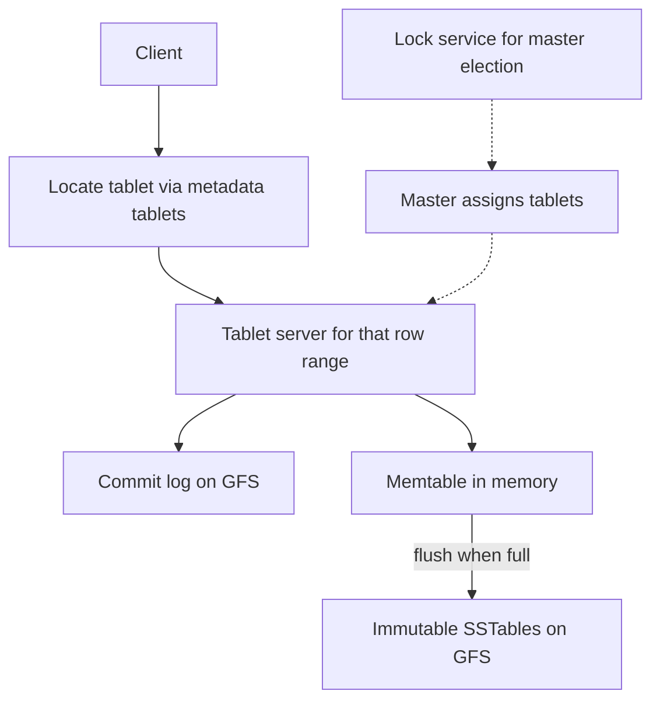

## The hook

Google in 2006 had to store the web crawl, map tiles, user analytics and more: billions of rows, columns that differ from row to row, and petabytes of data. Relational databases of the time wanted fixed schemas on single machines.

Bigtable, described by Chang and colleagues in 2006, answered with an almost embarrassingly simple data model: one enormous sorted map. Its influence shows up in HBase, Cassandra's storage engine and many "wide-column" databases since.

Predict the most common way people misuse such a system. It has nothing to do with the storage engine and everything to do with how you name your rows.

## The intuition

:::analogy
Imagine **a giant spreadsheet sorted by its first column, cut into pages**. Each page holds a contiguous stretch of rows, and different clerks look after different pages. Rows can have thousands of columns or just two, and empty cells cost nothing. Finding all rows between "com.google" and "com.googlf" means opening one or two neighbouring pages. But if everyone keeps adding rows at the very end of the sheet, one clerk does all the work.
:::

- The first column is the **[[row key]]**, and rows are sorted by it.
- The pages are **[[tablet]]s**, each served by one tablet server.
- The overworked clerk at the end is a **[[hotspot]]**, the answer to the hook.

## How it works

### The data model

A sparse, persistent, sorted map:

(row key, column family:qualifier, timestamp) → value

- Rows are sorted by row key, and operations on a single row are atomic.
- Columns are grouped into **[[column family|column families]]** declared up front; inside a family, any row can have any columns (for example, one column per inbound link).
- Each cell can keep several timestamped versions.

The paper's example "web table" used reversed URLs as row keys, such as `com.cnn.www`. Predict why reversed: because then maps.google.com, news.google.com and www.google.com all start with com.google, so pages of one site sort together.

### Tablets and servers

- The table is split into tablets by row range. Tablets split when they grow and are reassigned between servers to balance load.
- A master assigns tablets to tablet servers; a lock service (Chubby at Google) ensures one active master and tracks live servers.
- Clients find a row's tablet through metadata tablets and cache the locations, so the master stays off the data path, the same separation as in [The Librarian Who Knows Which Shelf Holds Each Chapter](article:system-design-gfs-hdfs).

### Storage: an LSM tree on GFS

A write goes to a commit log (on GFS) and into the in-memory **[[memtable]]**. When the memtable fills, it is flushed as an immutable **[[SSTable]]** to GFS. Reads merge the memtable with the SSTables, using Bloom filters to skip files that cannot contain the row. Background compactions merge SSTables. This is the LSM design from [Why Modern Databases Write So Fast](article:famous-algos-lsm-trees).

Wait, if tablet servers keep data in memory, what happens when one crashes? Its SSTables and commit log are on GFS, so another tablet server takes over the tablet by replaying the log. The data was never only on the crashed machine.

:::insight
Bigtable is one huge sorted map split into row ranges: sorting makes range scans cheap and gives single-row atomicity, LSM storage on a replicated file system makes writes fast and servers replaceable, and the row key you choose decides whether load spreads or piles onto one tablet.
:::

## Trade-offs

### Row key design

Take a guess before reading the table: which of these key patterns would you pick for a click log that receives 100,000 writes per second? Then check your answer against the effects below.

| Key pattern | Effect |
|---|---|
| timestamp#event | All writes hit the last tablet: hotspot |
| user_id#timestamp | Writes spread across users; one user's events are contiguous and time-ordered |
| hash(user_id) prefix#user_id#timestamp | Even spread, but scanning by user id ranges is lost |
| reversed_timestamp in the key | Newest events sort first, for "latest N" queries |
| com.cnn.www (reversed domain) | Pages of one site are contiguous |

| You gain | You give up |
|---|---|
| Massive scale for sparse, wide data | No joins, no multi-row transactions (in the original design) |
| Fast writes and sequential scans | Random reads may touch several SSTables |
| Flexible columns per row | Query patterns must be designed into row keys |

:::warning
Common misconception: "a wide-column store is a relational table with more columns." It is a sorted map optimised for access by row key and key ranges. Queries that do not follow the row key order require full scans or separately maintained index tables, so data must be modelled around access patterns, as in [A Copy of the Phone Number in Every Address Book](article:system-design-data-modeling-scale).
:::

:::try-this
You store sensor readings and the main query is "the last hour of readings for sensor 42". Design the row key. (sensor_id#reversed_timestamp, such as 42#(MAX − ts). Each sensor's rows are contiguous, newest first, so the query is one short range scan, and writes from many sensors spread across tablets. If one sensor is extremely busy, add a small bucket number to its prefix.)
:::

## What can go wrong

- **Hotspots** from sequential or low-cardinality key prefixes.
- **Huge rows** (millions of columns in one row) that become too big to serve efficiently.
- **Too many versions** kept per cell, inflating storage; set garbage-collection policies per column family.
- **Compaction debt** from heavy writes, slowing reads.
- **Scans without a key range** reading the whole table.

### Interview follow-ups

**"How is Bigtable different from Dynamo?"** Bigtable keeps data sorted by key with a master assigning ranges and strong single-row consistency; Dynamo hashes keys onto a leaderless ring with tunable eventual consistency. Cassandra borrowed Bigtable's data model and storage with Dynamo's distribution.

**"How would you support lookups by a secondary attribute?"** Maintain a second table whose row key starts with that attribute, updated alongside the main table, accepting that the two can briefly disagree.

**"Why are single-row operations atomic but multi-row ones not?"** A row lives in exactly one tablet on one server, so it can be updated atomically there; rows in different tablets would need distributed transactions.

## In the real world

- Bigtable is offered as Cloud Bigtable; Apache HBase is an open-source design modelled on it, running on HDFS.
- The memtable-plus-SSTable engine design appears in LevelDB, RocksDB and Cassandra.

## Further reading

- Chang et al., "Bigtable: A Distributed Storage System for Structured Data" (OSDI 2006).
- The Apache HBase reference guide, especially schema and row key design.

## Key takeaways

- Bigtable stores data as a sparse sorted map from (row key, column, timestamp) to value, with atomic single-row operations.
- The table is split into tablets by row range, assigned to tablet servers by a master, while clients locate tablets through cached metadata.
- Writes go to a commit log and memtable and are flushed into immutable SSTables on GFS, the LSM pattern, so a failed server's tablets can be reopened elsewhere.
- Row key design decides performance: sequential prefixes create hotspots, while entity-first keys spread load and make common range scans cheap.
- It trades joins and multi-row transactions for scale, so access patterns must be designed into the keys.
