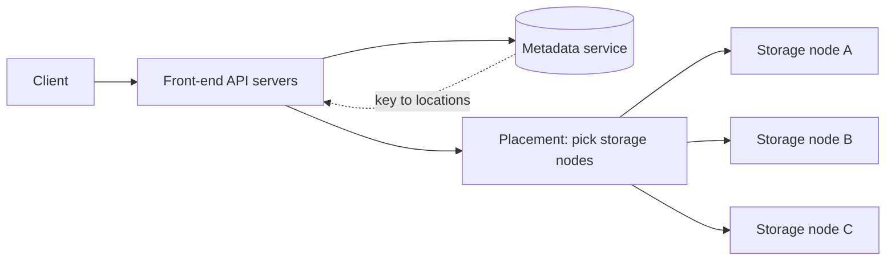
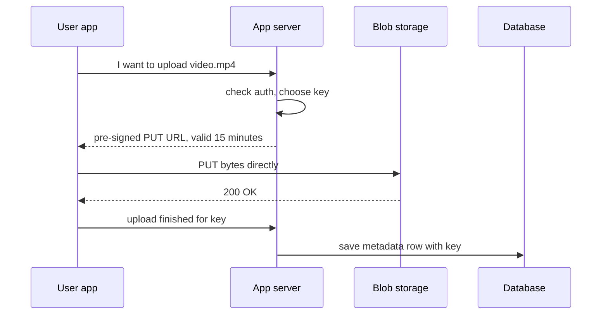

## The hook

Every photo you post, every video you upload, every PDF attached to an email, every nightly database backup has to live somewhere. It is not in the database: a 4 GB video in a table row would make every backup, replica and query painfully slow. It sits in a different kind of system, one built for a single job: take a pile of bytes, give it a name, and return exactly the same bytes, years later, even after disks and whole machines have died.

That system is blob storage, the idea behind Amazon S3, Google Cloud Storage and Azure Blob Storage. In almost every system design interview, "where do the images or videos go?" has the same answer: object storage, with the metadata in a database and a CDN in front. This article explains what happens inside, so you can defend that answer.

## The intuition

:::analogy
Think of a theatre cloakroom. You hand over a coat and get a numbered ticket. The attendant does not care what is in your pockets, does not alter the coat, and does not let you swap a sleeve; you can only hand in a whole coat, take it back, or replace it with another. The cloakroom keeps a ledger of which ticket goes with which hook, and a good one keeps a spare copy of the ledger. And for a famous guest's very valuable coat, a paranoid cloakroom might keep it on hooks in several rooms, so a fire in one room loses nothing.
:::

The coat is a [[blob]], the ticket is the object key, the rooms of hooks are storage nodes, and the ledger is the metadata service. Everything below is about running that cloakroom for billions of coats.

## How it works

### Objects, buckets and keys

[[Object storage]] has a deliberately simple model:

- A [[bucket]] is a named container, such as `photos-prod`.
- An object is a key plus bytes plus a little metadata: `photos-prod/users/42/avatar.jpg`, its size, content type and checksum.
- The API is tiny: PUT an object, GET it (whole or a byte range), DELETE it, LIST keys by prefix.
- Objects are immutable: to change one, you upload a new version that replaces it. No editing bytes in place, which is what makes replication and caching simple.

The slashes in a key look like folders, but they are just characters; "folders" are prefixes used for listing.

### Inside: metadata and data are separate

- **Front-end servers** authenticate requests and are stateless.
- The **metadata service** maps each key to where its bytes live, plus size, checksum and version. It is a large, partitioned, replicated key-value store, which is why prefix listing and key lookups are fast.
- **Storage nodes** hold the actual bytes on disks, often packed into large append-only files, so that millions of small objects do not each cost a filesystem file.

The cloakroom's ledger (metadata) and hooks (data) are separate systems that scale independently.

### Durability: replication or erasure coding

Disks fail every day in a large fleet, so every object is stored redundantly across machines and, ideally, across failure zones.

- **Replication**: keep 3 full copies on 3 nodes. Simple and fast to read, but costs 3x the storage and survives the loss of 2 copies.
- **[[Erasure coding]]**: split the object into k data pieces and compute m parity pieces, using Reed-Solomon codes. Any k of the k + m pieces rebuild the object. With k = 6 and m = 3, overhead is 9 / 6 = **1.5x**, and *any* 3 pieces can be lost.

Systems often replicate fresh, frequently read data and erasure-code older, colder data, where the cheaper storage matters more than the slightly slower reads and rebuilds. Background **scrubbing** reads stored pieces, checks their checksums, and rebuilds damaged ones before more failures pile up. This is where [[durability]] comes from: not from perfect disks, but from repairing faster than failures accumulate.

### Pre-signed URLs: upload around your servers

Sending a 2 GB video through your API servers ties them up for minutes and doubles your bandwidth bill. Instead:

A [[pre-signed URL]] embeds the key, the allowed operation, an expiry time and a signature made with the app's secret. Storage verifies the signature, so it accepts that one upload without the client ever holding credentials. Downloads of private files work the same way.

### Multipart upload

A [[multipart upload]] splits a big file into parts, uploads them in parallel, retries only failed parts, and then sends a "complete" call that stitches them into one object. On S3, parts must be at least 5 MB except the last one, and an upload can have up to 10,000 parts. It turns "the Wi-Fi dropped at 95%" from a restart into one retried part.

:::insight
Blob storage is fast and cheap because it refuses features. No in-place edits, no queries, no transactions across objects: just whole immutable objects addressed by key. That narrowness is what allows simple replication, erasure coding, caching in a CDN and nearly unlimited scale.
:::

## Trade-offs

| Choice | Benefit | Cost |
|---|---|---|
| Blob store vs database column | cheap, scalable, CDN-friendly | metadata and bytes live in two systems that must be kept in step |
| Replication (3x) | fast reads, simple recovery | 3x storage |
| Erasure coding (6 + 3) | 1.5x storage, survives 3 losses | more CPU, reads may touch several nodes, slower rebuilds |
| Pre-signed direct upload | app servers stay light | upload completion must be confirmed separately |
| Storage tiers (hot, cool, archive) | much cheaper for rarely read data | slower or paid retrieval for cold tiers |

## What can go wrong

:::warning
Common misconception: "putting files in the database keeps everything in one place, so it is simpler." Large binary columns bloat the database, slow its backups and replication, and waste its expensive memory and IOPS on bytes it never queries. Store the bytes in blob storage and only the key and metadata in the database.
:::

- **Orphans and dangling rows**: the upload succeeds but the "save metadata" call fails, leaving an unreferenced object; or a row points to an object that was never uploaded. Fix with a "pending" metadata row before upload, confirmation afterwards, and periodic cleanup of unconfirmed uploads and incomplete multipart uploads.
- **Leaked public buckets**: a misconfigured bucket exposes private files. Block public access by default and serve private files with short-lived pre-signed URLs.
- **Hot objects**: a viral image hammers the same storage nodes. Put a CDN in front, as in [Local Warehouses for the Whole Internet](article:system-design-cdn).
- **Listing as a database**: listing millions of keys by prefix to answer "which photos does user 42 have?" is slow and costly. Keep that index in your database.
- **Correlated failures**: three replicas on the same rack or power supply are not three independent copies. Spread pieces across racks and zones.

### Interview follow-ups

**"How should a mobile app upload a 2 GB video?"** The API returns a pre-signed URL and the client uploads directly to object storage in parts (multipart upload), retrying only failed parts. The app servers never carry the bytes. On completion, storage notifies the backend, which records metadata and starts processing.

**"Where do metadata and the file each live?"** The file in object storage under a generated key; owner, size, content type, key and status in a database row. Queries hit the database; bytes come from storage or a CDN.

**"How do you serve private files securely?"** Keep the bucket private and hand out short-lived signed URLs after an authorisation check. The link expires, so sharing it later does not leak the file.

**"How would you save storage costs?"** Lifecycle rules move old, rarely read objects to cheaper storage classes, deduplicate identical files by content hash, and delete abandoned partial uploads.

## In the real world

- Amazon S3 launched in 2006 and is designed for 99.999999999% (eleven nines) annual durability; since December 2020 it provides strong read-after-write consistency for all objects.
- Google Cloud Storage and Azure Blob Storage offer the same bucket-and-object model with hot, cool and archive tiers.
- Open-source systems such as Ceph and MinIO provide S3-compatible object storage that companies run themselves.
- Facebook published papers on Haystack, which packs many photos into large files to avoid per-file overhead, and f4, which moves warm data to erasure-coded storage to save space.

## Further reading

- Amazon S3 documentation, "Uploading and copying objects using multipart upload": https://docs.aws.amazon.com/AmazonS3/latest/userguide/mpuoverview.html
- Beaver et al., "Finding a Needle in Haystack: Facebook's Photo Storage", OSDI 2010.
- Muralidhar et al., "f4: Facebook's Warm BLOB Storage System", OSDI 2014.

## Key takeaways

- Blob storage keeps whole immutable objects addressed by bucket and key, with a tiny API of put, get, delete and list.
- Internally, a metadata service maps keys to locations while storage nodes hold the bytes, so each part scales on its own.
- Durability comes from storing pieces redundantly across failure zones, with replication for speed or erasure coding for cheaper storage, plus constant scrubbing and repair.
- Pre-signed URLs and multipart uploads let clients move large files directly to storage, reliably, without passing through app servers.
- Keep large files in blob storage and only their keys and metadata in the database, with a CDN in front for popular objects.
