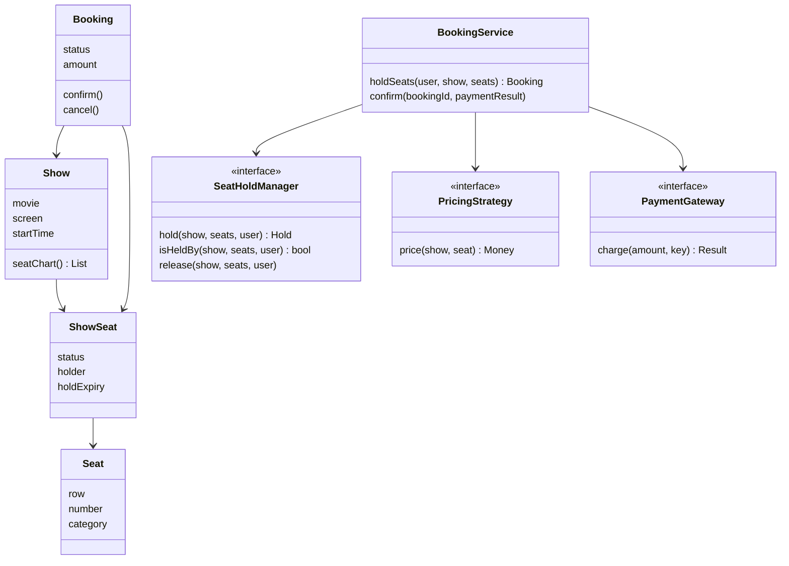

## The hook

Friday, 11:59 pm. Bookings for the biggest release of the year open at midnight. You and thousands of other fans are staring at the same seat chart, thumbs hovering over row R, the recliners.

At 12:00:00 you tap R1 and see "Seats held for you. Pay within 5 minutes." Somewhere, at the same instant, seven other people tapped R1 too. Exactly one of you must win. And if the winner gets distracted by a phone call and never pays, R1 must come back for the others, not sit blocked for the rest of the night.

That is the whole low-level design round in two sentences: model movies, shows and seats cleanly, then make seat holds correct under concurrency and impossible to leak. Here is how.

## Requirements

Clarify, as in [Build the Model House One Room at a Time](article:system-design-machine-coding-approach).

**Functional**

- Cities have theatres; theatres have screens; screens have seats in categories (for example Gold and Recliner).
- Movies are shown as shows: one movie, one screen, one start time.
- A user browses shows for a movie in a city and sees the seat chart.
- The user selects seats; the system holds them for a fixed time while the user pays.
- On payment success, the booking is confirmed and the seats are booked; on failure or timeout, they are released.
- Cancellation of a confirmed booking, with a refund policy.

**Non-functional**

- No seat is ever sold twice.
- Holds never leak: abandoned holds free themselves.
- Many users act at once on the same show.
- Pricing rules change often (weekends, categories, offers).

Our example uses a hold time of 300 seconds and prices of ₹250 for Gold and ₹400 for Recliner. Both are our own numbers for the demo.

:::analogy
Picture an old **theatre box office with a seat chart** on the counter. When you ask for seats, the clerk writes your name on them **in pencil** with the time, and gives you five minutes to bring the money. When you pay, the clerk goes over the pencil **in ink**. Every so often the clerk rubs out pencil marks older than five minutes. And there is only one chart per show, so two clerks never write on the same seat at once.
:::

## Core objects

Start with the nouns, and watch for the one trap that sinks most attempts.

- **Movie**: title, duration, language.
- **Theatre**, **Screen**, **Seat**: the building. A Seat has a row, a number and a category, and it never changes.
- **Show**: a movie on a screen at a time.
- **ShowSeat**: one seat for one show, with a status (available, held, booked), the holder and the hold's expiry.
- **Booking**: user, show, seats, amount, status (pending, confirmed, cancelled, expired).
- **Payment**: amount, method, status, idempotency key.
- **SeatHoldManager**: places, checks and releases holds.
- **PricingStrategy**: computes a price per seat.
- **BookingService**: coordinates the flow.

Wait, why both Seat and [[show seat|ShowSeat]]? Predict what breaks if you put a status field on Seat. Seat R1 in Screen 2 exists once, but it is sold separately for the 3 pm, 6 pm and 9 pm shows. A status on Seat would mean booking R1 for 6 pm also blocks it at 9 pm. Status belongs to the pair (show, seat), which is exactly what ShowSeat is.

## Class design



```pseudo
class ShowSeat:
    seat, status = AVAILABLE, holder = NONE, expiry = 0
    isFree(now): status == AVAILABLE or (status == HELD and expiry <= now)

interface SeatHoldManager:
    hold(show, seatIds, user, now) -> Hold or FAIL     // all or nothing
    confirm(show, seatIds, user, now) -> bool          // HELD by this user, not expired -> BOOKED
    release(show, seatIds, user)

class InMemoryHoldManager implements SeatHoldManager:
    hold(show, ids, user, now):
        sort ids                                       // one global order
        lock show:
            if any seat in ids is not isFree(now): return FAIL
            for each seat: status = HELD; holder = user; expiry = now + HOLD_TIME
        return Hold(ids, expiry)

class BookingService:
    holdSeats(user, show, ids, now):
        hold = holdManager.hold(show, ids, user, now) or fail "some seats are taken"
        amount = sum of pricing.price(show, seat) for each seat
        return bookings.save(Booking(user, show, ids, amount, PENDING, hold.expiry))

    onPaymentResult(bookingId, result, now):
        booking = bookings.get(bookingId)
        if result failed: holdManager.release(...); booking.status = CANCELLED; return
        if holdManager.confirm(booking.show, booking.seats, booking.user, now):
            booking.status = CONFIRMED; notify user
        else:
            booking.status = EXPIRED; payments.refund(result)    // paid too late
```

Three details carry the design. The hold is [[all-or-nothing]]: a user who wants A6 and A7 should never end up with only A7. Seat ids are sorted before locking, and we'll see why in a minute. And confirm **re-checks** the hold instead of trusting that it is still there.

## Key flows

### The midnight rush, traced

A show with Gold seats A5, A6, A7 at ₹250 and Recliner R1 at ₹400. Holds last 300 seconds. Time in seconds after bookings open.

| t | Action | Seat chart before | Decision | Seat chart after |
|---|---|---|---|---|
| 0 | U1 holds A6, A5 (sorted to A5, A6) | all free | both free | A5, A6 held by U1 until 300; total ₹500 |
| 10 | U2 holds A6, A7 | A6 held by U1 | A6 not free, so fail; A7 untouched | unchanged |
| 20 | U2 holds A7 | A7 free | free | A7 held by U2 until 320; total ₹250 |
| 100 | U1's payment succeeds, confirm | A5, A6 held by U1, expiry 300 | held by U1, not expired | A5, A6 booked by U1 |
| 320 | U2's hold expires | | no event needed | A7 still marked held, but free from now on |
| 400 | U3 holds A7 | A7 held by U2, expired at 320 | counts as free | A7 held by U3 until 700 |
| 410 | U2's payment finally succeeds, confirm | A7 held by U3 | not held by U2: reject | unchanged; refund U2 |
| 450 | U3's payment succeeds, confirm | A7 held by U3 | valid | A7 booked by U3 |
| 500 | 8 users hold R1 at once | R1 free | one wins under the show lock | R1 held by exactly one user |

Pause on row 10 and guess what a non-atomic version would do: hold A7 for U2 and then fail on A6, leaving U2 with half a booking they never wanted and A7 blocked from everyone else. All-or-nothing checks every seat first and writes only if all are free.

Rows 320 and 400 are the pencil marks being rubbed out. Nobody had to run a cleanup job at exactly t = 320: a hold whose expiry has passed simply counts as free the next time anyone looks. That is lazy expiry, and it is what makes holds leak-proof even if every background job is down.

Row 410 is the scariest one. U2 really paid. If confirm trusted the old hold, A7 would now be sold to both U2 and U3. Because confirm re-checks the holder and the expiry under the show lock, U2 is refunded instead.

:::insight
A seat hold is a lease, not a lock: it carries an expiry, every read treats an expired hold as free, and every confirmation re-checks that the lease is still yours. With those three rules, abandoned holds clean themselves up and late payments can never double-book.
:::

### The code

`main` replays the table, including eight threads racing for R1.

```cpp
#include <bits/stdc++.h>
using namespace std;

enum class Status { AVAILABLE, LOCKED, BOOKED };

struct ShowSeat {
    string id; int price;
    Status status = Status::AVAILABLE;
    string holder; long expiry = 0;              // valid while status is LOCKED
};

struct Show {
    map<string, ShowSeat> seats;                 // ordered by seat id
    mutex m;                                     // one lock per show
    static constexpr long HOLD_SECONDS = 300;    // example hold time

    bool freeAt(const ShowSeat& s, long now) const {   // an expired hold counts as free
        return s.status == Status::AVAILABLE || (s.status == Status::LOCKED && s.expiry <= now);
    }
    // All-or-nothing hold. Returns the total price, or -1 if any seat is taken.
    int hold(const string& user, vector<string> ids, long now) {
        sort(ids.begin(), ids.end());
        lock_guard<mutex> g(m);
        for (auto& id : ids) if (!freeAt(seats.at(id), now)) return -1;
        int total = 0;
        for (auto& id : ids) {
            ShowSeat& s = seats.at(id);
            s.status = Status::LOCKED; s.holder = user; s.expiry = now + HOLD_SECONDS; total += s.price;
        }
        return total;
    }
    // Called after payment succeeds. Fails if any hold expired or now belongs to someone else.
    bool confirm(const string& user, const vector<string>& ids, long now) {
        lock_guard<mutex> g(m);
        for (auto& id : ids) {
            const ShowSeat& s = seats.at(id);
            if (s.status != Status::LOCKED || s.holder != user || s.expiry <= now) return false;
        }
        for (auto& id : ids) seats.at(id).status = Status::BOOKED;
        return true;
    }
};

int main() {
    Show show;
    auto ok = [](bool b) { return b ? "booked" : "rejected, refund"; };
    for (string id : {"A5", "A6", "A7"}) show.seats[id] = {id, 250};
    show.seats["R1"] = {"R1", 400};

    cout << "t=0   U1 holds A5,A6: " << show.hold("U1", {"A6", "A5"}, 0) << "\n";     // 500
    cout << "t=10  U2 holds A6,A7: " << show.hold("U2", {"A6", "A7"}, 10) << "\n";    // -1, A7 untouched
    cout << "t=20  U2 holds A7: " << show.hold("U2", {"A7"}, 20) << "\n";             // 250
    cout << "t=100 U1 confirms: " << ok(show.confirm("U1", {"A5", "A6"}, 100)) << "\n";   // booked
    cout << "t=400 U3 holds A7: " << show.hold("U3", {"A7"}, 400) << "\n";            // 250, U2's hold expired at 320
    cout << "t=410 U2 confirms: " << ok(show.confirm("U2", {"A7"}, 410)) << "\n";         // rejected: hold expired
    cout << "t=450 U3 confirms: " << ok(show.confirm("U3", {"A7"}, 450)) << "\n";         // booked

    // Eight users tap R1 at the same instant: exactly one may win.
    atomic<int> winners{0};
    vector<thread> ts;
    for (int i = 0; i < 8; ++i)
        ts.emplace_back([&, i] { if (show.hold("T" + to_string(i), {"R1"}, 500) > 0) winners++; });
    for (auto& t : ts) t.join();
    cout << "t=500 R1 race winners: " << winners << " of 8\n";

    for (auto& [id, s] : show.seats)
        cout << id << " " << (s.status == Status::BOOKED ? "BOOKED" : s.status == Status::LOCKED ? "LOCKED" : "AVAILABLE")
             << (s.status == Status::BOOKED ? " by " + s.holder : "") << "\n";
}
```

The output follows the table: holds return 500, -1, 250 and 250, the confirmations print booked, rejected and booked, exactly one of the eight threads wins R1, and the final chart shows A5 and A6 booked by U1, A7 booked by U3 and R1 held. Which thread wins R1 changes from run to run; that exactly one wins never does.

### Why sorted seat ids

Here is the deadlock you were promised in the class design. Suppose each seat had its own lock instead of one lock per show, and holds took seat locks in the order the user tapped them.

| Time | U1 (tapped A5, then A6) | U2 (tapped A6, then A5) |
|---|---|---|
| 1 | locks A5 | |
| 2 | | locks A6 |
| 3 | waits for A6 | |
| 4 | | waits for A5 |

Both wait forever. Sorting the ids first means both users try A5 first; one gets it, the other waits, and no cycle can form. The code above sorts even though it uses a single show lock, so switching to per-seat locks later stays safe.

:::warning
Common misconception: "a cleanup job that releases old holds every minute prevents lock leaks." If the job is slow, crashed or behind, seats stay blocked during the busiest minutes of a release. Put the expiry in the hold itself and treat expired holds as free on every read; the sweeper then only tidies stored statuses and is never needed for correctness.
:::

:::try-this
A hold lasts 300 seconds. U4 holds B1 and B2 at t = 1000. At t = 1250, U5 tries to hold B2 and B3. At t = 1310, U5 tries again. What happens each time, and why? (At 1250, U4's hold is valid until 1300, so B2 is not free and U5 gets nothing, not even B3. At 1310 the hold has expired, so both B2 and B3 are free and U5 holds them until 1610.)
:::

### Taking it to a database

In an interview you will be asked how this works with many servers. The show lock becomes a database guarantee. Two common shapes:

| Approach | How it works | Gain | Cost |
|---|---|---|---|
| Pessimistic | Lock the show's seat rows (sorted) with SELECT ... FOR UPDATE inside a transaction, check, update, commit | Simple reasoning | Holds row locks while checking; contention on hot shows |
| [[Optimistic locking]] | One conditional UPDATE: set held, holder, expiry where show and seat match and the seat is available or its hold has expired; succeed only if the number of rows changed equals the number of seats, otherwise roll back | No waiting; fast under low contention | Losers must retry or pick other seats |

Either way, add a unique constraint on (show, seat) in the table of booked seats as a final safety net, so even a logic bug cannot sell a seat twice. Isolation levels decide what each transaction sees while others run; [Several Cashiers, One Ledger](article:system-design-isolation-levels) covers why.

Some designs keep holds in a shared in-memory store with a built-in TTL, and only write confirmed bookings to the database. That is fast, but the store and the database can disagree, so the database's unique constraint stays the source of truth.

## Patterns used

| Pattern | Where | Why |
|---|---|---|
| Strategy | PricingStrategy | Category prices, weekend surcharges and offers change without touching booking code |
| Strategy | SeatHoldManager implementations | In-memory for the round, database or shared cache in production, same interface |
| State | Booking: Pending, Confirmed, Cancelled, Expired | Only a pending booking can be confirmed; a confirmed one can only be cancelled |
| Observer | Notifications on confirmation and cancellation | Email, SMS and analytics subscribe without BookingService knowing them |
| Factory | Payment method from the request | One place maps "upi" or "card" to a PaymentGateway |

## Extensions

### Payments that time out

The gateway may answer after the hold expires, or not at all. Treat an unknown result as pending and check its status using the same idempotency key, never as a failure, as in [Design a Payment System](article:system-design-payments). If money was taken but the seats are gone, refund it automatically.

### Common mistakes

- **Status on Seat instead of ShowSeat**, which blocks a seat across every show.
- **Holds without expiry**, the classic [[lock leak]].
- **Partial holds**, where some requested seats are held and some are not.
- **Confirming without re-checking** the holder and expiry.
- **Locking seats in tap order**, which can deadlock under per-seat locks.
- **One global lock for every show in the city**, which makes the 9 pm show of one film wait on another film's midnight rush. Lock per show.

### Interview follow-ups

**"How long should a hold last?"** Long enough for a normal payment, short enough that abandoned holds come back quickly during a rush. Make it configuration, and show a countdown so users know. The [[TTL]] can also vary by payment method.

**"Can a user extend their hold?"** Only while it is still valid and still theirs: the same conditional update, with a new expiry, and a cap on extensions so one user cannot hold seats indefinitely.

**"How do you show live seat availability to thousands of viewers?"** Readers can see a slightly stale chart from a cache, because correctness is enforced at hold time, not at display time. Push updates to open charts when seats change, and accept that someone may occasionally tap a seat that was taken a second ago and get a clear "just taken" message.

**"How do you prevent one user from holding the whole theatre?"** Cap seats per hold and holds per user per show, and rate-limit hold requests per user.

**"How do you test this?"** With an injected clock, as in the parking lot: tests set the time to just before and just after an expiry. Add a concurrency test like the R1 race, asserting that exactly one of many simultaneous holds succeeds.

The same lease idea returns across this track, from parking reservations to cab dispatch; go back to [Design a Parking Lot](article:system-design-parking-lot) and you will spot exactly where a hold with an expiry would slot in.

## Key takeaways

- A ticket booking design separates the fixed building (theatre, screen, seat) from per-show state, so seat status lives on ShowSeat, the pair of a show and a seat.
- Seat holds must be all-or-nothing and must carry an expiry, so a user never gets half a selection and abandoned holds free themselves.
- Treating expired holds as free on every read makes holds leak-proof even when cleanup jobs fail, and confirmation must re-check that the hold still belongs to the user.
- Concurrency is handled by one atomic check-and-hold per show, or a conditional database update, with seats locked in sorted order to avoid deadlocks and a unique constraint as the final guard.
- Late or unknown payment results are resolved by idempotent status checks and automatic refunds, never by booking a seat twice.
