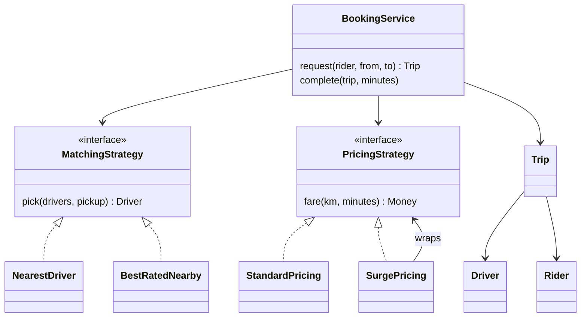

## The hook

A machine-coding prompt: "Design the core of a cab booking app: riders request rides, drivers get assigned, trips are priced." Most candidates write a `bookRide` method with distance calculations, driver search and fare formulas all inside it. It works.

Then the follow-ups arrive: "Add surge pricing. Now prefer highly rated drivers for premium rides. Now a festival discount." Predict how many places that `bookRide` method needs to change for each request. A good design changes one small class each time.

The high-level version of this problem (scale, geospatial indexes, millions of drivers) is in [Design a Ride-Sharing App](article:system-design-ride-sharing). This article is the classes.

## Requirements

- Riders request a ride from a pickup to a drop location.
- The system assigns an available driver using a configurable rule.
- Trips move through states; drivers become available again after a trip.
- Fares follow configurable pricing, including surge.
- Concurrency: one driver must never be assigned to two trips.

:::analogy
Picture **a dispatcher's board of drivers and requests**. Pins show where drivers are and whether they are free. A rulebook beside the board says how to choose a driver ("closest" on weekdays, "best rated nearby" for premium), and a separate rate card says how to charge. Swap the rulebook or the rate card, and the dispatcher keeps working the same way.
:::

## Core objects

- **Rider**, **Driver** (location, state, rating), **Location**.
- **Trip** (rider, driver, from, to, **[[trip state]]**, fare).
- **MatchingStrategy**: `pick(drivers, pickup)`.
- **PricingStrategy**: `fare(km, minutes)`.
- **BookingService**: coordinates requests, assignment and completion.

## Class design



```pseudo
class BookingService:
    constructor(drivers, matcher: MatchingStrategy, pricer: PricingStrategy)
    request(rider, from, to):
        driver = matcher.pick(drivers, from)
        if driver is null: return trip CANCELLED (no drivers)
        atomically set driver.state from AVAILABLE to ON_TRIP, else retry with another driver
        return trip DRIVER_ASSIGNED
    complete(trip, minutes):
        trip.fare = pricer.fare(distance(trip.from, trip.to), minutes)
        trip.state = COMPLETED; driver.state = AVAILABLE; driver.location = trip.to
```

Matching and pricing are **[[matching strategy|strategies]]** chosen at runtime, so the service never changes for new rules. Surge pricing is a **[[decorator]]** around any base **[[pricing strategy]]**: it multiplies whatever the inner strategy returns, as in [The Remote Control With Reprogrammable Buttons](article:system-design-behavioural-patterns).

Wait, why not make surge just a parameter of StandardPricing? Because surge, discounts and minimum fares compose: a decorator chain like Minimum(Discount(Surge(Standard))) adds each rule as one class, without a constructor with ten flags.

## Key flows

Drivers: Arjun at (0, 1) rated 4.6, Bina at (2, 2) rated 4.9, Chetan at (5, 5) rated 4.8. Pricing: ₹50 base + ₹12 per km + ₹1.5 per minute (example rates).

| Step | Request | Strategy | Chosen | Distance and time | Fare |
|---|---|---|---|---|---|
| 1 | Riya (0,0) → (3,4) | Nearest | Arjun, 1 km away | 5 km, 20 min | 50 + 60 + 30 = **₹140** |
| 2 | Sam (2,1) → (2,7), surge 1.5× | Nearest | Bina 1 km (Arjun is now at (3,4), about 3.2 km) | 6 km, 25 min | (50 + 72 + 37.5) × 1.5 = **₹239.25** |
| 3 | Tara at (4,4) | Best rated within 3 km | Chetan, 4.8, about 1.4 km (Bina at (2,7) is about 3.6 km, excluded) | | |

```cpp
#include <bits/stdc++.h>
using namespace std;

struct Location { double x, y; };
double dist(Location a, Location b) { return hypot(a.x - b.x, a.y - b.y); }   // km, flat-grid demo

enum class DriverState { Available, OnTrip };
struct Driver { string name; Location loc; DriverState state = DriverState::Available; double rating; };
struct Rider { string name; };
enum class TripState { Requested, DriverAssigned, Completed, Cancelled };
struct Trip { Rider rider; Driver* driver = nullptr; Location from, to; TripState state = TripState::Requested; double fare = 0; };

// Strategies: swap matching and pricing rules without touching the booking service.
struct MatchingStrategy {
    virtual Driver* pick(vector<Driver>& drivers, Location pickup) = 0;
    virtual ~MatchingStrategy() = default;
};
struct NearestDriver : MatchingStrategy {
    Driver* pick(vector<Driver>& ds, Location p) override {
        Driver* best = nullptr;
        for (auto& d : ds)
            if (d.state == DriverState::Available && (!best || dist(d.loc, p) < dist(best->loc, p))) best = &d;
        return best;
    }
};
struct BestRatedNearby : MatchingStrategy {           // highest rating within 3 km
    Driver* pick(vector<Driver>& ds, Location p) override {
        Driver* best = nullptr;
        for (auto& d : ds)
            if (d.state == DriverState::Available && dist(d.loc, p) <= 3.0 && (!best || d.rating > best->rating)) best = &d;
        return best;
    }
};

struct PricingStrategy {
    virtual double fare(double km, double minutes) = 0;
    virtual ~PricingStrategy() = default;
};
struct StandardPricing : PricingStrategy {           // example rates, not any real company's
    double fare(double km, double min) override { return 50 + 12 * km + 1.5 * min; }
};
struct SurgePricing : PricingStrategy {
    unique_ptr<PricingStrategy> base; double multiplier;
    SurgePricing(unique_ptr<PricingStrategy> b, double m) : base(move(b)), multiplier(m) {}
    double fare(double km, double min) override { return base->fare(km, min) * multiplier; }
};

class BookingService {
    vector<Driver>& drivers;
    unique_ptr<MatchingStrategy> matcher;
    unique_ptr<PricingStrategy> pricer;
public:
    BookingService(vector<Driver>& d, unique_ptr<MatchingStrategy> m, unique_ptr<PricingStrategy> p)
        : drivers(d), matcher(move(m)), pricer(move(p)) {}
    void setPricing(unique_ptr<PricingStrategy> p) { pricer = move(p); }
    Trip request(Rider r, Location from, Location to) {
        Trip t{r, nullptr, from, to};
        Driver* d = matcher->pick(drivers, from);
        if (!d) { t.state = TripState::Cancelled; return t; }
        d->state = DriverState::OnTrip;               // in a real system: an atomic compare-and-set
        t.driver = d; t.state = TripState::DriverAssigned;
        return t;
    }
    void complete(Trip& t, double minutes) {
        t.fare = pricer->fare(dist(t.from, t.to), minutes);
        t.state = TripState::Completed;
        t.driver->loc = t.to; t.driver->state = DriverState::Available;
    }
};

int main() {
    vector<Driver> drivers = {{"Arjun", {0, 1}, DriverState::Available, 4.6},
                              {"Bina", {2, 2}, DriverState::Available, 4.9},
                              {"Chetan", {5, 5}, DriverState::Available, 4.8}};
    BookingService svc(drivers, make_unique<NearestDriver>(), make_unique<StandardPricing>());
    Trip t1 = svc.request({"Riya"}, {0, 0}, {3, 4});          // nearest is Arjun (1 km)
    svc.complete(t1, 20);                                      // 5 km, 20 min
    cout << t1.driver->name << " fare " << t1.fare << "\n";    // 50 + 60 + 30 = 140
    svc.setPricing(make_unique<SurgePricing>(make_unique<StandardPricing>(), 1.5));
    Trip t2 = svc.request({"Sam"}, {2, 1}, {2, 7});            // Bina 1 km, Arjun now at (3,4) about 3.2 km
    svc.complete(t2, 25);                                      // 6 km, 25 min
    cout << t2.driver->name << " fare " << t2.fare << "\n";    // (50 + 72 + 37.5) * 1.5 = 239.25
    BookingService picky(drivers, make_unique<BestRatedNearby>(), make_unique<StandardPricing>());
    Trip t3 = picky.request({"Tara"}, {4, 4}, {4, 6});
    cout << t3.driver->name << "\n";                           // Chetan 4.8 within 3 km
}
```

:::try-this
A festival discount of 20% applies before surge, and fares must never drop below ₹80. Using decorators, what is the chain, and what is the fare for a 2 km, 8 minute ride with 1.5× surge? (Minimum(Surge(Discount(Standard))). Standard: 50 + 24 + 12 = 86. Discount 20%: 68.8. Surge 1.5×: 103.2. Minimum ₹80 does not apply, so the fare is ₹103.20.)
:::

## Patterns used

- **Strategy** for matching and pricing: new business rules are new classes.
- **Decorator** for surge, discounts and minimum fares: composable pricing rules.
- **State** for trips and drivers: only valid transitions are allowed (a completed trip cannot be cancelled).
- **Observer** (extension): riders and drivers subscribe to trip updates for notifications.

:::insight
Keep the booking flow fixed and push everything that changes often behind interfaces: who gets the ride is a matching strategy, what it costs is a pricing strategy composed with decorators, and what may happen next is a state machine. New product rules then become new small classes.
:::

:::warning
Common misconception: "pick the nearest available driver, then mark them busy" is safe if it is fast. Two requests can pick the same driver between the read and the write. Driver assignment must be an atomic compare-and-set from available to busy, as in [Concurrency in Machine Coding: Locks, Atomics and Thread Pools](article:system-design-concurrency-lld), with the loser moving on to the next candidate.
:::

## Extensions

- **Ride types** (auto, mini, premium): each with its own pricing and matching strategy.
- **Cancellation fees**: a policy object consulted when a trip in DRIVER_ASSIGNED is cancelled.
- **Driver acceptance**: offer to one driver with a timeout before assigning; the trip gains an OFFERED state.
- **Ratings** after completion updating driver rating averages.
- **Pooling**: matching several riders on overlapping routes.

### Interview follow-ups

**"How do you find nearby drivers efficiently?"** The LLD uses a list; at scale, a geospatial index (grid cells) answers "drivers near this point", as in the high-level design.

**"How would you test pricing?"** Unit-test each strategy and decorator chain with fixed inputs and expected fares, including edge cases such as zero distance and minimum fares.

**"Where would you put surge calculation (demand versus supply)?"** In a separate SurgeService that computes the multiplier per area and passes it into SurgePricing, keeping pricing classes free of demand data.

The design style builds on [Design a Parking Lot](article:system-design-parking-lot).

## Key takeaways

- Model riders, drivers and trips as objects with explicit states, and keep the booking flow fixed in a service.
- Matching is a strategy, so rules such as nearest driver or best rated nearby are interchangeable classes.
- Pricing is a strategy composed with decorators for surge, discounts and minimum fares, which keeps fare rules small and combinable.
- Assigning a driver must be an atomic state change from available to on trip, so two requests can never take the same driver.
- New product rules become new classes rather than edits to one large booking method.
