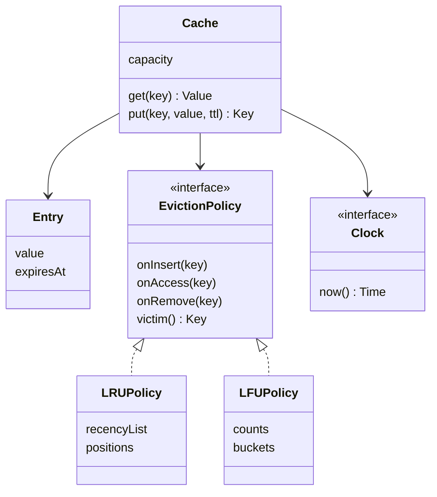

## The hook

The interviewer types one line into the doc: "Design an in-memory cache. LRU for now." You smile, because you have written an LRU cache with a hash map and a linked list before. Twenty minutes later it works.

Then: "Product wants to try LFU on half the traffic. Also, some keys should expire after five minutes. Also, this runs on a server with 32 threads."

If your `LRUCache` class has the linked list woven through `get` and `put`, every one of those sentences is a rewrite. The data-structure question was the warm-up. The design question is this: how do you build a cache that does not know, or care, which eviction rule it is running?

## Requirements

**Functional**

- `get(key)` returns the value or a miss; `put(key, value)` inserts or updates.
- A fixed capacity, counted in entries. When full, a put evicts one entry.
- The [[eviction policy]] is pluggable: [[LRU]] and [[LFU]] to start, more later.
- Optional per-entry [[TTL]]: an expired entry behaves exactly like a missing one.
- `put` reports what it evicted, so callers can log or count it.

**Non-functional**

- `get` and `put` in O(1) average time for LRU.
- Safe under many threads.
- Testable without sleeping: time comes from an injected clock.

**Out of scope, said out loud:** a distributed cache across machines, size-in-bytes limits, write-back to a database. Name them as extensions.

:::analogy
Think of the cache as **a fridge with a house rule for what gets thrown out**. The fridge has a fixed number of shelves. It stores things and hands them back; it has no opinion about what to throw away. That is the house rule, stuck on the door: "oldest untouched leftovers go first" in one flat, "whatever nobody eats goes first" in another. Some items also carry an expiry date, and anything past it counts as gone, even if it is still sitting there. Swap the note on the door and the same fridge behaves differently.
:::

## Core objects

- **Cache**: the fridge. Stores entries, enforces capacity, checks expiry, takes the lock.
- **Entry**: value plus expiry time.
- **EvictionPolicy**: the house rule. It hears about every insert, access and removal, and when asked, names a victim.
- **LRUPolicy**, **LFUPolicy**: two rules. Later, FIFO or random.
- **Clock**: where "now" comes from. A fake in tests.
- **CacheStats**, optionally: hits, misses, evictions.

Wait, why does the policy need to hear about every access? Because it keeps its own bookkeeping. LRU keeps an order of recency; LFU keeps counts. The cache owns the values, and the policy owns the metadata about the keys. Neither reaches into the other's data.

## Class design



```pseudo
interface EvictionPolicy:
    onInsert(key); onAccess(key); onRemove(key)
    victim() -> key                         // does not remove; the cache does

class LRUPolicy:                            // doubly linked list + map from key to node
    onInsert(k): push k to front
    onAccess(k): move k's node to front
    onRemove(k): unlink k's node
    victim():    return back of list

class LFUPolicy:                            // count per key + a recency list per count
    onInsert(k): count[k] = 1; push k to front of bucket[1]
    onAccess(k): move k from bucket[count[k]] to front of bucket[count[k] + 1]; count[k] += 1
    onRemove(k): unlink k from its bucket; forget count[k]
    victim():    back of the lowest non-empty bucket      // least used, then least recent

class Cache:
    capacity, policy, clock, entries: map key -> Entry, lock

    get(k):
        with lock:
            e = entries[k] or return MISS
            if e.expiresAt <= clock.now():          // lazy expiry
                policy.onRemove(k); entries.remove(k); return MISS
            policy.onAccess(k)
            return e.value

    put(k, v, ttl = forever):
        with lock:
            if k in entries: entries[k] = Entry(v, now + ttl); policy.onAccess(k); return NONE
            evicted = NONE
            if entries.size == capacity:
                evicted = policy.victim()
                policy.onRemove(evicted); entries.remove(evicted)
            entries[k] = Entry(v, now + ttl); policy.onInsert(k)
            return evicted
```

The linked-list surgery for LRU is exactly the structure from [The Desk That Keeps Your Latest Books on Top](article:dsa-lru-cache). The difference is where it lives: inside a policy object, not inside the cache.

### Same fridge, two house rules

Here is the predict moment. Capacity 3. You put A, B and C, read A three times, then B once, then C once.

Now you put D. Which key does LRU throw out?

Take a guess before you read on. Most people say B or C, because A is clearly the favourite.

LRU throws out A. After the reads, the order from newest to oldest is C, B, A. A was used four times, but its last use is the oldest, and LRU only remembers *when*, not *how often*. LFU sees counts of A = 4, B = 2, C = 2, D not yet in. It throws out B, the less recent of the two tied at 2.

Neither rule is "right", and you pick by workload. LRU is great when recent means likely, such as a user's open session. LFU is great when popularity is stable, such as a site's most-read articles. The fridge stays the same; only the note on the door changes.

:::insight
Separate what the cache stores from how it decides what to drop. The cache owns values, capacity, expiry and locking; the eviction policy owns key metadata and names a victim. Then a new rule is a new class, and an experiment is a constructor argument.
:::

## Key flows

### Eleven operations, two rules, traced

Capacity 3. LRU order is listed newest first. LFU shows each key's count.

| Step | Operation | LRU order after | LRU result | LFU counts after | LFU result |
|---|---|---|---|---|---|
| 1 | put A | A | inserted | A1 | inserted |
| 2 | put B | B A | inserted | A1 B1 | inserted |
| 3 | put C | C B A | inserted | A1 B1 C1 | inserted |
| 4-6 | get A three times | A C B | hits | A4 B1 C1 | hits |
| 7 | get B | B A C | hit | A4 B2 C1 | hit |
| 8 | get C | C B A | hit | A4 B2 C2 | hit |
| 9 | put D | D C B | evicts A | A4 C2 D1 | evicts B |
| 10 | put E | E D C | evicts B | A4 C2 E1 | evicts D |
| 11 | get A | E D C | miss | A5 C2 E1 | hit |

Look at step 10 under LFU. D had just arrived, with a count of 1, so it was the first to go.

Wait, why is that a problem? Because every new key starts at the bottom. A burst of fresh keys can keep evicting each other while a key that was popular last week sits safely on a high count. This is the classic weakness of plain LFU, and we will come back to the fix in the extensions.

:::try-this
Continue the LFU column from step 11: put F, then put G. Which keys are evicted, and what survives? (F evicts E, the only key with count 1. Then G evicts F, which now has count 1. A at 5 and C at 2 survive both puts, while each newcomer pushes out the previous one.)
:::

### Expiry dates on the shelf

TTL is checked lazily. The demo puts an OTP for Asha with a TTL of 5 seconds at t = 0.

| Time | Operation | expiresAt vs now | Result |
|---|---|---|---|
| 0 | put otp:asha, ttl 5 | expiresAt = 5 | stored |
| 3 | get otp:asha | 5 > 3 | hit |
| 6 | get otp:asha | 5 ≤ 6 | miss, entry removed now |

[[Lazy expiry]] costs nothing for entries nobody touches, but those entries also never leave on their own. In the fridge, expired yoghurt that nobody opens still takes a shelf. Real caches add a background sweeper that samples some entries now and then and removes the expired ones, so memory does not fill with the dead.

### Thirty-two threads at the fridge door

Predict this one before reading on: an LRU cache is read far more often than written, so a read-write lock, with many readers at once, should be a big win. Right?

No. In LRU, a get *moves the key to the front of the list*. Every get you make is a write to the policy's bookkeeping.

Two gets in parallel would both rewire the same linked list, and the list breaks. So the cache takes one exclusive lock for gets and puts alike. The house rule needs a pen to update, and only one person can hold the pen.

When one lock becomes the bottleneck, the usual step is [[lock striping]]:

| Option | How | Gain | Cost |
|---|---|---|---|
| One lock | Every get and put locks the whole cache | Simple, exact LRU | Threads queue up on hot paths |
| Striped segments | Hash the key to one of N sub-caches, each with its own lock and policy | N times less contention | LRU is exact per segment, approximate overall |
| Sampled or approximate LRU | Track an access time per key; on eviction, sample a few keys and drop the oldest | Gets barely write | Victim is "old enough", not "the oldest" |

The trade-off is precision against throughput. In an interview, you start with one lock, say out loud why a read-write lock does not help, and offer striping as the next step.

:::warning
Common misconception: "Using a thread-safe hash map makes the cache thread-safe." The map is only half the state. The policy's list or buckets must change together with the map, as one step. Two separately safe structures updated one after the other still let another thread see the map and the list disagree, and then a victim can name a key that is already gone.
:::

### The code

The program runs the traced table under both policies, then the TTL table. One mutex guards each cache; the policies are plain classes that the cache calls under that lock.

```cpp
#include <bits/stdc++.h>
using namespace std;

// The house rule: which key leaves when the fridge is full. The cache never knows which rule it has.
struct EvictionPolicy {
    virtual void onInsert(const string& k) = 0;
    virtual void onAccess(const string& k) = 0;
    virtual void onRemove(const string& k) = 0;
    virtual string victim() = 0;
    virtual ~EvictionPolicy() = default;
};

struct LRU : EvictionPolicy {                         // least recently used: list front = newest
    list<string> order; unordered_map<string, list<string>::iterator> pos;
    void onInsert(const string& k) override { order.push_front(k); pos[k] = order.begin(); }
    void onAccess(const string& k) override { order.splice(order.begin(), order, pos[k]); }
    void onRemove(const string& k) override { order.erase(pos[k]); pos.erase(k); }
    string victim() override { return order.back(); }
};

struct LFU : EvictionPolicy {                         // least frequently used, ties broken by LRU
    unordered_map<string, int> freq;
    map<int, list<string>> buckets;                   // freq -> keys, front = newest
    unordered_map<string, list<string>::iterator> pos;
    void place(const string& k, int f) { buckets[f].push_front(k); pos[k] = buckets[f].begin(); freq[k] = f; }
    void unplace(const string& k) {
        int f = freq[k]; buckets[f].erase(pos[k]);
        if (buckets[f].empty()) buckets.erase(f);
    }
    void onInsert(const string& k) override { place(k, 1); }
    void onAccess(const string& k) override { int f = freq[k]; unplace(k); place(k, f + 1); }
    void onRemove(const string& k) override { unplace(k); freq.erase(k); pos.erase(k); }
    string victim() override { return buckets.begin()->second.back(); }
};

struct Clock { long now = 0; };                       // injected, so tests move time by hand

struct Cache {
    size_t capacity; unique_ptr<EvictionPolicy> policy; Clock& clock;
    struct Entry { int value; long expiresAt; };
    unordered_map<string, Entry> data;
    mutex m;                                          // one lock: simple and correct for a demo

    Cache(size_t c, unique_ptr<EvictionPolicy> p, Clock& clk) : capacity(c), policy(move(p)), clock(clk) {}

    optional<int> get(const string& k) {
        lock_guard<mutex> g(m);
        auto it = data.find(k);
        if (it == data.end()) return nullopt;
        if (it->second.expiresAt <= clock.now) {      // lazy expiry: found stale, remove it now
            policy->onRemove(k); data.erase(it);
            return nullopt;
        }
        policy->onAccess(k);
        return it->second.value;
    }
    string put(const string& k, int v, long ttl = LONG_MAX / 2) {
        lock_guard<mutex> g(m);
        long exp = clock.now + ttl;
        if (data.count(k)) { data[k] = {v, exp}; policy->onAccess(k); return ""; }
        string evicted;
        if (data.size() == capacity) {
            evicted = policy->victim();
            policy->onRemove(evicted); data.erase(evicted);
        }
        data[k] = {v, exp}; policy->onInsert(k);
        return evicted;
    }
};

void run(const string& name, unique_ptr<EvictionPolicy> p) {
    Clock clock;
    Cache c(3, move(p), clock);
    cout << name << ":";
    vector<string> ops = {"put A", "put B", "put C", "get A", "get A", "get A", "get B", "get C", "put D", "put E", "get A"};
    for (size_t i = 0; i < ops.size(); i++) {
        string k = ops[i].substr(4);
        if (ops[i][0] == 'p') { string ev = c.put(k, 1); if (!ev.empty()) cout << " [" << ops[i] << " evicts " << ev << "]"; }
        else if (i + 1 == ops.size()) cout << " [last get A " << (c.get(k) ? "hit" : "miss") << "]";
        else c.get(k);
    }
    cout << "\n";
}

int main() {
    run("LRU", make_unique<LRU>());
    run("LFU", make_unique<LFU>());

    Clock clock;
    Cache c(3, make_unique<LRU>(), clock);
    c.put("otp:asha", 4821, 5);                      // lives 5 seconds
    clock.now = 3; cout << "t=3 otp " << (c.get("otp:asha") ? "hit" : "miss") << "\n";
    clock.now = 6; cout << "t=6 otp " << (c.get("otp:asha") ? "hit" : "miss (expired)") << "\n";
}
```

It prints `LRU: [put D evicts A] [put E evicts B] [last get A miss]`, then `LFU: [put D evicts B] [put E evicts D] [last get A hit]`, then `t=3 otp hit` and `t=6 otp miss (expired)`. The LFU here uses an ordered map of buckets, which costs O(log F) per access for F distinct counts; the textbook O(1) version keeps a `minFreq` integer and a hash map of buckets instead.

## Patterns used

| Pattern | Where | Why it earns its place |
|---|---|---|
| Strategy | EvictionPolicy with LRU and LFU | The rule changes per experiment; the cache does not |
| Observer, in spirit | Cache calling onInsert, onAccess, onRemove | The policy hears every event that matters to it and nothing else |
| Dependency injection | Clock | TTL tests set time by hand instead of sleeping |
| Decorator, optionally | A StatsCache or LoadingCache wrapping a Cache | Adds hit counters or read-through loading without editing the core |
| Factory | `Cache.withPolicy("lfu")` from config | One place maps a config string to a policy object |

## Extensions

### Get-or-load and the stampede

A common follow-up is a read-through cache: on a miss, load the value from the database and store it. Here is the catch. When a hot key expires, a hundred threads miss at once and all hit the database together.

The fix is to let only one thread load each key. You keep the database calm by making everyone else wait for that one load. Keep a map from key to an in-flight future; the first thread to miss creates it and loads, and later threads wait on the same future. That is the stampede problem from [When the Bakery Reopens](article:system-design-cache-problems), solved in fifty lines.

### Aging LFU counts

Back to the weakness at step 10. Real LFU variants halve every count now and then, or keep counts only for a recent window, so last week's favourite slowly loses its protection and new keys get a fair chance. It is one more change inside LFUPolicy and none in the cache.

### Size in bytes, not entries

Capacity by count treats a 10-byte entry and a 10 MB entry the same. You track the total size instead, and in `put`, keep evicting victims until the new entry fits. Edge case: an entry larger than the whole capacity is rejected, not inserted after evicting everything.

### Edge cases worth naming

- **Capacity zero:** every put is rejected or immediately evicted; decide and test it.
- **Put on an existing key:** update the value and TTL, count it as an access, evict nothing.
- **Victim is expired anyway:** fine, it leaves either way.
- **Clock moving backwards:** entries seem to live longer; use a monotonic clock for TTL.
- **Null values:** decide whether "cached absence" is allowed, which helps against repeated lookups of missing keys.

### Common mistakes

- An `LRUCache` class where the list logic is mixed into get and put, so LFU means a second copy of the cache.
- Forgetting that get changes LRU order, and guarding it with a shared read lock.
- Calling the policy outside the cache's lock, so map and list disagree.
- Checking expiry only in a background thread, so a get returns stale data until the sweeper runs.
- Sleeping in tests to check TTL.

### Interview follow-ups

**"How would you add a FIFO policy?"** A new class: onInsert pushes to the back of a queue, onAccess does nothing, victim is the front. The cache does not change, which is the whole point of the design.

**"How do you make the cache generic over key and value types?"** Template the cache and the policy on the key type, and the cache alone on the value type. The policy never sees values, so it needs only the key type.

**"What changes for a distributed cache?"** Keys are spread across nodes by consistent hashing, each node runs this exact class locally, and the client picks the node. See [A Shared Whiteboard the Whole Fleet Can Read](article:system-design-distributed-cache).

**"How would you write the cache to a database too?"** Write-through: the put writes to the database and then the cache, under the same key ordering. Write-back: the cache marks entries dirty and a worker flushes them, which is faster but can lose writes on a crash. Both are decorators around this cache.

A cache decides what to forget. The next design decides who to refuse, with per-user state, a clock and a lock problem of its own: [Design a Rate Limiter in Code](article:system-design-rate-limiter-lld).

## Key takeaways

- A good cache design keeps the eviction policy behind an interface, so the cache owns values, capacity, expiry and locking while the policy only tracks keys and names a victim.
- LRU evicts by recency and LFU by frequency, so the same access sequence can evict different keys, as the traced example shows with A under LRU and B under LFU.
- Every get in an LRU cache changes the recency order, so gets need the same exclusive lock as puts, and lock striping is the usual next step when that lock gets hot.
- TTL is checked lazily on access for correctness and swept in the background for memory, with time coming from an injected clock so tests never sleep.
- Plain LFU lets new keys evict each other while old favourites stay, which is why real systems age the counts.
