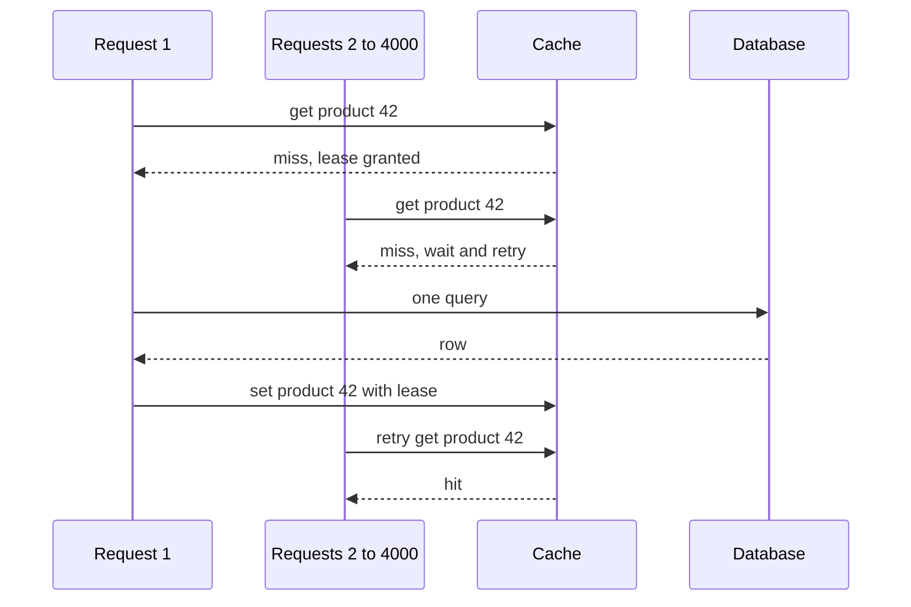

## The hook

Your product page is served from a cache with a 99% hit ratio, and the database is relaxed at 2% CPU. Then, at exactly 12:00:00, the cached entry for the homepage's top product expires. In the next 50 milliseconds, 4,000 requests miss, and all 4,000 run the same expensive query. The database goes to 100% CPU, queries start timing out, the timeouts mean the cache is never refilled, and the site goes down. Nothing was "broken"; the cache simply did its job until the one moment it did not.

Adding a cache, covered in [Keep the Spices on the Counter](article:system-design-caching), is the easy part. Interviewers ask about what happens next: stampedes, hot keys, lookups for things that do not exist, and stale data. Each has a standard name and a standard fix, and knowing them is what separates "add Redis" from a real design.

## The intuition

:::analogy
Think of a popular bakery that closes for ten minutes to restock. While it is open, the shelf (the cache) serves everyone instantly and the kitchen (the database) bakes calmly in the back. When the shelf empties and the door reopens, the whole crowd outside rushes to the kitchen at once, each person demanding a fresh loaf. The kitchen cannot bake 4,000 loaves at once, so everyone waits, and the shelf stays empty. A sensible bakery has one person bring a fresh tray while the crowd waits by the shelf, staggers its restocking, adds a second shelf for its bestseller, and puts up a sign for items it never sells.
:::

Each of those habits matches one cache problem and its fix. Let us take them in turn.

## How it works

### 1. Cache stampede (thundering herd)

A [[cache stampede]] happens when a hot key is missing and many requests try to rebuild it simultaneously. Three fixes, often combined:

- **[[Request coalescing]] (single-flight).** Inside one server, the first request for a missing key starts the database query; later requests for the same key wait on that same in-flight result. Across many servers, use a short lock in the cache: the request that sets "rebuilding:key" with a timeout does the query, others briefly wait and retry the cache, or serve the old value.
- **Serve stale while revalidating.** Keep the old value past its soft expiry, return it immediately, and refresh it in the background. Users see slightly old data instead of an error.
- **Probabilistic early refresh.** Each request near expiry refreshes the key with a small probability that grows as expiry approaches, so one request usually refreshes it before it actually expires.

### 2. Mass expiry

If you load a million keys at startup with the same one-hour TTL, they all expire in the same second an hour later: a stampede on every key at once. The fix is [[TTL jitter]]: set each TTL to, say, 60 minutes plus a random 0 to 6 minutes, so expiries spread out.

### 3. Hot keys

Consistent hashing puts each key on one cache node. A celebrity's profile or a flash-sale item can send so many requests to that one [[hot key]] that its node saturates its CPU or network while the rest of the cluster is idle. Fixes:

- **Local in-process cache** on each app server for the hottest keys, with a short TTL, so most reads never leave the server.
- **Replicate the key**: store copies under `key#1` to `key#N` on different nodes and have readers pick one at random; writes update all copies.
- **Detect hot keys** by sampling request logs, since they can appear suddenly.

### 4. Cache penetration

[[Cache penetration]] is the opposite of a hot key: requests for keys that exist nowhere, such as a bug looping over invalid ids or an attacker probing random ones. Each request misses the cache, queries the database, finds nothing, and caches nothing, so the next one does the same. Fixes:

- **[[Negative caching]]**: store "not found" for a short TTL, such as 30 to 60 seconds.
- **A Bloom filter of valid ids** in front of the cache, as in [The Data Structure That Is Allowed to Lie](article:famous-algos-bloom-filter): if it says "definitely not present", reject without touching cache or database.
- **Input validation and rate limiting** for clearly invalid or abusive traffic.

### 5. Stale data and invalidation

When the database changes, the cache may still hold the old value. Common strategies:

- **TTL only**: simplest; data is stale for up to the TTL.
- **Delete on write**: update the database, then delete the cache key so the next read reloads it. Prefer deleting over overwriting, because two concurrent writers that set values can leave the older value in the cache.
- **Event-driven invalidation**: a change stream from the database (change data capture) publishes updates that delete or refresh keys, decoupling writers from cache logic.

There is still a classic race: a reader misses, reads the old row, and is slow to write it back; meanwhile a writer updates the row and deletes the key; then the slow reader writes the old value into the cache, where it stays until the TTL. [[Lease]]s solve this: the cache issues a token on a miss, and invalidations cancel outstanding tokens, so the late write with an invalid lease is rejected.

:::insight
Every one of these problems is a burst of misses that the database was never sized for. The fixes all aim to keep the number of database queries per key bounded: one rebuild per key (coalescing), expiries spread over time (jitter), load spread over nodes (replication), and misses that do not reach the database at all (negative caching and Bloom filters).
:::

## Trade-offs

| Fix | Gains | Costs |
|---|---|---|
| Request coalescing and locks | one query per missing key | waiting requests, lock timeouts to tune |
| Serve stale | no latency spike | users may see old data briefly |
| TTL jitter | smooth expiry load | slightly less predictable freshness |
| Local cache for hot keys | removes node hotspots | more staleness, memory on every server |
| Key replication | spreads load | writes must update every copy |
| Negative caching | blocks repeated misses | a newly created item may appear missing until the short TTL ends |
| Delete on write | simple, avoids most races | next read pays a miss |

## What can go wrong

A failure timeline that combines several problems:

1. **12:00:00** a hot key expires; 4,000 requests miss.
2. **12:00:01** all 4,000 query the database; its connection pool is exhausted.
3. **12:00:03** queries time out, so nothing is written back and the key stays empty.
4. **12:00:05** clients retry immediately, doubling the load.
5. **12:00:10** the database is overloaded and other, unrelated queries fail too: a cascading failure.

Coalescing would have reduced step 2 to one query. Serving stale would have hidden the miss entirely. Retries with exponential backoff and jitter would have softened step 4. Also watch for:

- **Cold start**: a freshly restarted cache has a 0% hit ratio. Warm it gradually, or shift traffic to it slowly.
- **Locks that never release** when the rebuilding request crashes: always give rebuild locks a timeout.
- **Negative cache hiding new data**: keep negative TTLs short, or delete the negative entry when the item is created.

:::warning
Common misconception: "a cache always protects the database." A cache protects the database only while the hit ratio stays high. The dangerous moments are expiries, restarts and unusual traffic, when the miss rate jumps and the database receives load it was never sized to handle. Design for the miss path, not just the hit path.
:::

## In the real world

- Facebook's memcache paper describes using leases to prevent both thundering herds and stale sets in their very large memcached deployment.
- CDNs and HTTP caches expose "serve stale" behaviour through the `stale-while-revalidate` and `stale-if-error` Cache-Control extensions.
- Go's extended `golang.org/x/sync` module includes a `singleflight` package that implements in-process request coalescing.
- Redis and Memcached deployments commonly combine short negative TTLs, jittered expiries and client-side caching for hot keys.

## Further reading

- Nishtala et al., "Scaling Memcache at Facebook", NSDI 2013: https://www.usenix.org/conference/nsdi13/technical-sessions/presentation/nishtala
- RFC 5861, HTTP Cache-Control Extensions for Stale Content: https://www.rfc-editor.org/rfc/rfc5861
- Vattani, Chierichetti and Lowenstein, "Optimal Probabilistic Cache Stampede Prevention", VLDB 2015.

## Key takeaways

- A cache stampede happens when many requests miss the same key at once; coalescing rebuilds or serving stale data keeps the database to one query per key.
- Adding random jitter to TTLs prevents keys loaded together from expiring together.
- Hot keys overload a single cache node, so serve them from local caches or replicate them across several nodes.
- Requests for non-existent keys bypass the cache entirely unless you cache "not found" briefly or filter ids with a Bloom filter.
- Delete cache entries on writes rather than overwriting them, and use leases or short TTLs to close the race that can leave stale data cached.
