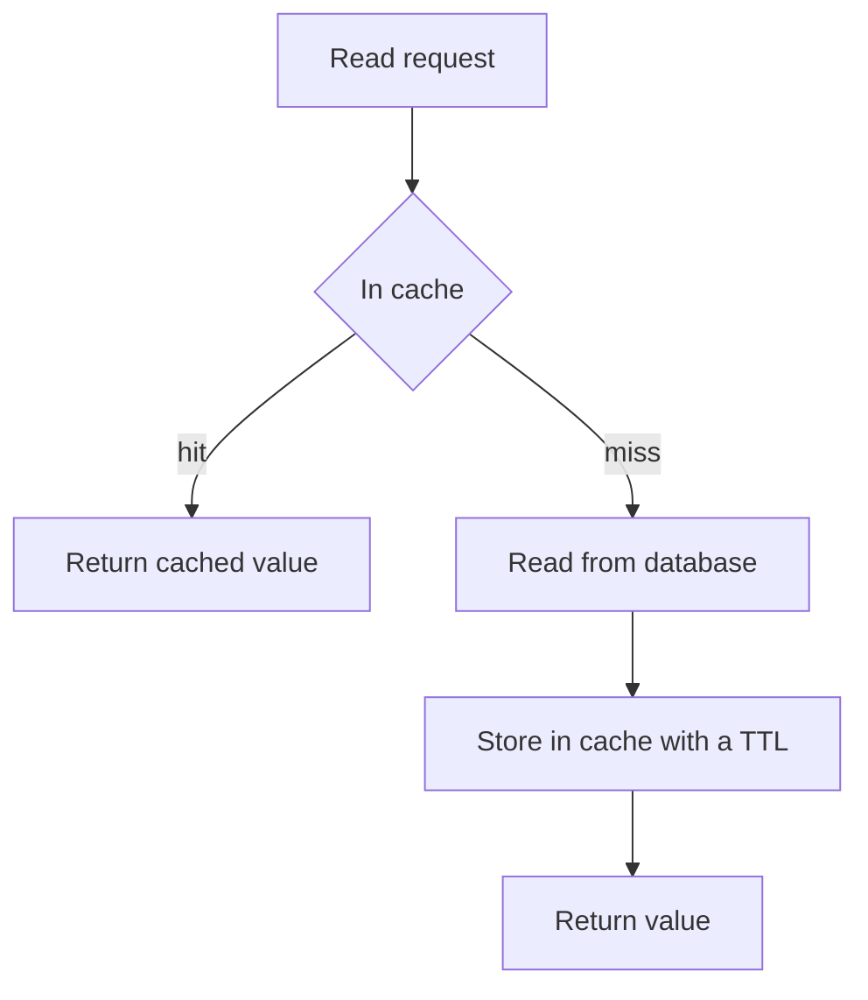

## The hook

A product page is viewed a million times a day. Its price, title and photos change maybe once a week. Yet without a cache, every single view asks the database the same question and waits for the same answer.

Caching is the idea of remembering answers you will need again. It is the most effective performance trick in system design, it appears in almost every interview, and it is also the source of some of the most confusing bugs, because a cache is, by definition, a copy that can go stale.

## The intuition

:::analogy
A cook keeps the spices used in every dish on the counter, within arm's reach, and the rarely used ones in the store room down the corridor. Reaching the counter takes a second; the store room takes a minute. The counter is small, so the cook must decide what earns a spot there, and remember that a jar on the counter can run out or go stale while the store room has the fresh supply.
:::

The counter is the [[cache]]. The store room is the database. The fraction of times the cook finds what they need on the counter is the [[hit ratio]], and everything about caching is a trade-off between that ratio, freshness and the counter's limited space.

## How it works

### Why it pays off

From the [latency numbers](article:system-design-latency-numbers), an in-memory read is far faster than a database query that may touch disk or cross the network. If a fraction h of reads hit the cache:

$$\text{average time} \approx h \cdot t_{\text{cache}} + (1 - h) \cdot t_{\text{db}}$$

- $h$ is the hit ratio.
- $t_{\text{cache}}$ and $t_{\text{db}}$ are the times for a cache read and a database read.

With a cache read of about 1 ms, a database read of about 10 ms and h = 0.9, the average is about 0.9 + 1.0 = 1.9 ms (all numbers are illustrative estimates). The database also handles only a tenth of the reads, which often matters even more than the speed.

### Read strategies

- **[[Cache-aside]]** (lazy loading): the application checks the cache; on a miss, it reads the database, returns the value and stores it in the cache with a [[TTL]]. Simple and the most common.
- **Read-through**: the cache itself knows how to load from the database on a miss; the application only talks to the cache.

### Write strategies

- **Invalidate on write**: update the database, then delete the cache entry so the next read reloads it. Often paired with cache-aside.
- **[[Write-through]]**: write to the cache and the database together. Reads are always fresh, but every write pays both costs.
- **[[Write-back]]**: write to the cache, acknowledge, and flush to the database later. Very fast writes, but a crash can lose data that never reached the database.

### When the counter is full

An [[eviction policy]] decides what to drop:

| Policy | Drops | Good for |
|---|---|---|
| LRU (least recently used) | the item untouched for longest | most general workloads |
| LFU (least frequently used) | the item used least often | stable popularity, like top products |
| TTL-based expiry | anything past its time to live | data that goes stale on a schedule |

:::insight
A cache is worth it when reads repeat and a slightly stale answer is acceptable. Ask two questions for every piece of data: how often is it read compared with written, and how stale may it be? The answers choose the strategy and the TTL.
:::

## Trade-offs

- **Freshness vs hit ratio.** Long TTLs give more hits but staler data; short TTLs are fresher but send more traffic to the database.
- **Memory vs coverage.** Memory is expensive, so caches hold the hot fraction of data. Popularity is usually skewed, so a small cache can serve a large share of reads.
- **Simplicity vs consistency.** Cache-aside with TTLs is simple but briefly stale; write-through is fresher but slower to write; write-back is fastest but riskiest.
- **Where to cache.** Browser, CDN, application memory, a shared cache like Redis, or the database's own buffer: each layer closer to the user saves more time but is harder to invalidate.

## What can go wrong

- **Stale reads** after a write if invalidation is missed or races with a concurrent reload.
- **Cache stampede**: a popular entry expires and thousands of requests miss at once, all hitting the database together. Request coalescing, locks around reloads, or refreshing early with jitter help.
- **Hot keys**: one item so popular that the single cache node holding it is overloaded. Replicate that key or add a small local cache in each server.
- **Cold start**: after a cache restart, every request misses and the database is flooded. Warm the cache gradually or restore it from a snapshot.

:::warning
Common misconception: "add a cache and the database load problem is solved." A cache only helps reads that repeat. Write-heavy data, data read once, or data that must always be exact gets little or no benefit, and a cache failure can suddenly send all the traffic back to a database sized for 10% of it.
:::

:::try-this
A service handles 20,000 reads per second (an estimate). The database can safely handle 3,000 per second. What hit ratio does the cache need, and what happens if the cache goes down? (Misses must stay under 3,000, so the hit ratio must be at least 85%. If the cache fails, all 20,000 reads hit the database at once, nearly seven times its capacity, which is why cache failures need a plan.)
:::

### Interview follow-ups

**"Cache-aside, write-through or write-back?"** Cache-aside: the app reads the cache, on a miss loads from the database and fills the cache; simple and the most common. Write-through: every write goes to cache and database together, so reads are fresh but writes are slower. Write-back: writes go to the cache and reach the database later; fastest, but data is lost if the cache dies first.

**"After an update, delete the cache entry or update it?"** Usually delete it after writing the database. Updating it can race: two writers may set the cache in the opposite order to the database. A delete makes the next reader load the current value.

**"Which eviction policy?"** LRU (least recently used) fits most workloads. LFU (least frequently used) keeps steady favourites better when there are one-off scans. Always add a TTL as a safety net against stale data.

**"What hit rate should you expect and why does it matter?"** It depends on the access pattern. The point to make: at a 90% hit rate, the database sees 10% of reads; at 99%, 1%. Going from 90% to 99% cuts database load by 10x, which is why small hit-rate gains matter.

## In the real world

Shared caches like Redis and Memcached sit in front of most large web databases. CDNs cache static files and even whole pages close to users. Databases keep their own in-memory buffer of hot pages, and CPUs have several cache levels of their own, the same idea at every scale. In design interviews, adding a cache is rarely wrong, but explaining its strategy, TTL, invalidation and failure behaviour is what earns credit.

## Further reading

- AWS whitepaper, "Database Caching Strategies Using Redis": https://docs.aws.amazon.com/whitepapers/latest/database-caching-strategies-using-redis/welcome.html
- Redis documentation, "Key eviction": https://redis.io/docs/latest/develop/reference/eviction/
- Facebook engineering, "Scaling Memcache at Facebook" (NSDI 2013).

## Key takeaways

- A cache keeps copies of frequently read data in fast memory, cutting latency and shielding the database from repeated reads.
- Cache-aside is the common default: check the cache, fall back to the database on a miss, then fill the cache with a TTL.
- Write-through keeps the cache fresh at the cost of slower writes, while write-back is fastest but can lose unflushed writes.
- Eviction policies like LRU decide what stays when memory is full, and skewed popularity lets small caches serve most reads.
- Plan for stale data, stampedes, hot keys and cold starts, because a failing cache can send its whole load to the database.
