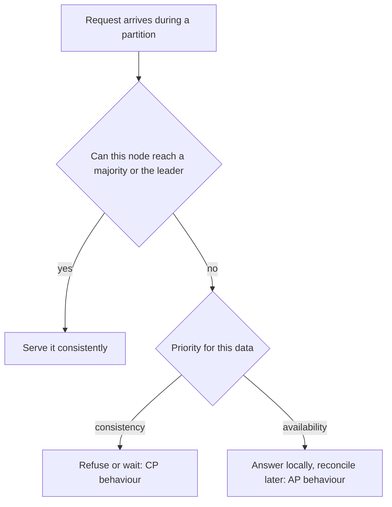

## The hook

"CAP theorem: consistency, availability, partition tolerance. Pick two." It is the most quoted line in system design interviews, and in its popular form it is misleading. You do not get to pick "CA" for a distributed system, and you are not making the choice once at design time.

The real statement is narrower and more useful: when the network breaks, you must decide what each request does. And its younger sibling, PACELC, describes the choice you make every single day, even when the network is fine.

## The intuition

:::analogy
Picture a bank with two branches that share account balances over a phone line. One afternoon the line goes dead. A customer walks into branch A wanting to withdraw money. Branch A can refuse until the line is back, so the balances can never disagree, or it can pay out and hope branch B does not also pay out the same money. There is no third option that is both always open and always correct.
:::

The dead phone line is a [[network partition]], and it can last seconds or hours. Refusing is choosing consistency; paying out is choosing [[availability]]. And even on normal days, phoning the other branch before every withdrawal makes customers wait, which is the latency side of the story.

## How it works

### CAP, stated carefully

In the formal version proved by Gilbert and Lynch in 2002, following Eric Brewer's conjecture:

- **C** means [[linearizable]] consistency: every read sees the latest write, as if there were one copy.
- **A** means every request to a non-failed node gets a non-error response.
- **P** means the system keeps working despite messages being lost between nodes.

The theorem: during a partition, you cannot have both C and A. Since real networks do partition, the practical choice is what to give up while a partition lasts.

A [[CP system]], like a Raft-replicated store, refuses writes on the minority side of a partition. An [[AP system]], like a Dynamo-style store configured for availability, accepts writes everywhere and resolves conflicts afterwards.

### PACELC: the everyday trade-off

Partitions are rare. Latency is constant. [[PACELC]], proposed by Daniel Abadi, reads: if **P**artition, choose **A** or **C**; **E**lse, choose **L**atency or **C**onsistency.

On a normal day, a strongly consistent read may have to contact a leader in another region or wait for a quorum. A latency-first read just asks the nearest replica. That cost is paid on every request, not just on bad days. Most of the design decisions you actually make, like "can this read come from a local replica?", are on the ELC side.

:::insight
CAP describes the rare bad day; PACELC adds the everyday cost. A useful habit is to label each piece of data with both choices, for example "PC/EC" for a payment ledger and "PA/EL" for a like counter.
:::

### What "refusing" looks like in practice

A CP system does not have to shut down entirely. The majority side of a partition keeps working normally. Only nodes cut off from the majority stop accepting writes, and often they keep serving reads that are explicitly marked as possibly stale. Clients see errors or timeouts from those nodes and retry elsewhere. An AP system, by contrast, keeps accepting writes on every side and records enough metadata, such as version vectors, to detect conflicts when the partition heals. Either way, the choice is visible to users only for the duration of the partition, which is why the everyday latency choice often matters more.

## Trade-offs

| Data | During a partition | Normal days | Reasoning |
|---|---|---|---|
| Payment ledger | consistency (refuse) | consistency (pay latency) | money must never diverge |
| Shopping cart | availability | latency | losing an add-to-cart is worse than a merge |
| Like counts | availability | latency | being briefly off harms no one |
| Seat booking | consistency for the final booking | consistency at hold time | double booking is unacceptable |

- **Choosing C** means some users see errors or waits during failures, and every request may pay coordination latency.
- **Choosing A** means writing code to merge or repair divergent data, and explaining occasional oddities to users.
- Many databases are tunable per request, so one system can behave CP for some operations and AP for others.

## What can go wrong

- **Split brain:** a system that claims CP but lets both sides of a partition elect a leader ends up with two sets of writes. Majority quorums prevent this.
- **Silent data loss in AP systems:** "last write wins" by timestamp can drop one of two concurrent updates without anyone noticing.
- **Partitions that look like slowness:** a node may be alive but too slow to answer, and timeouts must decide whether to treat it as gone. Too short and you flap; too long and users wait.

:::warning
Common misconception: "a single-node SQL database is CA, so it beats CAP." A single node is not distributed, so partitions between replicas do not arise, but it is also not available when that one node fails. As soon as you add replicas, the CAP choice reappears.
:::

:::try-this
Label each as PA/EL, PC/EC or a mix, and say why: a DNS-like configuration store for a CDN, a bank transfer service, a chat app's "last seen" status, and an inventory count during a flash sale. (Plausible answers: config store often PA/EL with short caches; bank PC/EC; last seen PA/EL; inventory PC/EC at the moment of purchase, even if the displayed count is EL.)
:::

## In the real world

Raft-based stores such as etcd behave as CP: a minority partition stops accepting writes. Dynamo-style databases such as Cassandra let each request choose how many replicas must respond, moving between AP-like and CP-like behaviour per operation. Google Spanner aims for strong consistency globally and pays for it with carefully engineered latency. The everyday ELC choice shows up whenever you decide whether reads may come from a nearby replica, as covered in [consistency basics](article:system-design-consistency-basics).

## Further reading

- Seth Gilbert and Nancy Lynch, "Brewer's Conjecture and the Feasibility of Consistent, Available, Partition-Tolerant Web Services", 2002.
- Eric Brewer, "CAP Twelve Years Later: How the Rules Have Changed", IEEE Computer, 2012.
- Daniel Abadi, "Consistency Tradeoffs in Modern Distributed Database System Design", IEEE Computer, 2012.
- Martin Kleppmann, "Please stop calling databases CP or AP" (blog post, 2015).

## Key takeaways

- CAP says that during a network partition a distributed system must choose between consistency and availability.
- Partitions happen in real networks, so "pick CA" is not a real option for a replicated system.
- PACELC adds that without partitions, stronger consistency still costs latency on every request.
- The choice can differ per piece of data and even per operation, so label data by what it can tolerate.
- Majority quorums prevent split brain in CP designs, while AP designs need explicit conflict handling.
