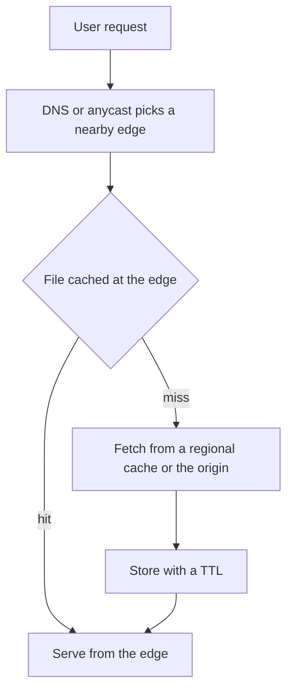

## The hook

A student in Chennai opens a video site whose servers are in Virginia. Every image, script and video segment would have to cross the Pacific or the Atlantic and back, each request paying a few hundred milliseconds of travel. Multiply by a hundred files per page and a million viewers, and the origin servers drown while users stare at spinners.

Yet the page loads quickly, because most of those files never come from Virginia at all. They come from a server a few kilometres away, run by a content delivery network.

## The intuition

:::analogy
An online store with one giant warehouse in one city ships slowly to everyone far away, and its trucks clog one road. So it opens small local warehouses in every region, stocked with the items people there order most. Most orders ship from around the corner; only rare items still come from the main warehouse, which now handles a fraction of the traffic.
:::

The local warehouses are [[edge server]]s. The main warehouse is your [[origin]]. A [[CDN]] is a company that runs thousands of local warehouses and lets you rent shelf space in all of them.

## How it works

1. **Routing to the edge.** When a user requests `cdn.example.com/logo.png`, DNS (or anycast routing) sends them to a nearby edge, as described in [The Phone Book That Holds the Internet Together](article:system-design-dns-deep-dive).
2. **Cache lookup.** The edge checks its cache using a [[cache key]], usually the URL plus selected headers.
3. **Hit:** serve the file immediately from the edge.
4. **Miss:** fetch it from the origin (often through a regional parent cache), store it with a TTL, and serve it.

### Pull vs push

- **Pull CDN**: the edge fetches from the origin on the first miss. Easy to set up; the first request in each region is slow.
- **Push CDN**: you upload content to the CDN ahead of time. Good for large files you know will be popular, like a game update.

### What to cache, and for how long

Static assets (images, scripts, stylesheets, fonts, video segments) are the classic CDN content. The cleanest approach is versioned file names: `app.3f9a2c.js`. When the file changes, its name changes, so you can cache each version for a year and never need to [[invalidation|invalidate]] it. HTML pages that reference those assets get short TTLs, so new versions are picked up quickly.

Dynamic or personalised content can still benefit: CDNs keep warm connections to the origin, terminate TLS near the user, and can cache API responses that are the same for everyone, such as a product catalogue.

:::insight
A CDN applies caching to geography. It moves the copy close to the user, so the slowest part of the journey, the long round trip across continents, disappears for most requests, and the origin only serves what the edges do not have.
:::

## Trade-offs

- **Freshness vs [[cache hit ratio]].** Long TTLs give more hits and less origin load, but changes take longer to appear unless you version or invalidate.
- **Cache key precision.** Including more headers (language, device, cookies) makes responses correct for each variant, but splits the cache into many small pieces with lower hit ratios.
- **Cost vs control.** CDNs charge for bandwidth and features, and some edge behaviour is harder to debug than your own servers. For a small audience in one region, a CDN may not be worth it.

### A quick estimate

A site serves 50 TB of images a month to users worldwide (an estimate). With a 95% edge hit ratio, the origin serves only about 2.5 TB, a twentieth of the traffic, and users get images from nearby edges. The origin can be sized for a twentieth of the load, which often pays for much of the CDN. Raising the hit ratio from 95% to 99% cuts origin traffic by another factor of five.

## What can go wrong

- **Private data cached publicly.** If a personalised response is cached under a key that ignores the user, the next visitor may see someone else's page. Mark private responses `Cache-Control: private` or `no-store`.
- **Stale content after a deploy** when files are not versioned and invalidation is slow or forgotten.
- **Origin overload on a cold cache** after a purge or for a sudden viral file. Regional parent caches and request collapsing at the edge reduce how many misses reach the origin.
- **CDN outage.** A provider-wide failure can take down many sites at once; critical services keep a way to fail over to another CDN or straight to the origin.

:::warning
Common misconception: "a CDN only helps static files." Even uncacheable requests often get faster through a CDN, because the user's connection and TLS handshake end at a nearby edge, which then talks to the origin over a fast, already-open connection. But the biggest wins are still for content that many users share.
:::

:::try-this
Your HTML page has a 60-second TTL and references `style.css` with a 1-day TTL. You change the CSS and deploy. What do users see, and how would versioned file names fix it? (For up to a day, many users get the new HTML with the old CSS, a broken mix. With versioned names, the new HTML points to `style.ab12.css`, a file no cache has seen, so everyone gets the matching CSS within 60 seconds.)
:::

### Interview follow-ups

**"How do you deploy a new version of app.js without users getting stale files?"** Put a content hash in the file name (app.3f9a1c.js) and cache it for a long time. The HTML that references it gets a short TTL. A deploy changes the name, so no purge is needed.

**"Push or pull CDN?"** Pull: the edge fetches from your origin on the first miss and caches it; easy and the default. Push: you upload content to the CDN ahead of time; useful for large files you know will be requested, such as a game patch.

**"Can a CDN help with dynamic or personalised pages?"** Partly: it still terminates TLS near the user and keeps warm connections to the origin, which cuts latency. Cache the shared parts and fetch the personal parts separately, and never cache user-specific responses under a shared key.

**"What protects the origin when the CDN cache is cold?"** An origin shield, a middle cache tier, so many edges ask one shield instead of all hitting the origin, plus request coalescing at the edge.

## In the real world

Large CDNs such as Akamai, Cloudflare, Fastly and Amazon CloudFront run edge servers in many cities worldwide. Video platforms serve most of their traffic from caches near users, and some, like Netflix with its Open Connect appliances, place their own cache servers inside internet providers' networks. In system design interviews, a CDN is the standard answer for static assets and media in any read-heavy, global product, as long as you also explain cache keys, TTLs and invalidation, which build on [Keep the Spices on the Counter](article:system-design-caching).

## Further reading

- Cloudflare Learning Center, "What is a CDN?": https://www.cloudflare.com/learning/cdn/what-is-a-cdn/
- MDN Web Docs, "HTTP caching": https://developer.mozilla.org/en-US/docs/Web/HTTP/Caching
- Netflix Open Connect overview: https://openconnect.netflix.com/

## Key takeaways

- A CDN caches content on edge servers close to users, so most requests avoid long round trips to the origin.
- Requests are routed to a nearby edge, served on a hit, and fetched from the origin and cached on a miss.
- Versioned file names allow very long TTLs without invalidation, while HTML keeps short TTLs to pick up new versions.
- Cache keys must include whatever makes a response different, or private or wrong content can be served to the wrong user.
- CDNs cut origin load dramatically, but plan for cold caches, purges and provider outages.
