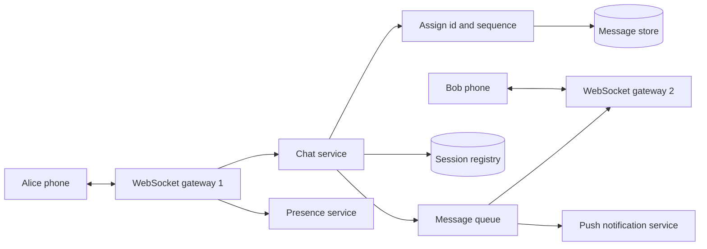

## The hook

You send "on my way" and, a moment later, two grey ticks turn blue. Behind those ticks, your message travelled over a connection your phone kept open, through a server that knew which machine your friend's phone was connected to, into durable storage, onto their screen, and back as a receipt. If their phone had been off, it would have waited and arrived the moment they reconnected, in the right order.

"Design a chat system like WhatsApp or Messenger" is one of the most common system design interview questions. It combines real-time connections, storage design, ordering, delivery guarantees and fan-out, and every part has a clear trade-off to discuss.

:::analogy
Think of a post office that holds letters until you come home. When you are home, a courier who knows your address brings each letter straight to your door. When you are out, letters go into your personal pigeonhole, and the moment you return you collect everything in order. Every letter is logged when it arrives, and when you sign for it the sender gets a slip saying it was delivered.
:::

The couriers are gateways, the address book is the session registry, the pigeonholes are stored messages per conversation, and the signed slips are receipts.

## Requirements

**Functional**

1. One-to-one chat and group chat (say up to a few hundred members).
2. Messages are delivered in real time when the recipient is online, and on reconnect when offline.
3. Sent, delivered and read receipts.
4. Online presence and last seen.
5. Multiple devices per user, all seeing the same history.

**Non-functional**

- Low latency: messages appear within a fraction of a second for online users.
- Durability: once the server acknowledges a message, it is never lost.
- Ordering: all devices show a conversation in the same order.
- High availability and scale to many millions of concurrent connections.

Out of scope: media uploads (stored in blob storage and sent as links), end-to-end encryption details, and search.

## Back-of-envelope numbers

All numbers are **estimates** for the interview.

- **Users:** 500 million daily active users, each sending 40 messages a day: 2 × 10¹⁰ messages per day ≈ **230,000 messages per second** on average, perhaps 3 to 5 times that at peak.
- **Storage:** 100 bytes of text plus about 100 bytes of metadata ≈ 200 bytes per message. 2 × 10¹⁰ × 200 B ≈ **4 TB per day**, about 1.5 PB per year before replication.
- **Connections:** if 20% of daily users are connected at once, that is **100 million open connections**. If one gateway holds about 100,000 connections, we need on the order of **1,000 gateway servers**.

The connection count, not the message rate, drives the gateway fleet; the storage volume drives the database choice.

## High-level design

1. Each client keeps a WebSocket to a [[WebSocket gateway]], as described in [Checking the Mailbox vs Hearing the Doorbell](article:system-design-realtime-communication). Gateways are stateful only in holding connections; all logic lives behind them.
2. Alice sends a message with an [[idempotency key]] (a client-generated id). The chat service checks for duplicates, assigns a server id and a per-conversation sequence number, writes it to the message store, and acknowledges Alice: one grey tick.
3. The chat service looks up Bob's devices in the [[session registry]]. For each online device, it publishes to the queue partition for Bob's gateway, which pushes the message down Bob's socket.
4. Bob's device acknowledges receipt; a "delivered" [[delivery receipt]] flows back to Alice the same way. Opening the chat sends "read".
5. If Bob has no online device, a push notification wakes his phone; on reconnect, his app syncs.

## Deep dives

### 1. Storing messages

The access pattern is simple and huge: append messages to a conversation, and read the latest N messages of a conversation, or everything after a given sequence number. A wide-column store such as Cassandra or ScyllaDB fits well:

- **Partition key:** conversation id, so a conversation's messages live together.
- **Clustering key:** message id or sequence number, descending, so "latest 50" is one sequential read.

Very active conversations can make partitions grow without bound; adding a time bucket to the partition key (conversation id + month) caps their size. Message ids can be Snowflake-style time-ordered ids, as in [Design a Unique ID Generator](article:system-design-unique-id-generator).

### 2. Ordering and sync

Client clocks disagree, so the server assigns order. Each conversation gets an increasing sequence number at write time. Each device keeps an [[inbox (sync) pointer]]: the last sequence it has seen per conversation. On reconnect it asks "give me everything after 1,042", which also handles the offline case without a separate "pending" store. Clients render by sequence, so all devices agree.

### 3. Group fan-out

For a group of up to a few hundred members, use **fan-out on write**: store the message once in the group conversation, then deliver to each member's online devices via the registry and queue. The message is not copied per member; each member's device syncs the shared conversation. For very large groups or channels, switch to **fan-out on read**: members fetch new messages when they open the channel, avoiding thousands of pushes per message.

### 4. Presence

Each gateway reports connect and disconnect events, and clients send a heartbeat every so often while connected. The presence service stores user → online / last seen in an in-memory store with a TTL; if heartbeats stop, the entry expires and the user shows as offline. Presence changes are pushed only to users who currently have that contact's chat open, or are batched, because pushing every change to every contact would generate far more traffic than messages do.

:::insight
Separate the parts that hold state from the parts that make decisions. Gateways only hold connections; the chat service is stateless and can scale freely; the registry and message store hold the facts. Any gateway can fail and clients simply reconnect elsewhere, re-register, and sync from their pointer.
:::

## Trade-offs

- **WebSockets vs long polling:** WebSockets give low latency and low overhead for millions of idle connections; long polling is simpler through restrictive networks and is a common fallback.
- **Fan-out on write vs on read:** write fan-out gives instant delivery for normal groups; read fan-out is cheaper for huge channels.
- **Wide-column store vs relational database:** wide-column stores scale writes and partition naturally by conversation; a relational database is easier for joins and transactions but needs sharding at this volume.
- **At-least-once delivery with deduplication vs exactly-once:** exactly-once across networks is impractical; at-least-once with client-side dedup by message id gives the same user experience.

## What can go wrong

- **A gateway crashes**: its 100,000 clients reconnect at once. Use jittered reconnect backoff and keep spare gateway capacity to avoid a reconnect storm.
- **Lost acknowledgements** cause resends; the idempotency key prevents duplicates.
- **Stale registry entries** route messages to a gateway the user has left; the gateway reports the failure, and the device will sync on reconnect anyway.
- **Ordering across devices** breaks if clients order by local time; always render by server sequence.
- **Huge groups** turn one message into thousands of pushes; cap write fan-out size and switch to read fan-out above it.
- **Hot conversations** create hot partitions; time-bucket the partition key.

:::warning
Common misconception: "the WebSocket connection guarantees delivery." A socket can look open while the network beneath it is dead, and a message written to it may never arrive. Delivery is guaranteed only by storing the message durably first, and by the recipient acknowledging it, with sync on reconnect as the safety net.
:::

### Interview follow-ups

**"How do you guarantee message order in a conversation?"** Assign a per-conversation sequence number on the server, for example by routing each conversation to one partition or using an atomic counter, and have clients display by that number, not by device clocks.

**"How does the sender see 'delivered' and 'read'?"** The recipient's device sends acknowledgements back through the gateway; the server stores the latest delivered and read sequence per user per conversation and forwards an update to the sender.

**"How do group chats with 500 members change the design?"** Fan-out: one message becomes 500 deliveries. Write the message once, then deliver to online members through their gateways and queue push notifications for offline ones. Very large groups or channels switch to members pulling recent messages instead of per-member pushes.

**"What about end-to-end encryption?"** The server then only stores and forwards ciphertext, so server-side search and moderation of content are no longer possible. Key management per device becomes the hard part.

## Further reading

- Discord engineering, "How Discord Stores Billions of Messages": https://discord.com/blog/how-discord-stores-billions-of-messages
- Discord engineering, "How Discord Stores Trillions of Messages": https://discord.com/blog/how-discord-stores-trillions-of-messages
- RFC 6455, The WebSocket Protocol: https://www.rfc-editor.org/rfc/rfc6455

## Key takeaways

- Clients hold WebSocket connections to gateways, and a session registry maps each online device to its gateway.
- The server stores each message durably, assigns it a per-conversation sequence number, and only then acknowledges and delivers it.
- Devices keep a sync pointer per conversation and fetch everything after it on reconnect, which handles offline delivery and ordering together.
- Normal groups use fan-out on write to online members, while very large groups or channels use fan-out on read.
- Idempotency keys, acknowledgements and jittered reconnects make delivery reliable despite dropped connections and crashed gateways.
