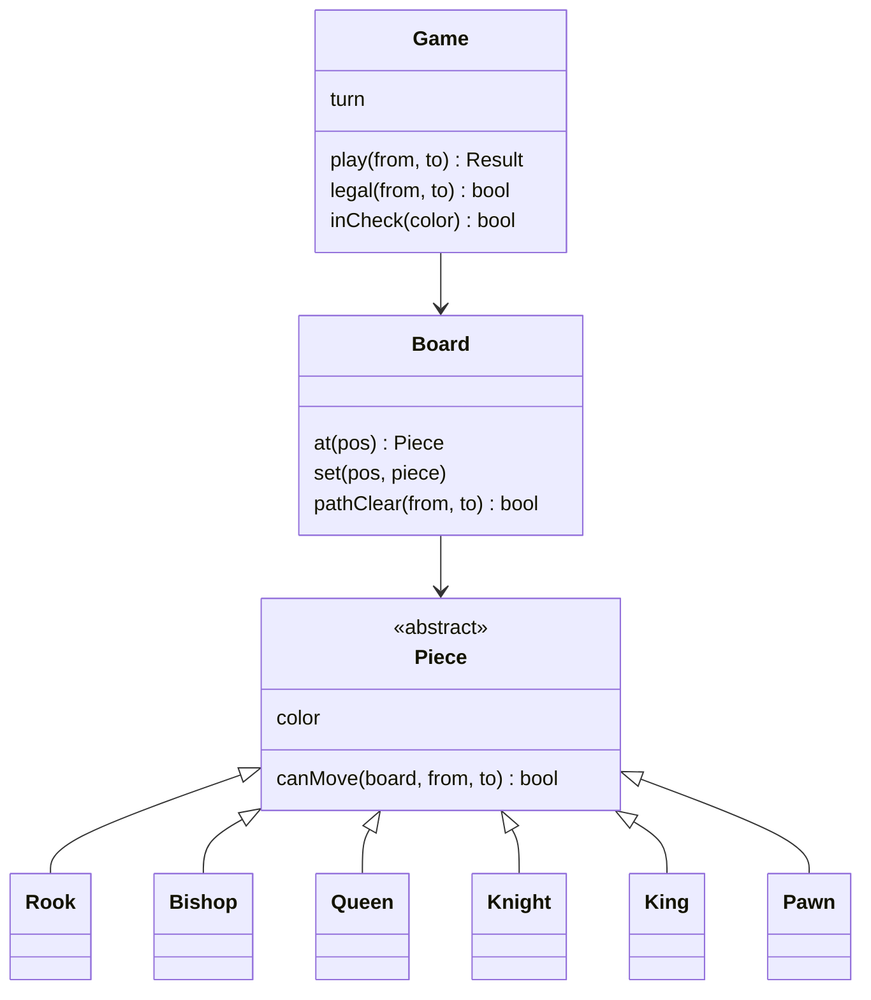

## The hook

A machine-coding round: "Design chess. Two players, legal moves only, detect check and checkmate. You have 90 minutes."

The tempting first version is one function, `isValidMove`, with a switch on the piece type: 200 lines of nested conditions for rooks, bishops, knights, pawns, kings, special cases. It works for the demo. Then the interviewer asks: "Add a new piece that moves like a knight or a bishop." Predict how much of that function you would have to touch, and how many existing pieces you might break.

A cleaner design lets each piece answer one question about itself, and lets the game answer the rest.

## Requirements

- Standard 8 × 8 board, two players taking turns.
- Validate moves per piece: rook, bishop, queen, knight, king, pawn (including the two-square first move and diagonal captures).
- Reject moves that leave your own king in check.
- Detect check and checkmate.
- Extensions to discuss: castling, en passant, promotion, stalemate, undo, move history.

:::analogy
Picture a dance floor where **each piece knows its own dance steps**. The knight knows its L-shaped hop, the bishop its diagonal glide. The floor manager (the game) does not memorise every dance; she asks a dancer "can you get from here to there?", checks nobody is in the way, and checks the move does not leave the king exposed.
:::

## Core objects

- **Piece** (abstract): colour, `symbol()`, `canMove(board, from, to)`.
- **Rook, Bishop, Queen, Knight, King, Pawn**: each implements `canMove`.
- **Board**: 8 × 8 squares, `at`, `set`, and `pathClear(from, to)` for sliding pieces.
- **Game**: whose turn it is, applying moves, legality, check and checkmate.
- **Position**: (rank, file).

## Class design



```pseudo
abstract class Piece:
    color
    canMove(board, from, to) -> bool      // movement rule plus blocking only

class Bishop extends Piece:
    canMove(board, from, to):
        return |dr| == |dc| and board.pathClear(from, to)

class Game:
    legal(from, to):
        piece = board.at(from)
        if piece missing or not my colour: return false
        if target holds my own piece: return false
        if not piece.canMove(board, from, to): return false     // pseudo-legal
        apply move; ok = not inCheck(myColour); undo move      // legal
        return ok
```

Two layers of rules, kept separate:

1. **[[Pseudo-legal move]]**: the piece's own geometry and blocking, in its class through **[[polymorphism]]**.
2. **[[Legal move]]**: does it leave my king attacked? Decided once, by the game, for every piece.

Wait, why not let each piece check whether its move exposes the king? Because the rule is the same for every piece and depends on the whole position. Putting it in the game avoids six copies of the same logic.

## Key flows

**Checking for [[check]]**: find my king, then ask every opponent piece whether it `canMove` to that square.

**Detecting [[checkmate]]**: after a move, if the opponent is in check, try every pair of (from, to) squares for the opponent; if none is legal, it is checkmate. Trying 64 × 64 pairs is fast enough for an interview solution, and simple to get right.

The program plays Scholar's Mate:

| Move | Result | Why |
|---|---|---|
| a1–a3 | illegal | the rook's path is blocked by its own pawn on a2 |
| e2–e4 | ok | pawn's two-square first move |
| e7–e5 | ok | |
| f1–c4 | ok | bishop's diagonal is clear after e4 |
| b8–c6 | ok | knight jumps |
| d1–h5 | ok | queen's diagonal is clear |
| g8–f6 | ok | |
| h5–f7 | **checkmate** | queen captures on f7, protected by the bishop on c4; the black king has no legal escape |

```cpp
#include <bits/stdc++.h>
using namespace std;

enum class Color { White, Black };
struct Pos { int r, c; };                         // r = rank 0..7 (1..8), c = file 0..7 (a..h)
class Board;

// Each piece knows its own movement rules (no giant switch in the game).
struct Piece {
    Color color;
    explicit Piece(Color c) : color(c) {}
    virtual ~Piece() = default;
    virtual char symbol() const = 0;
    virtual bool canMove(const Board& b, Pos from, Pos to) const = 0;   // geometry plus blocking
};

class Board {
    array<array<shared_ptr<Piece>, 8>, 8> sq{};
public:
    shared_ptr<Piece> at(Pos p) const { return sq[p.r][p.c]; }
    void set(Pos p, shared_ptr<Piece> x) { sq[p.r][p.c] = move(x); }
    bool pathClear(Pos a, Pos b) const {           // squares strictly between a and b on a line
        int dr = (b.r > a.r) - (b.r < a.r), dc = (b.c > a.c) - (b.c < a.c);
        for (int r = a.r + dr, c = a.c + dc; r != b.r || c != b.c; r += dr, c += dc)
            if (sq[r][c]) return false;
        return true;
    }
};

struct Rook : Piece { using Piece::Piece; char symbol() const override { return 'R'; }
    bool canMove(const Board& b, Pos f, Pos t) const override { return (f.r == t.r || f.c == t.c) && b.pathClear(f, t); } };
struct Bishop : Piece { using Piece::Piece; char symbol() const override { return 'B'; }
    bool canMove(const Board& b, Pos f, Pos t) const override { return abs(f.r - t.r) == abs(f.c - t.c) && b.pathClear(f, t); } };
struct Queen : Piece { using Piece::Piece; char symbol() const override { return 'Q'; }
    bool canMove(const Board& b, Pos f, Pos t) const override {
        return (f.r == t.r || f.c == t.c || abs(f.r - t.r) == abs(f.c - t.c)) && b.pathClear(f, t); } };
struct Knight : Piece { using Piece::Piece; char symbol() const override { return 'N'; }
    bool canMove(const Board&, Pos f, Pos t) const override { int a = abs(f.r - t.r), c = abs(f.c - t.c); return a * c == 2; } };
struct King : Piece { using Piece::Piece; char symbol() const override { return 'K'; }
    bool canMove(const Board&, Pos f, Pos t) const override { return max(abs(f.r - t.r), abs(f.c - t.c)) == 1; } };
struct Pawn : Piece { using Piece::Piece; char symbol() const override { return 'P'; }
    bool canMove(const Board& b, Pos f, Pos t) const override {
        int dir = color == Color::White ? 1 : -1, start = color == Color::White ? 1 : 6;
        if (t.c == f.c && !b.at(t)) {
            if (t.r == f.r + dir) return true;
            if (f.r == start && t.r == f.r + 2 * dir && !b.at({f.r + dir, f.c})) return true;
            return false;
        }
        return abs(t.c - f.c) == 1 && t.r == f.r + dir && b.at(t);   // diagonal capture
    } };

class Game {
    Board board;
    Color turn = Color::White;
    static Pos parse(const string& s) { return {s[1] - '1', s[0] - 'a'}; }
    Pos findKing(Color c) const {
        for (int r = 0; r < 8; r++) for (int f = 0; f < 8; f++) {
            auto p = board.at({r, f});
            if (p && p->color == c && p->symbol() == 'K') return {r, f};
        }
        return {-1, -1};
    }
    bool attacked(Pos target, Color by) const {
        for (int r = 0; r < 8; r++) for (int f = 0; f < 8; f++) {
            auto p = board.at({r, f});
            if (p && p->color == by && p->canMove(board, {r, f}, target)) return true;
        }
        return false;
    }
    bool inCheck(Color c) const { return attacked(findKing(c), c == Color::White ? Color::Black : Color::White); }
    // A move is legal if the piece can make it and it does not leave its own king in check.
    bool legal(Pos f, Pos t) {
        auto p = board.at(f), cap = board.at(t);
        if (!p || p->color != turn || (cap && cap->color == turn) || !p->canMove(board, f, t)) return false;
        board.set(t, p); board.set(f, nullptr);
        bool ok = !inCheck(turn);
        board.set(f, p); board.set(t, cap);          // undo the trial move
        return ok;
    }
    bool hasAnyLegalMove() {
        for (int a = 0; a < 64; a++) for (int b = 0; b < 64; b++)
            if (legal({a / 8, a % 8}, {b / 8, b % 8})) return true;
        return false;
    }
public:
    Game() {
        auto back = [&](int r, Color c) {
            board.set({r, 0}, make_shared<Rook>(c)); board.set({r, 7}, make_shared<Rook>(c));
            board.set({r, 1}, make_shared<Knight>(c)); board.set({r, 6}, make_shared<Knight>(c));
            board.set({r, 2}, make_shared<Bishop>(c)); board.set({r, 5}, make_shared<Bishop>(c));
            board.set({r, 3}, make_shared<Queen>(c)); board.set({r, 4}, make_shared<King>(c));
        };
        back(0, Color::White); back(7, Color::Black);
        for (int f = 0; f < 8; f++) board.set({1, f}, make_shared<Pawn>(Color::White)), board.set({6, f}, make_shared<Pawn>(Color::Black));
    }
    string play(const string& from, const string& to) {
        Pos f = parse(from), t = parse(to);
        if (!legal(f, t)) return from + to + ": illegal";
        board.set(t, board.at(f)); board.set(f, nullptr);
        turn = turn == Color::White ? Color::Black : Color::White;
        if (inCheck(turn)) return from + to + (hasAnyLegalMove() ? ": check" : ": checkmate");
        return from + to + ": ok";
    }
};

int main() {
    Game g;
    vector<pair<string, string>> moves = {{"e2","e4"}, {"e7","e5"}, {"f1","c4"}, {"b8","c6"},
                                          {"d1","h5"}, {"g8","f6"}, {"h5","f7"}};
    cout << g.play("a1", "a3") << "\n";          // rook blocked by its own pawn: illegal
    for (auto& [f, t] : moves) cout << g.play(f, t) << "\n";   // ends with h5f7: checkmate
}
```

:::try-this
Instead of 3...Nf6, Black plays 3...g6. Can White still play Qh5xf7, and why does the design need no new code to decide? (No. The pawn on g6 now stands on the queen's diagonal from h5 to f7, so the board's pathClear check fails and the queen's canMove returns false: the move is illegal. Running the program with g7–g6 instead of g8–f6 prints "h5f7: illegal". The same generic rules handle it, with no special case.)
:::

## Patterns used

- **Polymorphism / Strategy per piece**: each piece class supplies its own movement rule, so adding a new piece means adding a class.
- **Template for legality**: the game's `legal` method fixes the steps (ownership, pseudo-legal, king safety) for every piece.
- **Command (extension)**: representing each move as an object with `apply` and `undo` gives move history and undo almost for free.
- **Factory**: setting up the initial position, or variants, from a description.

The board-game basics behind this are in [Design Board Games: Snake and Ladder, Tic-Tac-Toe](article:system-design-snake-ladder-tictactoe), and the round strategy in [Build the Model House One Room at a Time](article:system-design-machine-coding-approach).

## Extensions

- **Castling**: track whether king and rooks have moved; the king may not castle out of, through or into check.
- **En passant**: remember the last move; a pawn can capture a pawn that just moved two squares, on the next move only.
- **Promotion**: a pawn reaching the last rank becomes a chosen piece, created by a factory.
- **Stalemate**: not in check, but no legal move: a draw.
- **Undo and history**: store moves as command objects including captured pieces and special-move state.
- **Clocks and online play**: a Player abstraction (human, network, engine) and a game clock.

:::warning
Common misconception: "put all move validation in one function so it is all in one place." That function grows with every piece and special rule, and every change risks breaking other pieces. Split movement rules into the pieces and keep only the shared rules (turns, captures, king safety) in the game.
:::

:::insight
A clean chess design gives each piece its own movement rule and gives the game the rules shared by all pieces. Legality is then "pseudo-legal for the piece, and the king is safe after trying it", and checkmate is "in check and no legal move exists", with no special cases per piece.
:::

### Interview follow-ups

**"How would you make move generation faster for an engine?"** Generate moves per piece from its own square instead of trying all 64 × 64 pairs, use bitboards (64-bit masks per piece type), and update attack maps incrementally.

**"Where would the Queen's logic come from if you want reuse?"** Composition: a Queen's rule is the rook rule OR the bishop rule, so it can delegate to shared helpers rather than inherit from both.

**"How do you test this?"** Unit tests per piece on small positions, plus known game sequences (like the one above) as integration tests, plus tests for each special rule.

## Key takeaways

- Each piece class owns its movement rule through a common canMove method, so new pieces are new classes rather than edits to a giant switch.
- The board provides shared helpers such as pathClear, and the game enforces rules common to all pieces: turns, own-piece captures and king safety.
- A move is legal if it is pseudo-legal for the piece and the player's king is not attacked after trying it.
- Check is "an opponent piece can reach my king"; checkmate is check with no legal move, found by trying candidate moves.
- Special rules such as castling, en passant and promotion, plus undo, extend the design cleanly through extra state and command objects.
