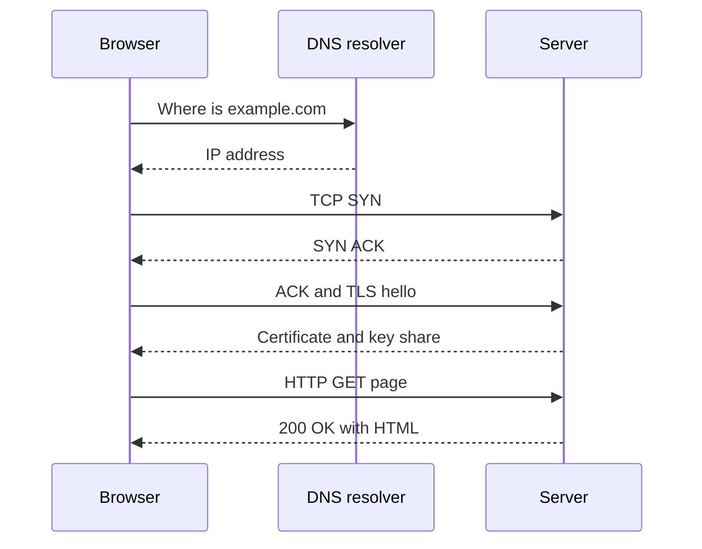

## The hook

You type a web address and press Enter. Half a second later, a page appears. It feels like one action. It is actually a relay race: at least four separate conversations with machines you never see, each one costing a trip across the network before the next can start.

Knowing those legs is not trivia. Almost every speed-up in web architecture, from CDNs to connection pools to HTTP/3, exists to shorten or skip one of them.

## The intuition

:::analogy
Ordering food from a restaurant you have never visited works in stages. First you look up its phone number. Then you call and wait until someone picks up and says hello. Then you agree on a private way to talk, so nobody overhears your card number. Only then do you place the order, and the food comes back. Every stage needs a back-and-forth before the next can begin, and a regular customer who already has the number and an open line skips most of them.
:::

On the web those stages are [[DNS]] (finding the number), [[TCP]] (the call connecting), [[TLS]] (agreeing on privacy), and [[HTTP]] (the order and the food). Each back-and-forth costs one [[round trip time]], which is why a server far away feels slow even when it does very little work.

## How it works

**1. DNS lookup.** The browser asks a resolver for the IP address of the name. If the answer is cached in the browser, the operating system or the resolver, this is nearly free; otherwise the resolver may ask several other servers. DNS gets its own article later.

**2. TCP handshake.** Three short messages (SYN, SYN-ACK, ACK) set up a reliable connection. That costs about one round trip before any data flows.

**3. TLS handshake.** The server proves its identity with a certificate, and both sides agree on encryption keys. With TLS 1.3 this takes about one round trip; older TLS versions needed two.

**4. HTTP request and response.** Finally the browser sends something like `GET /index.html` with headers, and the server answers with a status code such as `200 OK`, headers, and the HTML. Then the browser discovers it needs CSS, scripts and images, and asks for those too.

:::insight
Most of the wait is round trips, not data. A new HTTPS connection over TCP needs roughly three round trips before the first byte of the page arrives. Shrink the distance (CDNs, nearby regions) or reuse connections, and pages get faster without any server getting quicker.
:::

### Reusing connections

With [[keep-alive]], the same connection carries many requests, so only the first one pays for TCP and TLS. Servers keep connection pools to databases and other services for exactly the same reason.

### HTTP versions in one paragraph each

- **HTTP/1.1** sends one request at a time per connection, so browsers open several connections in parallel.
- **HTTP/2** multiplexes many requests over one connection and compresses headers. But it rides on TCP, which delivers bytes in order: one lost packet stalls every stream until it is resent. This is head-of-line blocking.
- **HTTP/3** runs over QUIC, built on UDP. Streams are independent, so a lost packet only delays its own stream, and transport and encryption setup are combined, saving round trips.

### Reading a request

| Part | Example | What it means |
|---|---|---|
| Method | `GET`, `POST`, `PUT`, `DELETE` | read, create, replace, remove |
| Path | `/users/42/orders` | which resource |
| Headers | `Authorization`, `Accept`, `Cookie` | who you are, what you want back |
| Status | `200`, `301`, `404`, `429`, `503` | success, moved, missing, slow down, unavailable |

## Trade-offs

- **Persistent connections vs server resources.** Keeping thousands of idle connections open saves round trips but costs memory and file descriptors. Servers set idle timeouts to balance the two.
- **Security vs setup cost.** TLS adds a handshake, but TLS 1.3 and session resumption make the cost small. Skipping encryption is not a real option for user traffic.
- **HTTP/3 vs operational simplicity.** QUIC avoids head-of-line blocking and handles changing networks well, but some networks treat UDP traffic poorly, so clients still fall back to HTTP/2 over TCP.

## What can go wrong

- **DNS failure or slowness** makes a healthy site unreachable. Low DNS TTLs speed up failover but increase lookups.
- **Slow first request.** A user far from the server pays several long round trips before seeing anything. CDNs and edge termination of TLS cut this.
- **Expired or misconfigured certificates** make the TLS handshake fail, and every client sees a security error even though the servers are healthy. Automated renewal and expiry alerts prevent this surprisingly common outage.
- **Connection storms.** After a deploy or a network blip, every client reconnects at once, and the TLS handshakes alone can overload servers. Gradual rollouts and connection reuse soften the spike.

:::warning
Common misconception: "a faster server fixes a slow page." If most of the wait is round trips to a server on another continent, making its code twice as fast barely helps. Moving content closer, cutting the number of requests and reusing connections usually matter more.
:::

:::try-this
Estimate time to first byte for a new HTTPS connection over TCP to a server 150 ms away (round trip), assuming DNS is cached and TLS 1.3. Count the round trips: TCP handshake, TLS handshake, then the HTTP request and response. (About 3 round trips, so roughly 450 ms before the page starts arriving. A nearby CDN edge at 20 ms brings it to about 60 ms.)
:::

## In the real world

Browsers prefetch DNS and preconnect to domains they expect to need. Large sites terminate TLS at edge locations close to users and then use long-lived connections back to their data centres. Inside companies, services talk over pooled connections, often with HTTP/2 and gRPC. Every piece follows the same rule from the [latency numbers](article:system-design-latency-numbers): round trips are expensive, so pay them rarely and pay them close by.

## Further reading

- MDN Web Docs, "An overview of HTTP" and "Evolution of HTTP": https://developer.mozilla.org/en-US/docs/Web/HTTP
- RFC 8446, The Transport Layer Security (TLS) Protocol Version 1.3: https://www.rfc-editor.org/rfc/rfc8446
- RFC 9114, HTTP/3: https://www.rfc-editor.org/rfc/rfc9114
- Ilya Grigorik, *High Performance Browser Networking* (free online): https://hpbn.co/

## Key takeaways

- Loading a page over HTTPS involves a DNS lookup, a TCP handshake, a TLS handshake and then the HTTP request and response.
- Most of the delay comes from round trips, so distance to the server matters more than raw server speed for the first byte.
- Keep-alive and connection pools reuse connections so later requests skip the handshakes.
- HTTP/2 multiplexes requests over one connection, and HTTP/3 over QUIC removes TCP's head-of-line blocking.
- CDNs, edge TLS termination and fewer requests are the standard ways to make the web feel fast.
