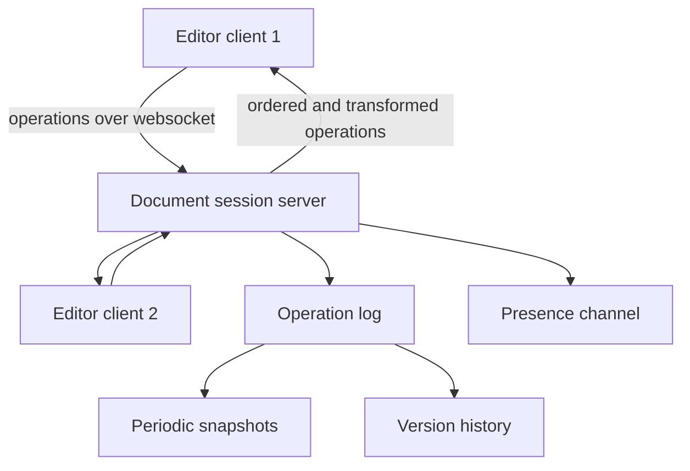

## The hook

Three classmates edit the same project report at 11 pm. Asha fixes a typo in the introduction, Ravi adds a paragraph in the middle, Meera deletes a sentence at the end. Each sees the others' cursors moving, and every change appears on every screen within a fraction of a second. Nobody's work is lost.

If the app saved whole files, the last save would win and two people's work would vanish. If it simply forwarded each keystroke, positions would shift under everyone's feet. Predict what happens when Asha inserts a character at position 1 while Bob deletes the character at position 2, both at the same moment, and the delete is applied as sent. (The wrong character disappears. The whole design exists to stop that.)

## Requirements

**Functional**
- Multiple users edit the same document at the same time; changes appear for everyone in near real time.
- Show presence: who is here, where their cursors are.
- Version history and restore; comments; offline edits that sync later.

**Non-functional**
- All copies converge to the same text; no edit is silently lost.
- Low latency for typing (local edits apply instantly).
- Documents are durable.

:::analogy
Picture **several people writing on one whiteboard** from different sides of the room. If one person adds a word near the start, everyone else's "third word from the left" moves. Writers must keep adjusting where they point, or agree on a scheme that gives every word its own name tag so positions never get confused.
:::

## Back-of-envelope numbers

All **estimates**.

- Most documents have one or a few editors; a few have dozens at once.
- A fast typist produces a handful of operations per second; batching keystrokes every 50 to 100 ms keeps message rates small.
- The heavy part is the number of open documents and connections, not per-document throughput.

## High-level design

- Each open document has one **[[document session]]** server (chosen by consistent hashing on document id).
- Clients send **[[operation]]s** over a persistent connection, as in [Checking the Mailbox vs Hearing the Doorbell](article:system-design-realtime-communication).
- The session server orders operations, transforms them if needed, appends them to a durable log, and broadcasts them.
- Snapshots of the document are saved periodically so loading does not replay the entire log.

## Deep dives

### 1. Why positions need transforming

| Step | Alice's view | Bob's view |
|---|---|---|
| Start | abc | abc |
| Local edit | inserts X at 1 → aXbc | deletes position 2 ('c') → ab |
| Receives the other's operation unchanged | delete 2 → **aXc** (wrong) | insert X at 1 → aXb |
| With OT | delete transformed to position 3 → aXb | aXb |

**[[Operational transformation]]** adjusts an incoming operation against concurrent operations already applied: an insert before your delete position shifts it right by one. With transformation, both copies converge to aXb.

### 2. Making OT manageable: a central order

OT gets complicated when every client transforms against every other in arbitrary orders. Editors typically make the session server the single authority: it assigns each operation a revision number. A client keeps its unacknowledged local operations, and when a server operation arrives, transforms its pending ones against it. Wait, why apply local edits immediately if the server decides the order? Because typing must feel instant; the client applies optimistically and transforms later, and the result still converges.

### 3. The CRDT alternative

A **[[CRDT]]** text type gives every character a unique, ordered identity (for example built from the author's id and a counter). Inserts say "after character id 7", not "at position 3", so positions never shift meaning, and replicas converge whatever order operations arrive in. This suits offline and peer-to-peer editing. The costs are extra metadata per character and more complex garbage collection of deleted characters.

### 4. Presence

**[[Presence]]** (who is here, cursors, selections) is ephemeral and high-frequency. It travels on the same connection but is never persisted; losing an update just means a cursor jumps slightly later. Cursor positions must also be transformed through concurrent edits, so they stay attached to the right text.

### 5. History and durability

The operation log plus snapshots gives version history: restore a version by loading the nearest snapshot and replaying operations up to that point. On reconnect after a network drop, the client sends its last acknowledged revision and receives every later operation, so no edits are lost.

:::insight
Collaborative editing works by sending small operations instead of files and making concurrent operations converge: either a central server orders them and clients transform positions (OT), or every character carries an identity so edits merge in any order (CRDTs). Presence rides alongside as throwaway real-time data.
:::

## Trade-offs

| Decision | Choice | Trade-off |
|---|---|---|
| Convergence | OT with a central server | Compact, proven for online editing; needs the server in the loop |
| Convergence | CRDT | Offline and peer-to-peer friendly; more metadata per character |
| Session placement | One server per document | Simple ordering; a hot document is limited by one server |
| Persistence | Operation log plus snapshots | History and recovery; snapshots must be compacted |
| Presence | Ephemeral, not stored | Cheap; occasional cursor lag |

:::warning
Common misconception: "real-time editing just means broadcasting keystrokes quickly." Without transformation or unique character identities, concurrent edits apply at shifted positions and copies diverge, sometimes deleting the wrong text. Speed does not fix ordering; convergence needs OT or CRDTs.
:::

:::try-this
Document 'hello'. Concurrently, Alice inserts '!' at position 5 (the end) and Bob inserts '?' at position 5. The server receives Alice's operation first. What should both clients end up with, and why? (The server applies Alice's insert, giving 'hello!', then transforms Bob's insert. Both inserted at the same position, so a tie-break rule, such as server order, places Bob's after Alice's at position 6: 'hello!?'. Both clients converge to that text.)
:::

## What can go wrong

- **Divergence** from missing or wrong transformation cases.
- **Lost edits on reconnect** if clients do not resend unacknowledged operations with their base revision.
- **Hot documents** with many editors overloading one session server.
- **Unbounded operation logs** without snapshots and compaction.
- **Cursor drift** when cursors are not transformed with edits.

### Interview follow-ups

**"How would you support offline editing?"** Store local operations with their base revision, and on reconnect transform them against everything that happened meanwhile (OT), or simply merge them (CRDT).

**"How do comments stay attached to text as it changes?"** Anchor them to positions that are transformed like cursors, or to character identities in a CRDT.

**"How would you scale to millions of open documents?"** Spread document sessions across many servers by consistent hashing on document id; each server handles many small sessions.

## Further reading

- Ellis and Gibbs, "Concurrency Control in Groupware Systems" (SIGMOD 1989), which introduced operational transformation.
- Shapiro et al., "Conflict-free Replicated Data Types" (2011).

## Key takeaways

- Collaborative editors send small operations rather than whole documents, applying local edits instantly for responsiveness.
- Concurrent operations shift each other's positions, so they must be transformed (OT) or anchored to unique character identities (CRDTs) for copies to converge.
- Server-centred OT gives one order per document and keeps transformation manageable; CRDTs merge in any order and suit offline and peer-to-peer editing.
- Presence data such as cursors is ephemeral, sent alongside operations but never stored.
- An operation log with periodic snapshots provides durability, version history and lossless reconnection.
