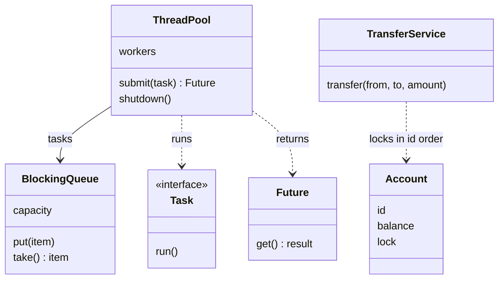

## The hook

Your machine coding solution passes every test you wrote. The interviewer nods, then asks one question: "What happens if two users call `book()` at the same time?"

You look at your code. There is a `if (seat.isFree())` on one line and a `seat.book(user)` on the next. You already know the answer, and so does the interviewer. Between those two lines, there is room for a second thread to walk in.

Concurrency is where machine coding rounds separate people who can write classes from people who can write systems. You do not need a textbook of theory. You need about five tools, the three bugs they prevent, and the habit of spotting shared state. Which tools, and how do you know which one a problem needs?

## Requirements

What an interviewer expects when they say "make it thread-safe":

**Functional**

- Shared counters, maps and objects stay correct under many threads: no lost updates, no torn reads.
- Work handed from one set of threads to another (producer-consumer) neither loses items nor spins the CPU while waiting.
- Background work runs on a bounded set of threads, with a way to get results back.
- Operations that touch two objects, like a transfer between accounts, never deadlock.

**Non-functional**

- Correctness first, then contention: lock as little as needed, for as short as possible.
- Deterministic tests: assert totals and invariants, not interleavings.
- Clean shutdown: threads finish their work and exit; nothing is left blocked.

:::analogy
Think of **two cooks sharing one knife**. The kitchen has one cutting board and one knife. A cook may chop only while holding the knife, so two cooks never slice the same onion at once. When the onions run out, a cook does not keep checking the basket every second; they sit by the counter until the delivery bell rings. And if one cook grabs the knife and waits for the board while the other grabs the board and waits for the knife, dinner never happens. The house rule fixes that: always pick up the board first, then the knife.
:::

## Core objects

The tools, and the kitchen object each one plays:

| Tool | Kitchen version | Use it for |
|---|---|---|
| [[Mutex]] with a scoped guard | The knife | Protecting a [[critical section]] that reads and writes shared state |
| [[Atomic operation]] | A tally counter you click | A single counter, flag or compare-and-set |
| [[Condition variable]] | The delivery bell | Waiting until something becomes true without spinning |
| Blocking queue | The order rail between waiters and cooks | Handing work between threads safely |
| [[Thread pool]] | A fixed kitchen staff | Running many tasks on a bounded number of threads |
| Future | The order ticket you collect food with | Getting a result back from a task |

Wait, why both mutexes and atomics if a mutex can protect anything? Because an atomic is cheaper and cannot be forgotten to unlock, but it only covers *one* variable. The moment an invariant spans two values, like "money leaves A and arrives in B", you are back to a lock.

## Class design



```pseudo
class BlockingQueue(capacity):
    items, lock, notFull, notEmpty            // two condition variables on one lock
    put(x):
        with lock:
            while items.size == capacity: wait on notFull      // releases lock while sleeping
            items.pushBack(x)
            signal notEmpty
    take():
        with lock:
            while items is empty: wait on notEmpty
            x = items.popFront()
            signal notFull
            return x

class ThreadPool(n):
    tasks = BlockingQueue(...)
    start n workers, each: loop { task = tasks.take(); if task is STOP: exit; task.run() }
    submit(f):  promise = new Promise; tasks.put(run f, set promise); return promise.future
    shutdown(): put n STOP markers; join all workers

class TransferService:
    transfer(from, to, amount):
        first, second = order (from, to) by id               // one global order
        with first.lock: with second.lock:
            if from.balance >= amount:
                from.balance -= amount; to.balance += amount
```

### The lost update, slowed down

Before reading on, predict: four threads each add 1 to a shared `count` 100,000 times with no lock. What does it print?

Almost never 400,000, and usually a different number on every run. In C++ it is worse than wrong: an unsynchronized write racing with another access is undefined behaviour. Here is the [[race condition]] slowed down to one lost step:

| Step | Thread 1 | Thread 2 | count in memory |
|---|---|---|---|
| 1 | reads 41 | | 41 |
| 2 | | reads 41 | 41 |
| 3 | writes 42 | | 42 |
| 4 | | writes 42 | 42 |

Two increments, one result. It is the two cooks slicing the same onion. `count++` looks like one step, but it is a read, an add and a write, and another thread can slip between them. Take the knife (a mutex) around the whole read-add-write, or use an atomic increment, and the program prints 400,000 every time.

:::insight
Every concurrency bug in a machine coding round comes from shared, mutable state touched by more than one thread. Find that state first. Then either make the check-and-act on it one indivisible step (a lock or an atomic), or stop sharing it (give each thread its own copy, or pass ownership through a queue).
:::

## Key flows

### Producer and consumer, traced

A blocking queue with capacity 2. One producer puts 1, 2, 3; one consumer takes four times.

| Step | Producer | Consumer | Queue after | Who is asleep |
|---|---|---|---|---|
| 1 | put 1 | | [1] | none |
| 2 | put 2 | | [1, 2] full | none |
| 3 | put 3: full, waits on notFull, lock released | | [1, 2] | producer |
| 4 | | take returns 1, signals notFull | [2] | none after wakeup |
| 5 | wakes, rechecks: size 1 < 2, puts 3, signals notEmpty | | [2, 3] | none |
| 6 | | take returns 2 | [3] | none |
| 7 | | take returns 3 | [] | none |
| 8 | | take: empty, waits on notEmpty | [] | consumer |

Look at step 3. Waiting on a condition variable *releases the lock* while sleeping; otherwise the consumer could never get in to take an item, and both would wait forever. That is the cook putting the knife down before sitting by the bell.

### Wait, why a while loop around wait?

Look at step 5 again: the producer *rechecks* the size after waking. Why not just assume there is space now?

Two reasons. First, with two producers, both can be woken, and the first one through the lock may fill the slot before the second gets there. Second, the language allows spurious wakeups, where a thread wakes with no signal at all. A wakeup only means "check again". The `while` loop, or the predicate form `wait(lock, [] { return !q.empty(); })`, which loops for you, handles both cases.

### The deadlock, traced

Two accounts, A (id 1) and B (id 2). Thread 1 transfers A to B, thread 2 transfers B to A, and each locks the source account first.

| Step | Thread 1 (A to B) | Thread 2 (B to A) |
|---|---|---|
| 1 | locks A | |
| 2 | | locks B |
| 3 | wants B: waits for thread 2 | |
| 4 | | wants A: waits for thread 1 |
| 5 | waits forever | waits forever |

That is the board-and-knife standoff from the kitchen.

The fix is the house rule: every thread takes locks in one global order. Lock the account with the smaller id first, always.

Then thread 2 also starts with A, finds it held, and waits *without holding B*. Thread 1 finishes, releases both, and thread 2 proceeds. A cycle needs someone to hold a "later" lock while waiting for an "earlier" one, and the ordering rule makes that impossible.

In C++17, `std::scoped_lock(a.m, b.m)` locks several mutexes together using a deadlock-avoidance algorithm, so you get the same safety without sorting by hand. Sorting by id is still the answer to give, because it works in every language and across databases too.

:::try-this
Three accounts with ids 1, 2 and 3. Thread X transfers 3 to 1, thread Y 1 to 2, thread Z 2 to 3, each locking the source first. Can they deadlock? What lock order does each thread use under the id rule? (Yes: X holds 3 and waits for 1, Y holds 1 and waits for 2, Z holds 2 and waits for 3, a cycle of three. Under the id rule, X locks 1 then 3, Y locks 1 then 2, and Z locks 2 then 3, so no thread ever waits for a smaller id while holding a larger one, and no cycle can form.)
:::

### Why a pool, not a thread per task

Predict what happens if a server starts a new thread for each incoming request and a burst of ten thousand requests arrives. Ten thousand threads, each with its own stack, all fighting for a few cores. Creation costs time, memory balloons, and context switching eats the CPU.

A thread pool keeps a fixed staff. Tasks wait on the queue; workers take them one at a time. The queue's bound gives [[thread pool|the pool]] backpressure: when it is full, `submit` blocks or rejects, instead of memory growing without limit. As a rule of thumb, CPU-heavy work wants roughly one worker per core, while work that mostly waits on I/O can use more.

:::warning
Common misconception: "Making every method `synchronized` (or locking every method) makes a class thread-safe." Each call is safe on its own, but a *sequence* of calls is not. `if (!map.contains(k)) map.put(k, v)` is two locked calls with a gap between them, and two threads can both see "not contained". The check and the act must happen under one lock, or through one atomic method such as put-if-absent.
:::

### The code

The program runs each tool and prints only results that must be the same on every run: counter totals, the producer-consumer sum, futures read in order, and the total money after opposite transfers.

```cpp
#include <bits/stdc++.h>
using namespace std;

// ---------- 1. a bounded blocking queue: the producer-consumer workhorse ----------
template <class T> class BlockingQueue {
    deque<T> q; size_t cap; mutex m; condition_variable notFull, notEmpty;
public:
    explicit BlockingQueue(size_t c) : cap(c) {}
    void put(T x) {
        unique_lock<mutex> lk(m);
        notFull.wait(lk, [&] { return q.size() < cap; });     // loop hidden in the predicate form
        q.push_back(move(x));
        notEmpty.notify_one();
    }
    T take() {
        unique_lock<mutex> lk(m);
        notEmpty.wait(lk, [&] { return !q.empty(); });
        T x = move(q.front()); q.pop_front();
        notFull.notify_one();
        return x;
    }
};

// ---------- 2. a fixed thread pool built on that queue ----------
class ThreadPool {
    BlockingQueue<function<void()>> tasks{64};
    vector<thread> workers;
public:
    explicit ThreadPool(int n) {
        for (int i = 0; i < n; i++)
            workers.emplace_back([this] {
                while (true) { auto t = tasks.take(); if (!t) return; t(); }   // empty task = stop
            });
    }
    template <class F> auto submit(F f) -> future<decltype(f())> {
        auto p = make_shared<packaged_task<decltype(f())()>>(f);
        tasks.put([p] { (*p)(); });
        return p->get_future();
    }
    ~ThreadPool() { for (size_t i = 0; i < workers.size(); i++) tasks.put(nullptr); for (auto& w : workers) w.join(); }
};

// ---------- 3. accounts: two locks, taken together so no deadlock is possible ----------
struct Account { int id; long balance; mutex m; };
void transfer(Account& from, Account& to, long amt) {
    scoped_lock both(from.m, to.m);                  // locks both with a deadlock-avoidance algorithm
    if (from.balance >= amt) { from.balance -= amt; to.balance += amt; }
}

int main() {
    // A shared counter, 4 threads x 100000 increments, guarded two ways.
    long locked = 0; mutex lm; atomic<long> atomicCount{0};
    vector<thread> ts;
    for (int i = 0; i < 4; i++)
        ts.emplace_back([&] {
            for (int j = 0; j < 100000; j++) {
                { lock_guard<mutex> g(lm); locked++; }
                atomicCount.fetch_add(1);
            }
        });
    for (auto& t : ts) t.join();
    cout << "mutex counter " << locked << ", atomic counter " << atomicCount << "\n";

    // Producer-consumer: 2 producers send 1..1000 each, 2 consumers add up what they take.
    BlockingQueue<int> q(8);
    atomic<long> sum{0}; atomic<int> taken{0};
    vector<thread> pc;
    for (int p = 0; p < 2; p++) pc.emplace_back([&] { for (int x = 1; x <= 1000; x++) q.put(x); q.put(-1); });
    for (int c = 0; c < 2; c++) pc.emplace_back([&] { for (int x; (x = q.take()) != -1;) { sum += x; taken++; } });
    for (auto& t : pc) t.join();
    cout << "consumers took " << taken << " items, sum " << sum << "\n";

    // Thread pool: results come back through futures, read in submission order.
    {
        ThreadPool pool(3);
        vector<future<int>> fs;
        for (int i = 1; i <= 5; i++) fs.push_back(pool.submit([i] { return i * i; }));
        cout << "squares:";
        for (auto& f : fs) cout << " " << f.get();
        cout << "\n";
    }

    // Opposite transfers at the same time: the classic deadlock, avoided.
    Account a{1, 1000}, b{2, 1000};
    thread t1([&] { for (int i = 0; i < 10000; i++) transfer(a, b, 1); });
    thread t2([&] { for (int i = 0; i < 10000; i++) transfer(b, a, 1); });
    t1.join(); t2.join();
    cout << "after 20000 opposite transfers: total " << a.balance + b.balance << "\n";
}
```

It prints `mutex counter 400000, atomic counter 400000`, `consumers took 2000 items, sum 1001000` (two producers each send 1 to 1000, and 2 × 500,500 = 1,001,000), `squares: 1 4 9 16 25`, and `after 20000 opposite transfers: total 2000`. The individual balances of A and B depend on timing; the total cannot. That is the habit to build for tests: assert invariants, not interleavings.

Two details are worth reading slowly. The consumers stop on a poison pill, `-1`, one per producer, so every consumer exits exactly once. And the pool's destructor pushes one empty task per worker and joins them all, which is a clean shutdown.

## Patterns used

| Pattern | Where | Why it earns its place |
|---|---|---|
| Monitor | BlockingQueue and Account own their locks | Callers never lock; the object protects its own state |
| Producer-consumer | BlockingQueue between producers and consumers | Decouples speeds, and the bound gives backpressure |
| Thread pool with futures | ThreadPool.submit | Bounded threads, results returned safely |
| Lock ordering | transfer by account id | Makes deadlock impossible by construction |
| Poison pill | `-1` item, empty task | A clean, in-band shutdown signal |
| Immutability | Values passed through the queue | Data nobody can change needs no lock |

These are the same tools you saw earlier in this track: compare-and-set for parking spots in [Design a Parking Lot](article:system-design-parking-lot), a bounded queue in [Design a Logging Framework](article:system-design-logger-lld), per-client locks in [Design a Rate Limiter in Code](article:system-design-rate-limiter-lld), and sorted per-SKU locks in [Design a Shopping Cart and Inventory](article:system-design-shopping-cart-lld).

## Extensions

### Read-write locks, striping and lock-free

A read-write lock lets many readers in together and a writer alone. It helps only when reads truly do not write; an LRU cache's get writes, as [Design an In-Memory Cache With Eviction Policies](article:system-design-cache-lld) shows. Lock striping splits one map into N segments with N locks. Lock-free code uses compare-and-set loops on atomics; it avoids blocking but is hard to get right, so in a 90-minute round, prefer locks and say where you would go lock-free.

### Thread-safe singletons

In C++11 and later, a function-local `static` object is initialized exactly once even if many threads call the function at once. That is the simplest thread-safe singleton, and it beats hand-written double-checked locking. Whether you should have a singleton at all is a different question.

### Testing concurrent code

- Stress tests: many threads, many iterations, then assert invariants such as totals and uniqueness.
- Run them under ThreadSanitizer (`-fsanitize=thread` in GCC and Clang), which reports data races it observes.
- Inject a clock and, where possible, a deterministic executor that runs tasks one by one, so most logic is tested without threads at all.

### Edge cases worth naming

- **Shutdown while threads wait:** a consumer asleep on an empty queue needs a poison pill or a closed flag plus a notify, or it never exits.
- **Exceptions inside a task:** the future captures them; a raw worker loop that lets one escape kills the thread silently.
- **Holding a lock while calling unknown code:** a callback might take another lock, which is a hidden lock-order violation.
- **Lock held during I/O:** correct, but everyone waits for the disk; move the I/O outside the critical section.
- **Livelock and starvation:** threads that keep retrying politely, or a waiting thread that never gets the lock; fair locks or back-off help.

### Common mistakes

- Check-then-act on shared state in two steps.
- `if` instead of `while` around a condition wait.
- Locking in different orders in different methods.
- A thread per request with no bound.
- Atomics used for an invariant that spans two variables.
- Tests that print interleavings and eyeball them, instead of asserting invariants.

### Interview follow-ups

**"Make this counter thread-safe. Mutex or atomic?"** Atomic, because it is one variable and an atomic increment is exactly the operation needed. Switch to a mutex the moment the update touches a second value.

**"How do you make the booking method in your design thread-safe?"** Find the shared state (the seat), and make check-and-claim one step: a lock on the seat, a compare-and-set on its status, or a conditional update in the database. Never a check on one line and a write on the next.

**"Your pool's queue is full. What should submit do?"** Pick a policy and say it: block the caller (natural backpressure), reject with an error (caller retries), or run the task on the caller's thread (slows the producer). Never grow without limit.

**"How would you detect a deadlock in production?"** A thread dump shows threads blocked on locks held by each other. Prevention is better: one lock order, documented, plus timeouts on lock attempts in places where waiting forever is unacceptable.

**"What changes when the threads are on different machines?"** The knife moves to a shared service, and the hard part becomes a lock holder that crashes or pauses. [One Key to the Shared Room, With a Numbered Tag](article:system-design-distributed-locks-sd) picks up exactly there.

## Key takeaways

- Every concurrency bug in a machine coding round starts with shared mutable state, so find that state first, then make each check-and-act on it a single indivisible step.
- A mutex protects any critical section, an atomic protects a single variable more cheaply, and an invariant that spans two values needs a lock.
- A bounded blocking queue built from one mutex and two condition variables gives safe producer-consumer hand-off, and every wait must sit in a loop that rechecks its condition.
- Deadlock needs a cycle of threads each holding a lock the next one wants, so taking locks in one global order, such as by id, makes it impossible.
- A fixed thread pool with a bounded queue and futures runs many tasks on few threads, and tests should assert invariants like totals rather than particular interleavings.
