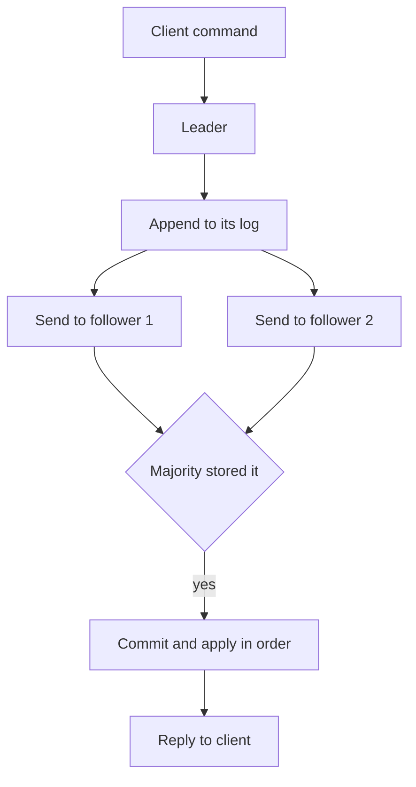

## The hook

Three replicas of your database run in three data centres. At 3 am, the link between data centre A and the other two goes down. A still thinks it is the primary. B and C cannot hear A, so after a timeout they decide A is dead and promote B.

Now two machines believe they are the primary, and both accept payments.

The replication article told you to "elect a new leader by majority and fence the old one". This article is about the machinery that makes that sentence true: consensus. Predict the smallest number of machines that can survive one failure without ever ending up with two leaders. (It is not two.)

## The intuition

:::analogy
A housing society's **committee only acts on majority votes**. Any decision needs more than half the members to sign. Two rival factions can never both pass contradictory decisions, because two majorities of the same committee must share at least one member, and that member will not sign both. If half the committee is away on holiday, nothing gets decided at all, which is annoying but safe.
:::

**[[Consensus]]** is that committee for computers: a group of machines agrees on a value, or on an order of values, even when some crash or messages are delayed. The trick is the **[[majority quorum]]**:

- Any decision needs votes from more than half.
- Any two majorities overlap.
- So two conflicting decisions are impossible.

For the hook: with two machines, a majority is both of them, so one failure stops everything. You need **three** machines to survive one failure: two are still a majority.

## How it works

Most practical systems use consensus to build a **[[replicated log]]**: an ordered list of commands that every member applies in order. Raft, described in [How Five Servers Agree on One Truth](article:famous-algos-raft), is the most widely taught version.

1. Members elect a leader for a numbered **[[term]]**. A candidate needs votes from a majority, and each member votes at most once per term.
2. The leader appends commands to its log and sends them to followers.
3. An entry is **committed** once a majority has stored it. Only then is it applied and acknowledged.
4. If the leader fails, a new election starts with a higher term. A candidate whose log is missing committed entries cannot win, because the majority that stored those entries will refuse to vote for it.

Wait, what about the old leader in the hook, still cut off in data centre A? It cannot commit anything, because it cannot reach a majority. When it reconnects, it sees a higher term and steps down. Safety comes from majorities and terms, not from timing.

### Cluster sizes

| Voting members | Majority | Failures tolerated |
|---|---|---|
| 3 | 2 | 1 |
| 4 | 3 | 1 |
| 5 | 3 | 2 |
| 7 | 4 | 3 |

Four members tolerate no more failures than three, and every write must reach one more machine. That is why clusters use odd sizes, usually 3 or 5.

:::insight
Consensus is safe because any two majorities overlap: no two conflicting decisions can each collect a majority. It stays live only while a majority can talk to each other, so it chooses consistency over availability when the network splits.
:::

## Trade-offs

### What systems use it for

Consensus is precious and expensive, so real systems keep it small and put it where a single agreed answer matters:

- **Leader election**: which replica is the primary for a database shard right now.
- **Configuration and metadata**: which node owns which partition, feature flags, schema versions.
- **Locks and leases**: who may run the nightly job, with fencing tokens; the next article covers this.
- **Membership**: which nodes are in the cluster.

These live in a **[[coordination service]]** (etcd, ZooKeeper, Consul) or in a consensus group built into the database. The bulk data path uses partitioning and replication, and asks the consensus layer only "who leads this shard?"

### Costs

| You gain | You pay |
|---|---|
| One agreed order of decisions, no split brain | Every committed write waits for a majority round trip and durable logging |
| Survives f failures with 2f + 1 members | No progress without a majority |
| Clear leadership with terms | One leader handles all writes for the group |

Rough latency, as an **estimate**: if members sit in different availability zones with about 1 ms between them, a commit costs at least one round trip to the nearest majority plus a disk flush. Across continents, that round trip can be tens to hundreds of milliseconds, which is why globally replicated consensus is reserved for data that truly needs it.

:::warning
Common misconception: "consensus makes everything safe, so route all writes through it." Every consensus write goes through one leader and waits for a majority, so throughput is capped and latency rises. Systems that scale use consensus for metadata and leadership, and partition the data so each shard has its own small group or a simpler replication scheme.
:::

:::try-this
You run a 5-member cluster split across two data centres: 3 in Mumbai and 2 in Pune. The Mumbai data centre goes offline. Can the cluster accept writes? What if it were 2 in Mumbai and 3 in Pune? (With 3 in Mumbai, only 2 remain: below the majority of 3, so writes stop. With 3 in Pune, Pune keeps a majority and continues. Place members so the site most likely to survive holds a majority, or use three sites so no single site failure loses the majority.)
:::

## What can go wrong

- **Even-sized clusters** pay for an extra member with no extra fault tolerance.
- **Too many members** slow every commit; add read-only observers or replicas for read scaling instead of more voters.
- **Losing a majority** stops writes completely; place members across independent failure domains.
- **Slow disks** stall the whole group, because commits wait for durable logging on a majority.
- **Reading from followers** can return stale data; for linearizable reads, go through the leader and confirm it is still leader.
- **Misusing the coordination service** as a general database with large or frequent writes overloads it.

### Interview follow-ups

**"Raft or Paxos?"** Both solve the same problem with majority quorums. Raft was designed to be easier to understand and implement, with a strong leader and a clear log structure. Paxos is the older, more general family. In interviews, explain one clearly rather than comparing details.

**"What is the FLP result?"** It shows that in a fully asynchronous system where even one process may crash, no deterministic algorithm can guarantee consensus always terminates. Practical systems keep safety always and use timeouts and randomised elections so progress happens in practice.

**"How would you elect a leader for a job scheduler?"** Each scheduler tries to acquire a lease key in etcd or ZooKeeper; the one that holds it is leader and renews it; others watch the key and take over when the lease expires. Use the lease's revision number as a fencing token.

## In the real world

- etcd and Consul are built on Raft; ZooKeeper uses its own atomic broadcast protocol (ZAB). Kubernetes stores its cluster state in etcd.
- Many distributed databases run one consensus group per data range or shard, so each group stays small while the whole system scales out.
- The failover and fencing described in [A Teacher Dictating Notes to the Class](article:system-design-replication) rely on exactly this machinery.

Next: the most common thing built on top of consensus, and the most commonly built wrong: distributed locks.

## Further reading

- Ongaro and Ousterhout, "In Search of an Understandable Consensus Algorithm" (the Raft paper, USENIX ATC 2014).
- The consistency and consensus chapter of Martin Kleppmann's *Designing Data-Intensive Applications*.

## Key takeaways

- Consensus lets a group of machines agree on one value or one order of commands despite crashes and delays, usually as a replicated log.
- Majority quorums make it safe: any two majorities share a member, so two conflicting decisions can never both be accepted, and terms reject outdated leaders.
- A cluster of 2f + 1 voters survives f failures; odd sizes of 3 or 5 are standard, and losing the majority stops writes.
- Every consensus write waits for a majority and flows through one leader, so use it for leadership, configuration, locks and membership rather than for all data.
- Coordination services such as etcd, ZooKeeper and Consul package consensus so other systems can use it safely.
