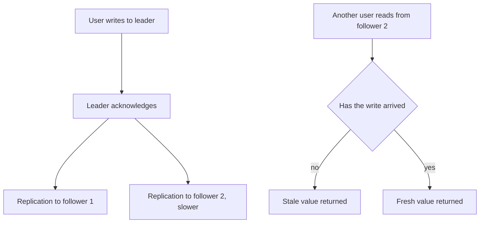

## The hook

You like a friend's photo. The heart turns red. You refresh, and the like count drops by one. You refresh again, and it is back. Nothing is broken. You just watched two copies of the same data disagree for a moment.

Every large system keeps several copies of its data, and copies take time to agree. "Consistency" is the name for the promises a system makes about what you see while they are catching up. Choosing those promises is one of the most important decisions in a design interview.

## The intuition

:::analogy
Picture a college with a main notice board in the office and copies pinned up in every hostel. When the office changes the exam date, a runner carries the update to each hostel board, one by one. For a few minutes, some boards show the new date and some the old. A student in a fast-updated hostel and a student in a slow one can disagree, both reading an "official" notice.
:::

Each notice board is a [[replica]] of the original notice. The runner's delay is [[replication lag]]. The question is what the college promises students while the runner is still on the way.

## How it works

### The two ends of the spectrum

**[[Strong consistency]]** promises that every read sees the latest completed write, as if there were only one notice board. Usually this means reads and writes go through a single leader or a quorum that includes the latest write, and the write is not acknowledged until enough replicas have it.

**[[Eventual consistency]]** promises only that if writes stop, all boards will eventually show the same thing. Reads can go to any nearby replica and return quickly, but they might be stale.

### The guarantees users actually notice

Between the two ends sit smaller promises that fix the most visible problems cheaply:

- **[[Read-your-writes]]**: after you post a comment, you always see it. Implement by sending a user's reads to the leader for a short time after they write, or by remembering the version they wrote and waiting for a replica that has it.
- **[[Monotonic reads]]**: you never go backwards, like the like count that dropped and came back. Implement by sticking each user to one replica.
- **Consistent prefix**: you never see an answer before its question. Implement by keeping causally related writes on the same partition or ordering them.

:::insight
Most users do not need the whole world to be perfectly up to date. They need their own actions to stick and their view never to jump backwards. Those targeted guarantees give most of the user-visible benefit of strong consistency at a fraction of the cost.
:::

### How read-your-writes is built in practice

A common technique uses version tokens. When a write succeeds, the leader returns the position of that write in its replication log, say version 1,042. The client keeps this token, often in a cookie or in the app's memory. On its next read, it sends the token along, and the system routes the read to any replica that has applied at least version 1,042, or to the leader if none has. Other users, who carry no token, read from any replica. The author sees their change immediately, and everyone else still gets fast local reads from whichever replica is closest.

### Choosing per piece of data

Consistency is not one switch for a whole system. A good design labels each piece of data:

| Data | Typical choice | Why |
|---|---|---|
| Account balance, inventory count at checkout | strong | stale reads cause real harm |
| Your own profile edits | read-your-writes | you must see your change |
| Like counts, view counts | eventual | being a second behind harms nobody |
| Feed of other people's posts | eventual with monotonic reads | freshness matters less than not jumping backwards |

## Trade-offs

- **Latency:** strong consistency often means a round trip to a leader or a quorum, possibly in another region. Eventual consistency lets reads hit the nearest replica.
- **Availability:** if the replicas cannot talk to each other, a strongly consistent system may refuse requests rather than risk stale answers; an eventually consistent one keeps answering. CAP and PACELC, covered next, make this precise.
- **Complexity:** eventual consistency moves work to the application: handling stale reads, merging conflicting writes, and explaining odd moments to users.

## What can go wrong

- **Disappearing writes for the author**: the classic "my comment vanished" bug when reads hit a lagging replica without read-your-writes.
- **Overselling**: two buyers both read "1 left" from stale replicas and both pay. Stock decrements need a strongly consistent check, such as a conditional update on the leader.
- **Lag spikes**: a heavy batch job or a slow replica can stretch lag from milliseconds to minutes. Monitor replication lag and stop routing reads to replicas that fall too far behind.

:::warning
Common misconception: "eventual consistency means the data might be wrong forever" or "it means seconds of delay." It means replicas converge once writes stop, and in healthy systems lag is usually small. But "usually" is not a guarantee, so anything that must never be stale, like money, needs a stronger promise.
:::

:::try-this
For an online ticket booking app, label each item as strong, read-your-writes or eventual: the seat map shown while browsing, the "seat held for you" status, the payment record, and the "people viewing this show" counter. (One reasonable answer: seat map eventual, but confirmed at hold time with a strong check; your hold read-your-writes; payment strong; viewers counter eventual.)
:::

### Interview follow-ups

**"A user posts a comment and refreshes, but it is gone. Fix it."** Give read-your-writes: route that user's reads to the primary for a short window after they write, or remember the write's position (log sequence number) and only read from a replica that has caught up past it.

**"What is a quorum and why does R + W > N matter?"** With N replicas, a write waits for W acknowledgements and a read asks R replicas. If R + W > N, every read set overlaps every write set in at least one replica, so a read sees the latest acknowledged write. N = 3, W = 2, R = 2 is the classic choice.

**"Which data needs strong consistency?"** Anything where two people acting on a stale value causes harm: balances, stock counts, unique usernames, seat bookings. Feeds, likes, view counts and recommendations are fine eventually consistent.

## In the real world

Many relational databases send writes to a primary and let applications choose whether reads go to the primary or to replicas. Dynamo-style stores such as Cassandra let each query choose how many replicas must answer, trading latency for freshness per request. Global databases like Google Spanner offer strong consistency across regions by paying with carefully engineered latency. In interviews, saying which data needs which guarantee, and why, matters far more than naming products. This builds directly on the requirements step of the [interview framework](article:system-design-interview-framework).

## Further reading

- Werner Vogels, "Eventually Consistent", Communications of the ACM, 2009: https://cacm.acm.org/research/eventually-consistent/
- Martin Kleppmann, *Designing Data-Intensive Applications*, chapter 5 on replication (O'Reilly, 2017).
- Jepsen, consistency models overview: https://jepsen.io/consistency

## Key takeaways

- Large systems keep several replicas, and replication lag means replicas briefly disagree.
- Strong consistency makes every read see the latest write; eventual consistency only promises that replicas converge when writes stop.
- Targeted guarantees like read-your-writes and monotonic reads fix the problems users notice most, at low cost.
- Choose consistency per piece of data: money and stock need strong guarantees, while counters and feeds can be eventual.
- Stronger consistency costs latency and availability, which is the trade-off CAP and PACELC describe.
