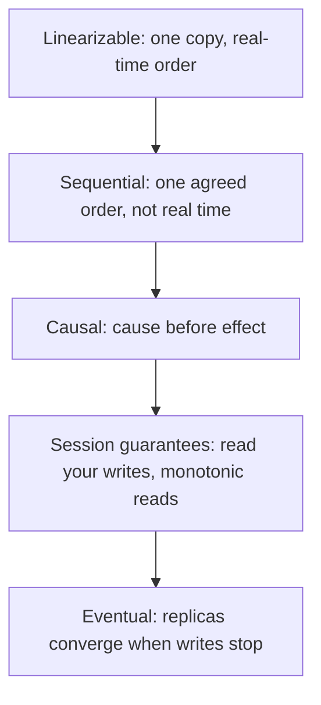

## The hook

You change your profile picture, refresh, and the old one is back. A friend replies to your comment, but someone else sees the reply before your comment exists. A bank shows a balance that ignores a transfer you made a second ago. None of these is a crash. Each is the system keeping, or not keeping, a particular promise about what reads can return when data lives on several replicas.

Those promises are called consistency models. Interviewers expect you to say more than "strong vs eventual": they want to hear which guarantee a feature actually needs and what it costs. As [When the Phone Line Between Branches Goes Dead](article:system-design-cap-pacelc) explained, stronger promises cost latency and availability, so naming the weakest model that is still correct is a real design skill.

## The intuition

:::analogy
Imagine a messenger service that carries updates from a shared notice board to everyone in town. Different services make different promises. The premium service: "the moment a notice is pinned, anyone who asks after that hears it." A cheaper one: "everyone hears notices in the same order, though perhaps late." Another: "you will never hear a reply before the notice it replies to." A personal service: "you will at least always hear your own notices, and never go back to older news." The cheapest: "if people stop pinning notices, eventually everyone hears everything."
:::

Each promise is a [[consistency model]]. Stronger promises need more coordination between messengers, so they are slower and fail more easily when roads are cut.

## How it works

Assume a single value x, replicated, with clients reading and writing concurrently. Each operation has a start and an end.

### Linearizability

[[Linearizability]] is the strongest single-object model. Every operation appears to happen atomically at some instant between its start and end, and those instants are consistent with real time.

Timeline (x starts at 0):

| Time | Client A | Client B | Client C |
|---|---|---|---|
| 1 | write x = 1 starts | | |
| 2 | write x = 1 ends | | |
| 3 | | read x → must be 1 | |
| 4 | | | read x → must be 1 |

Once B has seen 1, nobody may later see 0: the system behaves like one copy. This is what you need for locks, leader election, unique usernames, and "do not sell the last seat twice". It typically requires consensus, such as [How Five Servers Agree on One Truth](article:famous-algos-raft), or reading from a single leader.

### Sequential consistency

[[Sequential consistency]] requires one global order of all operations that every client agrees on, and that respects each client's own order, but not real time. In the timeline above, B reading 0 at time 3 is allowed, as long as everyone agrees B's read came "before" A's write and no client sees the values go backwards relative to that order.

### Causal consistency

[[Causal consistency]] only orders operations that could have influenced each other: if an operation saw a value, or came later in the same session, it is causally after it. Unrelated operations can be seen in different orders by different clients.

| Step | Alice | Bob | Carol sees |
|---|---|---|---|
| 1 | posts "Lost my phone" | | |
| 2 | posts "Found it!" | | |
| 3 | | reads both, replies "Great news!" | |
| 4 | | | allowed: "Lost", "Found", "Great news!" |
| 5 | | | not allowed: "Great news!" before "Found it!" |

Causality is tracked with structures like [Catching Two Edits That Never Saw Each Other](article:famous-algos-vector-clocks). Causal consistency can be provided while staying available during network partitions, which makes it attractive for social features.

### Session guarantees

Weaker but very practical promises, scoped to one client's session:

- **[[Read-your-writes]]**: after you update your profile, you see the update. Implement by reading from the leader for a short time after a write, or by sending the version you wrote and waiting for a replica that has it.
- **[[Monotonic reads]]**: you never see time go backwards. Implement by pinning a user to one replica, or by tracking the newest version seen.
- **Monotonic writes** and **writes-follow-reads** keep a session's own writes in order and after what it read.

### Eventual consistency

[[Eventual consistency]] only promises convergence: if updates stop, all replicas end up equal. Reads may be stale, and different replicas may disagree for a while. Like counts, view counts and recommendation feeds are fine with this, as [Why Your Like Count Can Be Wrong for a Second](article:system-design-consistency-basics) showed.

Each step down the ladder removes a promise and with it some coordination, latency and unavailability.

:::insight
Consistency models are about what clients can observe, not how replication is implemented. Pick by asking what anomaly would hurt this feature: a double-sold seat needs linearizability; a reply before its question needs causal; a user not seeing their own edit needs read-your-writes; a like count lagging needs nothing stronger than eventual.
:::

## Trade-offs

| Model | Guarantees | Cost | Typical use |
|---|---|---|---|
| Linearizable | latest value, real-time order | consensus or leader round trips; unavailable in partitions | locks, leader election, inventory, unique ids |
| Sequential | one global order | coordination; still not partition-tolerant | rarely exposed directly in services |
| Causal | cause before effect | metadata to track dependencies | comments, chats, collaborative apps |
| Session guarantees | per-user sanity | sticky routing or version tracking | profile edits, settings |
| Eventual | convergence only | stale and conflicting reads; need conflict resolution | counters, feeds, caches, DNS |

## What can go wrong

:::warning
Common misconception: "consistency in CAP, consistency in ACID and transaction isolation are the same thing." CAP's C is linearizability of single objects. ACID's C means the database's invariants hold. Isolation, such as serializable or snapshot isolation, governs how concurrent transactions interleave. A database can be serializable yet serve stale reads from a replica.
:::

- **Read from a lagging follower right after a write**: the user sees their old data; fix with read-your-writes routing.
- **Load balancer bouncing a user between replicas** with different lag: values flicker backwards; fix with monotonic reads.
- **Assuming "strongly consistent" in marketing means linearizable**: check exactly which operations are covered, such as single-key reads only.
- **Eventual consistency without conflict resolution**: concurrent writes on different replicas; "last write wins" by timestamp silently drops one, so use version vectors or merge logic where loss matters.
- **Clock-based ordering**: wall clocks drift, so they cannot by themselves give linearizable order; use logical clocks or consensus.

## In the real world

- etcd and ZooKeeper use consensus to provide linearizable writes; etcd serves linearizable reads by default.
- Google Spanner provides external consistency, a form of linearizability for transactions, using tightly synchronised clocks.
- Amazon DynamoDB reads are eventually consistent by default, with an option for strongly consistent reads.
- Cassandra lets each query choose a consistency level, trading latency for how many replicas must answer.
- MongoDB offers causally consistent client sessions.

## Further reading

- Herlihy and Wing, "Linearizability: A Correctness Condition for Concurrent Objects", ACM TOPLAS, 1990.
- Lamport, "How to Make a Multiprocessor Computer That Correctly Executes Multiprocess Programs", IEEE Transactions on Computers, 1979.
- Terry et al., "Session Guarantees for Weakly Consistent Replicated Data", 1994.
- Jepsen, "Consistency Models": https://jepsen.io/consistency

## Key takeaways

- A consistency model is a contract about which values reads can return when data is replicated and accessed concurrently.
- Linearizability makes a replicated object behave like a single copy in real time, which needs consensus or a single leader and costs latency and availability.
- Causal consistency keeps causes before effects without global coordination, and can remain available during partitions.
- Session guarantees such as read-your-writes and monotonic reads fix the most visible user anomalies cheaply.
- Choose the weakest model that prevents the anomalies a feature cannot tolerate, and do not confuse consistency models with transaction isolation.
