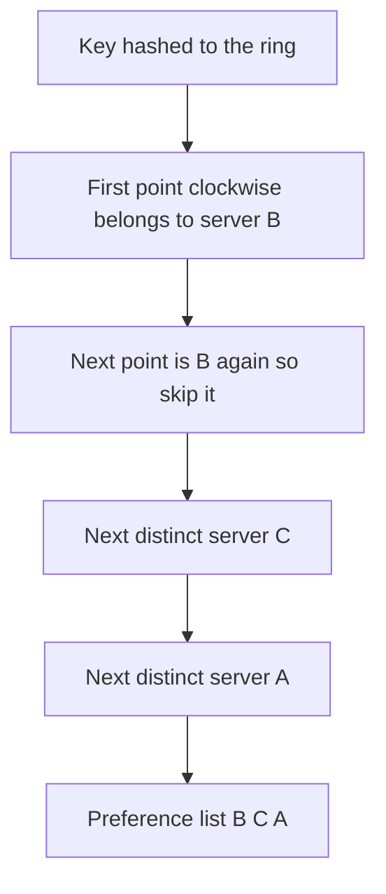

## The hook

Your cache cluster has 4 servers, and keys are placed with `hash(key) % 4`. It is Diwali sale morning, traffic doubles, and you add a fifth server.

Within seconds the database is on fire. Predict why before you scroll.

`% 4` became `% 5`, so almost every key now maps to a different server. About 80% of the cache is suddenly in the wrong place, every lookup misses, and all of it falls through to the database at the worst possible moment. You scaled up and caused an outage.

In interviews, the fix is said in two words: consistent hashing. This article is about saying the next ten sentences well: how the ring is used in a real system, why virtual nodes are not optional, how replicas are placed, and what actually moves when a node joins.

## The intuition

:::analogy
Guests sit at **seats around a round table**, and the dishes are placed around the table's edge. Each dish is served by the first guest clockwise from it. When a new guest pulls up a chair, only the dishes between them and the guest on their left change hands. Nobody else at the table is disturbed.
:::

That table is the **[[hash ring]]**:

- Hash each server onto a point of the circle; hash each key onto the circle too.
- A key belongs to the first server clockwise from its point.
- A new server takes over only the arc between itself and its counter-clockwise neighbour. Everyone else keeps their keys.

The algorithm itself is explained in [Adding a Server Without Moving Everything](article:famous-algos-consistent-hashing). Here we use it as a building block in a design.

## How it works

### Virtual nodes are not optional

Predict how even the load is with 4 servers and one point each. In one simulation (MD5 hash, 100,000 keys), the shares came out as 3,065, 1,343, 40,076 and 55,516 keys. One server held 2.2 times its fair share, another almost nothing. Random points cut a circle into very uneven arcs.

Give each server many **[[virtual node]]s** (many points on the ring) and the arcs average out:

| Points per server | Keys per server (one simulation, 100,000 keys) | Busiest ÷ average |
|---|---|---|
| 1 | 3,065 / 1,343 / 40,076 / 55,516 | 2.22 |
| 10 | 11,923 / 40,141 / 21,691 / 26,245 | 1.61 |
| 100 | 25,398 / 25,006 / 25,199 / 24,397 | 1.02 |

Wait, why does this also help when a server dies? With one point, a dead server's whole arc falls on one neighbour, which may then fall over too. With 100 points, its load is spread across the many servers that sit just after each of its points.

Virtual nodes also handle different machine sizes: give a bigger machine more points.

### Placing replicas

With replication factor N, a key is stored on the first N **distinct physical** servers clockwise from it. That ordered list is the key's **[[preference list]]**. Skipping repeated physical servers matters: with virtual nodes, the next two points might belong to the same machine, and two replicas on one machine is no replica at all.

To survive a whole rack or zone failing, the walk can also skip servers in a zone already used.

### What moves when membership changes

Adding a fifth server to four, in the same simulation with 100 points per server: **19.3% of keys moved**, close to the ideal 1/5, and every one of them moved to the new server. Compare about 80% with `% N`.

That movement is **[[rebalancing traffic]]**: the data copied to the newcomer. Systems throttle it so copying does not starve live traffic, and the newcomer starts serving a range only after it has caught up.

:::insight
Consistent hashing turns "who owns this key" into a walk around a circle, so a membership change only touches the arcs next to the changed node. Virtual nodes make the arcs fair and spread a failure's load, and a distinct-server walk gives each key its replicas.
:::

## Trade-offs

| Option | Movement when a node is added | Balance | Lookup | Notes |
|---|---|---|---|---|
| hash % N | About (N)/(N + 1) of keys | Even | O(1) | Fine only if membership never changes |
| Ring with virtual nodes | About 1/(N + 1) | Even with enough points | O(log of ring size) | Most common in data stores |
| Fixed partitions assigned to nodes | Only whole partitions move | Even | O(1) table lookup | Many systems pre-split into many partitions |
| Rendezvous hashing | About 1/(N + 1) | Even | O(N) per lookup | No ring to maintain; good for small N |

The ring also needs membership agreement: every client and node must see the same set of servers, typically spread by gossip or a coordination service. Two clients with different rings send the same key to different servers.

:::warning
Common misconception: "consistent hashing balances load." It balances the number of keys per server, and only with enough virtual nodes. A single celebrity key still lives on one preference list. Hot keys need caching, replication of that key, or splitting it into sub-keys, as in [Splitting the Phone Book by Surname](article:system-design-partitioning).
:::

:::try-this
A ring has servers A, B and C with 100 points each, replication factor 2. Server B crashes. Roughly what share of keys needs a new replica, and which servers take them? (Every key that had B in its preference list, about two-thirds of keys, since each key's 2 replicas cover 2 of 3 servers. Each such key's next distinct server clockwise takes over, which is spread over A and C because B's 100 points are scattered around the ring.)
:::

## What can go wrong

- **Too few virtual nodes**: one server gets a large share, runs hot and fails first.
- **Inconsistent membership views**: clients route the same key differently, causing misses or split writes; publish one versioned ring.
- **Rebalancing storms**: a new node copying data as fast as possible starves user traffic; throttle and stagger.
- **Cascading failures**: a dead server's load lands on neighbours that were already busy; virtual nodes spread it, and headroom absorbs it.
- **Hot keys**: unaffected by the ring; handle separately.

### Interview follow-ups

**"How many virtual nodes per server?"** Enough that the busiest server is close to average, typically tens to a few hundred; more points mean a bigger ring to store and search. Say you would measure the spread for your node count.

**"How does a client find the owner quickly?"** Keep the ring as a sorted array of (point, server) and binary search for the first point at or after hash(key), wrapping around at the end: O(log P) for P points.

**"What happens to in-flight requests during rebalancing?"** The old owner keeps serving until the new one has the data, then ownership switches in the ring metadata, and clients retry or get redirected if they used the old view.

## In the real world

- Dynamo-style stores such as Cassandra and Riak place data and replicas on a ring with virtual nodes and preference lists.
- Many cache client libraries use consistent hashing so adding a cache server does not wipe the whole cache's effectiveness.
- Load balancers sometimes use consistent hashing (or rendezvous hashing) to keep sessions or cached content sticky to the same backend.

Combine this with replication and the quorums from [Ask Enough People and Someone Heard the News](article:system-design-quorums), and you have the core of a distributed key-value store, the case study that comes next.

## Further reading

- Karger et al., "Consistent Hashing and Random Trees" (STOC 1997), the original paper.
- DeCandia et al., "Dynamo: Amazon's Highly Available Key-value Store" (SOSP 2007), for virtual nodes and preference lists in practice.

## Key takeaways

- With hash % N, changing N moves almost every key; consistent hashing moves only the keys on the arcs next to the changed node, about 1/(N + 1) of them.
- Virtual nodes are essential: they even out each server's share and spread a failed server's load across many servers.
- Replicas go on the first N distinct physical servers clockwise, skipping extra points of servers already chosen, and optionally skipping zones already used.
- Membership must be agreed by all clients, and rebalancing traffic should be throttled so copying does not hurt live requests.
- Consistent hashing balances keys, not traffic: hot keys still need caching, replication or splitting.
