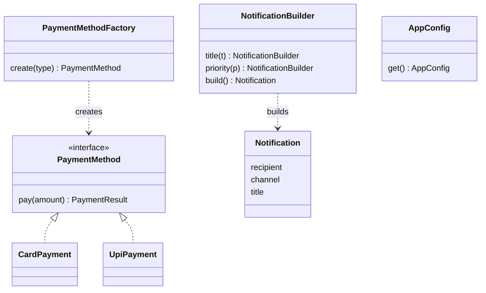

## The hook

Your checkout from the last article is clean now: CheckoutService depends on a PaymentMethod interface and never names a concrete class. Lovely.

Then you search the codebase and find this, copied into the API controller, the retry job, the admin panel and two tests:

```pseudo
if request.type == "card": method = new CardPayment(cardGateway, config)
else if request.type == "upi": method = new UpiPayment(upiClient, config)
else if request.type == "wallet": method = new WalletPayment(walletService)
```

The if-else you killed in the checkout has escaped and multiplied. Something still has to decide which brick to build. Predict where that decision should live, and how many places should know about the concrete classes. The answer is one, and the patterns in this article are how you get there.

## Requirements

Three creation problems from our food-delivery app, each needing a different answer:

- **Choosing a class**: turn "upi" from a request into the right PaymentMethod, with its dependencies, from one place only.
- **Building a complex object**: an outgoing Notification has a recipient and channel (required) plus title, body, image, deep link, priority, expiry, retry policy and tags (all optional).
- **Exactly one of something**: the app's configuration should be loaded once at startup and shared.

:::analogy
A **car factory** builds standard models: you say "the blue hatchback" and it knows which parts, which line and which workers to use. A **custom car configurator** is different: you pick the engine, then the seats, then the wheels, step by step, and only when you press "order" does a car get built, checked as a whole. Factory patterns are the car factory; the Builder pattern is the configurator.
:::

These three are among the creational patterns catalogued in the 1994 book *Design Patterns* by Gamma, Helm, Johnson and Vlissides, often called the Gang of Four. A [[design pattern]] is a name for a solution shape you will recognise again and again.

## Core objects

- **PaymentMethodFactory**: knows how to create each PaymentMethod.
- **Notification** (immutable) and **NotificationBuilder**.
- **AppConfig**: loaded once, shared.

## Class design

### Factory: one place decides

```pseudo
class PaymentMethodFactory:
    constructor(cardGateway, upiClient, walletService, config):
        store them

    create(type) -> PaymentMethod:
        switch type:
            "card":   return new CardPayment(cardGateway, config)
            "upi":    return new UpiPayment(upiClient, config)
            "wallet": return new WalletPayment(walletService)
            default:  throw UnsupportedPaymentType(type)

// Every caller:
method = factory.create(request.type)
```

Wait, isn't that the same if-else? Yes, but now it exists **once**, next to the classes it creates, and every caller depends only on the factory and the interface. Adding pay-later changes one switch and adds one class.

The switch can even disappear with a registry: each PaymentMethod type registers a creator function under its name at startup, and create(type) looks it up in a map. Then a new method is purely additive, which is open/closed in its purest form.

Three flavours you should be able to name:

| Flavour | What it is | Use when |
|---|---|---|
| Simple factory | One class or function with a create(type) method | Most real code; the example above |
| Factory method | A method subclasses override to decide which product to create | A framework lets subclasses customise what gets created |
| Abstract factory | One factory that creates a whole family of related objects | Families must match, such as all light-theme widgets or all test doubles for one provider |

### Builder: many options, readable and safe

The constructor approach falls apart quickly. Predict what this line does:

```pseudo
new Notification(user, "push", "Order placed", null, null, "HIGH", 3600, null, true, null)
```

Nobody can tell which null is the image and which is the deep link, and swapping two strings compiles fine. That is the **[[telescoping constructor]]** problem. A [[builder]] fixes it:

```pseudo
class NotificationBuilder:
    constructor(recipient, channel):     // required fields up front
        set them; set defaults for the rest

    title(t):    this.title = t; return this
    body(b):     this.body = b; return this
    deepLink(u): this.deepLink = u; return this
    priority(p): this.priority = p; return this
    expiresIn(seconds): this.ttl = seconds; return this

    build() -> Notification:
        if channel == "push" and title is empty: throw InvalidNotification
        if ttl <= 0: throw InvalidNotification
        return new Notification(all fields)   // immutable from here on

n = new NotificationBuilder(user, "push")
        .title("Order placed")
        .deepLink("app://orders/501")
        .priority("HIGH")
        .expiresIn(3600)
        .build()
```

Each value is named, defaults live in one place, build() validates the combination once, and the result is an [[immutable object]] that can be shared between threads without locks.

### Singleton: exactly one, and carefully

A [[singleton]] guarantees one instance and a global access point.

```pseudo
class AppConfig:
    private static instance = null
    private constructor(): load settings from file and environment

    static get() -> AppConfig:
        if instance is null:
            instance = new AppConfig()
        return instance
```

Predict the bug. Two request threads call AppConfig.get() at the same moment on a fresh server. Both see null, both construct, and you get two configurations, or a half-built object observed by one thread.

Thread-safe options:

- **Create it eagerly at startup**, before any threads exist. Simplest and usually best.
- **Language-guaranteed lazy initialisation**: in C++11 and later, a function-local `static` is initialised exactly once even with concurrent callers; in Java, the holder-class idiom gives the same guarantee.
- **Double-checked locking**: check, lock, check again, create. It is easy to get wrong without the right memory-visibility guarantees (in Java the field must be `volatile`), so prefer the two options above.



## Key flows

**Pay for an order**: the API handler calls factory.create("upi") and passes the result to CheckoutService.placeOrder. Only the factory names UpiPayment.

**Send a notification**: the order service uses NotificationBuilder, which validates and returns an immutable Notification; the notifier sends it.

**Start the app**: main() loads AppConfig once, then passes it to the factory and services through their constructors.

That last flow is the important twist. The config exists once because main() created it once, not because every class reaches for AppConfig.get().

:::warning
Common misconception: "Singleton is the right way to share anything." A singleton reached from everywhere is a global variable with better manners: any code can depend on it invisibly, tests leak state into each other, and swapping it for a fake is painful. Keep the "one instance" idea, but create it at startup and inject it, as in the dependency-inversion section of [Lego Bricks With Standard Studs](article:system-design-oop-solid).
:::

:::insight
Creational patterns move the question "which concrete object, built how?" into one deliberate place: a factory picks the class, a builder assembles and validates the options, and the composition root (main) decides how many instances exist. Everything else just asks for interfaces.
:::

:::try-this
Your notification system must support three providers for push (two vendors plus a test fake), and each provider needs its own matching HTTP client, credential store and rate limiter. Which creational pattern fits, and why not a simple factory? (An abstract factory: one ProviderKitFactory per provider creates a matching family of client, credentials and limiter. A simple factory picks one class; here the parts must always come from the same family, and an abstract factory makes mismatches impossible.)
:::

## Patterns used

- **Simple factory and registry** for PaymentMethod: one place maps a type name to a class; a registry makes new types purely additive.
- **Builder** for Notification: named optional fields, one validation point, immutable result.
- **Singleton, used sparingly**, for AppConfig: one instance, created at startup and injected.
- **Dependency injection** ties them together: factories and config are passed in, never fetched from globals.

## Extensions

- **"Add pay-later in a hurry."** Add the PayLater class and register it with the factory. No caller changes.
- **"Notifications need A/B variants."** Add a variant(name) step to the builder and validate allowed values in build().
- **"Reload config without a restart."** A singleton with mutable fields becomes a concurrency hazard. Build a new immutable AppConfig and swap one reference atomically; readers see either the old or the new config, never a mix.
- **"Object creation is expensive"** (for example, database connections). That calls for a pool, which hands out and takes back a fixed number of reusable objects, rather than a factory that creates new ones each time.

### Interview follow-ups

**"Factory method vs abstract factory?"** Factory method is one overridable method that creates one product. Abstract factory is an object with several creation methods for a family of related products that must match.

**"Builder vs a constructor with default arguments?"** Default arguments help only for trailing parameters and cannot validate combinations. A builder names every field, allows any order, and validates the whole object once in build().

**"How do you make a singleton thread-safe in C++?"** Return a function-local static (`static Config c; return c;`), which C++11 guarantees is initialised exactly once, or create it eagerly before starting threads.

**"Where have you seen these patterns in libraries?"** String builders and HTTP request builders, logger factories, and connection pools are all common examples you can mention.

Next in this track come the behavioural patterns, such as Strategy, Observer and State, which decide how these objects talk once they exist.

## Key takeaways

- Creational patterns decide which concrete object is created and how, so the rest of the code can depend only on interfaces.
- A factory puts the "which class for this type" decision in one place, and a registry of creators makes adding new types purely additive.
- A builder replaces telescoping constructors with named steps and a single build() that validates and returns an immutable object.
- A singleton guarantees one instance but easily becomes hidden global state, so create such objects once at startup and inject them.
- Make lazily created singletons thread-safe with eager creation or language-guaranteed one-time initialisation, not hand-rolled locking.
