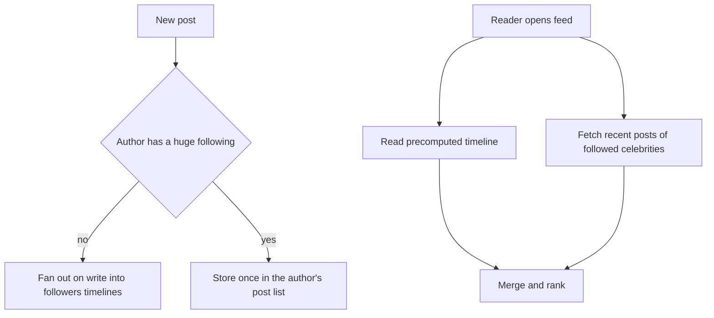

## The hook

A college project's database is beautifully normalised: users, posts, follows, likes, each fact stored once, joined together at read time. It scores full marks.

Then the app becomes popular. The home feed query joins follows to posts to users to likes, sorts by time and takes 20. With 50 million users, that query runs about 500 million times a day, and each run touches thousands of rows across tables. The database melts.

The fix feels like breaking the rules you were taught: store the same data in several places, on purpose. Predict the price you pay for that speed. (Hint: think about what happens when someone changes their profile name.)

## The intuition

:::analogy
Your phone number is stored once at the telephone exchange. But every friend also keeps **a copy of your phone number in their own address book**, because looking it up at the exchange every time they want to call you would be slow. The price: when you change your number, you have to tell everyone, and some will have the old one for a while.
:::

- The exchange is **[[normalisation]]**: one copy, always consistent, but every read has to go and look it up.
- The address books are **[[denormalisation]]**: copies kept where they are read, fast, but every change must be spread, and copies can disagree for a while. That disagreement is an **[[update anomaly]]**, the answer to the hook's question.

## How it works

### Step 1: list the access patterns

At scale, schema design starts from **[[access pattern]]s**, not entities:

| Access pattern | Frequency (estimate) | Latency need |
|---|---|---|
| Load my home feed, newest 20 | Very high | Under 200 ms |
| Load one user's profile and recent posts | High | Under 200 ms |
| Create a post | Medium | Under 500 ms |
| Change my display name | Rare | Can take a while to spread |

Then shape storage so the very frequent queries are single, cheap lookups, and push work onto the rare operations.

### Step 2: denormalise for the hot reads

Before (normalised):

| Table | Columns |
|---|---|
| users | user_id, name, avatar |
| posts | post_id, author_id, text, created_at |
| follows | follower_id, followee_id |

Rendering a feed needs follows → posts → users joins.

After (shaped for the feed):

| Table | Key | Columns |
|---|---|---|
| timeline | (reader_id, created_at desc) | post_id, author_id, author_name, author_avatar, text_preview |
| posts | post_id | full post, author_name copied in |
| users | user_id | name, avatar (source of truth) |

The feed becomes one range read on `timeline` for one reader, no joins. The author's name is copied into every timeline row, which is the price: a name change must update many rows, usually asynchronously.

Wait, why not just keep the name in users and look it up for the 20 posts? You can, with a cache: a batched lookup of 20 author ids from a cache is cheap. Denormalising every field is not required; denormalise what removes the expensive part of the query.

### Step 3: fan-out on write or on read

How do posts get into each reader's timeline?

**[[Fan-out on write]]**: when someone posts, push the post id into the timeline of every follower.
- Reads are a single lookup.
- With 5 million posts a day and 200 followers on average (estimates), that is 10⁹ timeline inserts a day, about 11,600 per second.
- A celebrity with 10 million followers creates 10 million inserts for one post; at 100,000 inserts per second, that takes 100 seconds and crowds out everyone else.

**[[Fan-out on read]]**: store each post once; when a reader opens the feed, fetch recent posts from everyone they follow and merge.
- Writes are cheap; celebrities cost nothing extra to post.
- Each feed load merges many lists. If 50 million users load the feed 10 times a day and follow 300 accounts each, that is 1.5 × 10¹¹ list reads a day.

The common answer is **hybrid**: fan-out on write for normal accounts, fan-out on read for the few huge ones, merged when the feed is loaded. The full case study is in [Design a News Feed](article:system-design-news-feed).

:::insight
At scale, model data around the queries you run most, not around the entities you have. Copy data so hot reads are single lookups, push the work to rarer writes, and accept that the copies must be kept in sync, usually asynchronously.
:::

## Trade-offs

| | Normalised | Denormalised |
|---|---|---|
| Reads | Joins, slower at scale | Single lookups |
| Writes | One place to update | Many copies to update |
| Consistency | Automatic | Copies may lag; needs a sync process |
| Storage | Minimal | More, sometimes much more |
| Flexibility for new queries | High: write a new join | Low: new queries may need new tables |
| Good for | Transactions, rarely changing access patterns | Read-heavy, known, high-volume access patterns |

Most systems mix both: a normalised source of truth for correctness and transactions, plus denormalised read models (timelines, search indexes, caches) derived from it through events.

:::warning
Common misconception: "denormalisation is just bad design that big companies get away with." It is a deliberate trade: faster reads in exchange for more writes and the work of keeping copies in sync. Without a plan for updates (events, background jobs, versioning), copies drift and users see stale or contradictory data.
:::

:::try-this
A user changes their display name. With the denormalised timeline, which records must change, and how would you do it without slowing the request? (Every timeline row and post that copied the old name. Update the users table synchronously, publish a "user renamed" event, and let background workers update the copies in batches; alternatively, copy only the user id and fetch names from a cache at read time.)
:::

## What can go wrong

- **Update anomalies**: copies not updated, showing old names or prices.
- **Write amplification** from fan-out on write for huge accounts.
- **Unbounded rows or partitions**: a single partition holding a celebrity's millions of followers; split it.
- **Modelling without access patterns**, then needing a new table for every new screen.
- **Dual writes** to two stores in application code that fail halfway; use an outbox or change data capture.

### Interview follow-ups

**"How would you model comments with replies for fast loading?"** Partition by post id and sort by (thread, time) so one read returns a post's comments in display order; keep reply counts as denormalised counters updated asynchronously.

**"How do you keep a denormalised counter (likes) correct?"** Update it with atomic increments, or aggregate from an event stream in batches, and periodically reconcile against the source of truth.

**"When is normalisation still the right choice at scale?"** For transactional data where correctness matters more than read speed, such as payments and inventory, with indexes for the hot queries as in [Why Some Queries Are Instant and Others Take Minutes](article:system-design-database-indexing).

## In the real world

- Wide-column and key-value databases recommend designing tables per query (query-first modelling), with partition and sort keys chosen for each access pattern.
- Social feeds commonly use hybrid fan-out, precomputing timelines for most users and merging posts from very large accounts at read time.
- CQRS separates a write model from denormalised read models built from events.

## Further reading

- The data modelling guides for Cassandra or DynamoDB (query-first design, single-table patterns).
- The "Data Models and Query Languages" chapter of Martin Kleppmann's *Designing Data-Intensive Applications*.

## Key takeaways

- At scale, start data modelling from the access patterns: which queries run, how often and how fast they must be.
- Denormalise so that the hottest reads become single lookups, accepting more writes and the job of keeping copies in sync.
- Fan-out on write makes reads cheap but makes posts from accounts with huge followings very expensive; fan-out on read does the reverse.
- Hybrid fan-out, write for most accounts and read for the largest, is the common answer for feeds.
- Keep a normalised source of truth for correctness and derive denormalised read models from it through events.
