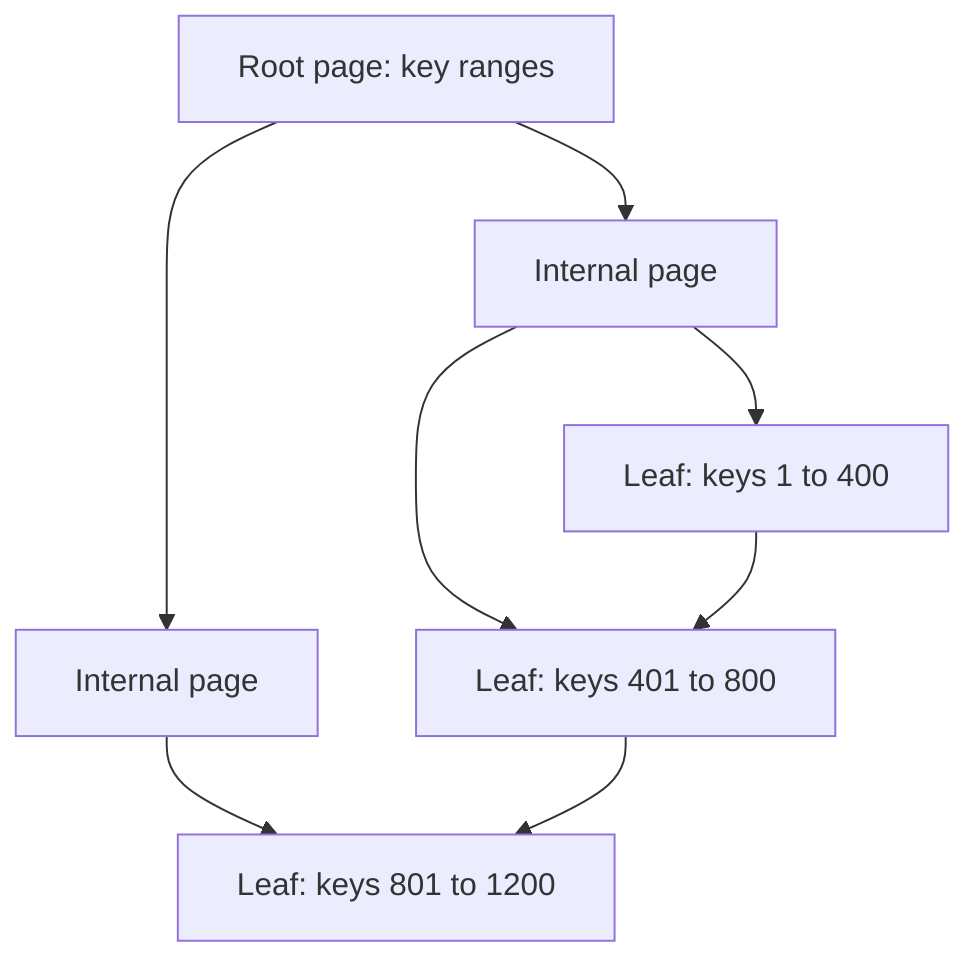

## The hook

A query that took 3 milliseconds yesterday takes 40 seconds today. The code did not change. The table grew from ten thousand rows to fifty million, and the query was quietly reading every one of them.

One line, `CREATE INDEX`, brings it back to milliseconds. Indexes are the most powerful performance tool in a database, and also a cost you pay on every write. Knowing how they work, and which ones to create, is a core system design skill.

## The intuition

:::analogy
To find every mention of "recursion" in a thick textbook, you could read every page. Or you could open the index at the back, find "recursion" alphabetically, and jump straight to pages 112, 340 and 341. The index is extra pages the publisher had to print and keep up to date with every edition, but it turns a day of reading into a minute.
:::

A database [[index]] is that book index. Without one, a query performs a [[full table scan]]: it reads every page. With one, it looks up the value and jumps to the matching rows.

## How it works

### The B+ tree

Most relational databases store indexes as a [[B+ tree]]:

- Each node holds many sorted keys, often hundreds, and pointers to children.
- The tree stays balanced, so every lookup goes from root to leaf in the same small number of steps.
- Leaves hold the keys with pointers to rows (or the rows themselves), and leaves are linked in order, so range queries walk sideways along them.

Because each node branches hundreds of ways, the tree is very shallow. With a fan-out of about 500, three levels address about 500³ = 125 million entries and four levels about 60 billion (estimates). A lookup reads a handful of pages, and the top levels are usually cached in memory.

### Composite indexes and column order

A [[composite index]] on (user_id, created_at) is sorted by user_id, then by created_at within each user, like a phone book sorted by surname then first name.

- `WHERE user_id = 5 ORDER BY created_at DESC LIMIT 20`: perfect; jump to user 5 and read the newest 20 in order.
- `WHERE user_id = 5`: works, using the first column.
- `WHERE created_at > yesterday` alone: cannot use the index efficiently, just as a phone book sorted by surname cannot find everyone named "Priya".

The rule: put equality-filtered columns first, then the range or sort column.

### Covering indexes

If an index contains every column the query needs, the database answers from the index alone, a [[covering index]], skipping the trip to the table rows. That can make a hot query several times faster.

:::insight
An index is a sorted copy of some columns. A query is fast when it can use that sort order: an exact match on the leading columns, then a range or ordering on the next one. Design indexes from your most important queries, not from your table's columns.
:::

### When the database ignores your index

Indexes help when the condition is selective. If a condition matches a large fraction of rows, low [[selectivity]], reading the whole table sequentially can be cheaper than thousands of index jumps, and the query planner will choose the scan. Use `EXPLAIN` to see what the database actually does. Statistics about each column also guide that choice, which is why databases periodically analyse tables; stale statistics can lead the planner to pick a slow plan for a query that used to be fast.

## Trade-offs

- **Reads vs writes.** Every index speeds up some reads and slows down every insert, update and delete that touches its columns, because the index must be updated too.
- **Space.** Indexes take disk and memory; many large indexes push hot data out of the cache.
- **Too many indexes** confuse the planner and multiply write costs; too few leave important queries scanning.
- **B+ trees vs LSM trees.** B+ trees give predictable reads and in-place updates; LSM-based stores trade some read cost for much higher write throughput, as explained in [Why Modern Databases Write So Fast](article:famous-algos-lsm-trees).

## What can go wrong

- **A missing index on a growing table**: fine in development with 1,000 rows, a full scan in production with 50 million.
- **Wrong column order** in a composite index, so the main query cannot use it.
- **Functions on indexed columns**: `WHERE LOWER(email) = ...` cannot use a plain index on email; create an expression index or store a normalised column.
- **Index bloat and write slowdowns** after adding indexes for every report someone once ran.
- **Building an index on a huge live table** can lock it or slow it for a long time; use online or concurrent index builds.

:::warning
Common misconception: "add an index on every column to be safe." Each index costs write time, space and memory, and a separate index on each column is often less useful than one well-ordered composite index for the real query. Index for the queries you actually run, and remove ones nobody uses.
:::

:::try-this
A feed query is `SELECT post_id, created_at FROM posts WHERE author_id = ? ORDER BY created_at DESC LIMIT 20`. Design one index for it, and say why it can be covering. (Index on (author_id, created_at) and include post_id, for example as (author_id, created_at, post_id). Equality on author_id first, ordering by created_at second, and every selected column is in the index, so no table lookups are needed.)
:::

## In the real world

PostgreSQL and MySQL's InnoDB store indexes as B-tree variants; InnoDB clusters the table itself on the primary key, so secondary indexes point to primary keys. Teams review slow-query logs, run `EXPLAIN` on the worst offenders and add or adjust indexes, and also delete unused ones. In interviews, naming the key queries of your design and the indexes that serve them shows you understand where a database's speed really comes from, building on the data choices in [Filing Cabinet, Labelled Boxes or Giant Spreadsheet?](article:system-design-sql-vs-nosql).

## Further reading

- Markus Winand, *Use The Index, Luke!* (free online): https://use-the-index-luke.com/
- PostgreSQL documentation, "Indexes": https://www.postgresql.org/docs/current/indexes.html
- MySQL documentation, "Optimization and Indexes": https://dev.mysql.com/doc/refman/8.0/en/optimization-indexes.html

## Key takeaways

- An index is a sorted structure on some columns that lets the database find rows without a full table scan.
- Relational databases mostly use B+ trees, whose high fan-out keeps them only a few levels deep even for billions of rows.
- Composite index order matters: equality-filtered columns first, then the range or sort column.
- A covering index includes every column a query needs, so the table itself is never read.
- Every index slows writes and uses space, so design indexes from the important queries and verify them with EXPLAIN.
