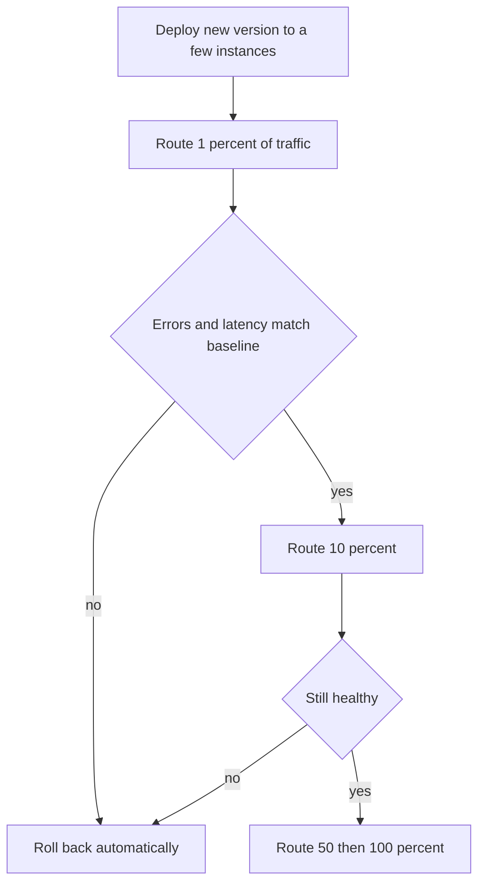

## The hook

Friday, 6 pm. A small change ships to all servers at once: a column renamed in the database and the code updated to match. Within seconds, half the requests fail. Why half? Because the deploy was still rolling: half the servers ran old code that looked for the old column, which no longer existed.

The team rolls back the code. It still fails, because the database change cannot be rolled back by redeploying code.

Most large outages are not caused by hardware. They are caused by changes. So the question is not "how do we never make mistakes" but "how do we make a mistake hurt as few users as possible, for as short a time as possible". Predict the one rule that would have prevented this whole evening. (It is in the migrations section, and it is surprisingly simple.)

## The intuition

:::analogy
A restaurant chain opening a new branch does a soft launch: **open to a few diners first**, watch closely, fix what goes wrong, then open to everyone. The old branch stays open the whole time, so if the new kitchen catches fire, customers are simply sent back to the old one.
:::

Safe deployment is that soft launch:

- Expose the new version to few users first (a small **[[blast radius]]**).
- Watch real signals, compared against the old version.
- Keep a fast way back.
- Make every step work while old and new versions run side by side.

## How it works

### Three strategies

| Strategy | How | Rollback | Extra cost |
|---|---|---|---|
| [[Rolling deployment]] | Replace instances a few at a time | Roll forward or back gradually | Little; capacity dips slightly |
| [[Blue-green deployment]] | Start a full new environment, switch traffic at once | Switch back instantly | Two full environments during the switch |
| [[Canary release]] | Send 1%, then 5%, 25%, 100% of traffic | Stop and shift traffic back | Needs good metrics and automation |

### A canary, step by step

With 1 million active users, a bad canary at 1% affects about 10,000 users for a few minutes, instead of all 1 million. The comparison uses the RED signals from [A Dashboard, a Trip Log and a GPS Trace](article:system-design-observability), measured on the canary and on the old version at the same time, so a traffic spike affects both equally.

### Feature flags

A **[[feature flag]]** separates deploying code from releasing a feature. Ship the code turned off, then enable it for employees, then 1% of users, then everyone, with an instant off switch. Wait, why not just deploy when the feature is ready? Because a flag can be turned off in seconds, while a rollback is a deploy, and may be blocked by a database change.

### Database migrations: expand and contract

Here is the rule from the hook: **every schema change must work with both the old and the new code**, because during a rollout both run at once. That is **[[expand and contract]]**:

| Step | Schema | Code | Safe with old code? |
|---|---|---|---|
| 1. Expand | Add column mobile (nullable) | No change | Yes |
| 2. Dual write | Both columns | Write phone and mobile | Yes |
| 3. Backfill | Copy phone into mobile for old rows, in batches | No change | Yes |
| 4. Switch reads | Both columns | Read mobile | Yes, phone still written |
| 5. Stop old writes | Both columns | Write only mobile | Yes, after all old code is gone |
| 6. Contract | Drop phone | No change | Yes |

Each step is a separate deploy, and each one can be rolled back on its own. Renaming the column in one step, as in the hook, breaks every instance still running the old code.

:::insight
Deployments go wrong in proportion to how much changes at once and how many users see it. Expose new versions gradually with automatic health comparisons, keep a fast way back, decouple release from deploy with flags, and change databases only in steps that both old and new code can live with.
:::

## Trade-offs

| Choice | Gain | Cost |
|---|---|---|
| Small, frequent deploys | Each change is easy to understand and revert | Needs automation and fast pipelines |
| Big, rare releases | Fewer deploy events | Large blast radius, hard to find which change broke things |
| Canary with automatic analysis | Bad versions caught early | Requires trustworthy metrics |
| Blue-green | Instant switch both ways | Double infrastructure briefly; shared database still needs compatible migrations |
| Feature flags | Instant on and off | Flag debt: old flags must be removed |

:::warning
Common misconception: "we can always roll back." Code can be rolled back; data and schema changes often cannot, and external effects such as sent emails or charged cards never can. Design migrations to be backward compatible, and put risky behaviour behind flags, so going back never requires undoing data.
:::

:::try-this
A new version changes the format of messages written to a queue. Old consumers are still running during the deploy. How do you roll it out safely? (Expand and contract for messages: first deploy consumers that understand both the old and new formats, then deploy producers that write the new format, and only after the old format has drained remove support for it. Versioned message schemas make this explicit.)
:::

## What can go wrong

- **Incompatible migrations**, as in the hook.
- **Canary metrics that are too noisy or too slow** to catch a regression before the next step.
- **Comparing the canary against last week** instead of the current old version, so a traffic change looks like a regression or hides one.
- **Configuration changes** pushed globally without a canary; config is code too.
- **Rollbacks that were never tested** and fail when needed.
- **Long-lived feature flags** that nobody removes, making code paths confusing.

### Interview follow-ups

**"How would you deploy to 1,000 servers safely?"** Rolling or canary in waves: one server, then 1%, then 10% per wave, each wave gated on automatic health checks against the baseline, with automatic rollback.

**"How do you add a NOT NULL column to a huge table?"** Add it as nullable with a default handled by code, backfill in batches, then add the constraint once every row has a value, rather than one long locking change.

**"Where do deployments fit with multiple regions?"** Deploy region by region, starting with the least critical or lowest-traffic region, so one bad version never reaches every region at once.

## In the real world

- Container platforms such as Kubernetes provide rolling updates with health checks; service meshes and load balancers can split traffic by percentage for canaries.
- Feature flag services and in-house systems let teams release to segments of users without deploys.
- Online schema migration tools perform large table changes in the background with expand-and-contract style steps.

## Further reading

- *Site Reliability Engineering* (Google), chapter "Release Engineering".
- Martin Fowler's articles "BlueGreenDeployment", "CanaryRelease" and "ParallelChange" (expand and contract).

## Key takeaways

- Most outages come from changes, so deploy in small steps that limit how many users a bad version can reach.
- Rolling deploys replace instances gradually, blue-green switches between two full environments, and canaries send a growing share of traffic while comparing health with the old version.
- Feature flags separate deploying code from releasing features and give an instant off switch.
- Database changes must follow expand and contract: add new structures, migrate code and data, and remove old structures only after no running code needs them.
- Rollbacks only work for code; data changes and external effects must be designed so that going back never requires undoing them.
