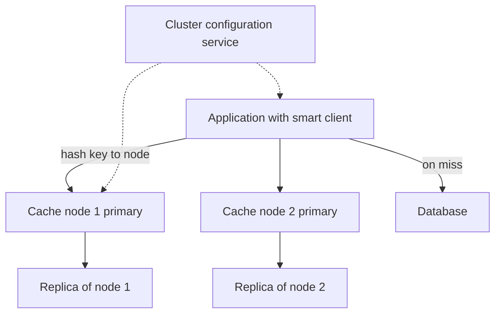

## The hook

Your database can serve about 60,000 reads per second before it struggles. Your product serves 1 million. The difference is a cache cluster answering 95% of reads from memory.

That makes the cache not an optimisation but a load-bearing wall. Now picture one of its 32 nodes failing at peak. Predict what happens to the database within the next second. (Its load jumps by roughly 60%, and if it was already near its limit, the cache failure becomes a database outage.)

Designing a distributed cache is mostly about that moment, and about the one key that everybody wants at once.

## Requirements

**Functional**
- get(key), set(key, value, ttl), delete(key) with sub-millisecond to low-millisecond latency.
- Values up to a few hundred KB; data size around 2 TB (**estimate**).

**Non-functional**
- About 1 million reads and 100,000 writes per second (**estimates**).
- Scale by adding nodes; survive node failures without overwhelming the database.
- Cache data may be lost (it can be rebuilt), but losing it all at once must not take the system down.

:::analogy
A restaurant chain keeps **many small fridges instead of one giant one**. Each fridge holds a known share of ingredients, so cooks go straight to the right one. Popular ingredients are stocked in two fridges. When one fridge breaks, its ingredients are fetched from the warehouse until it is restocked, and the warehouse must not be swamped while that happens.
:::

## Back-of-envelope numbers

All **estimates**.

- Memory: 2 TB of data ÷ 64 GB usable per node ≈ **32 nodes**, plus replicas.
- Normal database load at a 95% hit rate: 1,000,000 × 5% = **50,000 reads per second**.
- One node of 32 fails: its share, 1,000,000 ÷ 32 ≈ 31,000 reads per second, now misses. Database load becomes about 50,000 + 95% × 31,000 ≈ **80,000 per second**, about **1.6 times** normal.

## High-level design

- Keys are spread over **[[cache node]]s** with consistent hashing or a fixed number of hash slots, as in [Seats Around a Round Table](article:system-design-consistent-hashing-sd).
- A **[[smart client]]** caches the cluster map and sends each request directly to the owning node.
- Each primary has a replica for failover.
- The application does cache-aside: read the cache, on a miss read the database and fill the cache.

## Deep dives

### 1. Sharding and rebalancing

With 16,384 fixed hash slots (a common design), each node owns ranges of slots. Adding a node moves some slots to it; only those keys move. Clients learn the new map from the configuration service or from redirect responses.

### 2. Replication and failover

A primary asynchronously copies writes to its replica. If the primary dies, the replica is promoted, so most of that node's keys survive and the miss storm in the estimate is avoided. The cost: a few recent writes may be lost, which is acceptable for a cache.

### 3. Eviction and expiry

When memory is full, the **[[eviction policy]]** removes keys: LRU or an approximation of it is common; LFU suits workloads with steady favourites. TTLs bound staleness. The single-node mechanics are in [Design an In-Memory Cache With Eviction Policies](article:system-design-cache-lld).

### 4. Protecting the database

Predict the second-worst moment after a node failure: a popular key expires and 5,000 requests miss at once. Defences, from [When the Bakery Reopens](article:system-design-cache-problems):

- **[[Request coalescing]]**: one request reloads the key; the rest wait for it.
- **TTL jitter** so keys loaded together do not expire together.
- **Replicas**, so a node failure promotes a warm copy instead of emptying a shard.
- **Database-side limits** (connection pools, load shedding) so a miss storm degrades instead of crashing.

### 5. Hot keys

A **[[hot key]]** lives on one node by design. If 200,000 reads per second hit it, that node saturates while the others idle. Fixes:

- Read from replicas as well as the primary for that key.
- Copy the key under several names (key#1 … key#8) and pick one at random.
- Keep a tiny in-process cache in each application server for the hottest keys, refreshed every second or two.

Wait, why not just make that node bigger? Because a single key's reads still go to one place; vertical scaling raises the ceiling once, while spreading copies removes it.

:::insight
A distributed cache spreads keys across many memory nodes with consistent hashing, replicates each shard so a failure promotes a warm copy, and evicts with LRU and TTLs. The hard part is protecting the database from miss storms and protecting single nodes from hot keys.
:::

## Trade-offs

| Decision | Choice | Trade-off |
|---|---|---|
| Routing | Smart clients | One network hop; client libraries per language |
| Replication | Async primary to replica | Fast writes and quick failover; may lose recent writes |
| Eviction | Approximate LRU plus TTL | Good hit rates; occasional eviction of useful keys |
| Hot keys | Local in-process cache | Removes the bottleneck; slightly stale for a second or two |
| Consistency with the database | Delete on write, TTL as a backstop | Simple; short staleness windows |

:::warning
Common misconception: "the cache is optional, so its failures do not matter." Once traffic has grown, the database is sized for the cache's hit rate. Losing a node, or the whole cache, sends the full read load to a database that cannot handle it. Treat the cache as critical infrastructure with replicas, failover and miss-storm protection.
:::

:::try-this
The cluster grows from 32 to 40 nodes. With consistent hashing, roughly what fraction of keys move, and what happens to the database during the move? (About 8 of 40, or 20% of keys, move to the new nodes. Those keys miss until refilled, so database load rises temporarily; add nodes gradually and off-peak, or pre-warm them by copying slots before switching ownership.)
:::

## What can go wrong

- **Miss storms** after node failures or mass expiry.
- **Hot keys** saturating one node.
- **Big values** (multi-megabyte) blocking a node's event loop; cap value sizes.
- **Stale data** after writes when invalidation fails; use TTLs as a safety net.
- **Clients with stale cluster maps** sending requests to the wrong node; handle redirects.
- **Memory fragmentation** reducing usable memory over time.

### Interview follow-ups

**"Write-through or cache-aside for this design?"** Cache-aside is the usual default: simple, and the cache only holds data someone read. Write-through suits data read immediately after writing.

**"How would you warm a new cluster?"** Replay recent read traffic or bulk-load the most popular keys before switching traffic, so the database does not see a cold-cache spike.

**"How do you measure success?"** Hit rate, latency percentiles per node, evictions per second, memory usage, and database load during node failures.

## Further reading

- The Redis Cluster specification (hash slots, replication, failover).
- Nishtala et al., "Scaling Memcache at Facebook" (NSDI 2013).

## Key takeaways

- A distributed cache spreads keys over many memory nodes with consistent hashing or hash slots, and smart clients route each key to its owner directly.
- At a 95% hit rate, losing one of 32 nodes raises database load by about 60%, so replicas and fast failover are essential.
- Eviction with LRU or LFU plus TTLs keeps memory bounded and staleness limited.
- Request coalescing, TTL jitter and database-side limits protect against miss storms.
- Hot keys need replicated copies or small in-process caches, because one key always lives on one node.
