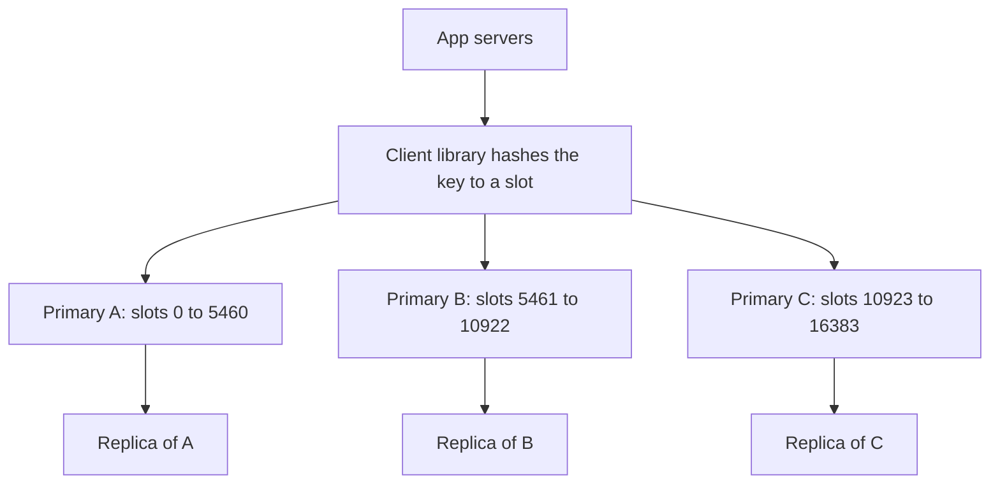

## The hook

Your app runs on fifty servers. Each one keeps a little in-memory cache of user profiles. A user changes their photo; one server updates its copy, and the other forty-nine keep showing the old one until their entries expire. After every deploy, all fifty caches start empty and hammer the database together.

The usual fix is to move the cache out of the app servers into its own cluster that every server talks to. In practice, that cluster is very often Redis.

## The intuition

:::analogy
Think of an office where every employee keeps their own sticky notes about customers. Notes go out of date, get thrown away when someone leaves, and two people's notes disagree. So the office puts up one big shared whiteboard in the hallway. Anyone can read it in a few steps, everyone sees the same information, and it stays up when an employee goes home.
:::

The shared whiteboard is a [[distributed cache]]. It is a short network hop away, not inside your process, but it is still far faster than the database, and it gives the whole fleet one view.

## How it works

### Two common choices

- **[[Memcached]]**: a simple, multi-threaded key-value cache. Values are opaque blobs, there is no persistence, and clients spread keys across servers with consistent hashing. Excellent for plain object caching.
- **[[Redis]]**: an in-memory data structure server. Besides strings, it has hashes, lists, sets, [[sorted set]]s, bitmaps, HyperLogLogs and streams, plus TTLs, atomic operations and scripting, optional [[persistence]] and built-in replication and clustering.

### What teams use Redis for

| Job | Redis feature | Example |
|---|---|---|
| Caching | strings or hashes with TTL | user profiles, rendered fragments |
| Sessions | key with TTL | logged-in session data |
| Counters and rate limits | atomic `INCR`, Lua scripts | API rate limiting, view counts |
| Leaderboards | sorted sets | top players, trending posts |
| Unique counts | HyperLogLog | daily unique visitors |
| Distributed locks | `SET key value NX PX` | short exclusive jobs (with care) |
| Lightweight queues | lists and streams | background jobs, event fan-out |

The sorted-set leaderboard and HyperLogLog counts rely on algorithms covered in this app, such as [Counting a Billion Visitors With Twelve Kilobytes](article:famous-algos-hyperloglog).

### Scaling out: sharding and replication

One Redis node is limited by its memory and, since commands run on a main thread, by one CPU core for command execution. Redis Cluster splits the key space into 16,384 hash slots and assigns slot ranges to primary nodes; each primary has [[replica]]s that take over on failure. Clients route each key to the node owning its slot.

:::insight
A distributed cache is more than a faster copy of the database. Its data structures, atomic operations and TTLs make it the natural home for fast, shared, slightly temporary state: counters, sessions, rankings and rate limits. Use it for state you can afford to rebuild, and keep the source of truth elsewhere.
:::

### Persistence options

Redis can snapshot memory to disk periodically (RDB), append every write to a log (AOF), or both. Snapshots lose writes since the last snapshot on a crash; the append-only log loses at most about a second with the common `everysec` setting. Replication to replicas is asynchronous, so a failover can lose the most recent writes.

## Trade-offs

- **Local vs shared cache:** a local in-process cache costs nanoseconds and no network, but each server has its own copy; a shared cache costs a network round trip, roughly sub-millisecond in a data centre, but is consistent across the fleet. Many systems use both: a tiny local cache in front of Redis for the hottest keys.
- **Memcached vs Redis:** Memcached is simpler and scales across cores in one process; Redis offers data types, persistence and replication.
- **Memory cost:** RAM is expensive, so cache the hot subset, set TTLs and choose an eviction policy.
- **Cache vs database:** Redis with persistence can hold important data, but its durability and consistency guarantees are weaker than a replicated database's.

### A quick estimate

10 million active sessions at about 1 KB each need about 10 GB, plus overhead: comfortably one node, or a small cluster for headroom and redundancy. 200 million cached product pages at 20 KB each need about 4 TB, which means a large sharded cluster, or caching only the most popular few percent. All figures are estimates; the point is to size the cache from what is actually hot.

## What can go wrong

- **Hot keys**: a single viral key overloads one shard; replicate it, add a local cache, or split it into several keys.
- **Big keys**: a huge list or hash blocks the main thread while being read or deleted; keep values small and use incremental commands.
- **Cache stampede** after a hot key expires; use request coalescing, early refresh or locks, as discussed in [Keep the Spices on the Counter](article:system-design-caching).
- **Lost writes on failover** because replication is asynchronous; do not store anything you cannot afford to lose without extra safeguards.
- **Unsafe locks**: Redis-based locks need expiry times and fencing tokens, or a paused client can act after its lock has expired.

:::warning
Common misconception: "Redis is just a cache." It is often used as one, but its data structures make it a fast, shared state server for counters, rankings, sessions and queues. The real question is not "cache or not" but "can I rebuild or tolerate losing this data?". If not, the source of truth belongs in a durable database.
:::

:::try-this
Design the storage for a game leaderboard with 5 million players, updated on every match, needing the top 100 and any player's rank instantly. Which Redis structure and commands? (One sorted set: `ZADD` or `ZINCRBY` to update a score, `ZREVRANGE 0 99` for the top 100, `ZREVRANK` for a player's rank, each O(log n). Persist results to a database periodically as the source of truth.)
:::

## In the real world

Redis and Memcached sit in front of databases at most large web companies. Facebook's paper "Scaling Memcache at Facebook" describes running Memcached at very large scale with regional pools, leases to prevent stampedes, and invalidation from the database's commit log. Managed services like Amazon ElastiCache, Google Memorystore and Redis's own cloud offering run clusters for teams that do not want to operate them. In interviews, a distributed cache appears in almost every read-heavy design.

## Further reading

- Redis documentation, "Data types": https://redis.io/docs/latest/develop/data-types/
- Redis documentation, "Scale with Redis Cluster": https://redis.io/docs/latest/operate/oss_and_stack/management/scaling/
- Nishtala et al., "Scaling Memcache at Facebook", NSDI 2013.

## Key takeaways

- A distributed cache is a shared in-memory cluster that gives every app server the same fast view and survives app deploys.
- Memcached is a simple key-value cache; Redis adds rich data structures, atomic operations, persistence and replication.
- Redis Cluster shards keys across primaries by hash slot, with replicas for failover.
- Typical jobs are caching, sessions, counters, rate limits, leaderboards, unique counts and lightweight queues.
- Watch for hot and big keys, stampedes and asynchronous replication losing recent writes, and keep the source of truth in a durable store.
