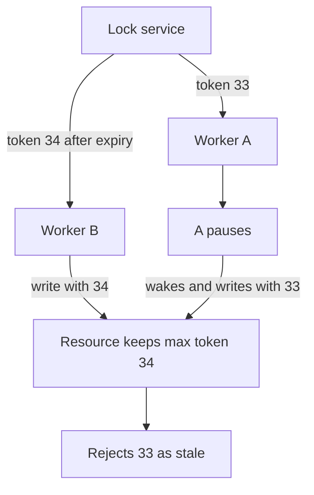

## The hook

A nightly job charges every customer's subscription. It must run exactly once, so you protect it with a distributed lock with a 30-second expiry, renewed every 10 seconds. Two copies of the job start on two machines; only one gets the lock. Perfect.

One night, the lock holder freezes for 40 seconds during a long garbage-collection pause. Its lock expires. The second machine takes the lock and starts charging customers. Then the first machine wakes up, still convinced it holds the lock, and carries on charging too.

Some customers are charged twice. The lock service did nothing wrong; it worked exactly as designed. Before reading on, think about who could possibly have stopped the first machine. (It was not the first machine itself.)

## The intuition

:::analogy
An office has **one key to a shared room**. Whoever holds the key may use the room. The key is lent out for an hour at a time, so a person who leaves with it does not lock everyone out forever. But someone who falls asleep inside might wake up after the hour, after the key was lent to someone else, and walk in anyway. So every time the key is lent, it gets a **numbered tag**: 41, then 42, then 43. The room's door remembers the highest tag it has seen and refuses anyone showing a lower one.
:::

Mapping it across:

- The key is a **[[distributed lock]]**.
- Lending it for an hour is a **[[lease]]**: the lock expires unless renewed.
- Falling asleep is a **[[process pause]]**: GC, swapping, a VM being migrated.
- The numbered tag is a **[[fencing token]]**, checked by the resource itself.

## How it works

### Leases: locks that expire

A lock without expiry is dangerous: if the holder crashes, nobody can ever take it again. So distributed locks are leases. The holder must renew before expiry; if it stops renewing (crashed, partitioned, paused), the lock becomes available.

That fixes crashes and creates the hook's problem: the lock service cannot tell a crashed holder from a paused one. When the pause ends, the old holder does not know time has passed.

Wait, why can't the holder just check the clock before each write? Because the pause can happen between the check and the write. "Check, then act" is never atomic across a pause.

### Fencing: let the resource say no

Every grant comes with a number that only increases. The holder sends that token with every write. The resource (the database, the storage service, the payment ledger) stores the highest token it has accepted and rejects anything lower.

The whole timeline from the hook, fenced:

| Time (s) | Worker A | Worker B | Lock service | Resource (max token seen) |
|---|---|---|---|---|
| 0 | gets lock, token 33 | waits | lease to A until 30 | 0 |
| 5 | writes with 33 | | | accepts, max 33 |
| 10 | GC pause starts | | | |
| 30 | (paused) | | A's lease expires | |
| 31 | (paused) | gets lock, token 34 | lease to B | |
| 32 | (paused) | writes with 34 | | accepts, max 34 |
| 50 | wakes, writes with 33 | | | **rejects** 33 < 34 |

The answer to the hook's question: the resource stopped it.

:::insight
A lease protects against crashed holders, and a fencing token protects against paused ones. Only the resource can reject a stale holder, because only the resource sees both the old and the new holder's writes. A lock without fencing is a hint, not a guarantee.
:::

### Where the lock comes from

- **A consensus-backed store** (etcd, ZooKeeper, Consul): the lock is a key with a lease, and the key's revision or sequence number makes a natural fencing token. Safe because the store itself never has two conflicting views, as in [A Committee That Only Acts on Majority Votes](article:system-design-consensus-overview).
- **A database row**: `UPDATE locks SET owner = me, token = token + 1, expires = now + 30 WHERE name = 'job' AND expires < now`. Strongly consistent if the database is.
- **A single Redis instance**: `SET lock <random value> NX PX 30000` acquires; release with an atomic "delete only if the value is still mine". Simple and fast, but a failover of that Redis can lose the lock entry, and the random value is not an increasing fencing token.

Multi-node Redis locking schemes exist, and their safety under clock drift and process pauses has been publicly debated. In an interview, say plainly: for correctness, use a consensus-backed lock and fencing tokens.

## Trade-offs

Not every lock needs the full treatment. Decide which kind you have:

| | [[Efficiency lock]] | [[Correctness lock]] |
|---|---|---|
| Purpose | Avoid duplicate work | Prevent corruption or double effects |
| Cost of two holders | Wasted compute | Wrong data, double charges |
| Good enough | A single Redis with a lease | Consensus-backed lease plus fencing token checked by the resource |
| Example | Regenerating a cache entry | Charging customers, writing a shared file |

### Leader election is a lock

"Only one scheduler should assign jobs" is a lock named "leader". Candidates race to acquire a lease key; the winner renews it and acts as leader; the others watch the key and take over when it expires. The leader includes its token (its term) in every action, and downstream systems reject older terms, exactly the fencing rule again.

:::warning
Common misconception: "my lock has a timeout, so it is safe." A timeout guarantees that a dead holder eventually releases the lock. It does not stop a paused holder from acting after its lease ended. Without a fencing check at the resource, two processes can both believe they hold the lock.
:::

:::try-this
A job writes report files to object storage, and the storage cannot check tokens. You still need at most one effective writer per report. What can you do? (Make the write itself conditional: write to a path that includes the token, such as report-v34, and have readers use the highest version; or use the storage's conditional-write feature, such as writing only if the object's version matches what you last read. If the resource can check anything monotonic, you can fence.)
:::

## What can go wrong

- **No fencing**: the hook's double charges.
- **Releasing someone else's lock** with a plain delete after your lease expired; always compare-and-delete.
- **Lease too short**: normal pauses or slow networks cause false expiry and constant leader churn.
- **Lease too long**: a crashed holder blocks progress for the whole lease.
- **Clock assumptions**: lease checks that depend on synchronised wall clocks across machines break when clocks jump; consensus stores measure leases on their own side.
- **Lock service as a single point of failure**: a single Redis or a single database row stops all lock-protected work when it is down.

### Interview follow-ups

**"How would you ensure a cron job runs once across 10 servers?"** All 10 try to acquire a lease in etcd or a database row; the winner runs and renews; the job's writes carry the lease's token, and the target tables reject smaller tokens. If the job is idempotent, a rare duplicate is harmless anyway, which is even better.

**"Can you avoid locks entirely?"** Often, yes: idempotent operations with unique keys, conditional writes (compare-and-set on a version number), or routing all work for one key to one partition owner. Locks are a last resort for coordination.

**"Why not use the database's own row lock?"** Within one database transaction, use it. Distributed locks are for coordinating actions that span services or long-running work outside a single transaction.

## In the real world

- Coordination services such as etcd, ZooKeeper and Consul provide lease-based locks and leader election recipes, with revision or sequence numbers usable as fencing tokens.
- Job schedulers and controllers commonly elect a leader through such a lease so only one instance acts at a time.
- Martin Kleppmann's essay "How to do distributed locking" (2016) is a widely cited explanation of process pauses and fencing tokens.

The pause problem here is one example of a deeper fact: in a distributed system you cannot rely on clocks or timing to order events. That is the next topic, time and ordering, and it builds on the same lesson as [One Stronger Horse or a Team of Horses?](article:system-design-vertical-horizontal): coordination is the expensive part of going wide.

## Further reading

- Martin Kleppmann, "How to do distributed locking" (2016).
- The etcd documentation on leases and the concurrency (lock and election) API.
- The "Knowledge, Truth and Lies" sections on process pauses and fencing in *Designing Data-Intensive Applications*.

## Key takeaways

- Distributed locks are leases that expire, so a crashed holder cannot block others forever, but a paused holder can wake up after its lease ended and still act.
- Fencing tokens fix this: each grant gets an increasing number, and the protected resource rejects any request with a smaller number than it has already seen.
- Use a strongly consistent, consensus-backed store for locks that protect correctness; a single Redis lock is acceptable only for efficiency locks where duplicates are harmless.
- Release locks with an atomic compare-and-delete so you never remove a lock that someone else now holds.
- Leader election is a lock on "leader", and the leader's term should fence every action it takes.
