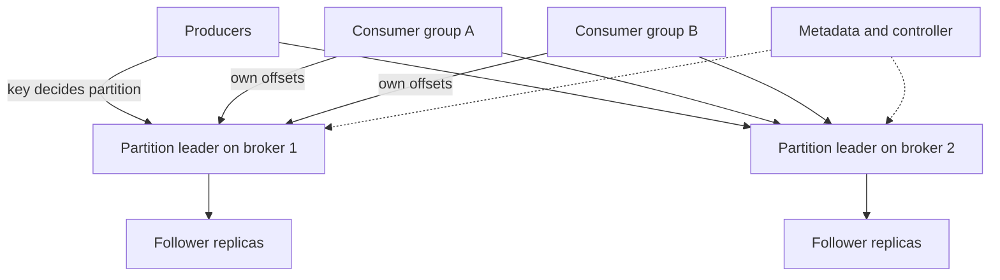

## The hook

Every click, order, payment and log line at a large company becomes an event. Dozens of systems want them: search wants new products, fraud detection wants payments, analytics wants everything, and each of them reads at a different speed. Some are down for an hour and need to catch up.

A classic queue deletes a message once someone reads it, so only one system gets it. A database could hold the events, but a thousand readers polling it would crush it.

The design that won is surprisingly simple: append every event to a numbered log and let readers keep their own bookmarks. LinkedIn built Kafka on this idea, open-sourced in 2011. Predict what "consuming" a message changes in such a system. (Only the reader's bookmark; the message stays.)

## Requirements

**Functional**
- Producers publish messages to named topics; consumers subscribe and read.
- Multiple independent consumer groups read the same topic.
- Ordering for related messages; replay from an earlier point.

**Non-functional**
- About 1 million messages per second of about 1 KB (**estimates**), retained for 7 days.
- Durable: acknowledged messages survive broker failures.
- Horizontally scalable; consumers can fall behind and catch up.

:::analogy
Picture **a row of numbered notebooks that many readers follow at their own pace**. Writers only ever add lines at the end of a notebook. Each reader keeps a bookmark in each notebook they follow. Reading does not tear out pages; old pages are only thrown away after a week, whether anyone read them or not.
:::

## Back-of-envelope numbers

All **estimates**.

- 1,000,000 messages per second × 1 KB = **1 GB/s** of incoming data.
- 7 days of retention: 1 GB/s × 604,800 s ≈ **605 TB**; with replication factor 3, about **1.8 PB** of disk.
- If one partition comfortably handles about 10 MB/s, the topic needs about **100 partitions**, spread across many brokers.

## High-level design

- A **[[topic]]** is split into **[[partition]]s**; each partition is an append-only log with one leader broker and follower replicas.
- Producers pick the partition by hashing the message key (or round robin without a key).
- Each message gets an **[[offset]]**. Consumers in a **[[consumer group]]** divide partitions among themselves and commit the offsets they have processed.
- A controller (backed by a consensus system) tracks brokers, leaders and partition assignments.

## Deep dives

### 1. Why a log is fast

Appends go to the end of a file: sequential disk writes, which are fast even on spinning disks, and readers mostly read recent data that is still in the operating system's page cache. Logs are split into segment files; deleting old data means deleting whole old segments, which is cheap. Batching many small messages into one request and compressing batches cuts per-message overhead.

### 2. Ordering and keys

Order is guaranteed **only within a partition**. To keep one customer's events in order, use the customer id as the key: the same key always hashes to the same partition. Across partitions there is no global order, which is the price of parallelism.

### 3. Consumer groups and offsets

Each partition is read by exactly one consumer in a group, so a group's parallelism is capped by the partition count. When consumers join or leave, partitions are rebalanced. Different groups are independent: search, fraud and analytics each have their own offsets.

Wait, so when is a message deleted? When its segment passes **[[retention]]** (7 days here), regardless of who has read it. Consumers that fall more than 7 days behind lose data, so lag must be monitored.

### 4. Replication and durability

Each partition has, say, 3 replicas. Followers fetch from the leader. The **[[in-sync replicas]]** are those fully caught up. A write is committed once all in-sync replicas have it. The producer chooses how long to wait: for the leader only, or for the in-sync replicas (acknowledge after commit). If the leader dies, the controller promotes an in-sync follower, so committed messages are not lost. Requiring at least two in-sync replicas for writes prevents acknowledging data that exists on only one machine.

### 5. Delivery semantics

Consumers commit offsets after processing for at-least-once delivery; duplicates are possible after a crash between processing and committing, so consumers should be idempotent. Committing offsets together with results in one transaction, or idempotent producers plus transactions inside the log system, give effectively-once processing.

:::insight
A distributed log turns a queue into shared history: producers append to partitioned logs, readers keep their own offsets, and data is deleted by retention, not by reading. Partitions give parallelism and per-key order; replication with in-sync replicas gives durability.
:::

## Trade-offs

| Decision | Choice | Trade-off |
|---|---|---|
| Ordering | Per partition only | Parallelism; no global order |
| Partition count | Many | More throughput and consumer parallelism; more files, metadata and rebalancing cost |
| Producer acknowledgement | After all in-sync replicas | No loss on leader failure; higher write latency |
| Retention | Time-based, 7 days | Replay and slow consumers; disk cost grows with volume |
| Delivery | At least once by default | Simple and robust; consumers must be idempotent |

:::warning
Common misconception: "once a message is consumed, it is gone, like a queue." In a log, consuming only moves that group's offset; other groups and later replays can still read it until retention deletes it. That is a feature, but it also means retention size, not consumption, drives storage cost.
:::

:::try-this
Your fraud service must process each payment event in order per card, and you have 100 partitions. Which key do you use, and how many fraud consumers can usefully run in one group? (Key by card number, so each card's events stay in one partition and in order. Up to 100 consumers can work in parallel, one per partition; more would sit idle.)
:::

## What can go wrong

- **Hot partitions** from skewed keys (one huge customer).
- **Consumer lag** beyond retention, losing unread data.
- **Rebalance storms** when consumers repeatedly join and leave.
- **Acknowledging too early** (leader-only), losing messages when that leader dies before followers copy them.
- **Unbounded retention costs** when retention is set by habit rather than need.
- **Assuming global order** across partitions.

### Interview follow-ups

**"How would you add partitions to a busy topic?"** You can add partitions, but keys then map to different partitions, breaking per-key order during the change; plan partition counts generously up front.

**"Queue (like RabbitMQ) or log (like Kafka) for background jobs?"** For task queues with per-message acknowledgement, retries and routing, a broker queue is simpler. For event streams, replay and many independent consumers, a log fits better, as in [The Ticket Rail Between Waiters and Cooks](article:system-design-message-queues).

**"How do you keep consumers from reprocessing after a restart?"** Commit offsets after processing, and make processing idempotent so the small window of duplicates is harmless.

The internals of one popular implementation follow in the next article on Kafka.

## Further reading

- Kreps, Narkhede and Rao, "Kafka: a Distributed Messaging System for Log Processing" (NetDB 2011).
- Jay Kreps, "The Log: What every software engineer should know about real-time data's unifying abstraction" (2013).

## Key takeaways

- A distributed log stores each topic as partitioned, append-only logs; consumers track offsets instead of deleting messages.
- Order is guaranteed within a partition, so use a key such as customer id to keep related messages ordered.
- A consumer group assigns each partition to one consumer, so partition count caps a group's parallelism, and many groups read independently.
- Replication with in-sync replicas makes acknowledged writes survive broker failures when producers wait for commitment.
- Data is removed by retention, not by reading, so retention size drives storage cost and slow consumers must be watched for lag.
