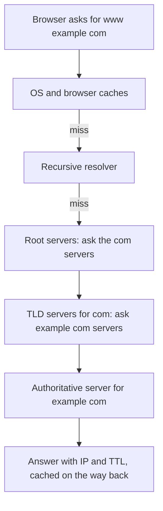

## The hook

Every website you visit begins with a question your browser asks before anything else: "where is this name?" If that question cannot be answered, a perfectly healthy service simply vanishes. Several of the internet's most visible outages have come not from servers crashing but from DNS answers going missing or wrong.

DNS is easy to take for granted because it is usually invisible. It is also a distributed, cached, globally replicated database, and a powerful design tool once you understand it.

## The intuition

:::analogy
Think of looking up a phone number by asking a librarian. You do not know every number, and neither does the librarian. But the librarian knows which shelf holds country directories, the country directory says which city directory to open, and the city directory finally has the number. A good librarian also keeps a notepad of recent answers, so the next person asking for the same number gets it instantly.
:::

The librarian is the recursive [[resolver]]. The shelves are a hierarchy of servers. The notepad is caching, controlled by each answer's [[TTL]].

## How it works

DNS names are read right to left as a hierarchy: `www.example.com.` sits under `example.com`, under `com`, under the root (the final dot).

1. The browser and operating system check their own caches.
2. On a miss, the device asks its resolver, a single question.
3. The resolver, if it has nothing cached, asks a root server, which points to the servers for `.com`.
4. The `.com` servers point to the [[authoritative server]]s for `example.com`.
5. The authoritative server returns the answer, and every cache on the way back stores it for the TTL.

Because answers are cached at every level, most lookups never reach the root or even the authoritative server. Popular names are almost always already on some resolver's notepad.

### What a lookup costs

A lookup answered from the browser or operating system cache costs essentially nothing. One answered by a nearby resolver's cache costs one short round trip, often a few milliseconds. A full miss, where the resolver must walk from the root down, costs several round trips to servers that may be far away, which can add tens or even hundreds of milliseconds to the first request. That is why browsers prefetch DNS for links on a page, and why a cold cache after a long TTL expiry is felt as a slightly slower first visit.

### Why the root servers do not melt

There are only 13 named root server identities, yet they answer queries from the whole internet. Two tricks make this possible. Each identity is served by many machines in many countries that share the same address through anycast routing, so a query goes to a nearby copy. And because answers about `.com` or `.org` are cached for a long time, resolvers rarely need to ask the root at all.

### Records you will meet

| [[Record]] | Maps | Typical use |
|---|---|---|
| A / AAAA | name to IPv4 / IPv6 address | the server to connect to |
| CNAME | name to another name | point `www` at a CDN's hostname |
| MX | domain to mail servers | where email is delivered |
| TXT | name to text | domain verification, email security policies |
| NS | domain to its name servers | delegation in the hierarchy |

:::insight
DNS is a read-heavy, globally cached database where the authoritative copy is small and the caches do almost all the work. The TTL is the one dial that trades freshness for speed and load.
:::

### DNS as a design tool

- **Round robin:** return several A records; clients spread across them.
- **[[GeoDNS]] and latency-based routing:** return the address of the nearest region or CDN edge, based on where the resolver or client appears to be.
- **Failover:** health-checked DNS stops returning the address of a dead region.

## Trade-offs

- **Low TTL** (say 30 to 60 seconds): changes and failovers take effect quickly, but resolvers ask more often, adding load and a little latency on misses.
- **High TTL** (hours): fast, cheap and resilient if the DNS provider has trouble, but a bad record or a dead server stays cached for a long time.
- **DNS load balancing vs a real load balancer:** DNS is global and cheap but coarse, because cached answers stick and DNS cannot see server load. Most systems use DNS to pick a region, then a load balancer to pick a server.

## What can go wrong

- **Misconfigured records** take a service offline even though every server is fine. Change DNS carefully and keep TTLs low before planned migrations.
- **DNS provider outage:** if the authoritative servers are unreachable and caches expire, the name stops resolving. Large sites use more than one DNS provider for this reason.
- **Stale answers:** some clients and resolvers keep answers longer than the TTL, so traffic to an old address can trickle in long after a change.
- **Spoofing and cache poisoning:** forged answers can redirect users. DNSSEC adds signatures to answers, and encrypted transports protect the query in transit.

:::warning
Common misconception: "DNS changes propagate instantly" or "DNS changes take 48 hours." Neither is a rule. Each cached answer lives until its own TTL expires. If the old TTL was a day, plan for about a day; lower it well in advance of a migration.
:::

:::try-this
Your site's A record has a TTL of 3,600 seconds. You plan to move to a new server next Monday. What should you do on Friday, and why? (Lower the TTL to about 60 seconds on Friday, so that by Monday every cache holds a short-lived answer. Then switch the record, and clients follow within a minute or so. Raise the TTL again afterwards.)
:::

### Interview follow-ups

**"Why do DNS changes take time to apply everywhere?"** Resolvers cache answers for the record's TTL. Lower the TTL well before a planned change, wait for the old TTL to expire, then switch.

**"How can DNS help with global load balancing?"** GeoDNS or latency-based routing returns the IP of the nearest healthy region, and health checks remove failed regions from answers. Failover is limited by caching, so it takes about a TTL to take effect.

**"A record, CNAME or alias?"** An A record maps a name to an IPv4 address (AAAA for IPv6). A CNAME points one name at another name. Many providers offer an alias type to point the bare domain at a load balancer, because a CNAME is not allowed at the zone apex.

**"Recursive versus authoritative server?"** The recursive resolver (your ISP's or a public one) does the lookup work and caches results. The authoritative server holds the actual records for a domain and answers only for it.

## In the real world

Public resolvers run by large providers answer enormous query volumes from caches spread across many locations. CDNs and cloud providers use DNS to steer users to nearby edges, then terminate connections there, as described in [Everything That Happens Before a Page Appears](article:system-design-client-server-http). Inside data centres, service discovery systems often expose services through DNS names, so a service can move without its callers changing configuration.

## Further reading

- Cloudflare Learning Center, "What is DNS?": https://www.cloudflare.com/learning/dns/what-is-dns/
- RFC 1034, Domain Names: Concepts and Facilities: https://www.rfc-editor.org/rfc/rfc1034
- Julia Evans, "How DNS works" zine and blog posts: https://jvns.ca/

## Key takeaways

- DNS turns names into addresses through a hierarchy of root, top-level domain and authoritative servers.
- A recursive resolver does the lookups for you and caches answers, so most queries never leave the cache.
- The TTL on each record trades freshness for speed and load, and should be lowered before planned changes.
- DNS can steer users by geography and fail over regions, but it is coarse because cached answers stick.
- Misconfigured or unreachable DNS can make healthy services disappear, so careful changes and redundant providers matter.
