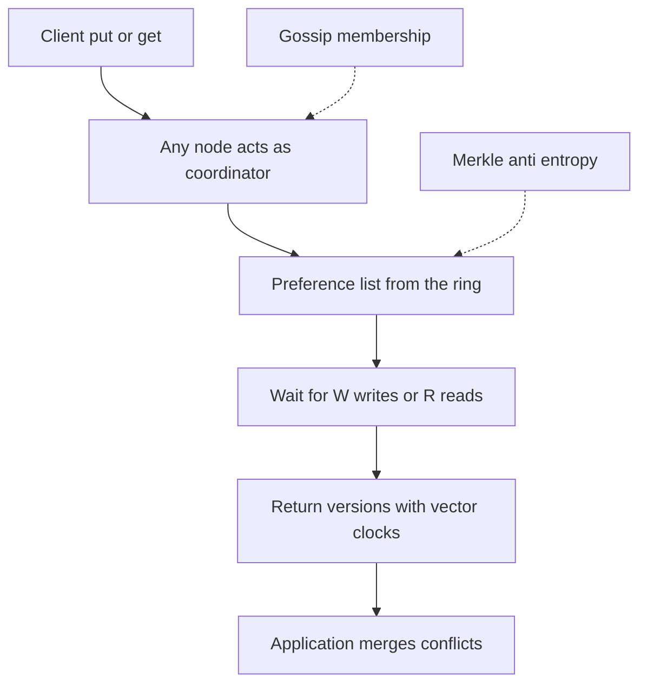

## The hook

It is the holiday shopping peak. A customer adds a gift to their cart, and somewhere in a data centre a network link flaps. A strongly consistent database would face a choice: refuse the write ("please try again later") or risk two replicas disagreeing.

Amazon decided that refusing was the worse outcome. A rejected "add to cart" is a lost sale and a frustrated customer. A cart that briefly exists in two versions can be merged. That decision, published as the Dynamo paper by DeCandia and colleagues at SOSP 2007, became one of the most influential papers in distributed databases.

Before reading on, guess the price of "never refuse a write". (Someone has to clean up afterwards, and it is not always the database.)

## The intuition

:::analogy
Picture **a shop that never refuses an order**. Even if the stockroom phone is down and two clerks take orders for the same item at the same time, both orders are written down. Later, a manager reconciles: merges duplicates, calls customers if needed. The shop gives up "every clerk always knows everything instantly" in exchange for "a customer is never turned away".
:::

Dynamo is that shop. It is **[[always writable]]**, accepts temporary disagreement between replicas, and promises **[[eventual consistency]]**: if writes stop, replicas converge. The price from the hook: conflicting versions sometimes reach the client, and the application must merge them.

## How it works

The paper's strength is showing how a set of known techniques combine, each solving one problem:

| Problem | Technique | Why it helps |
|---|---|---|
| Spread data and add nodes easily | Consistent hashing with virtual nodes | Adding a node moves only nearby keys; load stays even |
| Survive node failures | Replicate each key to N nodes (a preference list) | Copies on several machines |
| Tune consistency against latency | Configurable N, R and W quorums | Each service chooses its trade-off |
| Concurrent writes | Vector clocks, conflicting versions returned to the client | No silent loss; the app merges |
| Temporary failures | Sloppy quorums and hinted handoff | Writes keep succeeding |
| Permanent divergence | Merkle-tree anti-entropy | Efficient background repair |
| Membership and failure detection | Gossip | No central coordinator |

Each technique is covered in this track: the ring in [Seats Around a Round Table](article:system-design-consistent-hashing-sd), quorums in [Ask Enough People and Someone Heard the News](article:system-design-quorums), repair in [Neighbours Comparing Notes to Fix the Gossip](article:system-design-anti-entropy). The full design is assembled in [Design a Distributed Key-Value Store](article:system-design-key-value-store).

### Design principles worth remembering

- **Incremental scalability**: add one node at a time.
- **[[Symmetry]]** and decentralisation: no master; every node can coordinate.
- **Heterogeneity**: give stronger machines more virtual nodes.
- **Business-driven trade-offs**: each service using Dynamo could pick its own N, R and W.
- **Measure the tail**: targets were set on high percentiles of latency, such as the 99.9th, not on averages, because **[[tail latency]]** is what some customers actually experience, and one page may wait on many calls.

Wait, why push conflict resolution to the application instead of solving it in the database? Because only the application knows what a correct merge is. For a cart, the union of items is sensible. For a bank balance it would be wrong. Dynamo offered **[[application-level reconciliation]]** where it mattered, and simple last-write-wins for services that did not care.

:::insight
Dynamo showed how to build a database around a business priority, availability for writes, by combining consistent hashing, replication, tunable quorums, vector clocks, hinted handoff and Merkle repair, and by honestly pushing conflict resolution to the applications that understand the data.
:::

## Trade-offs

| Gained | Paid |
|---|---|
| Writes accepted during failures and partitions | Clients may receive conflicting versions to merge |
| No master, no single point of failure | No global ordering or multi-key transactions |
| Tunable latency and consistency per service | Developers must understand N, R, W and conflicts |
| Smooth scaling node by node | Operational complexity of repair, hints and gossip |

:::warning
Common misconception: "Dynamo is how Amazon DynamoDB works." DynamoDB is a later managed service that shares the name and some ideas, but its architecture and consistency options differ from the 2007 paper. Use the paper to learn design trade-offs, not as documentation of a current product.
:::

:::try-this
A service storing user session data chooses N = 3, R = 1, W = 1. What does it gain and lose, and why might that be acceptable for sessions? (Lowest latency and highest availability: any single replica can answer. It may read stale sessions and accept conflicting writes. For sessions, an occasional stale read or a lost update is a minor inconvenience, such as signing in again, so the trade is reasonable.)
:::

## What can go wrong

- **Conflicts piling up** when applications never merge siblings.
- **Misconfigured quorums** (R + W ≤ N) chosen for speed, giving more stale reads than the team realises.
- **Operational load**: repair, hints and membership changes need tooling and monitoring.
- **Using an always-writable store for invariants** such as unique usernames or stock counts, which it cannot enforce.

### Interview follow-ups

**"What are the main lessons of the Dynamo paper for system design?"** Let business requirements choose the trade-off; combine simple techniques, each fixing one failure; design for the tail, not the average; and be explicit about who resolves conflicts.

**"When would you not use a Dynamo-style store?"** When you need transactions across keys, strict uniqueness or strongly consistent reads by default, such as payments or inventory reservations.

**"How does Dynamo relate to Cassandra?"** Cassandra combined Dynamo-style distribution (ring, gossip, tunable consistency) with a Bigtable-style data model and storage engine.

## In the real world

- Cassandra and Riak adopted many Dynamo techniques; the paper also influenced the broader NoSQL movement.
- Amazon DynamoDB, a managed service, carries the name and the focus on availability and predictable latency, with its own architecture.

## Further reading

- DeCandia et al., "Dynamo: Amazon's Highly Available Key-value Store" (SOSP 2007).
- Werner Vogels, "Eventually Consistent" (Communications of the ACM, 2009).

## Key takeaways

- The Dynamo paper (2007) described an always-writable key-value store built because refusing writes such as "add to cart" was worse for the business than occasional conflicts.
- It combined consistent hashing, replication with preference lists, tunable quorums, vector clocks, sloppy quorums with hinted handoff, Merkle-tree repair and gossip.
- Conflicting versions are returned to the application, which merges them using knowledge of the data.
- Its design principles of symmetry, incremental scaling and targeting tail latency remain widely used.
- Amazon DynamoDB shares the name and goals but is a different, later system.
