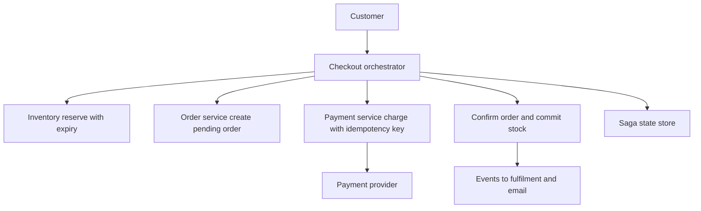

## The hook

A phone launch goes on sale at noon: 10,000 units, 1 million people waiting. At 12:00:03, the site has taken 10,600 orders. At 12:00:10, payment has been collected for some orders whose stock was already gone, and some customers who were told "sold out" were still charged.

Every one of those failures came from the same root: checkout touches several systems (cart, inventory, orders, payments), and they were updated as if they were one database. Predict the hardest part to get right. (It is not the happy path. It is what happens when step 3 of 4 fails.)

## Requirements

**Functional**
- Cart management; checkout of the cart: reserve stock, create order, take payment, confirm.
- Order history and cancellations.

**Non-functional**
- **Never oversell** and never charge without a valid order (or refund promptly if it happens).
- Handle flash sales with very high contention on a few items.
- Checkout survives service crashes and retries.

:::analogy
At a supermarket checkout, the cashier **puts items on hold** behind the counter while you pay: they are not on the shelf any more, but not yours yet. If your card fails, the items go back on the shelf. Each step has an undo: put back the items, cancel the receipt, refund the card.
:::

## Back-of-envelope numbers

All **estimates**.

- Normal traffic: a few hundred checkouts per second; flash sale: **50,000 checkout attempts per second** for one item.
- If one stock row can handle about 2,000 conditional updates per second, one row is far too slow for the flash sale: about **25 buckets** are needed, each holding 400 of the 10,000 units.
- Every successful checkout calls 3 to 4 services; each call needs timeouts, retries and idempotency.

## High-level design



The orchestrator runs an **[[orchestrated saga]]**, storing its progress after each step, as in [Book the Trip, Cancel the Hotel](article:system-design-sagas).

## Deep dives

### 1. The saga, forward and backward

| Step | Forward action | Compensating action |
|---|---|---|
| 1 | Reserve stock (expires in 10 minutes) | Release reservation |
| 2 | Create order as PENDING | Cancel order |
| 3 | Charge payment (idempotency key = order id) | Refund |
| 4 | Mark order CONFIRMED; convert reservation into a sale | (none needed) |

If step 3 fails (card declined), run compensations in reverse: cancel the order, release the stock. If the orchestrator crashes, a new instance reads the saga state and continues from the last recorded step. Every step is idempotent, so repeating one after a crash is safe.

Predict the trickiest case: payment times out. Did it succeed? Unknown. The orchestrator must not release stock or cancel yet. It queries the payment service by the idempotency key (or waits for the provider's webhook), then either continues forward or compensates. That logic is detailed in [Design a Payment System](article:system-design-payments).

### 2. Never oversell

**[[Inventory reservation]]** is a conditional decrement on available stock:

```pseudo
UPDATE stock SET available = available - :qty
WHERE sku = :s AND available >= :qty
-- 1 row: reserved; 0 rows: not enough stock
```

The reservation row records the quantity and expiry. If checkout never completes, an expiry job returns the quantity to `available`. Confirmation converts it into a sale. This makes **[[overselling]]** impossible no matter how many requests race.

### 3. Flash sales: spreading a hot row

One row decremented 50,000 times a second becomes a queue of lock waits. Split the item into **[[stock bucket]]s**: 25 rows of 400 units. Each request picks a bucket at random (or by user hash) and tries the conditional decrement; if the bucket is empty, it tries another. When all are empty, the item is sold out, which can be published to a cache so the page stops offering it.

Add a waiting room or rate limit in front of checkout, as in the ticket booking design, so the stock service sees a controlled flow.

Wait, why not keep stock in a cache like Redis instead? You can, with atomic decrement scripts, for very hot items. But the durable stock record and the order must still agree, so the cache becomes another step in the saga with its own compensation. Many designs use the cache to absorb the spike and reconcile with the database.

### 4. Reliable side effects

Fulfilment, emails and analytics react to "order confirmed" events, published with the outbox pattern in the same transaction as the confirmation, as in [Write the Letter and the Envelope Together](article:system-design-outbox-cdc). No "order confirmed" email is ever sent for an order that rolled back.

:::insight
Checkout is a saga: each step (reserve, create order, pay, confirm) is idempotent and has a compensating action, and the orchestrator persists progress so crashes resume rather than restart. Overselling is prevented in exactly one place, a conditional stock decrement, and hot items spread that decrement across buckets.
:::

## Trade-offs

| Decision | Choice | Trade-off |
|---|---|---|
| Coordination | Orchestrated saga | Clear flow and monitoring; one more service |
| Stock timing | Reserve at checkout, not at add-to-cart | Carts do not lock stock; some checkouts find items gone |
| Hot items | Stock buckets plus waiting room | High throughput; sell-out detection needs all buckets empty |
| Consistency | Eventual across services, strict on stock | Scales; brief intermediate states visible |
| Payment uncertainty | Wait and reconcile before compensating | No double charges or wrong refunds; slower resolution |

:::warning
Common misconception: "wrap the whole checkout in one database transaction." Inventory, orders and payments are separate services, and the payment provider is outside your system entirely, so no single transaction spans them. Use a saga with compensations, and keep atomic guarantees where they are possible: the stock decrement.
:::

:::try-this
Step 1 reserved 2 units, step 2 created the order, step 3 was declined. List the compensations in order, and say what the customer sees. (Cancel the pending order, then release the 2-unit reservation back to available stock. The customer sees "payment declined, your items are still in your cart", and can retry with another method, which starts a new saga.)
:::

## What can go wrong

- **Overselling** from check-then-decrement code.
- **Charged without an order** when steps are not persisted or payment uncertainty is resolved wrongly.
- **Stock stuck in reservations** when expiry jobs fail.
- **Hot rows** on flash-sale items.
- **Duplicate orders** from retried checkout requests without idempotency keys.
- **Emails for failed orders** when events are published outside the transaction.

### Interview follow-ups

**"Choreography or orchestration for checkout?"** Orchestration: the flow is critical, ordered and needs clear visibility and timeouts; a coordinator makes it easier to reason about and monitor.

**"How do you handle a price change during checkout?"** Lock the price into the pending order at step 2 and show the customer the final total before payment.

**"How would you scale checkout globally?"** Partition orders by customer, keep inventory per warehouse or region, and reserve from the nearest warehouse with stock.

## Further reading

- Chris Richardson, *Microservices Patterns*, chapters on sagas.
- Garcia-Molina and Salem, "Sagas" (SIGMOD 1987).

## Key takeaways

- Checkout spans cart, inventory, orders and payments, so it runs as an orchestrated saga with idempotent steps and compensating actions.
- The orchestrator persists progress after each step, so a crash resumes the saga instead of leaving it half done.
- Overselling is prevented by a single conditional stock decrement that succeeds only while enough stock remains, with reservations that expire.
- Flash-sale items spread that decrement across stock buckets and sit behind a waiting room or rate limit.
- Uncertain payments are reconciled before compensating, and confirmation events are published with an outbox so side effects match committed orders.
