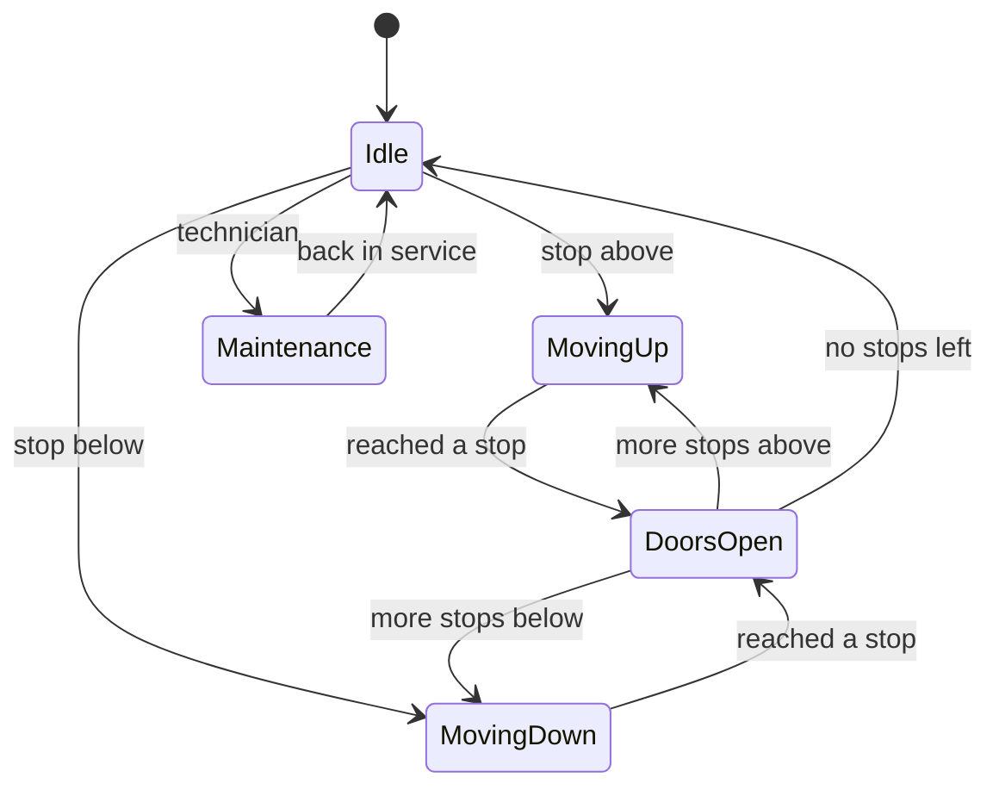
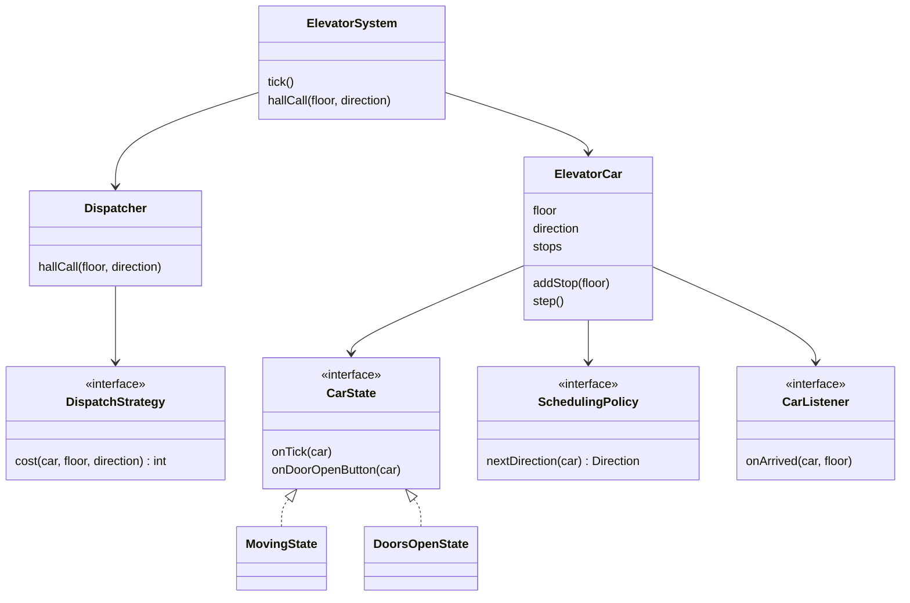

## The hook

You press the down button on floor 2 of an office block. Two lifts. One is at floor 4, just two floors up. The other is at floor 5. The display says the floor 5 lift is coming for you, not the nearer one.

You mutter something about software and consider the stairs. Someone wrote the rule that made that choice. Was it wrong, or did it know something you did not?

An elevator system is a favourite machine coding problem because it packs three classic ideas into one building: a state machine that keeps doors and motors safe, a scheduling rule that decides the order of stops, and a dispatcher that picks which car answers which button. Get any of them wrong and someone waits forever on floor 20. By the end of this article you will know exactly why.

## Requirements

Clarify first, as in [Build the Model House One Room at a Time](article:system-design-machine-coding-approach).

**Functional**

- A building with N floors and M cars.
- [[Hall call|Hall calls]]: up and down buttons on each floor.
- [[Car call|Car calls]]: floor buttons inside each car.
- The system assigns each hall call to one car and moves cars to serve all requests.
- Doors open at each stop; door-open and door-close buttons inside the car.
- A car can be put into maintenance and stops taking calls.

**Non-functional**

- Safety first: doors never open while moving; a car in maintenance never moves for calls.
- No request waits forever.
- Swappable scheduling, because offices, hospitals and residential towers want different rules.
- Testable as a simulation in discrete time ticks, with no real motors.

**Simplification, stated out loud**: one tick moves a car one floor, and a door stop takes one tick.

:::analogy
Picture a **building concierge directing lifts**. The concierge sits at a desk with a board showing where every lift is and which way it is heading. When someone presses a button on any floor, the concierge decides which lift should go, by asking which one will get there soonest. Each lift has its own operator who follows one simple rule: keep going in your direction while anyone ahead needs you, then turn around. The concierge never drives a lift; the operators never choose which floor calls are theirs.
:::

## Core objects

- **ElevatorCar**: current floor, direction, its set of stops, and its current state.
- **CarState**: Idle, MovingUp, MovingDown, DoorsOpen, Maintenance. Each answers the same events differently.
- **Request**: a hall call (floor plus direction) or a car call (floor, belonging to one car).
- **Dispatcher**: the concierge. Assigns each hall call to a car.
- **DispatchStrategy**: how the concierge estimates "soonest".
- **SchedulingPolicy**: the operator's rule for the order of stops (LOOK here).
- **ElevatorSystem**: owns the cars and the dispatcher, and runs the clock tick by tick.
- **Display** and **Door**: observers of car events.

Wait, why split Dispatcher from SchedulingPolicy? They answer different questions. The [[dispatcher]] decides **which car**; the scheduling policy decides **in what order one car visits its own stops**. You can swap either without touching the other, exactly like the concierge and the operators.

## Class design

### The car is a state machine

Predict what happens with flags. A car has `isMoving` and `doorsOpen` booleans, and a passenger presses door-open while the car moves between floors 5 and 6. Unless every method remembers to check isMoving, the doors open. Four booleans allow sixteen combinations, and most of them are nonsense.

A [[state machine]] allows only the states that exist:



With the State pattern from [The Remote Control With Reprogrammable Buttons](article:system-design-behavioural-patterns), each box is a class and every class must answer every event:

| Event | Idle | MovingUp or MovingDown | DoorsOpen | Maintenance |
|---|---|---|---|---|
| tick | start moving if stops exist | move one floor; open doors if this floor is a stop | close after the dwell time, pick next state | nothing |
| door-open button | open doors | ignored | extend dwell time | ignored |
| new stop | choose a direction | add to stops | add to stops | rejected |
| maintenance on | enter Maintenance | finish to the next floor first | close doors, then Maintenance | already |

The "ignored" cells are the safety story. The unsafe action has no code path at all.

### The operator's rule: LOOK

Pause and work this out. A car is at floor 4, moving up, with stops at 1, 3, 7 and 9. In what order should it visit them?

**Nearest first** (shortest seek first) picks 3, then 1, then 7, then 9, for 1 + 2 + 6 + 2 = 11 floors of travel. The [[LOOK algorithm]] carries on upward first: 7, then 9, then reverses to 3 and 1, for 3 + 2 + 6 + 2 = 13 floors.

Nearest first travelled less. So why do elevator designs prefer the sweep? Here is the catch, and we will see it in a moment when floor 20 shows up.

```pseudo
class LookPolicy implements SchedulingPolicy:
    nextDirection(car):
        if car.stops is empty: return IDLE
        if car.direction == UP and no stop above car.floor: return DOWN
        if car.direction == DOWN and no stop below car.floor: return UP
        if car.direction == IDLE: return UP if any stop above else DOWN
        return car.direction           // keep sweeping
```

### The concierge's estimate

```pseudo
interface DispatchStrategy:
    cost(car, floor, wantedDirection) -> number

class EtaDispatch implements DispatchStrategy:
    cost(car, f, d):
        if car.isIdle: return distance(car.floor, f)
        if f is ahead of car and d == car.direction:
            return distance(car.floor, f)                    // on the way
        turn = car's farthest stop in its current direction
        return distance(car.floor, turn) + distance(turn, f) // finish the sweep, come back

class Dispatcher:
    hallCall(f, d):
        best = car with the lowest cost(car, f, d), skipping cars in Maintenance
        best.addStop(f)
```



## Key flows

### A morning in a 10-floor building, traced

Floors 0 to 9. Car A idle at floor 0, car B idle at floor 9. Each tick, events are handled first, then each car either opens its doors (if its floor is a stop) or moves one floor.

| t | Event | Dispatcher costs | Car A after tick | Car B after tick |
|---|---|---|---|---|
| 0 | hall call 3 up | A: 3, B: 6, so A | floor 1, up | floor 9, idle |
| 0 | hall call 8 down | A: 3 + 5 = 8 (must finish its sweep), B: 1, so B | floor 1, up | floor 8, down |
| 1 | | | floor 2, up | doors open at 8, then idle |
| 2 | hall call 4 up | A: 2 (on its way), B: 4, so A | floor 3, up | floor 8, idle |
| 3 | inside B: press 0 | | doors open at 3 | floor 7, down |
| 4 | inside A: press 7 | | floor 4, up | floor 6, down |
| 5 | | | doors open at 4 | floor 5, down |
| 6 | hall call 2 down | A: 3 + 5 = 8, B: 3 (on its way), so B | floor 5, up | floor 4, down |
| 7 | | | floor 6, up | floor 3, down |
| 8 | | | floor 7, up | floor 2, down |
| 9 | | | doors open at 7, then idle | doors open at 2 |
| 10-11 | | | idle at 7 | floors 1, then 0 |
| 12 | | | idle at 7 | doors open at 0, then idle |

Look at row 6. Car A is closer in raw floors (it is at floor 4, two floors from the caller), yet it costs 8, because A is heading up to 7 and the passenger wants to go down. Car B, three floors away but already travelling down, costs 3. That is exactly the scene from the hook, and the concierge was right: it sent the lift that would arrive soonest, not the one that looked closest.

### Floor 20 never gets a lift

Now the catch you were promised. Take one car at floor 4 using nearest first. A passenger at floor 20 presses the button. Before the car gets anywhere near, new requests arrive at floors 3, 5 and 4, then again, and again: a busy lunch hour on the low floors.

Each time, some low floor is nearer than 20, so the car never heads up. That is [[starvation]]. LOOK cannot do this: once the car is moving up because floor 20 asked, it keeps moving up until no stops remain above it. Requests behind it wait at most one sweep, never forever.

:::insight
In scheduling, the shortest next hop is not the same as the shortest wait. A sweep rule that finishes its direction before turning gives every request a bounded wait, and a dispatcher that estimates arrival time, not raw distance, sends the right car.
:::

:::warning
Common misconception: "always send the nearest elevator." Distance ignores direction. A car two floors away but heading the other way must finish its sweep first, so a farther car already travelling towards you often arrives sooner. Cost functions estimate time to arrive, including the detour.
:::

### The code

A compact simulation of the traced morning. Each car runs LOOK; the dispatcher uses the cost rule above.

```cpp
#include <bits/stdc++.h>
using namespace std;

enum class Dir { UP, DOWN, IDLE };

struct Elevator {
    string name; int floor; Dir dir = Dir::IDLE;
    set<int> stops;                                  // floors this car must stop at
    Elevator(string n, int f) : name(move(n)), floor(f) {}

    // LOOK: keep going while there are stops ahead, then reverse.
    void step(int t) {
        if (stops.count(floor)) {                    // doors open for this tick
            stops.erase(floor);
            cout << "t=" << t << " car " << name << " opens doors at " << floor << "\n";
            if (stops.empty()) dir = Dir::IDLE;
            return;
        }
        if (stops.empty()) { dir = Dir::IDLE; return; }
        bool above = stops.upper_bound(floor) != stops.end();
        bool below = *stops.begin() < floor;
        if (dir == Dir::UP && !above) dir = Dir::DOWN;
        else if (dir == Dir::DOWN && !below) dir = Dir::UP;
        else if (dir == Dir::IDLE) dir = above ? Dir::UP : Dir::DOWN;
        floor += dir == Dir::UP ? 1 : -1;
    }
    // Cost to answer a hall call at floor f going in direction d.
    int cost(int f, Dir d) const {
        if (dir == Dir::IDLE) return abs(floor - f);
        bool ahead = dir == Dir::UP ? f >= floor : f <= floor;
        if (ahead && d == dir) return abs(floor - f);        // on the way
        int turn = dir == Dir::UP ? max(*stops.rbegin(), floor) : min(*stops.begin(), floor);
        return abs(floor - turn) + abs(turn - f);            // finish the sweep, come back
    }
};

struct Dispatcher {
    vector<Elevator*> cars;
    void hallCall(int t, int f, Dir d) {
        Elevator* best = nullptr; int bestCost = INT_MAX;
        for (Elevator* c : cars) {
            int k = c->cost(f, d);
            if (k < bestCost) { bestCost = k; best = c; }
        }
        best->stops.insert(f);
        if (best->dir == Dir::IDLE && best->floor != f) best->dir = f > best->floor ? Dir::UP : Dir::DOWN;
        cout << "t=" << t << " hall call " << f << (d == Dir::UP ? " up" : " down")
             << " -> car " << best->name << " (cost " << bestCost << ")\n";
    }
};

int main() {
    Elevator a("A", 0), b("B", 9);
    Dispatcher disp{{&a, &b}};
    for (int t = 0; t <= 12; ++t) {
        if (t == 0) { disp.hallCall(t, 3, Dir::UP); disp.hallCall(t, 8, Dir::DOWN); }
        if (t == 2) disp.hallCall(t, 4, Dir::UP);
        if (t == 3) { b.stops.insert(0); cout << "t=3 inside B: press 0\n"; }
        if (t == 4) { a.stops.insert(7); cout << "t=4 inside A: press 7\n"; }
        if (t == 6) disp.hallCall(t, 2, Dir::DOWN);
        a.step(t); b.step(t);
    }
}
```

It prints the dispatcher decisions with costs 3, 1, 2 and 3, and door openings for A at 3, 4 and 7 and for B at 8, 2 and 0, matching the table. The state machine is folded into the step function here to keep it short; in the round, give each state its own class as in the table of events.

:::try-this
Car A is at floor 6 moving down with stops at 4 and 1. Car B is idle at floor 9. A hall call comes from floor 7 going up. Compute both costs with the rule above and say which car is sent. (A must finish its sweep to floor 1 and come back: 5 + 6 = 11. B is idle: 9 - 7 = 2. Car B is sent.)
:::

## Patterns used

| Pattern | Where | Why |
|---|---|---|
| State | CarState: Idle, Moving, DoorsOpen, Maintenance | Same events, different safe behaviour; illegal actions have no code path |
| Strategy | DispatchStrategy and SchedulingPolicy | Office towers, hospitals and residential blocks tune these differently |
| Observer | Displays, door hardware and logs listen to car events | The car does not know who shows its floor |
| Command | Requests as objects in a queue | Requests can be queued, logged and replayed in tests |

## Extensions

### One brain, many buttons

Hall calls arrive from every floor at once, from different threads. If two threads run the dispatcher at the same moment, both may read car A's stops, both decide, and one update can be lost.

The cleanest machine-coding answer is a single control loop: button presses push Request objects onto a thread-safe queue, and one thread pops them and runs dispatch and ticks in order. That is the concierge again: many people shout, but only one person writes on the board. If you must dispatch from many threads, lock per car when adding a stop, and compute costs under a lock for the whole assignment.

### Common mistakes

- **Nearest-first scheduling**, which starves far floors, as above.
- **One stop set for both directions.** The demo keeps a single set, so a car going up will stop for someone at that floor who wants to go down. A full design tags hall calls with direction and serves a down call on the downward sweep.
- **Dispatching by distance alone**, which ignores direction and detours.
- **Booleans instead of states**, which allows doors open while moving.
- **Reassigning car calls.** A passenger inside car A pressed 7; only car A can serve it.

### Variants worth naming

- **Destination dispatch**: passengers enter the destination floor in the lobby, and the system groups people going to nearby floors into the same car.
- **Zoning**: in tall buildings, some cars serve only low floors and some only high floors.
- **Peak modes**: in the morning rush, idle cars return to the lobby; that is a different parking strategy, swapped in at 8 am.

### Interview follow-ups

**"How do you handle a car going into maintenance with pending stops?"** It finishes moving to the next floor, opens its doors, and its unserved hall calls go back to the dispatcher for reassignment. Its car calls are dropped and passengers are told to exit, which is the only safe option.

**"What is the difference between SCAN and LOOK?"** SCAN travels to the end of the shaft before reversing, like a disk head sweeping the whole disk. LOOK reverses at the last request in the current direction, so it wastes no trips to empty top floors.

**"How would you test this?"** Run the simulation with a scripted list of timed requests, as main does, and assert on the sequence of stops and dispatch decisions. Add a property test: every request is served within a bounded number of ticks, which catches starvation.

**"How do you add capacity limits?"** Give the car a load sensor value. When it is full, its cost for new hall calls becomes infinite, so the dispatcher sends another car, and the full car skips hall stops while still serving its car calls.

Next in this track, [Design a Vending Machine](article:system-design-vending-machine) takes the state machine idea and makes it the entire design, with money in the mix.

## Key takeaways

- An elevator design separates three decisions: each car's state machine for safety, a scheduling policy for the order of stops, and a dispatcher that chooses which car answers each hall call.
- The State pattern makes unsafe actions such as opening doors while moving impossible, because the moving state simply has no code path for them.
- Nearest-first scheduling minimises each hop but can starve far floors, while LOOK finishes its current direction before reversing and so bounds every wait.
- A good dispatcher estimates time to arrive, including the detour to finish a sweep, so a farther car moving towards the caller often beats a nearer one moving away.
- Funnel all requests through one control loop or lock per car, so two concurrent assignments never overwrite each other's stops.
