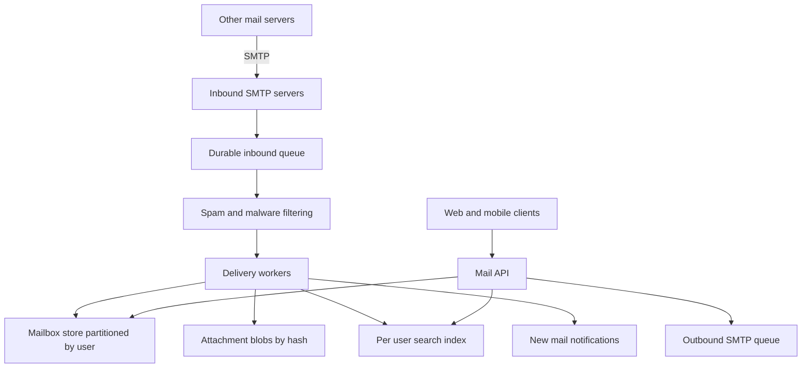

## The hook

Somewhere a mail server says "250 OK" to another mail server. With those three characters, responsibility for your email has changed hands: the sender's server deletes its copy, and from now on, if the message is lost, it is lost forever.

An email service must accept mail from the whole internet (much of it spam), store years of messages per user, find one email from 2019 in milliseconds, and never lose anything it said "OK" to. Predict which of those is the most expensive at scale. (Storage, mostly because of attachments.)

## Requirements

**Functional**
- Receive mail from other servers (SMTP) and send mail out.
- Inbox, threads, labels or folders, read status; search across all mail; attachments.
- Spam filtering; web and mobile clients.

**Non-functional**
- About 100 million users receiving about 40 emails each per day (**estimates**).
- Never lose accepted mail; mailboxes durable for years.
- Fast inbox loading and search.

:::analogy
An email service is **a post office with a filing room for every person**. Trucks from other post offices unload at the dock; inspectors open suspicious parcels; each letter is filed in its owner's room with an index card; bulky packages go to a central warehouse with a slip in the room saying where they are. And once the dock signs for a delivery, the post office alone is responsible for it.
:::

## Back-of-envelope numbers

All **estimates**.

- 100,000,000 users × 40 emails ≈ **4 billion emails a day**, about **46,000 per second** arriving.
- Average 75 KB including attachments: about **300 TB of new data per day** before deduplication and replication.
- Attachments dominate. A 5 MB file sent to 200 colleagues costs 1,000 MB without deduplication, about **5 MB** with it.

## High-level design

## Deep dives

### 1. Ingestion

Other servers find ours through **[[MX record]]s** in DNS and deliver over **[[SMTP]]**. Inbound servers do cheap checks during the conversation (valid recipient, sender authentication results, size limits), then write the message to a durable, replicated queue, and only then reply "250 OK".

Wait, why not filter spam before saying OK? Heavy analysis takes time and SMTP connections should be quick. Cheap rejections happen during the conversation; the expensive filtering happens after the message is safely stored.

### 2. Spam filtering

The **[[spam filter]]** pipeline combines sender authentication (SPF, DKIM, DMARC), sender and IP reputation, content and link analysis with machine-learned models, malware scanning of attachments, and feedback from users marking spam. The result decides inbox, spam folder or quarantine.

### 3. Mailbox storage

The **[[mailbox store]]** holds metadata per message (ids, headers, labels, thread id, flags), partitioned by user id so "list my inbox" or "label these messages" stays on one partition. Message bodies and attachments go to blob storage, as in [The Cloakroom That Never Loses a Coat](article:system-design-blob-storage), with **[[attachment deduplication]]** by content hash. Older mail moves to cheaper storage tiers.

### 4. Search

Each user's mail is indexed in a per-user (or user-partitioned) inverted index, so a search only touches that user's data, as in [A Library Catalogue for Every Word](article:system-design-search-systems). New mail is indexed asynchronously; a few seconds of delay before it is searchable is acceptable.

### 5. Sending

Outgoing mail goes into an outbound queue; workers look up the recipient domain's MX records, deliver over SMTP, retry with backoff for temporary failures (as SMTP expects), and generate bounce messages for permanent ones. Outbound reputation matters: rate limits and abuse detection keep spammers from using the service.

:::insight
An email service is a durable pipeline wrapped around per-user storage: accept mail only after it is safely queued, filter and deliver asynchronously, keep metadata partitioned by user, push bodies and deduplicated attachments into blob storage, and index each user's mail separately for search.
:::

## Trade-offs

| Decision | Choice | Trade-off |
|---|---|---|
| Acceptance | Queue durably before "250 OK" | No loss; slight delay before mail appears |
| Partitioning | By user id | Local operations; huge mailboxes need care |
| Attachments | Blob storage, deduplicated by hash | Big savings; must not reveal other users' files |
| Search | Per-user index | Small, private searches; many indexes to maintain |
| Old mail | Cheaper storage tiers | Lower cost; slower access to very old messages |

:::warning
Common misconception: "store each email as one row in a big database table." Bodies and attachments are large and rarely read after the first days, while metadata is small and constantly queried. Mixing them makes every query slow and every backup enormous. Split metadata from content, and partition by user.
:::

:::try-this
A user with 15 years of mail searches for "invoice 2019". Why is a per-user index fast here, and what would go wrong with one global index of all users' mail? (The per-user index holds only that user's terms, so the search touches a small index and needs no permission filtering. A global index would make every query sift through all users' postings and filter by owner, slower and riskier for privacy.)
:::

## What can go wrong

- **Losing accepted mail** by acknowledging before it is durable.
- **Spam floods** overwhelming filters; reject cheaply early and rate-limit by sender reputation.
- **Huge mailboxes** creating hot partitions; split a user's data by time.
- **Attachment storage costs** without deduplication and tiering.
- **Outbound abuse** damaging the service's reputation, so its mail lands in others' spam folders.

### Interview follow-ups

**"How do threads work?"** Group messages by reply headers (In-Reply-To, References) and subject heuristics, store a thread id in metadata, and list threads by latest message time.

**"How would you show new mail instantly?"** After delivery, publish a notification on the user's open connection, as in [Design a Notification System](article:system-design-notification-system), and let the client fetch the new metadata.

**"How do you delete an account's data?"** Delete metadata and index for the user, and drop references to attachment blobs; blobs whose reference count reaches zero are garbage-collected.

## Further reading

- RFC 5321 (SMTP) and RFC 7489 (DMARC).
- Engineering talks and papers from large email providers on storage, spam filtering and search.

## Key takeaways

- Inbound mail is accepted over SMTP only after it is written to a durable queue, because acceptance transfers responsibility for the message.
- Spam and malware filtering run asynchronously on queued mail, combining sender authentication, reputation, content models and user feedback.
- Mailbox metadata is partitioned by user, while bodies and attachments live in blob storage, with attachments deduplicated by content hash.
- Each user's mail has its own search index, updated asynchronously after delivery.
- Outbound mail goes through a queue with retries, bounces, rate limits and abuse controls that protect the service's sending reputation.
