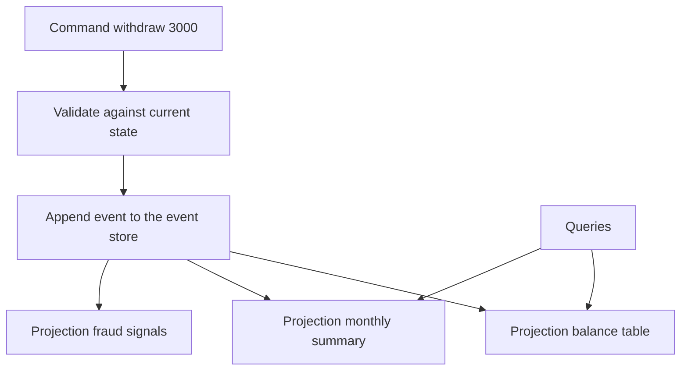

## The hook

A customer calls their bank: "My balance says ₹1,600. That cannot be right." If the bank stored only a balance column, the support agent could only reply: "The system says ₹1,600." There is no way to show how it got there.

But banks do not store just a balance. They store a statement: every deposit and withdrawal, in order, forever. The balance is just the sum of the statement. The agent walks through the history line by line, and the customer finds the ₹3,000 withdrawal they forgot.

What if your software stored data the same way? Predict the biggest benefit and the biggest headache before reading on. (One involves time travel; the other involves changing your mind about what an event looks like.)

## The intuition

:::analogy
**A bank statement instead of just a balance.** The statement lists everything that happened; the balance is derived from it. You can always recompute the balance, compute last month's balance, or produce a new kind of report from the same statement. You can never quietly change a past line; mistakes are corrected with a new line.
:::

- Storing the statement is **[[event sourcing]]**.
- The balance, the monthly summary, the fraud report: each is a **[[projection]]** of the statement.
- Using the statement for writes and projections for reads is **[[CQRS]]**.

## How it works

### The write side: commands become events

A command ("withdraw ₹3,000") is checked against the entity's current state (rebuilt from its events, or from a **[[snapshot]]** plus newer events). If valid, it is recorded as an immutable event ("withdrew ₹3,000 at 10:42") appended to that entity's stream in the **[[event store]]**. Concurrency control is simple: append only if the stream is still at the version you read, otherwise retry.

### Rebuilding state

| Event | Amount | Balance after |
|---|---|---|
| Opened | | 0 |
| Deposited | 5,000 | 5,000 |
| Withdrew | 1,200 | 3,800 |
| Deposited | 800 | 4,600 |
| Withdrew | 3,000 | 1,600 |

The balance is never stored as the truth; it is computed. For entities with thousands of events, a snapshot every N events keeps rebuilding fast.

### The read side: projections

Projections consume events and maintain tables shaped for queries: current balances for the app, summaries for statements, aggregates for dashboards. Each is optimised for its readers, the denormalisation idea from [A Copy of the Phone Number in Every Address Book](article:system-design-data-modeling-scale).

Wait, what is the real superpower here? Projections are disposable. Found a bug in the monthly summary? Fix the code, delete the projection, replay all events, and the history is recomputed correctly. Need a brand new report? Build it from events that were recorded before anyone thought of it.

:::insight
Event sourcing makes history the source of truth: current state, reports and read models are all derived by replaying events, so they can be rebuilt, audited or invented later. The price is that events become a permanent public contract that is hard to change.
:::

## Trade-offs

| You gain | You pay |
|---|---|
| Complete audit trail of every change | More storage, growing forever |
| Rebuild or add read models at any time | Read models are eventually consistent |
| Time travel: state as of any past moment | Rebuilding state needs snapshots for speed |
| Natural fit with event-driven systems | Event schemas are hard to change once written |
| Debugging by replaying production history | More concepts and infrastructure than plain tables |

### Changing events over time

The headache from the hook: events written in 2024 have the old shape forever. Options:

- Make events **additive**: new optional fields, never removed meanings.
- **Version** event types and use **[[upcasting]]**: convert old versions to the new shape when reading.
- In rare cases, copy the stream into a new one with transformed events.

:::warning
Common misconception: "event sourcing means using Kafka as the database." A message broker with a retention period is not an event store. An event store keeps events forever, supports reading one entity's stream in order, and appends with optimistic concurrency checks per stream. Brokers can distribute events to projections, ideally fed reliably via an outbox, as in [Write the Letter and the Envelope Together](article:system-design-outbox-cdc).
:::

:::try-this
After withdrawing ₹3,000, the user's app immediately reloads the balance from the projection and still sees ₹4,600. Why, and name two fixes. (The projection had not yet processed the new event: CQRS read models lag. Fixes: return the new balance from the command response itself; or read the user's own balance from the write model for a few seconds after a command; or have the UI wait until the projection reaches the event's version.)
:::

## What can go wrong

- **Event schema changes** breaking old events, with no versioning plan.
- **Unbounded replay times** without snapshots.
- **Projections that are not idempotent**, double-counting events after a restart; track the last processed position.
- **Treating events as commands** ("send email") rather than facts ("order placed"), which makes replays trigger side effects again.
- **Using event sourcing everywhere**, adding complexity to simple CRUD data that never needed history.

### Interview follow-ups

**"When would you use event sourcing?"** When the history itself is valuable or required: ledgers, orders with complex lifecycles, audits, collaborative editing. For simple settings or profiles, plain tables are better.

**"How do you handle deleting personal data with immutable events?"** Store personal data separately and reference it, or encrypt it per user and delete the key ("crypto-shredding"), so the events remain but the data becomes unreadable.

**"CQRS without event sourcing?"** Yes: a normal database for writes, with read models updated by change data capture or events. CQRS is about separate read and write models; event sourcing is one way to feed them.

## In the real world

- Accounting ledgers have worked this way for centuries; banking and payment systems commonly keep append-only transaction records.
- Event stores and event-sourcing frameworks exist for many languages, and teams also build them on relational databases with an append-only events table.
- Many systems apply CQRS partially: a transactional database plus search indexes and caches as read models.

## Further reading

- Martin Fowler's articles "Event Sourcing" and "CQRS".
- Greg Young's talks and writing on event sourcing and CQRS.

## Key takeaways

- Event sourcing stores every change as an immutable event and derives current state by replaying them, like a bank statement behind a balance.
- Projections are read models built from events; because they are derived, they can be rebuilt after bugs or created later for new questions.
- CQRS separates the write model (commands validated and recorded as events) from read models optimised for queries, usually updated asynchronously.
- Events become a permanent contract, so plan for versioning and upcasting, and use snapshots to keep rebuilding fast.
- Use event sourcing where history matters, not for every piece of simple data.
