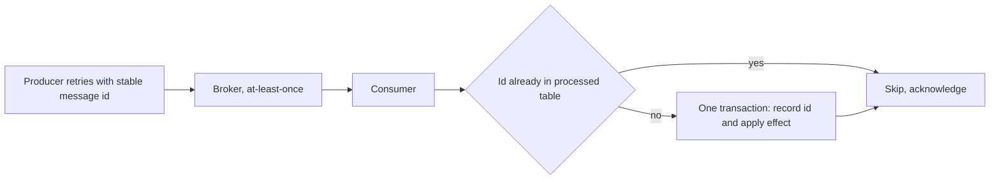

## The hook

A payment service sends "credit ₹100" to the ledger service. The ledger applies it and replies "done", but the reply is lost in the network. The payment service waits, hears nothing, and does the only sensible thing: it sends again. Now the customer has ₹200. Or it does not resend, and if the original had actually been lost, the customer has ₹0.

Every distributed system faces this choice, and interviewers love to ask about "exactly-once delivery" precisely because the honest answer is subtle: the network cannot guarantee it, but your system can guarantee exactly-once *effects*.

## The intuition

:::analogy
Think of a cheque. If you post a cheque and hear nothing, you might write another, and if both arrive, you have paid twice. Banks solve this with a serial number on each cheque: the bank keeps a record of serial numbers already cashed and refuses any repeat. You can safely send the same cheque again if you are unsure, because the bank pays each serial number only once. Delivery happened twice; payment happened once.
:::

The serial number is a message id, the bank's record is a [[deduplication]] table, and "payment happened once" is [[exactly-once processing]].

## How it works

### The three guarantees

| Guarantee | How | Loss? | Duplicates? |
|---|---|---|---|
| [[At-most-once]] | send once, never retry; or acknowledge before processing | possible | no |
| [[At-least-once]] | retry until acknowledged; acknowledge after processing | no | possible |
| Exactly-once effect | at-least-once delivery plus deduplication or idempotency | no | no visible effect |

### Why the network cannot do it alone

The sender cannot tell "my message was lost" from "the reply was lost". Both look like silence. Any finite exchange of acknowledgements leaves the last message unconfirmed, a puzzle known as the Two Generals' problem. So the sender must either risk losing the message (do not retry) or risk duplicating it (retry). Exactly-once is built at the endpoints, not in the wire.

### Recipe: at-least-once plus idempotent effects

1. **Producers retry** until acknowledged, attaching a stable message id generated once per logical message, not per attempt.
2. **Consumers make effects idempotent**, by one of:
   - **Natural idempotency**: "set status to SHIPPED" is safe to repeat; "add ₹100" is not.
   - **Dedup table in the same transaction**: insert the message id into a `processed` table with a unique constraint, and apply the effect, in one local transaction. A duplicate fails the insert and is skipped.
   - **Version checks**: apply an update only if its version is newer than the stored one.

```pseudo
handle(msg):
    begin transaction
        if insert into processed(id) values (msg.id) violates unique key:
            rollback; ack(msg); return             // already done
        update accounts set balance = balance + msg.amount where id = msg.account
    commit
    ack(msg)                                       // crash before this means redelivery, which is now harmless
```

The key is atomicity between "remember the id" and "apply the effect". If they were separate, a crash between them recreates the original problem. This is the consumer-side twin of the outbox in [Write the Letter and the Envelope Together](article:system-design-outbox-cdc), and the server-side twin of idempotency keys in [Pressing the Pay Button Twice Should Charge Once](article:system-design-stateless-idempotency).



### Stream processing: transactions in Kafka

For pipelines that read from Kafka, transform, and write back to Kafka, Kafka provides two features:

- **Idempotent producer**: each producer has an id and numbers its messages per partition; the broker discards a retried message whose sequence number it has already written. This removes duplicates caused by producer retries.
- **Transactions**: a producer can write output records to several partitions **and** commit the consumer's input [[offset]] in one atomic transaction. Consumers reading with `isolation.level=read_committed` only see committed outputs. A crash mid-transaction aborts it, so the input is re-read and the output rewritten, with no duplicates visible downstream.

This gives exactly-once processing *within Kafka*. The moment a step calls an external database, email service or payment API, that effect needs its own idempotency.

### Sizing a dedup store

A labelled **estimate**: at 10,000 messages per second, keeping ids for 7 days, with about 24 bytes per entry (a 16-byte id plus overhead), the table holds 10⁴ × 86,400 × 7 ≈ 6 × 10⁹ ids, about **145 GB**. That is why dedup windows are bounded: keep ids only as long as duplicates can realistically arrive, or scope them per key or partition.

:::insight
Exactly-once is a property of the effect, not of the delivery. Accept that messages will sometimes arrive twice, give each one an identity, and store that identity atomically with the change it causes. Duplicates then become harmless.
:::

## Trade-offs

| Approach | Gains | Costs |
|---|---|---|
| At-most-once | simplest, lowest latency | data loss; fine only for metrics or logs you can lose |
| At-least-once, no dedup | no loss, simple | duplicate effects |
| Dedup table | exactly-once effects anywhere with a database | storage, an extra write per message, bounded window |
| Naturally idempotent design | no extra storage | not every operation can be expressed this way |
| Kafka transactions | exactly-once within Kafka pipelines | extra latency, only covers Kafka reads and writes |

## What can go wrong

A timeline of the classic double-credit bug:

1. **t1** Consumer reads "credit ₹100, id m-42".
2. **t2** It updates the balance and commits.
3. **t3** It crashes before acknowledging.
4. **t4** The broker redelivers m-42 to another consumer.
5. **t5** Without a dedup check, the balance is credited again: ₹200.

With the dedup row written in the same transaction at t2, step t5 finds m-42 already recorded and skips. Other traps:

- **Ids generated per attempt** instead of per logical message: every retry looks new.
- **Dedup check and effect in separate transactions**: a crash between them loses or duplicates.
- **Dedup window shorter than redelivery delays**, for example a replay from a week-old offset.
- **External side effects inside a stream job**, such as sending an email, which Kafka transactions cannot roll back.

:::warning
Common misconception: "our broker supports exactly-once, so duplicates cannot happen." Broker-level guarantees cover the broker's own reads and writes. Any effect outside it, a database update, an API call, an email, can still happen twice unless that consumer is idempotent.
:::

:::try-this
An email service consumes "send welcome email" events with at-least-once delivery. How do you avoid sending two emails? (Record the event id, or "welcome-sent" for the user, in a table with a unique key before or atomically with sending; skip if present. A tiny window remains if the process crashes after sending but before recording, so prefer recording first and accept a rare missed email, or use a provider that deduplicates by an idempotency key.)
:::

## In the real world

- Kafka added the idempotent producer and transactions to support exactly-once stream processing, used by Kafka Streams.
- Payment APIs commonly accept an idempotency key header so that client retries do not create duplicate charges.
- Cloud queues offer at-least-once delivery by default, with deduplication features limited to a time window.

## Further reading

- Apache Kafka documentation, message delivery semantics: https://kafka.apache.org/documentation/#semantics
- KIP-98, "Exactly Once Delivery and Transactional Messaging" (Apache Kafka improvement proposal).
- Martin Kleppmann, *Designing Data-Intensive Applications*, chapter 11.

## Key takeaways

- Networks can offer at-most-once or at-least-once delivery, because a sender cannot distinguish a lost message from a lost reply.
- Exactly-once is achieved as an effect: deliver at least once, then make processing idempotent.
- Storing the message id and applying the effect in one local transaction makes duplicates harmless.
- Kafka's idempotent producer and transactions give exactly-once processing within Kafka by committing outputs and input offsets atomically.
- Side effects outside the broker, such as database writes, payments and emails, still need their own idempotency keys or dedup records.
