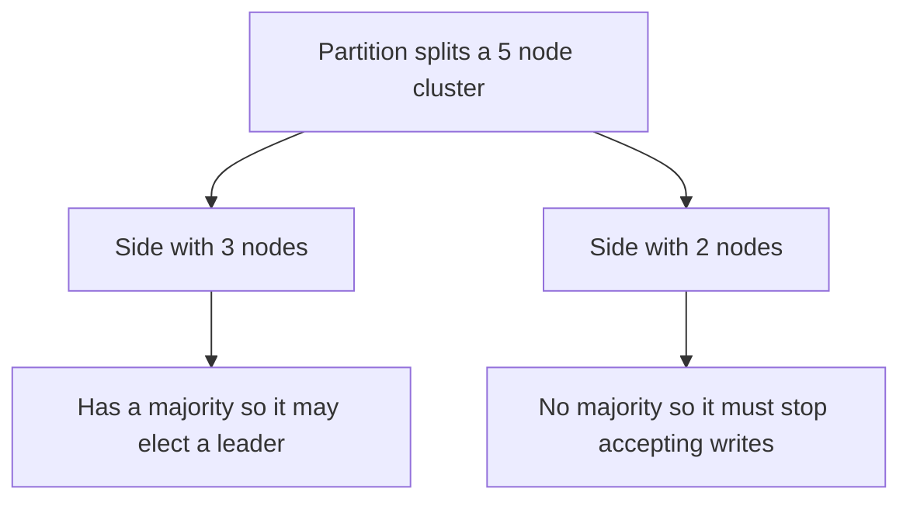

## The hook

A two-server database cluster runs a primary and a standby. They send each other heartbeats every second. At 11:02, a network switch between them fails, but both servers keep running, and both can still reach the app servers.

The standby hears nothing for 10 seconds, concludes the primary is dead, and promotes itself. The primary, equally deaf, concludes the standby is dead and carries on. For the next twenty minutes, half the app servers write to one, half to the other.

Nobody crashed. Every component did exactly what it was programmed to do. Predict the minimum number of servers needed so this cannot happen, even in principle. (It is the same answer as in the consensus article, for the same reason.)

## The intuition

:::analogy
In a storm, the radio between the bridge and the engine room fails. The captain on the bridge thinks the first officer has been washed overboard and keeps command. The first officer thinks the captain is lost and takes command too. Now there are **two captains, each thinking they command the ship**, giving opposite orders to the same crew.
:::

That is **[[split brain]]**, and its cause is not a crash but a **[[network partition]]**: everyone is alive, they just cannot hear each other. The lesson: silence does not mean death.

## How it works

### A timeout is only a guess

A **[[failure detector]]** usually works by heartbeats: if a node is not heard from within a timeout, it is suspected dead. But from outside, these all look identical:

| What really happened | What other nodes observe |
|---|---|
| Node crashed | No heartbeat |
| Node paused (garbage collection, VM migration) | No heartbeat |
| Node overloaded, responding very slowly | No heartbeat in time |
| Network between them failed | No heartbeat |

Short timeouts detect real crashes fast but produce false alarms. Long timeouts avoid false alarms but leave a dead node unnoticed longer. Adaptive detectors adjust to the observed delays, and gossip-based ones ask several peers before suspecting, as in [Is That Server Dead, or Just Slow?](article:famous-algos-swim-failure-detection). None can be certain.

### Quorums prevent two leaders

The answer to the hook is **three**. With a majority **[[quorum]]** rule ("only a node that can talk to a majority may lead"), at most one side of any partition has a majority:

With two nodes, a majority is both of them, so a partition leaves neither side able to act safely. Systems that run two nodes add a third "witness" or "tie-breaker" vote somewhere else.

Wait, what about the old leader on the minority side, which still thinks it is in charge? It cannot commit anything that needs a majority, and it must step down when it notices it has lost contact with the majority (for example, when its lease expires). This is how consensus systems such as Raft stay safe.

### Fencing: making sure the old leader stops

Quorums stop a minority from making *new* decisions. But a paused old leader that wakes up may still try to write to shared resources (a disk, storage, a payment API). So systems also **fence** it:

- **Fencing tokens**: every leader term gets a higher number, and resources reject writes with an older number, as in [One Key to the Shared Room, With a Numbered Tag](article:system-design-distributed-locks-sd).
- **[[STONITH]]** ("shoot the other node in the head"): power it off through a management interface, or revoke its access to shared storage, before promoting the replacement.

:::insight
A failure detector can only suspect, never know, so safety must not depend on the guess being right. Require a majority quorum for leadership so only one side of a partition can act, and fence the old leader so even a node that wrongly believes it is in charge cannot do damage.
:::

## Trade-offs

| Choice | Gain | Cost |
|---|---|---|
| Short heartbeat timeout | Fast failover after real crashes | More false failovers, more churn |
| Long timeout | Fewer false alarms | Longer outages after real crashes |
| Majority quorum | No split brain | Minority side stops, so less availability during partitions |
| Two nodes plus witness | Cheap high availability | Witness must be placed in a separate failure domain |
| STONITH | Strong guarantee the old node stops | Needs out-of-band control, adds complexity |

This is CAP in practice: during a partition, the minority side gives up availability to keep the data consistent, as described in [When the Phone Line Between Branches Goes Dead](article:system-design-cap-pacelc).

:::warning
Common misconception: "if a node stops responding, it is dead, so take over its work." It may only be slow or cut off, and it may come back still believing it is in charge. Taking over without a quorum and without fencing is exactly how split brain and duplicate writes happen.
:::

:::try-this
You run three database nodes, all in the same rack, with majority-based failover. The rack's top-of-rack switch fails. What happens, and how would you place the nodes instead? (All three lose contact with the clients and each other at once, so the cluster is unavailable, though safe. Place nodes in three different racks or availability zones, so one switch or zone failure leaves a majority running.)
:::

## What can go wrong

- **Split brain** from two-node clusters or failover without quorum.
- **Flapping failovers** from timeouts shorter than normal pauses.
- **Old leaders writing after a pause** when there is no fencing.
- **Correlated failures**: all quorum members in one failure domain.
- **Clients still talking to the old leader** because their routing was not updated.

### Interview follow-ups

**"How would you design leader failover for a primary-replica database?"** A consensus-based coordinator (or three-node orchestrator) monitors the primary; on suspicion confirmed by a majority, it fences the old primary, promotes the most up-to-date replica and updates the writer endpoint.

**"What is the difference between crash failures and Byzantine failures?"** Crash failures stop or go silent; Byzantine failures behave arbitrarily, even lying. Ordinary data-centre systems assume crash failures; tolerating Byzantine ones needs different, more expensive protocols.

**"Why not use longer heartbeats to avoid false alarms?"** Because detection time is part of the outage after a real crash. Choose timeouts from measured normal behaviour, and make failover safe enough that an occasional false alarm is harmless.

## In the real world

- Consensus systems (etcd, ZooKeeper, Consul) use majority quorums and leader leases to avoid split brain.
- Database high-availability tools commonly use a witness or an odd number of monitors, plus fencing of the old primary.
- Cluster managers use STONITH devices or cloud APIs to stop failed nodes before failing over shared resources.

## Further reading

- The "Knowledge, Truth, and Lies" chapter of Martin Kleppmann's *Designing Data-Intensive Applications*.
- The Pacemaker cluster documentation on fencing and STONITH.

## Key takeaways

- A crashed, paused, overloaded or unreachable node all look the same from outside, so a failure detector's timeout is a suspicion, not proof.
- Network partitions can leave every node alive but split, and without safeguards both sides may act as leader: split brain.
- Requiring a majority quorum for leadership means at most one side of a partition can act, which is why clusters use three or more nodes, or a witness.
- Fencing, through increasing tokens or by forcibly stopping the old node, ensures a leader that wrongly believes it is in charge cannot cause damage.
- Choose timeouts from measured behaviour and place quorum members in separate failure domains.
