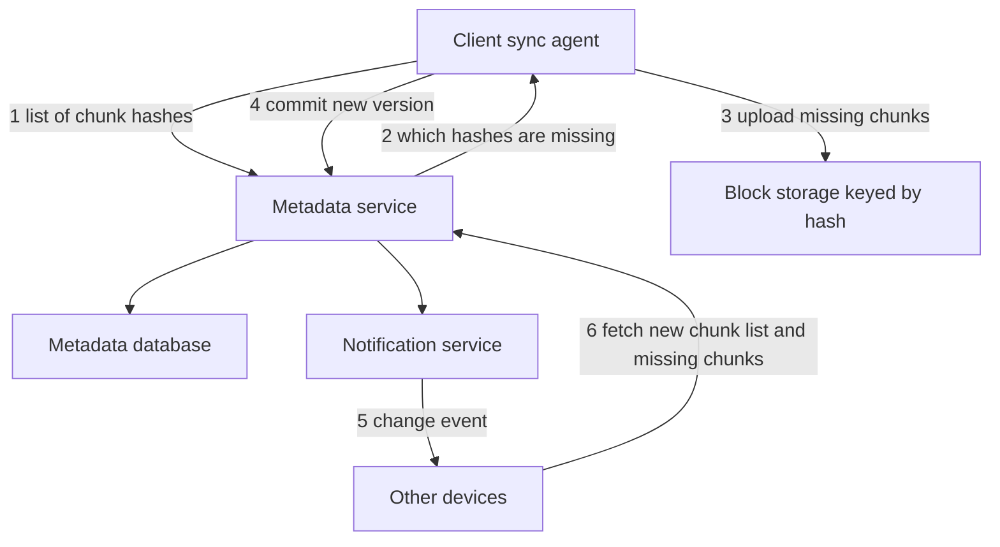

## The hook

You edit one sentence in a 100 MB presentation and press save. A second later, your other laptop shows the change. Your phone too. Your colleague's copy updates without them doing anything.

Nobody uploaded 100 MB three times. Something much smarter happened: the service figured out which few megabytes changed, sent only those, and told every other device exactly what to fetch.

Predict what goes wrong if your edit inserts a slide at the very beginning instead of changing a sentence. (With the naive approach, almost everything gets re-uploaded. The fix is one of the prettiest ideas in this case study.)

## Requirements

**Functional**
- Upload, download and automatically sync files and folders across a user's devices.
- Share files and folders with others.
- Keep version history; restore old versions.
- Work offline and sync when back online.

**Non-functional**
- Large scale: about 100 million users storing about 2 GB each on average (**estimates**).
- Never lose data; durability matters more than speed.
- Efficient bandwidth: send only what changed.
- Changes appear on other devices within seconds.

:::analogy
You have a binder of 1,000 pages and a copy in another city. When you change page 412, you do not post the whole binder; you **ship only the changed page**, along with a note saying "replace page 412". And if many binders contain the same standard page, the archive keeps one copy of it.
:::

## Back-of-envelope numbers

All **estimates**.

- 100 million users × 2 GB = **200 PB** of logical data, before deduplication and replication.
- If 10% of users each change 20 files a day: 100,000,000 × 0.1 × 20 ÷ 86,400 ≈ **2,300 file updates per second**, more at peaks.
- A 100 MB file in 4 MB chunks is 25 chunks. A small in-place edit uploads **one 4 MB chunk**, 25 times less than the whole file.
- Metadata (file names, versions, chunk lists) is small per file but very read-heavy: every device asks "what changed?" frequently.

## High-level design

1. The client splits the changed file into **[[chunk]]s** and hashes each one.
2. It asks the **[[metadata service]]** which hashes the store does not already have.
3. It uploads only the missing chunks to block storage, keyed by hash.
4. It commits a new file version: an ordered list of chunk hashes.
5. The notification service tells the user's other devices (and collaborators) that the file changed.
6. Those devices fetch the new chunk list and download only chunks they do not have.

## Deep dives

### 1. Chunking and deduplication

Chunks are stored by the hash of their content: **[[content-addressed storage]]**. If two files, or two versions of one file, share a chunk, it is stored once. Uploading a file someone else already uploaded can cost almost nothing.

Now the hook's question. With fixed 4 MB chunks, inserting one slide at the beginning shifts every later byte, so every chunk boundary moves and every chunk's hash changes: the whole file is re-uploaded.

**[[Content-defined chunking]]** fixes it. A rolling hash slides over the bytes, and a boundary is cut wherever the hash matches a pattern (for example, its low bits are all zero). Boundaries depend on content, not position, so after an insertion the boundaries downstream land in the same places as before, and only the chunks around the edit change. This is the rolling-hash idea from [Copying Only the Paragraphs That Changed](article:famous-algos-rsync-rolling-checksum).

### 2. Metadata, separate from bytes

The metadata database holds users, folders, files, versions and each version's chunk list. It is relational and transactional, because moves, renames and shares must be consistent. Chunks live in blob storage, as in [The Cloakroom That Never Loses a Coat](article:system-design-blob-storage).

Wait, why not store files directly in blob storage? Because sync needs fast answers to "which files in this folder changed since cursor X?", renames without copying data, and per-chunk deduplication. Those are metadata operations; the bytes just sit there.

Each device keeps a **cursor**: the position in its user's change log it has seen. "Give me changes since cursor 1,842" makes sync incremental and cheap.

### 3. Notifications

Devices hold a long-lived connection (long polling or WebSockets) to the notification service, as in [Checking the Mailbox vs Hearing the Doorbell](article:system-design-realtime-communication). The notification carries only "something changed"; the device then calls the metadata service with its cursor. Offline devices simply catch up from their cursor when they reconnect.

### 4. Conflicts

Every commit names the version it was based on. If the file's current version is still that base, the commit succeeds. If not, another device changed it first.

| Time | Laptop | Phone | Server version |
|---|---|---|---|
| t1 | edits notes.txt offline (base v7) | edits notes.txt offline (base v7) | v7 |
| t2 | comes online, commits based on v7 | | v8 (laptop's) |
| t3 | | commits based on v7: conflict | v8 |
| t4 | | saved as "notes (phone's conflicted copy)" | v8 plus a new file |

Generic files cannot be merged automatically, so the safe answer is a **[[conflicted copy]]**: nobody's work disappears. Collaborative document editors avoid this by merging operations live, a different design.

:::insight
Sync is mostly a metadata problem: split files into content-addressed chunks so only new chunks travel and identical chunks are stored once, keep an ordered change log per user so devices sync from a cursor, and detect conflicting edits by base version instead of silently overwriting.
:::

## Trade-offs

| Decision | Choice | Trade-off |
|---|---|---|
| Chunk size | A few MB | Smaller: better dedup and less re-upload, more metadata; larger: the reverse |
| Chunking method | Content-defined | Robust to insertions; more CPU on the client |
| Dedup scope | Per user or global | Global saves more storage but can leak whether a file exists elsewhere; many services limit it |
| Consistency | Strong for metadata, eventual for propagation | Correct versions; devices catch up within seconds |
| Conflicts | Conflicted copies | Never lose data; users sometimes tidy up duplicates |

:::warning
Common misconception: "sync means uploading the changed file again." Re-uploading whole files wastes bandwidth and battery and makes large files painful. Real systems hash chunks, upload only missing ones, and use content-defined boundaries so insertions do not invalidate everything after them.
:::

:::try-this
Two users each upload the same 1 GB video, split into 256 chunks of 4 MB. How much is uploaded and stored for the second user, with global deduplication, and why might a service still upload it? (With global dedup, the client learns all 256 hashes already exist, so nothing is uploaded and storage grows only by metadata. Some services avoid cross-user dedup, or require proof of possession, because "instant upload" reveals that the same file already exists in someone else's account.)
:::

## What can go wrong

- **Lost edits** from last-write-wins on concurrent commits.
- **Metadata hot spots** for huge shared folders with many members.
- **Partial uploads**: a version committed before all its chunks are uploaded; commit only after verifying every chunk exists.
- **Deleted chunks still referenced** by old versions; garbage-collect by reference counting or marking.
- **Clock-based ordering** of changes across devices; use server-assigned versions instead.
- **Notification storms** when a big shared folder changes; batch and coalesce.

### Interview follow-ups

**"How would you support sharing a folder with 1,000 people?"** Store one folder tree with access-control entries, not 1,000 copies; fan out change notifications through the notification service, possibly batched.

**"How do you restore a deleted file from 30 days ago?"** Versions point to chunks; keep old versions and their chunks for the retention period and garbage-collect only unreferenced chunks after it.

**"How would you make uploads resumable on mobile?"** Upload chunk by chunk; each chunk is independent and idempotent by hash, so a dropped connection resumes from the next missing chunk.

## Further reading

- Muthitacharoen, Chen and Mazières, "A Low-bandwidth Network File System" (SOSP 2001), which introduced content-defined chunking for file systems.
- Engineering blog posts by file-sync companies describing their sync engines and storage systems.

## Key takeaways

- File sync splits files into chunks identified by content hashes, uploads only chunks the store does not already have, and stores identical chunks once.
- Content-defined chunking chooses boundaries from the content itself, so inserting data changes only nearby chunks instead of everything after the edit.
- A transactional metadata service records files, versions and chunk lists, and each device syncs incrementally from a cursor into its change log.
- Notifications tell devices that something changed; devices then fetch the new metadata and only the chunks they lack.
- Concurrent edits are detected by base version and resolved with conflicted copies, so no one's work is silently lost.
