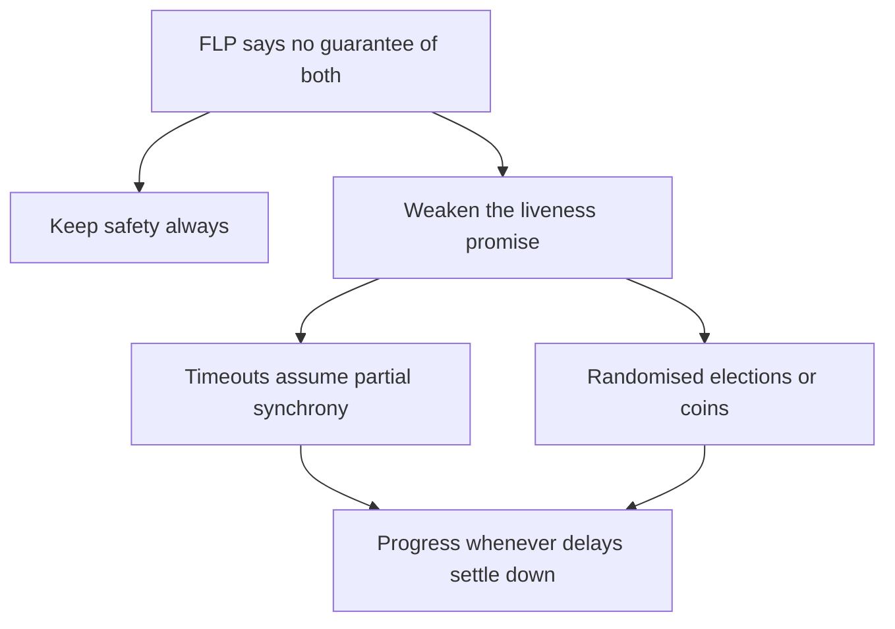

## The hook

In 1985, Michael Fischer, Nancy Lynch and Michael Paterson proved a result that sounds like it should have ended distributed computing: in a fully asynchronous system, no deterministic algorithm can guarantee that a group of processes will agree on a value if even one of them might crash.

Yet etcd, ZooKeeper and every consensus-based database you have read about run on asynchronous networks and agree on things all day long. Either the proof is wrong (it is not), or those systems quietly break a rule (they do not), or something subtler is going on. Before reading on, guess which part of the theorem real systems sidestep.

## The intuition

:::analogy
You have agreed to meet a friend and decide together where to eat. You are **waiting for a friend who might just be slow**: maybe stuck in traffic, maybe they cancelled and their phone died. With no promise about how long traffic can last, you can never tell which. If you decide alone, they might show up with a different plan. If you wait, you might wait forever.
:::

That is the heart of FLP. In an **[[asynchronous system]]**, messages can be delayed arbitrarily, so a crashed process and a very slow one look identical. Any deterministic algorithm that waits for a slow process risks waiting forever; any that stops waiting risks deciding without it, wrongly.

## How it works

### What the theorem assumes

The impossibility holds only when all of these are true:

| Assumption | Meaning |
|---|---|
| Fully asynchronous | No bound at all on message delays or processing speed |
| Deterministic | The algorithm makes no random choices |
| At least one crash possible | Even a single process may stop silently |
| Termination guaranteed | Every correct process must always eventually decide |

Under these, the proof shows that an adversary controlling message timing can always keep the system in an undecided state, delaying exactly the message that would have tipped the decision, forever.

### Safety and liveness

Consensus asks for **[[safety]]** (never decide two different values) and **[[liveness]]** (eventually decide). FLP says you cannot *guarantee both* under those assumptions. Practical systems choose: **safety always, liveness when conditions allow**.

### How real systems sidestep it

- **[[Partial synchrony]]**: assume delays are bounded *most of the time*. Raft and Paxos use timeouts; when the network behaves for long enough, a leader is elected and decisions happen. During chaos they may stall, but they never decide wrongly.
- **Randomisation**: Raft's randomised election timeouts make endless split votes overwhelmingly unlikely. **[[Randomised consensus]]** algorithms reach agreement with probability 1.
- **Failure detectors**: assume an oracle that eventually suspects crashed processes correctly, which encodes timing assumptions in a separate component.

So the answer to the hook: real systems give up the *guarantee* of termination in the worst case, not safety.

Wait, does that mean Raft can hang forever? In theory, an adversarial network could keep it from electing a stable leader indefinitely. In practice, randomised timeouts and normal network behaviour make that astronomically unlikely, and safety holds the whole time.

:::insight
FLP does not say consensus is useless; it says you cannot guarantee both safety and termination when delays are unbounded and a process may crash. Practical protocols keep safety unconditionally and make progress whenever the network is reasonably timely, using timeouts and randomness.
:::

## Trade-offs

| Approach | Safety | Liveness |
|---|---|---|
| Raft, Paxos (timeouts) | Always | When the network is timely for long enough |
| Randomised consensus | Always | With probability 1 |
| Synchronous model (known delay bounds) | Always, if the bounds really hold | Always |
| "Decide after a fixed timeout" without quorums | Can be violated | Always |

The last row is what naive systems do, and it is how split brain happens, as in [Two Captains Who Each Think They Command the Ship](article:system-design-failure-detection).

:::warning
Common misconception: "FLP proves consensus is impossible, so distributed databases cannot be consistent." It proves that no deterministic algorithm can *guarantee termination* under full asynchrony with crashes. Systems remain perfectly safe; they only lose the promise of always making progress during pathological conditions.
:::

:::try-this
A 3-node Raft cluster sits on a network where every message is delayed by a random amount between 1 ms and 10 seconds, forever. Will it stay safe? Will it make progress? (Safe: yes, terms and majority votes still prevent conflicting decisions. Progress: poorly; elections keep timing out before votes arrive, so it may rarely or never commit. Raising election timeouts above the real delays restores progress.)
:::

## What can go wrong

- **Trusting timeouts for safety**: deciding based on a timeout alone, without quorums, causes conflicting decisions.
- **Timeouts too short** for real delays: endless elections and no progress.
- **Assuming synchrony**: algorithms that are correct only if messages arrive within a bound break when the bound is exceeded.

### Interview follow-ups

**"Explain FLP in one minute."** In a fully asynchronous network you cannot tell a crashed node from a slow one, so any deterministic protocol either might wait forever or might decide without that node and be wrong. Real systems keep correctness and use timeouts and randomness to make progress when the network is reasonable.

**"How does FLP relate to CAP?"** Both are about the limits imposed by unreliable networks. CAP is about availability versus consistency during partitions; FLP is about guaranteeing termination of consensus under asynchrony and crashes.

**"Why do consensus systems use randomised election timeouts?"** So candidates rarely time out at the same moment, avoiding repeated split votes and making progress likely, as in [How Five Servers Agree on One Truth](article:famous-algos-raft).

## In the real world

- Paxos, Raft and ZooKeeper's protocol all assume partial synchrony for liveness and remain safe under asynchrony.
- The broader theory, from the paper "Impossibility of Distributed Consensus with One Faulty Process" (Journal of the ACM, 1985), shaped how protocol papers state their models and guarantees.
- In practice, the consensus overview in [A Committee That Only Acts on Majority Votes](article:system-design-consensus-overview) is how these ideas meet production.

## Further reading

- Fischer, Lynch and Paterson, "Impossibility of Distributed Consensus with One Faulty Process" (JACM, 1985).
- Dwork, Lynch and Stockmeyer, "Consensus in the Presence of Partial Synchrony" (JACM, 1988).

## Key takeaways

- The FLP result says no deterministic algorithm can guarantee consensus in a fully asynchronous system if even one process may crash, because a crashed process looks like a slow one.
- Its conditions matter: drop determinism, full asynchrony or the guarantee of termination, and consensus becomes possible.
- Practical protocols such as Raft and Paxos keep safety always and achieve liveness when the network is timely for long enough, using timeouts and randomness.
- FLP is a statement about worst-case guarantees, not a reason to avoid consensus; it explains why systems may stall, but not decide wrongly, under extreme conditions.
