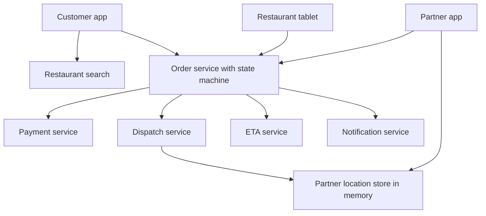
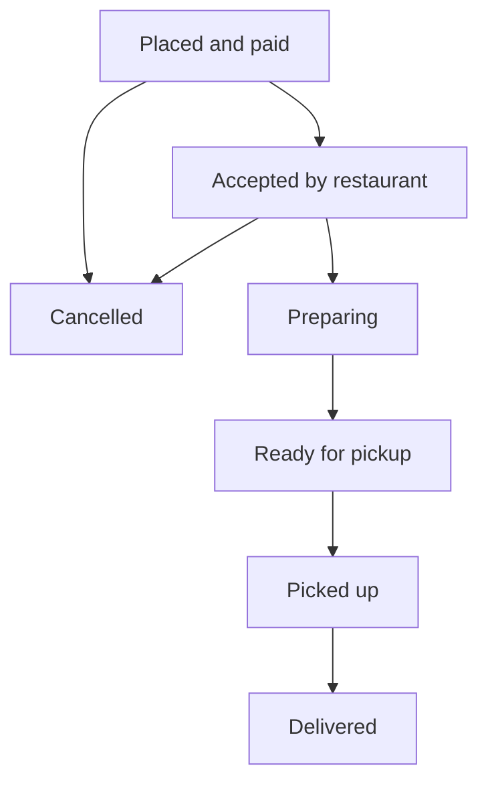

## The hook

You order biryani at 8 pm. The app promises 35 minutes. Over the next half hour it tells you the restaurant accepted, the food is being prepared, a delivery partner named Ravi is on the way to the restaurant, he picked it up, and he is two minutes away.

Behind that friendly timeline are three systems that must agree: the restaurant's tablet, Ravi's phone and yours. If they disagree, you see "delivered" while the food is still in the kitchen, or Ravi stands at a restaurant for 20 minutes waiting.

Predict which piece most designs get wrong first. (The order's state, because three different people update the same order at nearly the same time.)

## Requirements

**Functional**
- Search restaurants and menus near the customer.
- Place an order and pay; restaurant accepts or rejects; food is prepared.
- Assign a delivery partner; track the partner live; deliver.
- Notifications and ETAs at every step; cancellations and refunds.

**Non-functional**
- About 2 million orders per day with a dinner peak (**estimates**).
- The order state must never be contradictory; payments must be reliable.
- Location tracking and ETAs update every few seconds.

:::analogy
Delivery is **a relay race from kitchen to doorstep**. The baton (the order) passes from customer to restaurant to delivery partner to customer. Each runner can only take the baton in a specific order, and the race official records each handover exactly once. A runner who starts too early waits at the exchange zone; one who starts too late slows the whole team.
:::

## Back-of-envelope numbers

All **estimates**.

- 2,000,000 orders a day ≈ **23 per second** on average; if 12% happen in the peak hour, about **67 per second**.
- Each order has about 6 status changes with notifications: about **400 pushes per second** at peak.
- About 200,000 active partners sending location every 5 seconds: **40,000 location updates per second**, far more than orders.
- Restaurant search is read-heavy and cacheable by area, like [Design a Nearby Places Service](article:system-design-proximity-service).

## High-level design



## Deep dives

### 1. The order state machine

The **[[order state machine]]** is the backbone:



Every change is a **[[conditional state transition]]**:

```pseudo
UPDATE orders SET state = 'READY', ready_at = now()
WHERE order_id = :id AND state = 'PREPARING'
```

The hook's problem, traced: the restaurant marks "ready" while the customer cancels.

| Time | Restaurant | Customer | Order state |
|---|---|---|---|
| t0 | | | PREPARING |
| t1 | UPDATE … WHERE state = PREPARING → READY | cancel: UPDATE … WHERE state IN (PLACED, ACCEPTED) | |
| t2 | 1 row updated | 0 rows: not allowed from PREPARING | READY |
| t3 | | "Too late to cancel online; contact support" | READY |

Each transition also writes an event (via an outbox) that drives notifications, dispatch and analytics, so every system sees the same sequence.

Wait, why not let each app keep its own copy of the state? Because then three copies drift, and the customer's app can say "delivered" while the kitchen still says "preparing". One authoritative state machine in the order service, with everyone else following its events, keeps the story consistent.

### 2. Dispatch

**[[Dispatch]]** chooses a partner. Candidates come from the in-memory location store (partners near the restaurant, via geospatial cells as in [Design a Ride-Sharing App](article:system-design-ride-sharing)). The score weighs:

- travel time to the restaurant versus predicted food-ready time (arrive just as food is ready);
- current load (already carrying an order?) and **[[batching]]** opportunities (two orders from the same restaurant or along one route);
- fairness and partner preferences.

The offer to a partner is atomic: a conditional update from AVAILABLE to OFFERED with a short expiry, so two orders never grab the same partner.

### 3. ETAs

The **[[ETA]]** is preparation time (predicted per restaurant, time of day and order size) plus travel to the restaurant plus travel to the customer (from road-network routing with live traffic). Each part is re-estimated as the order progresses, and the customer sees the updated total. Models are trained on past orders.

### 4. Location tracking

Partner apps send location every few seconds to an in-memory store keyed by partner, and the customer's app subscribes to updates for its order's partner over a persistent connection. Only a sample of positions is persisted for history and disputes.

:::insight
Food delivery works when one authoritative order state machine, changed only by conditional transitions, drives everything else through events; dispatch matches partners to predicted food-ready times rather than nearest distance; and high-frequency location data lives in memory, apart from the transactional order path.
:::

## Trade-offs

| Decision | Choice | Trade-off |
|---|---|---|
| Order state | One state machine with conditional transitions | No contradictions; a central service every app depends on |
| Dispatch timing | Assign when the food will be ready | Less partner idle time; harder predictions |
| Batching | Allowed at peaks | Better partner utilisation; slightly longer delivery for some |
| Location storage | In memory, sampled persistence | Handles 40,000 updates per second; limited history |
| ETA | Recomputed at each stage | Accurate; ETAs visibly change during the order |

:::warning
Common misconception: "the order status is just a string field that apps update." Without allowed transitions and conditional updates, concurrent updates from three apps create impossible histories, such as cancelled after picked up or delivered before ready. Model it as a state machine and reject invalid transitions.
:::

:::try-this
At peak, a restaurant's predicted preparation time is 18 minutes. Partner A is 4 minutes away, partner B is 14 minutes away, and B is finishing a delivery nearby. Whom should dispatch prefer, and when should it assign? (Prefer a partner who arrives close to minute 18. Sending A now means about 14 minutes of waiting. B arriving at about minute 14 to 18 fits better, or the system can wait and assign the best-placed partner a few minutes later.)
:::

## What can go wrong

- **Contradictory states** from unconditional updates.
- **Double assignment** of one partner to two orders without atomic offers.
- **Partners waiting at restaurants** because dispatch ignores preparation time.
- **Location update floods** overwhelming a database used as the location store.
- **Notifications out of order** when sent outside the state transition; publish from the state change's events.
- **Payment captured for rejected orders** without refunds wired into the cancellation path.

### Interview follow-ups

**"How do you handle a restaurant that never accepts the order?"** A timer on the PLACED state: after a few minutes, auto-cancel and refund, or call the restaurant, as defined by the state machine's timeouts.

**"How would you scale to many cities?"** Partition orders, dispatch and location stores by city (or region), since an order never crosses cities, so each city's traffic is independent.

**"How do notifications reach users reliably?"** Each state-change event triggers notifications through a dedicated service with priorities and retries, as in [Design a Notification System](article:system-design-notification-system).

## Further reading

- Engineering blog posts from food-delivery companies on dispatch, ETA prediction and order state management.
- The state-machine and event-driven sections of Chris Richardson's *Microservices Patterns*.

## Key takeaways

- One authoritative order state machine with conditional transitions prevents contradictory states when restaurant, partner and customer act at the same time.
- Every state change emits an event that drives notifications, dispatch and analytics, so all apps tell the same story.
- Dispatch matches partners to the predicted food-ready time, considering load and batching, and offers orders atomically so no partner is double-booked.
- ETAs combine predicted preparation time with live travel times and are recomputed at every stage.
- High-frequency partner locations live in an in-memory store, separate from the transactional order path.
