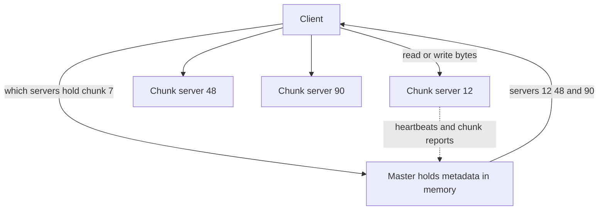

## The hook

In the early 2000s, Google needed to store and crawl the web: files of many gigabytes, written by many machines at once, read sequentially by batch jobs, on thousands of cheap disks that failed every day. No existing file system fit.

So they built the Google File System, described by Ghemawat, Gobioff and Leung in 2003. Its open-source cousin, HDFS, became the storage layer of the Hadoop ecosystem. Both rest on a design choice that sounds like a mistake: **one** master for the whole cluster.

Predict how a single master can coordinate petabytes without drowning. (Hint: it never touches the actual data.)

## The intuition

:::analogy
A huge library has **a librarian who knows which shelf holds each chapter** of every book. You ask her once: "Chapter 7 of this book?" She says: "Shelves 12, 48 and 90 each have a copy." Then you walk to a shelf and read it yourself. She never carries books; she only knows where they are. That is how one person can run a building with millions of chapters.
:::

- The librarian is the **[[master]]** (HDFS calls it the NameNode).
- The shelves are **[[chunk server]]s** (DataNodes).
- Chapters are **[[chunk]]s**: large fixed-size pieces of files, each copied to several servers.

The answer to the hook: the master handles only small metadata questions; data flows directly between clients and chunk servers.

## How it works

### Big chunks, few of them

Chunks are 64 MB in the GFS paper (HDFS uses 128 MB by default in recent versions). The paper notes the master keeps under 64 bytes of metadata per chunk. So one petabyte of data is about 1.5 × 10⁷ chunks, roughly 1 GB of chunk metadata: it fits in one machine's memory, which makes metadata operations fast.

### Replication and recovery

Each chunk is stored on 3 chunk servers by default, placed across racks so a rack failure does not lose every copy. Chunk servers send heartbeats; when one dies, the master notices missing replicas and copies chunks from surviving replicas to other servers until each chunk is back to 3.

### Writes and appends

For each chunk, the master grants a **[[lease]]** to one replica, the primary, which decides the order of all mutations so every replica applies them identically. Data is pushed along a chain of chunk servers to use network bandwidth well, then the primary commits the order.

GFS added **[[record append]]**: many producers (say, hundreds of crawlers) append records to one file concurrently, and GFS picks the offset and guarantees each record is appended atomically at least once. Readers must tolerate occasional duplicates or padding, usually with record ids and checksums. HDFS took a simpler path: one writer per file, append-only.

Wait, why give up ordinary in-place edits? Because the workloads were "write once, append, read sequentially many times". Dropping random writes made consistency and replication much simpler and throughput much higher.

:::insight
GFS and HDFS separate metadata from data: one master knows where every large chunk lives, while clients stream bytes directly to and from many chunk servers holding three replicas each. Designing for huge, append-mostly files read sequentially is what made a single master workable.
:::

## Trade-offs

| Choice | Gain | Cost |
|---|---|---|
| Single master | Simple, globally consistent placement decisions | Memory and availability limit; needs standby and fast recovery |
| Large chunks | Little metadata, efficient streaming | Small files waste resources and create hot spots |
| Three replicas across racks | Survives disk, machine and rack failures | 3× storage |
| Append-oriented design | Simple consistency, high throughput | No efficient random writes |
| Relaxed record-append semantics | Many concurrent producers | Readers must handle duplicates |

Predict the classic failure mode. One billion files of 100 KB each is only about 100 TB, tiny for such a cluster. But each file needs its own metadata, and even one chunk per file means a billion chunks: about 64 GB of chunk metadata alone, plus file entries. The master's memory, not the disks, runs out first.

:::warning
Common misconception: "a single master cannot scale, so this design is obsolete." It scaled to very large clusters because the master serves only metadata and chunks are huge. Its real limits are small files, metadata memory and master availability, which later systems addressed with standby masters, federation (several namespaces) and, at Google, a successor file system with distributed metadata.
:::

:::try-this
A team stores application logs as one new HDFS file per request, millions per day. What breaks, and what would you do instead? (Millions of tiny files overload the NameNode's metadata memory. Batch logs into large files, for example one file per hour per service, append to them, or store logs in a system designed for small objects, such as object storage with a log pipeline.)
:::

## What can go wrong

- **Master failure** makes the whole file system unavailable; run a standby with replicated metadata logs and automatic failover.
- **Small-file explosions** exhausting master memory.
- **Hot chunks**: a popular small file, such as a program everyone loads, overloads its three servers; raise its replication.
- **Silent data corruption** on disks; chunk servers checksum blocks and re-replicate from good copies.
- **Rebalancing storms** after many failures, as replicas are recreated.

### Interview follow-ups

**"Why does the client cache chunk locations?"** So repeated reads of the same chunk do not go back to the master, keeping master load low.

**"How do GFS/HDFS relate to object storage today?"** Many data lakes now use cloud object storage instead of HDFS, as in [The Cloakroom That Never Loses a Coat](article:system-design-blob-storage), trading data locality for elasticity and simpler operations.

**"How would you make the master highly available?"** Log every metadata change durably and replicate the log to standbys (a shadow or standby master), so one can take over with up-to-date metadata, using leader election to avoid two active masters, as in [Two Captains Who Each Think They Command the Ship](article:system-design-failure-detection).

## In the real world

- HDFS stores data for Hadoop and Spark clusters, with batch jobs scheduled close to the data.
- Bigtable stored its files on GFS; the next article covers it.
- Google later described Colossus, a successor with distributed metadata, in talks and blog posts.

## Further reading

- Ghemawat, Gobioff and Leung, "The Google File System" (SOSP 2003).
- The Apache Hadoop HDFS architecture guide.

## Key takeaways

- GFS and HDFS split metadata from data: one master knows which servers hold each chunk, and clients read and write bytes directly with chunk servers.
- Very large chunks (64 MB in GFS, 128 MB by default in recent HDFS) keep master metadata small enough to fit in memory.
- Each chunk has three replicas placed across racks, and the master re-replicates automatically when servers fail.
- The design targets huge files written by appending and read sequentially, giving up efficient random writes for simpler consistency and high throughput.
- Its weak spots are many small files and master availability, handled with batching, standby masters and federation.
