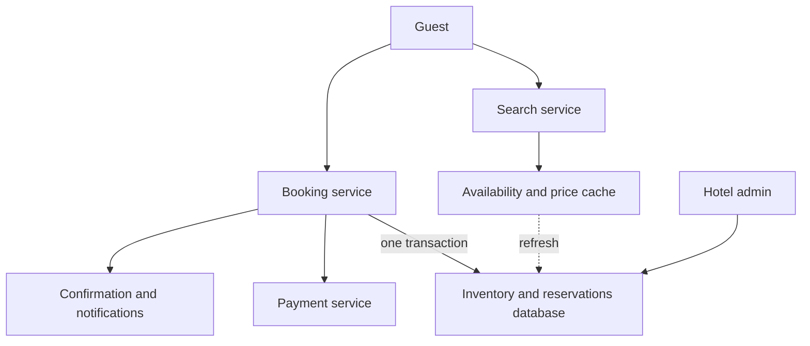

## The hook

It is the night before a long weekend. A beach hotel has one deluxe room left for Saturday. Two families, on two different booking sites connected to the same system, press "Book" in the same second for Friday to Sunday.

The naive code checks availability for each night, sees one room, and inserts a booking. Both requests pass the check. Both families arrive on Friday with a confirmation. One of them sleeps somewhere else.

Unlike concert tickets, the hard part here is not the crowd size; hotels get a few bookings per second. It is that a single booking touches several nights, any of which might be the one that runs out. Predict how many database rows a 3-night booking must change atomically. (Three, and either all three change or none.)

## Requirements

**Functional**
- Search hotels by city and dates; show availability and price per room type.
- Book a room type for a date range; cancel; modify.
- Hotel staff manage room types, prices and inventory.

**Non-functional**
- Never double-book beyond the overbooking policy.
- Searches are frequent; bookings are comparatively rare.
- Payments and confirmations must be reliable and idempotent.

:::analogy
A small hotel keeps **a register with a row for every room type for every night**: "Deluxe, 12 November: 20 rooms, 17 taken". To book three nights, the clerk ticks three rows at once, and only if all three have space. If the third row is full, the first two ticks are erased.
:::

## Back-of-envelope numbers

All **estimates**.

- 5,000 hotels with 1,000,000 rooms in total, 70% occupancy, average stay 3 nights: 1,000,000 × 0.7 ÷ 3 ≈ **233,000 bookings per day**, about **3 per second** on average. Bookings are not the scaling problem.
- Searches: perhaps 100 to 1,000 times the bookings, so reads dominate.
- Inventory rows: 5,000 hotels × about 20 room types × 365 days ≈ **36.5 million rows**: comfortably one relational database, partitioned by hotel if needed.

## High-level design



- **Search** reads cached availability and prices: slightly stale is fine, because the booking itself re-checks.
- **Booking** runs a transaction against the inventory and reservations tables, then handles payment.

## Deep dives

### 1. Data model

| Table | Key | Columns |
|---|---|---|
| room_type_inventory | (hotel_id, room_type_id, date) | total_rooms, reserved_rooms |
| reservations | reservation_id | hotel, room type, check_in, check_out, guest, status, idempotency_key |
| room_types | (hotel_id, room_type_id) | name, capacity, base price |

Booking against **[[room-type inventory]]** rather than specific rooms keeps every check a simple count per night.

### 2. The booking transaction

A **[[date-range booking]]** updates one inventory row per night, all in one transaction:

```pseudo
BEGIN
for each night d in [check_in, check_out):
    UPDATE room_type_inventory
    SET reserved_rooms = reserved_rooms + 1
    WHERE hotel_id = :h AND room_type_id = :t AND date = d
      AND reserved_rooms < total_rooms
    if 0 rows updated: ROLLBACK; return "not available"
INSERT INTO reservations (..., idempotency_key = :k)
COMMIT
```

Each update is a conditional increment, so two transactions cannot both take the last room on the same night: the database applies one, and the other's condition fails. Updating nights in date order avoids deadlocks between overlapping stays.

The race from the hook, traced for Saturday:

| Time | Family A | Family B | Saturday reserved / total |
|---|---|---|---|
| t0 | | | 19 / 20 |
| t1 | Friday +1 ok | Friday +1 ok | |
| t2 | Saturday: 19 < 20, update to 20 | waits on the Saturday row | 20 / 20 |
| t3 | Sunday +1 ok, commit | Saturday: 20 < 20 false, 0 rows | 20 / 20 |
| t4 | confirmed | rollback, Friday released | 20 / 20 |

Wait, why not a "SELECT then INSERT" with a check in code? Because two transactions can both read 19 before either writes, exactly the hook's bug. The condition must be part of the write, or the rows must be locked with SELECT … FOR UPDATE, as in [Several Cashiers, One Ledger](article:system-design-isolation-levels).

### 3. Overbooking

Hotels expect some cancellations and no-shows, so many accept **[[overbooking]]** up to a policy limit. The condition becomes `reserved_rooms < total_rooms × (1 + overbook_ratio)`: with 10% on 100 rooms, up to 110 reservations. That is a business decision encoded in one place, not a bug.

### 4. Retries and payments

Network timeouts make clients retry. Each booking attempt carries an **[[idempotency key]]**; a unique constraint on it in the reservations table turns a retry into "return the existing reservation". Payment follows the same pattern, as in [Design a Payment System](article:system-design-payments). If payment fails, a compensating step releases the nights.

:::insight
Hotel booking is a small-scale but strict concurrency problem: keep inventory as a count per room type per night, reserve a stay with conditional increments on every night inside one transaction, and let retries be safe with idempotency keys. Searches can be cached and stale, because the booking re-checks everything atomically.
:::

## Trade-offs

| Decision | Choice | Trade-off |
|---|---|---|
| Granularity | Room type per night | Simple counts; specific rooms assigned later |
| Concurrency | Conditional updates (or row locks) in one transaction | Correct under races; contention on popular dates |
| Search freshness | Cached availability | Fast; occasional "sold out at checkout" |
| Overbooking | Configurable per hotel | More revenue; occasional relocated guests |
| Hold before payment | Short hold or book-then-pay | Better experience; held inventory can go unpaid |

Compared with [Design a Ticket Booking System](article:system-design-ticket-booking), traffic is much lower, but every booking spans several rows, and overbooking is allowed by design.

:::warning
Common misconception: "low booking volume means concurrency does not matter." Races are about timing, not volume. Two requests for the last room on a holiday weekend can still arrive in the same second, and check-then-insert code double-books regardless of how quiet the rest of the day is.
:::

:::try-this
A guest modifies a reservation from 10 to 12 November into 11 to 13 November. Which inventory rows change, and how do you make the change safe? (Release the night of 10 November and reserve the night of 12 November; 11 November stays. Do it in one transaction with the conditional increment on the 12th, so if the 12th is full, nothing changes and the original reservation stands.)
:::

## What can go wrong

- **Double booking** from check-then-insert logic.
- **Partial stays** booked when one night fails, without a single transaction.
- **Deadlocks** when overlapping stays update nights in different orders.
- **Duplicate reservations** from client retries without idempotency keys.
- **Unreleased holds** when payment fails or the user abandons; expire them.
- **Cache showing availability** that no longer exists; always re-check in the booking transaction.

### Interview follow-ups

**"How would you scale to 1 million hotels?"** Partition inventory and reservations by hotel id; all of a booking's rows live in one partition, so transactions stay local.

**"How would you show prices that change by date and demand?"** A pricing table per hotel, room type and date (or rules), cached for search and re-read at booking time.

**"How do third-party booking sites stay in sync?"** Channel managers push availability changes and receive bookings through APIs; the central inventory remains the source of truth and every booking re-checks it.

## Further reading

- The transactions chapter of Martin Kleppmann's *Designing Data-Intensive Applications*.
- Revenue management literature on overbooking for hotels and airlines.

## Key takeaways

- Model inventory as total and reserved counts per hotel, room type and night, and assign specific rooms at check-in.
- A multi-night booking must reserve every night inside one transaction, all or nothing.
- Use conditional increments (or row locks) so two bookings can never take the last room on the same night, and update nights in a fixed order to avoid deadlocks.
- Overbooking is a business policy expressed in the same condition, allowing reservations up to a set ratio above capacity.
- Cache availability for search, but always re-check in the booking transaction, and make retries safe with idempotency keys.
