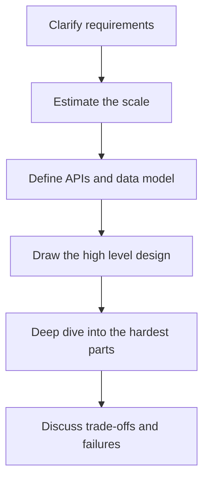

## The hook

"Design Instagram." Three words, then silence. There is no input format, no constraints, no expected output. Just a whiteboard and forty-five minutes.

Candidates who freeze usually know plenty: caches, queues, databases. What they lack is a route through the conversation. The good news is that one route works for almost every design question, and once you have it, the blank whiteboard stops being scary.

## The intuition

:::analogy
An architect asked to "design a house" does not start by choosing door handles. They ask who will live there and on what budget, sketch the rooms and how people move between them, and only then zoom into the tricky parts, like the staircase or the plumbing. A system design interview is the same walk: from the people, to the floor plan, to the hard details.
:::

The interviewer is not grading whether you produce the "right" architecture. There is no single right one. They are watching how you clarify a vague problem, make reasonable choices, and explain what each choice costs. The framework below keeps you doing exactly that.

## Let's build it up

### Step 1: requirements (about 5 minutes)

Split them into two lists.

[[Functional requirement]]s are what users can do: "post a photo", "follow someone", "see a feed of people I follow". Pick the three or four that matter most and say out loud that you are leaving the rest, like stories or direct messages, for later.

[[Non-functional requirement]]s are qualities: how many users, how fast the feed must load, whether a lost photo is acceptable (it is not), and whether a slightly stale like count is fine (it usually is). These decide the design far more than the features do.

### Step 2: estimate the scale (about 5 minutes)

A [[back-of-envelope estimate]] turns vague words like "lots of users" into numbers that drive decisions. You will learn the technique properly in the next article; here is the flavour, with every number an **estimate**:

- 100 million daily active users, each viewing the feed 10 times a day, is about 1 billion feed reads a day, or roughly 12,000 reads per second on average, more at peak.
- If 10 million photos are posted a day at 1 MB each, that is about 10 TB of new storage every day.

Two conclusions fall out immediately. Reads vastly outnumber writes, so caching matters. Storage grows fast, so photos belong in blob storage, not the database.

### Step 3: APIs and data model (about 5 minutes)

Sketch the few endpoints that serve your functional requirements, such as `POST /photos` and `GET /feed?cursor=...`, and the core tables or objects: users, photos, follows. This makes the design concrete and catches gaps early.

### Step 4: high-level design (about 10 minutes)

Draw the [[high-level design]]: clients, load balancer, stateless application servers, database, cache, blob storage, maybe a queue. Walk one request through it from start to finish. Start simple; scale it up only where your estimates say it needs to.

:::insight
Start with the simplest design that works, then let the numbers force each addition. "Reads are 100 times writes, so I add a cache" is a far stronger sentence than adding a cache because big systems have caches.
:::

### Step 5: deep dives (about 15 minutes)

Pick the one or two hardest parts and go deep. For Instagram, that is probably building the feed: do you compute it when someone posts, or when someone opens the app? What about a celebrity with 100 million followers? A good [[deep dive]] compares options and picks one for stated reasons. Interviewers often steer this part; follow their lead.

### Step 6: trade-offs and failures (the last 5 minutes, and throughout)

Every choice has a [[trade-off]]. A cache makes reads fast but may serve stale data. Precomputing feeds makes reading instant but makes posting expensive. Say what you gave up. Then ask what breaks: a database replica dies, a region goes down, a hot key melts a cache server. Say how you would notice and recover.

:::warning
Common misconception: "the best answer uses the most impressive technology." Naming Kafka, Cassandra and Kubernetes without a reason from your requirements reads as memorisation. Every box on your diagram should exist because a requirement or an estimate demanded it.
:::

## A tiny example

Here is how the first two minutes of "design a URL shortener" might sound.

> "Before I design anything, let me pin down scope. Users submit a long URL and get a short one; visiting the short one redirects. Should links expire? Do we need click analytics? Let's say no expiry, basic click counts. For scale, I'll assume 100 million new links a month, and that each link is read about 100 times as often as it is created. Redirects should feel instant, say under 50 milliseconds, and a working link must never break."

In under a minute, the candidate has fixed the features, the read-to-write ratio and the latency goal, and the design that follows almost writes itself: a fast key-value lookup, aggressive caching, and a way to generate unique short keys.

:::try-this
Take "design a ride-sharing app" and write, in two minutes, three functional requirements and three non-functional ones. Then name the one requirement you think will make the design hardest. (Most people land on real-time driver locations and matching, which is exactly where the deep dive goes.)
:::

## Where you'll see this again

Every case study in this subject follows these six steps, from the URL shortener and rate limiter to chat, news feeds and payments. The next article, back-of-envelope estimates, sharpens step 2. If you have done the DSA framework in [What to Do When You Have Never Seen the Problem](article:dsa-problem-solving-framework), you will notice the same spirit: understand first, start simple, then let the bottleneck guide you.

## Key takeaways

- Every design question follows the same route: requirements, scale estimates, APIs and data model, high-level design, deep dives, and trade-offs.
- Non-functional requirements such as scale, latency and durability shape the design more than the feature list does.
- Rough estimates reveal where the pressure is, for example a 100 to 1 read-to-write ratio that makes caching essential.
- Start with the simplest working design and add components only when a requirement or an estimate demands them.
- Strong answers name what each choice costs and how the system behaves when parts of it fail.
