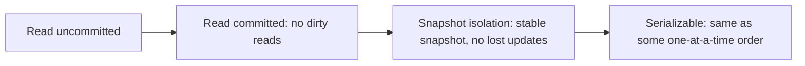

## The hook

Two support agents refund the same order at the same moment, and the customer gets paid twice. A hospital rota allows every doctor to go off call because each one checked that "someone else is still on". A report adds up account balances while transfers run and shows money that never existed. Every query in these stories was correct on its own. The bug lives in how concurrent [[transaction]]s overlapped.

Databases control that overlap with isolation levels. Most applications run on the database's default level without knowing what it allows, and many interview questions about payments, bookings and inventory come down to one question: "what happens if two of these run at the same time?"

## The intuition

:::analogy
Picture several cashiers sharing one big ledger of accounts. Each cashier handles a customer by reading some lines, doing some arithmetic, and writing new lines. If cashiers could read each other's half-written pencil notes, they would act on numbers that might be erased. If a cashier reads a balance, looks away, and reads it again, someone may have changed it. And if two cashiers each check the ledger, each decides "fine", and each writes a different line, the ledger can end up breaking a rule that both of them checked.
:::

An [[isolation level]] is a rule about what one cashier may see of the others' work. Stricter rules mean fewer surprises but more waiting or retrying.

## How it works

### The anomalies

An [[anomaly]] is an outcome impossible if transactions ran one at a time.

| Anomaly | What happens | Ledger example |
|---|---|---|
| Dirty read | T1 reads a value T2 wrote but has not committed; T2 then rolls back | a cashier acts on a pencil note that gets erased |
| Non-repeatable read | T1 reads a row twice and gets different committed values | balance is 100, then 80 within one transaction |
| [[Phantom]] | T1 repeats a search and gets a different set of rows | "orders today" returns 5 rows, then 6 |
| Lost update | T1 and T2 both read, modify and write the same row; one write overwrites the other | both add to a balance of 100; one addition vanishes |
| [[Write skew]] | T1 and T2 read the same data, then write *different* rows, jointly breaking a rule | two doctors both go off call |

### The levels

| Level | Dirty read | Non-repeatable read | Phantom | Lost update | Write skew |
|---|---|---|---|---|---|
| Read uncommitted | possible | possible | possible | possible | possible |
| Read committed | prevented | possible | possible | possible | possible |
| [[Snapshot isolation]] (often called repeatable read) | prevented | prevented | prevented for reads | prevented | possible |
| [[Serializable]] | prevented | prevented | prevented | prevented | prevented |

The SQL standard defines levels by which of the first three anomalies they forbid, but real databases implement them differently, so always check your database's documentation. For example, the standard's repeatable read permits phantoms, while snapshot-based implementations avoid them for reads.

### How databases implement them

- **Read committed**: each statement sees only committed data. With multi-version storage, as in [Readers Never Wait for Writers](article:famous-algos-mvcc), every statement takes a fresh snapshot.
- **Snapshot isolation**: the whole transaction reads one snapshot from its start. If two transactions update the same row, the second to commit is aborted ("first committer wins"). That stops lost updates, but not write skew, because write skew touches different rows.
- **Serializable**: either two-phase locking (readers lock what they read, writers wait), or serializable snapshot isolation (SSI), which runs like snapshot isolation but tracks read-write dependencies and aborts a transaction when they could form a non-serial pattern.



### Traced interleaving 1: lost update under read committed

Account balance is 100. T1 deposits 50, T2 withdraws 20. The correct result is 130.

| Step | T1 | T2 | Stored balance |
|---|---|---|---|
| 1 | read balance → 100 | | 100 |
| 2 | | read balance → 100 | 100 |
| 3 | write 100 + 50 = 150 | | 150 (uncommitted) |
| 4 | commit | | 150 |
| 5 | | write 100 − 20 = 80 | 80 (uncommitted) |
| 6 | | commit | **80** |

T1's deposit is lost. Under snapshot isolation, T2's write at step 5 conflicts with T1's committed change to the same row, so T2 aborts and retries, reading 150 and writing 130.

### Traced interleaving 2: write skew under snapshot isolation

Rule: at least one doctor must be on call. Alice and Bob are both on call.

| Step | T1 (Alice) | T2 (Bob) | On call |
|---|---|---|---|
| 1 | count on-call doctors → 2 | | Alice, Bob |
| 2 | | count on-call doctors → 2 | Alice, Bob |
| 3 | set Alice off call | | |
| 4 | | set Bob off call | |
| 5 | commit | | Bob |
| 6 | | commit | **nobody** |

Each transaction saw 2 in its snapshot and updated a different row, so snapshot isolation finds no conflict. Under serializable, the database detects that T1 read what T2 wrote and vice versa, and aborts one of them.

:::insight
Every anomaly is the same shape: a transaction makes a decision based on data that another transaction changes before the first one finishes. The isolation level decides which of those hidden dependencies the database catches for you, and which your code must handle itself.
:::

### Fixes when you stay on a weaker level

```pseudo
// lost update: let the database do the arithmetic atomically
UPDATE accounts SET balance = balance + 50 WHERE id = 7

// or lock the row you are about to change
SELECT balance FROM accounts WHERE id = 7 FOR UPDATE

// write skew: lock the rows your decision depends on
SELECT * FROM doctors WHERE on_call AND shift = 42 FOR UPDATE

// or rely on a constraint the database enforces
UNIQUE / CHECK constraints, or a single "shift" row both must update
```

## Trade-offs

| Level | Gains | Costs |
|---|---|---|
| Read committed | high concurrency, few aborts, the common default | lost updates and write skew must be handled in application code |
| Snapshot isolation | consistent reads for reports, no lost updates | write skew still possible, aborted writers must retry |
| Serializable | no anomalies: reason as if alone | more aborts or blocking, must retry, lower throughput under contention |
| Explicit locks | targeted protection at a weaker level | easy to forget, deadlocks possible |

## What can go wrong

:::warning
Common misconception: "my database is transactional, so it is serializable by default." PostgreSQL, Oracle and SQL Server default to read committed, and MySQL's InnoDB defaults to repeatable read. None of these defaults prevents write skew, and read committed does not even prevent lost updates.
:::

- **Read-modify-write in application code** (read balance, add in code, write back) under read committed loses updates.
- **Check-then-insert** ("is this username free?" then insert) lets two transactions both insert; use a unique constraint.
- **Long reports under read committed** see a mix of before and after values across statements; use a snapshot.
- **Serializable without retries**: aborts are normal at this level, so code must catch serialization failures and retry the whole transaction.
- **Mixing up isolation and consistency**: replica lag is a separate problem from transaction isolation, as [The Promises a Messenger Can Make](article:system-design-consistency-models) explains.

## In the real world

- PostgreSQL implements its repeatable read level as snapshot isolation and, since version 9.1, its serializable level with serializable snapshot isolation.
- Oracle's level named "serializable" is actually snapshot isolation, so it can allow write skew.
- MySQL InnoDB uses consistent snapshots for plain reads at repeatable read, and locking reads for `SELECT ... FOR UPDATE`.
- Payment and booking systems commonly combine read committed with atomic updates, row locks and unique constraints on the few critical paths.

## Further reading

- PostgreSQL documentation, "Transaction Isolation": https://www.postgresql.org/docs/current/transaction-iso.html
- Berenson et al., "A Critique of ANSI SQL Isolation Levels", SIGMOD 1995.
- Cahill, Röhm and Fekete, "Serializable Isolation for Snapshot Databases", SIGMOD 2008.

## Key takeaways

- Isolation levels decide which interleavings of concurrent transactions the database prevents, and weaker levels allow specific anomalies.
- Read committed prevents dirty reads but allows non-repeatable reads, phantoms, lost updates and write skew.
- Snapshot isolation gives each transaction a stable snapshot and stops lost updates, but still allows write skew across different rows.
- Serializable guarantees the result matches some one-at-a-time order, at the cost of aborts or blocking that the application must retry.
- Most databases default to a weaker level, so protect critical paths with atomic updates, row locks, constraints or serializable transactions.
